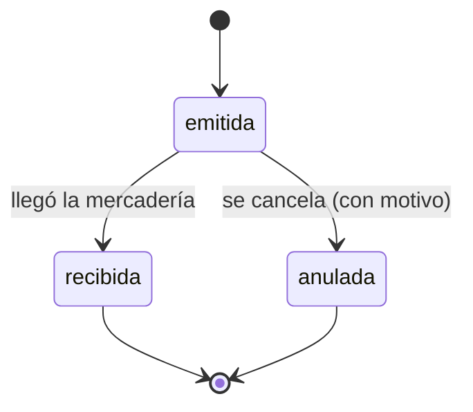

# Stock · Órdenes de compra a proveedores (F-PRV-09, MSF-454)

Spec: `specs/20261109-103000-ordenes-de-compra-a-proveedores/`. Épica MSF-450 (Clientes y proveedores ·
Cuentas y compras a proveedores). La orden de compra es el **pedido de mercadería que la organización le
hace a un proveedor**, y nace del listado de reposición de Stock: los productos que están en alerta.

## Modelo (esquema `dominio`, Principio VII)

| Tabla | Qué guarda |
|-------|-----------|
| `dominio.ordenes_compra` | Cabecera: empresa, proveedor, fecha, estado (`emitida` / `recibida` / `anulada`), observaciones, fecha de recepción y motivo de anulación |
| `dominio.ordenes_compra_items` | Línea: producto y cantidad pedida (una por producto) |

Las dos son de negocio → esquema `dominio`. El proveedor es **el del producto**
(`dominio.productos.proveedor_id`, F-PRV-03): por eso una orden es de un solo proveedor y sus productos
son los de ese proveedor. Un producto **sin** proveedor no entra en ninguna orden.

RLS por organización y por nivel de la sección `stock`: lectura con `lectura` o `edicion`. **No hay
escritura directa** desde el rol: las escriben solo las RPC `security definer` de esta historia.
`anon` sin privilegios.

## RPC (`public`)

| RPC | Qué hace |
|-----|----------|
| `crear_orden_compra(p_empresa, p_proveedor, p_fecha, p_observaciones, p_items)` | Crea la orden `emitida` con sus líneas. Valida empresa activa accesible, proveedor activo de la organización, fecha no futura, permiso `edicion` en `stock`, que cada producto sea del proveedor y que siga **en alerta de reposición**, y cantidades mayores a cero. |
| `cambiar_estado_orden_compra(p_orden, p_estado, p_fecha_recepcion, p_motivo)` | `emitida` → `recibida` (con fecha) o → `anulada` (con motivo de 3 a 500 caracteres). Idempotente: repetir la transición deja la orden como está. Los estados terminales no cambian. |
| `productos_en_reposicion_de_proveedor(p_proveedor)` | Productos del proveedor **en alerta** (`disponible <= mínimo`) con la cantidad sugerida `max(1, mínimo − disponible)`. Expone solo datos de reposición (sin costos ni contacto). |
| `listar_ordenes_compra(p_estado, p_empresa, p_proveedor, p_pagina, p_tamano)` | Listado paginado (fecha, proveedor, empresa, estado, unidades, total). `security invoker`: decide la RLS. |
| `detalle_orden_compra(p_orden)` | Cabecera y líneas de la orden. `security invoker`: null si no existe o es de otra organización. |

## Estados

Una orden **no se edita ni se borra**: se anula con motivo. **Recibir no mueve stock**: la mercadería
entra por «Ingreso de mercadería» (F-PRV-04, `docs/ingreso-de-mercaderia.md`), que pide el costo unitario
y es el camino del stock. Vincular la orden con el ingreso (o recibirlas desde la orden) es una historia
aparte: cambiaría el contrato de `registrar_ingreso_mercaderia`.

## Interfaz (`apps/web`)

- Ruta canónica: `/stock/ordenes-compra` (pestaña «Órdenes de compra» dentro de Stock, entrada de menú
  en el grupo Stock, sección `stock`).
- Listado: fecha, proveedor, tienda, estado y unidades; filtro por estado y por tienda (`FiltroEmpresa`,
  que sigue a la empresa activa de la barra superior) y paginación en servidor.
- «Nueva orden de compra»: empresa (la activa por omisión), proveedor, fecha, los productos en alerta del
  proveedor con la cantidad sugerida (editable) y observaciones.
- Detalle: cabecera y líneas; «Marcar como recibida» y «Anular» (con motivo) solo con `edicion` en
  `stock`. El diálogo abierto se cierra con aviso si cambia la empresa activa.

## Reversión

Migraciones aditivas `20270220180001` (tablas) y `20270220180002` (RPC). Para deshacer, en una migración
posterior: `drop function public.crear_orden_compra(...)`, `drop function
public.cambiar_estado_orden_compra(...)`, `drop function public.productos_en_reposicion_de_proveedor(...)`,
`drop function public.listar_ordenes_compra(...)`, `drop function public.detalle_orden_compra(...)` y
después `drop table dominio.ordenes_compra_items; drop table dominio.ordenes_compra;` (las órdenes
cargadas son dato nuevo: exportarlas antes). El camino exacto está en el encabezado de cada migración.

## Pruebas

- pgTAP: `supabase/tests/database/ordenes_compra.test.sql` (aislamiento entre organizaciones, permisos por
  rol, los tres estados y sus transiciones, rechazo de datos inválidos, sin escritura directa, `anon`).
- Vitest: `apps/web/src/lib/ordenesCompra.test.ts` y `apps/web/src/pages/stock/ordenes-compra.test.tsx`.
- E2E: `apps/web/e2e/ordenes-compra.e2e.ts` (requiere el stack local, ver `docs/e2e-app.md`).

## Fuera de alcance

N.º correlativo de la orden, condiciones de compra, «Compra para», envío por correo al proveedor,
costo de la orden, varias empresas por orden y el vínculo con el ingreso de mercadería (ver arriba).
