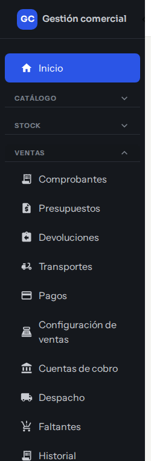
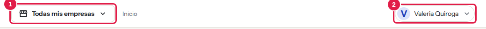
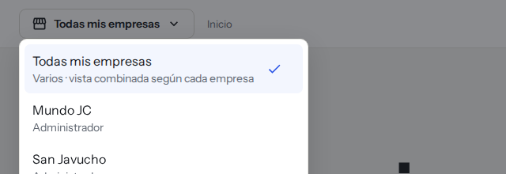

# Bienvenida: qué es MSF y por dónde empezar

**MSF** es el sistema con el que se administran las tiendas del negocio (por ejemplo, San Javucho y Mundo JC) desde un solo lugar. Reúne el catálogo de productos, los precios, el stock, las compras a proveedores, las ventas y los cobros, el despacho, las devoluciones, el service técnico, las tiendas online y las consultas de los clientes.

Cada persona entra con su propio usuario y ve solamente lo que le corresponde según su rol.

## Cómo está organizado el menú

El menú de la izquierda agrupa las pantallas por tema. Hacé clic en el nombre de un grupo para ver sus pantallas (se abre un grupo a la vez). Si una sección no aparece, es porque tu rol no la incluye (más abajo se explica cómo pedir acceso).

*Menú lateral: cada grupo se abre con un clic y muestra sus pantallas.*

| Grupo del menú | Para qué sirve | Guías |
|---|---|---|
| **Inicio** | Pantalla de bienvenida. | — |
| **Catálogo** | Productos y categorías. | [Productos](catalogo-productos.md) · [Precios por escala](precios-e-iva.md) |
| **Stock** | Existencias, movimientos, ingreso de mercadería y depósitos. | [Stock](stock-movimientos.md) · [Ingreso de mercadería](ingreso-de-mercaderia.md) · [Depósitos y reservas](stock-depositos-y-reservas.md) |
| **Ventas** | Comprobantes, presupuestos, devoluciones, pagos, despacho y transportes. | [Comprobantes](ventas-comprobantes.md) · [Cobros](ventas-cobros-y-conciliacion.md) · [Despacho](ventas-despacho-y-faltantes.md) · [Devoluciones](ventas-rma-devoluciones.md) |
| **Servicio técnico** | Reparaciones de equipos. | [Service técnico](service-listado-items-impresion.md) |
| **Contactos** | Clientes y proveedores. | [Clientes](clientes.md) · [Proveedores](proveedores.md) |
| **Canales** | Consultas que llegan desde las tiendas y las empresas (tiendas). | [Consultas](consultas.md) · [Tiendas online](tiendas-online.md) |
| **Análisis** | Rentabilidad de los productos. | [Rentabilidad](rentabilidad.md) |
| **Administración** | Organización, cotización del dólar, actividad, usuarios y permisos. | [Precios y dólar](precios-dolar.md) · [Actividad](actividad.md) · [Usuarios y roles](usuarios-y-roles.md) |

Arriba, junto al menú, está el selector de **empresa activa** (1: con qué tienda estás trabajando) y, a la derecha, el menú con tu nombre (2: perfil, contraseña, cerrar sesión). Ver [Tu organización y tus empresas](organizacion-y-empresas.md) y [Tu perfil](perfil-propio.md).

*Barra superior: el recuadro 1 es la empresa activa y el 2, tu menú personal.*

Al hacer clic en la empresa activa se abre la lista de empresas a las que tenés acceso, con la opción **Todas mis empresas**.

*Selector de empresa activa abierto: elegí con qué tienda querés trabajar.*

## Por dónde empezar según tu rol

| Si sos… | Empezá por |
|---|---|
| **Administrador** | [Usuarios y roles](usuarios-y-roles.md), [Tu organización y tus empresas](organizacion-y-empresas.md) y [Precios y dólar](precios-dolar.md). |
| **Operador** | [Productos](catalogo-productos.md), [Comprobantes](ventas-comprobantes.md) y [Clientes](clientes.md). |
| **Mostrador** | [Comprobantes](ventas-comprobantes.md), [Cobros](ventas-cobros-y-conciliacion.md) e [Impresión](ventas-impresion.md). |
| **Depósito** | [Stock](stock-movimientos.md), [Ingreso de mercadería](ingreso-de-mercaderia.md) y [Despacho](ventas-despacho-y-faltantes.md). |
| **Administración** | [Cobros y conciliación](ventas-cobros-y-conciliacion.md), [Proveedores](proveedores.md) y [Rentabilidad](rentabilidad.md). |
| **Técnico** | [Service técnico](service-listado-items-impresion.md) y [repuestos](service-repuestos-y-stock.md). |
| **Consulta** | Las pantallas que tu rol permita ver; consultá [Usuarios y roles](usuarios-y-roles.md). |

## Primeros pasos para todos

1. Ingresá con tu correo y contraseña: [Ingresar y recuperar el acceso](acceso-y-sesion.md).
2. Revisá tu [perfil](perfil-propio.md): nombre, foto y contraseña.
3. Elegí la empresa activa con la que vas a trabajar.
4. Si hay un término que no conocés, buscalo en el [Glosario](glosario.md).

## Para seguir

- [Qué podés hacer con el sistema](capacidades.md): resumen por área.
- [Glosario](glosario.md): los términos que ves en pantalla.
- [Actividad](actividad.md): quién hizo qué y cuándo.
