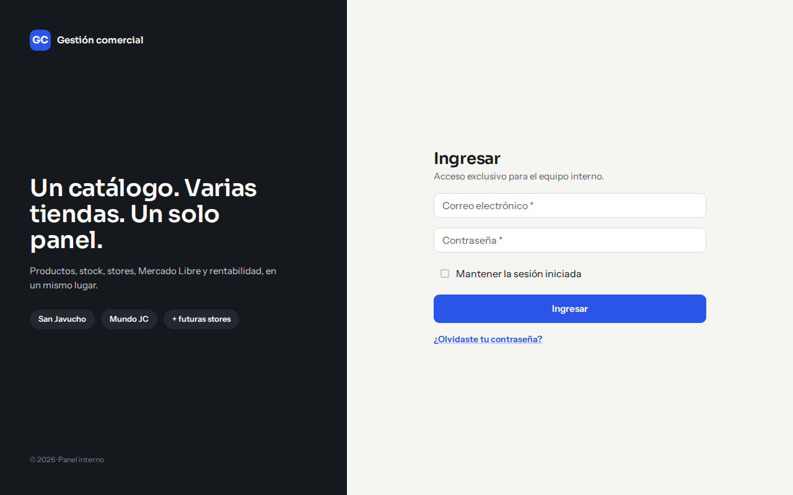
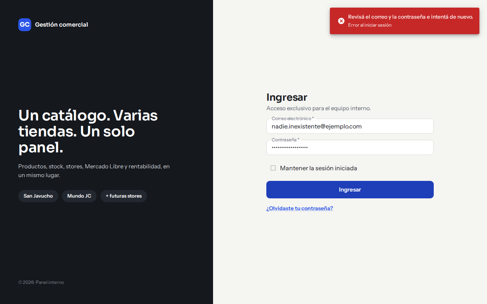
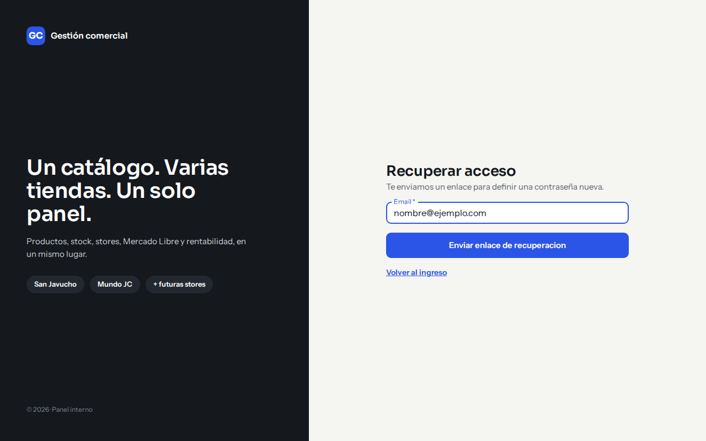
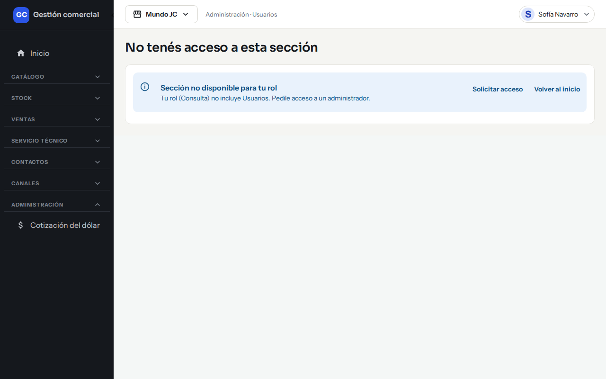

# Ingresar, recuperar el acceso y pedir permisos

## Para qué sirve

Explica cómo entrar al sistema, qué hacer si olvidaste la contraseña, cómo aceptar una invitación y cómo pedir acceso a una pantalla que no ves.

No hay registro propio: tu cuenta la crea un Administrador al invitarte.

## Aceptar una invitación

1. Te llega un correo con un enlace para crear tu contraseña.
2. Al abrirlo ves «Fuiste invitado como» y el rol que te asignaron.
3. Escribí la contraseña nueva y confirmala. La pantalla marca cada regla como «Cumple» o «Falta»: al menos 12 caracteres, una mayúscula, una minúscula, un número y un símbolo.
4. Hacé clic en **Guardar y entrar**.

**Si algo no sale**

- «La invitación venció. Pedile a un Administrador que te envíe una nueva.» La invitación vale 7 días; el enlace del correo dura 1 hora. Pedí que te la reenvíen.
- «La invitación fue cancelada o ya no existe.» Pedí que te inviten de nuevo.

## Ingresar

1. Abrí la pantalla **Ingresar**.
2. Escribí tu **Correo electrónico** y tu **Contraseña**.
3. Si usás tu propia computadora, podés tildar **Mantener la sesión iniciada**.
4. Hacé clic en **Ingresar**.

*Pantalla de ingreso.*

Sin esa casilla, la sesión se cierra al cerrar la pestaña y también después de 12 horas sin usar el sistema. Con la casilla, dura hasta 30 días.

### Si algo no sale

*El mensaje aparece arriba a la derecha cuando el correo o la contraseña no coinciden.*

| Mensaje | Qué significa |
|---|---|
| «Revisá el correo y la contraseña e intentá de nuevo.» | Alguno de los dos datos es incorrecto, o tu usuario está suspendido. Por seguridad el mensaje es el mismo en todos los casos. |
| «Demasiados intentos. Esperá unos minutos antes de volver a intentar.» | Después de 5 intentos fallidos, el ingreso con ese correo se bloquea unos 15 minutos, incluso con la contraseña correcta. Esperá y volvé a probar. |
| «No pudimos verificar tu ingreso por un problema del servicio. Intentá de nuevo en unos minutos.» | Es un problema temporal, no un error tuyo. |

## Recuperar la contraseña

1. En la pantalla de ingreso, hacé clic en **¿Olvidaste tu contraseña?**.
2. Escribí tu correo y hacé clic en **Enviar enlace de recuperación**.

*Recuperar acceso: escribí tu correo y pedí el enlace.*

3. Vas a ver «Si existe una cuenta para ese correo, enviamos un enlace para continuar.» (el mensaje es igual exista o no la cuenta).
4. Abrí el correo, entrá al enlace y definí la contraseña nueva. Elegí **Guardar contraseña**.

El enlace se usa una sola vez y vence a la hora. Si ves «El enlace venció o ya se usó», pedí uno nuevo. Si ya estás dentro y querés cambiarla, mirá [Tu perfil](perfil-propio.md).

Un Administrador también puede enviarte el enlace desde **Usuarios** → **Editar** → **Restablecer contraseña**. Nunca ve ni fija tu contraseña.

## Cerrar sesión

Menú con tu nombre (arriba a la derecha) → **Cerrar sesión**.

## Cuando una pantalla dice «No tenés acceso a esta sección»

Significa que tu rol no incluye esa sección. La pantalla muestra tu rol y la sección, con dos botones:

- **Solicitar acceso**: avisa por correo a los Administradores de tu organización, indicando quién pide y qué sección. Vas a ver «Solicitud enviada al administrador». Pedir lo mismo el mismo día no genera un segundo aviso.
- **Volver al inicio**.

*Un usuario con rol Consulta intentó abrir Usuarios: puede pedir acceso con un clic.*

Si tu organización no tiene ningún Administrador activo, el pedido igual queda registrado, pero no hay a quién avisar. Si el envío falla, aparece «No pudimos enviar tu solicitud» con la opción de reintentar.

Que te den acceso depende del Administrador: puede cambiar tu rol o ajustar los permisos. Ver [Usuarios y roles](usuarios-y-roles.md).

## Tu usuario fue suspendido

Si un Administrador suspende tu usuario, se cierra tu sesión y no podés volver a entrar hasta que lo reactive.
