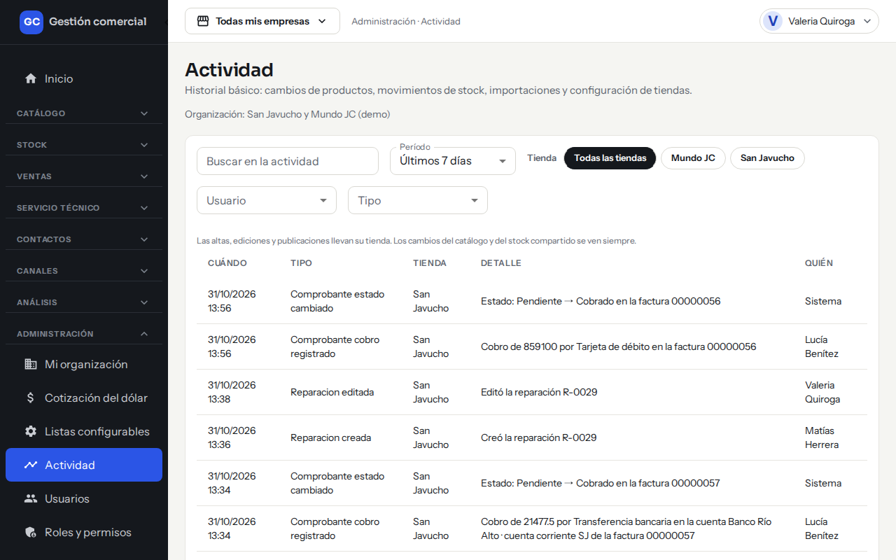
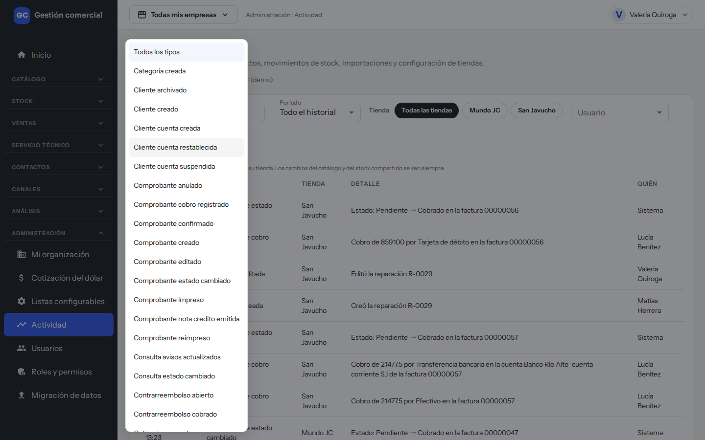
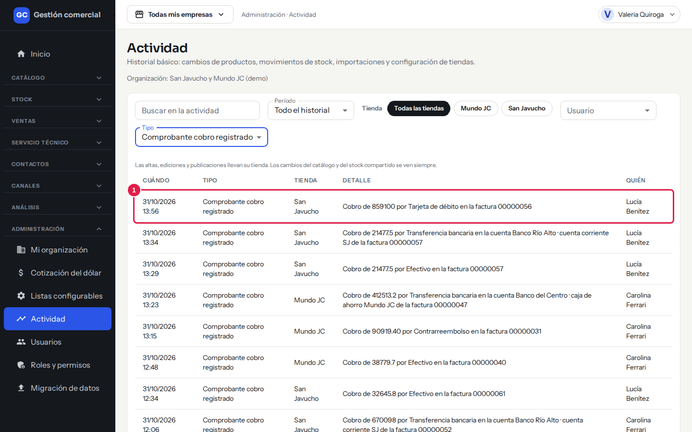
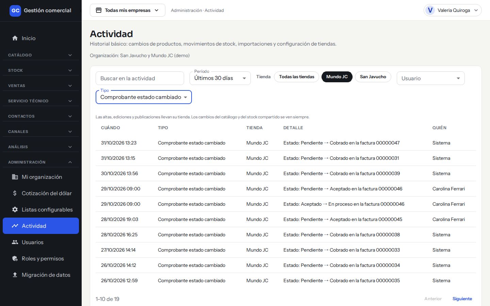

# Consultar la actividad: quién hizo qué y cuándo

## Para qué sirve

**Actividad** es el historial de lo que pasó en el sistema: altas y cambios de productos, clientes, ventas y cobros, movimientos de usuarios y permisos, cambios en las tiendas. Sirve para saber quién hizo algo, cuándo y en qué tienda, y para aclarar dudas sin tener que preguntarle a todo el equipo.

Es solo de consulta: nadie, ni el Administrador, puede editar ni borrar lo registrado.

## Quién puede verla

| Rol | Acceso |
|---|---|
| **Administrador** | Ve todos los eventos de la organización. |
| **Operador** y **Administración** | Ven todos, en solo lectura. |
| **Mostrador, Depósito, Técnico y Consulta** | No ven la pantalla. |

El Administrador puede cambiar estos accesos en **Roles y permisos** ([Usuarios y roles](usuarios-y-roles.md)).

## Dónde la encontrás

Menú **Administración → Actividad**.

*Actividad: filtros arriba y, debajo, un evento por fila, del más reciente al más antiguo.*

## Cómo filtrar

Podés combinar todos los filtros.

| Filtro | Qué hace |
|---|---|
| **Buscar en la actividad** | Busca texto en el detalle (no distingue mayúsculas ni tildes). |
| **Período** | **Hoy**, **Últimos 7 días** (es el que viene elegido), **Últimos 30 días** o **Todo el historial**. |
| **Tienda** | **Todas las tiendas** o una tienda puntual. |
| **Usuario** | **Todos los usuarios** o una persona. |
| **Tipo** | **Todos los tipos** o una clase de evento (por ejemplo, «Cliente creado»). |

*El filtro Tipo muestra la lista completa de eventos que se registran.*

Por ejemplo, con **Período** en «Todo el historial» y **Tipo** en «Comprobante cobro registrado», cada fila cuenta un cobro: cuánto, con qué medio de pago, en qué comprobante, y quién lo registró.

*Un evento de cobro: el recuadro 1 marca una fila con su detalle y la persona que lo hizo.*

También podés combinar filtros, por ejemplo una tienda, los últimos 30 días y el tipo «Comprobante estado cambiado» para ver cómo avanzaron las ventas:

*Filtros combinados: tienda, período y tipo.*

Si ningún evento coincide, ves «No hay actividad con esos filtros». Probá con otro período o quitá algún filtro. Los resultados se muestran de a diez; usá **Página anterior** y **Página siguiente** para recorrerlos.

## Cómo leer cada fila

| Columna | Qué muestra |
|---|---|
| **Cuándo** | Fecha y hora, en horario de Buenos Aires. |
| **Tipo** | Qué clase de evento fue. |
| **Tienda** | La tienda a la que pertenece. Dice **Compartido** si el evento no es de una tienda en particular (por ejemplo, un cambio en el catálogo o el stock compartido, que se ven siempre). |
| **Detalle** | Una frase que cuenta qué pasó, como «Creó la reparación R-0029». |
| **Quién** | La persona que lo hizo. Dice **Sistema** cuando lo hizo el propio sistema (por ejemplo, al cambiar un estado de forma automática). |

## Qué tipos de eventos hay

- **Usuarios y permisos:** usuario agregado, cambio de rol, usuario suspendido, reactivado o removido, empresas asignadas, invitaciones enviadas, reenviadas o canceladas, permisos modificados o restablecidos, cambio de empresa activa.
- **Empresas:** empresa actualizada, pausada o reactivada.
- **Clientes:** cliente creado, editado, archivado o restaurado.
- **Productos, proveedores y stock:** altas, cambios, activaciones e ingresos o anulaciones de mercadería.
- **Ventas y cobros:** comprobantes, presupuestos copiados, cobros registrados y cambios de estado.
- **Service técnico:** reparaciones creadas o editadas, y repuestos o mano de obra agregados o quitados.

El detalle de los eventos nunca incluye costos ni importes de los productos ni datos de contacto de los clientes.

## Preguntas frecuentes

**¿Por qué no veo un cambio que hice hace meses?** Elegí **Todo el historial** en **Período**. El registro empieza cuando se activó el sistema.

**¿Los datos del panel anterior aparecen acá?** No. Esos datos se consultan en **Ventas → Historial**.

**¿Cambia con la empresa activa?** Sí: con una tienda elegida arriba ves los eventos de esa tienda y los compartidos; con **Todas mis empresas** ves todo. Ver [Tu organización y tus empresas](organizacion-y-empresas.md).

**«No pudimos cargar la actividad».** Usá el botón de reintentar; si sigue, avisá a un Administrador.
