# API y avisos para conectar otros sistemas

## Para qué sirve

La pantalla **Administración → API** permite que otro sistema (por ejemplo, el de un socio o un tablero propio) **lea** los datos de tu organización sin entrar al panel. Tiene cuatro bloques:

- **Claves**: las credenciales que usa el otro sistema para identificarse.
- **Suscripciones a avisos**: direcciones a las que el sistema te avisa solo cuando algo cambia, sin que el otro sistema tenga que preguntar todo el tiempo.
- **Entregas recientes**: el resultado de cada aviso enviado.
- **Llamadas recientes**: un registro de cada vez que alguien usó una clave.

La conexión es **solo de lectura**: con una clave se consultan datos, nunca se modifican.

## Quién puede hacerlo

Solo el **Administrador** de la organización. Los demás roles no ven la pantalla.

## Qué datos se pueden consultar

Cada clave tiene **alcances**, que son las áreas que puede leer. Se eligen al crearla:

| Alcance | Qué permite leer |
|---|---|
| **productos** | El catálogo, con categoría, moneda y precio de lista. |
| **stock** | El stock de cada producto en cada depósito. |
| **precios** | Los precios por escala (x5, x10, x50). |
| **ventas** | Las facturas confirmadas. |

Una clave con el alcance **stock** no puede leer ventas, y así con cada área. Cada clave ve solo los datos de tu organización.

## Crear una clave

1. Entrá a **Administración → API**, bloque **Claves**.
2. Hacé clic en **Crear clave**.
3. Escribí un **Nombre** que te recuerde para qué sistema es (por ejemplo, «Tablero del contador»).
4. Marcá los **Alcances de lectura**. Tenés que elegir al menos uno.
5. Si querés que deje de funcionar sola, completá **Vencimiento (opcional)**.
6. Hacé clic en **Crear**.

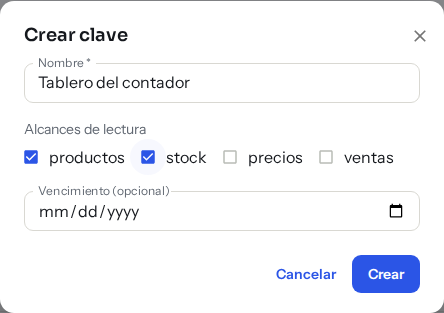

Se abre **Copiá la clave** con el valor completo. **Es la única vez que se muestra**: después el sistema solo guarda una huella y no puede mostrártela de nuevo. Copiala con el botón **Copiar**, guardala en un lugar seguro y hacé clic en **Listo, ya la copié**.

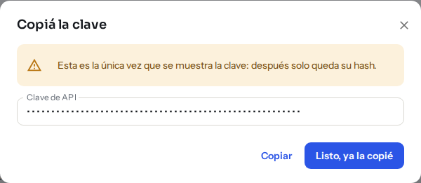

Si la perdés, no se recupera: rotala (ver abajo) o creá otra. Si sospechás que alguien más la tiene, **revocala** en lugar de rotarla: la anterior seguiría funcionando 24 horas.

En el listado ves de cada clave su **Nombre**, el **Prefijo** (las primeras letras, para reconocerla), los **Alcances**, el **Estado** (Activa, Vencida o Revocada), el **Último uso** y cuándo **Vence**.

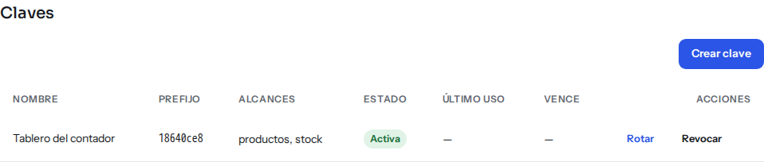

## Cambiar una clave: rotar y revocar

- **Rotar**: genera una clave nueva y la anterior **sigue funcionando hasta 24 horas** (menos, si ya iba a vencer antes). Rotar de nuevo la misma clave no renueva esas 24 horas. Una clave **vencida** se puede rotar para renovarla; una **revocada**, no. Sirve para cambiarla en el otro sistema sin cortar el servicio. Se muestra la clave nueva una sola vez, igual que al crearla.
- **Revocar**: la clave **deja de funcionar en la llamada siguiente** y no se puede deshacer. Usalo si sospechás que alguien más la tiene.

Los dos piden confirmación antes de actuar.

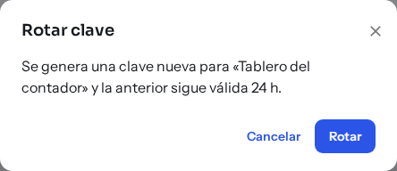

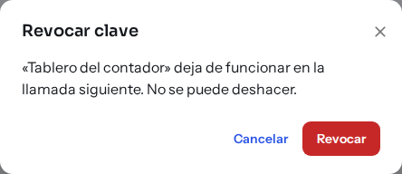

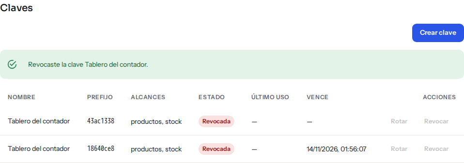

## Avisos cuando algo cambia

En el bloque **Suscripciones a avisos** le indicás al sistema una dirección web a la que avisar. Los eventos disponibles son:

| Evento | Cuándo se envía |
|---|---|
| **stock.actualizado** | Cuando cambia el stock de un producto (movimiento, reserva o liberación). **No** avisa los movimientos de variantes ni los traslados entre depósitos. |
| **precio.actualizado** | Cuando cambia de verdad el precio de lista, el de una escala o la moneda. |
| **venta.registrada** | Cuando una factura pasa a confirmada. |

Para crear una suscripción:

1. Hacé clic en **Nueva suscripción**.
2. Escribí la **URL del aviso**. Tiene que empezar con **https**.
3. Marcá los **Eventos** que querés recibir (al menos uno).
4. Hacé clic en **Crear**.

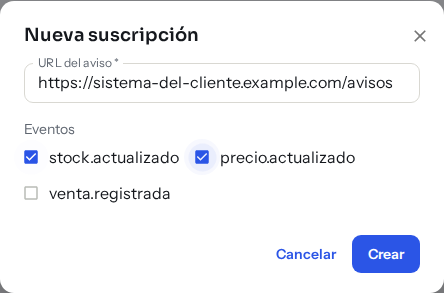

Se abre **Copiá el secreto** con el **Secreto de firma**. Es la única vez que se muestra. El sistema que recibe los avisos lo usa para comprobar que el aviso viene de acá y no de otro lado. Copialo y entregáselo a quien configura el otro sistema.

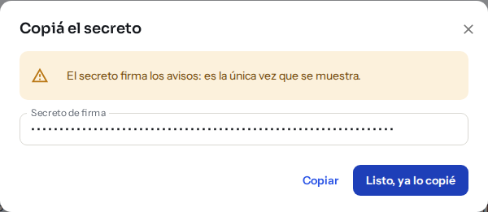

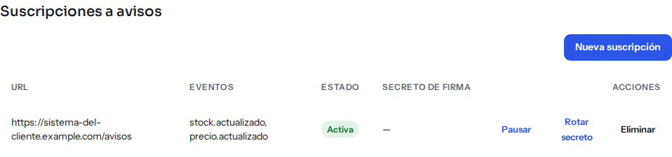

Por seguridad, la dirección no puede apuntar a una computadora interna ni llevar usuario y contraseña. Si no cumple, no se puede crear.

Desde el listado podés **Pausar** una suscripción (deja de enviar avisos hasta que la **Reanudes**) o **Eliminarla**. Los avisos que ya estaban pendientes se entregan al reanudar, pero **los eventos que ocurran mientras está pausada no se envían después**: al reanudar, el otro sistema tiene que ponerse al día con una consulta.

El **secreto de firma no se puede volver a ver**, pero se puede **rotar** sin cortar el servicio:

1. En el listado, hacé clic en **Rotar secreto** de esa suscripción y confirmá.
2. Se abre **Copiá el secreto** con el secreto nuevo. **Es la única vez que se muestra.** Copialo y entregáselo a quien configura el otro sistema.
3. El secreto anterior **sigue valiendo 24 horas**. Durante ese tiempo cada aviso lleva las dos firmas, y el otro sistema lo acepta con cualquiera de las dos: así puede cambiar el secreto sin perder avisos. En el listado ves hasta cuándo vale el anterior («Rotado: el anterior vale hasta…»).

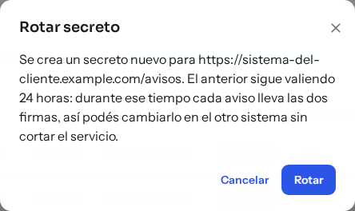

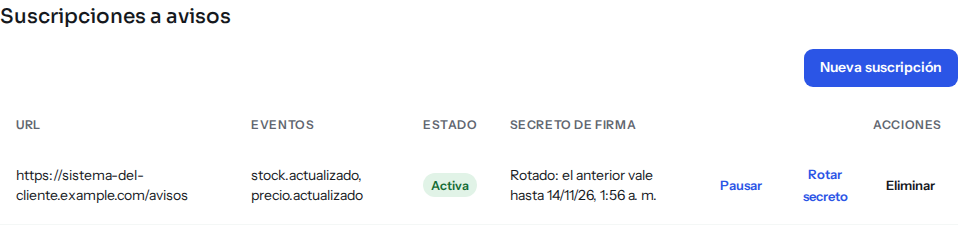

**Cuidado:** si el secreto nuevo se perdió y rotás otra vez mientras el anterior todavía vale, el secreto original **deja de valer en ese momento** y el otro sistema deja de recibir avisos hasta que cargue el nuevo. La pantalla te lo advierte. Si pensás que el secreto se filtró, rotalo y entregá el nuevo enseguida.

Si restauraste la base en otra instancia, los secretos guardados no se pueden leer: rotá el secreto de cada suscripción.

### Qué pasa si el aviso no llega

Si la dirección no responde bien, el sistema lo intenta **hasta 5 veces en total** (el envío original y 4 reintentos), esperando como mínimo 1, 2, 4 y 8 minutos entre uno y otro. Si los 5 intentos fallan, la entrega queda **agotada** y **no se vuelve a enviar sola**. Un Administrador la puede **reintentar a mano** desde **Entregas recientes** (ver abajo); lo que el otro sistema se perdió y no se reintenta lo recupera con una consulta. Un mismo aviso puede llegar más de una vez, así que el otro sistema debe ignorar los repetidos.

## Revisar qué pasó

- **Entregas recientes**: cada aviso con su **Estado** (por ejemplo, completada o agotada), los **Intentos** y el **Último error**, con el código de respuesta si lo hubo. Si hay entregas agotadas, revisá que la dirección esté bien y que el otro sistema esté funcionando, y después usá **Reintentar** en cada una: vuelve a la cola con sus 5 intentos. Con el interruptor **Solo agotadas** ves únicamente esas, aunque sean viejas. Si la suscripción está pausada, el aviso espera a que la reanudes. Hay un máximo de 200 avisos esperando para enviarse a la vez: si lo alcanzás, esperá a que se vacíe la cola.
- **Llamadas recientes**: cada uso de una clave, con **Cuándo**, **Método**, **Ruta**, **Estado** y **Duración**. Un estado de 400 o más se marca como error. También quedan registrados los intentos rechazados, por ejemplo con una clave revocada. El registro **no guarda la clave ni los datos consultados**, y se borra solo a los 90 días (valor por defecto).

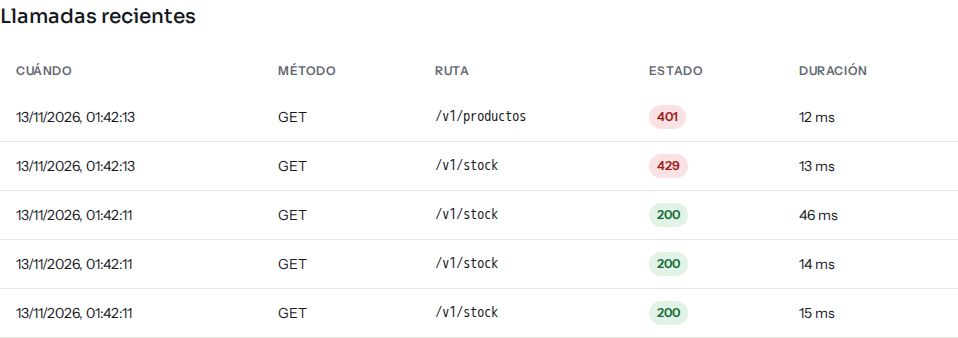

## Límites

Cada organización puede tener hasta **50 claves vigentes** (las revocadas y las vencidas no cuentan) y hasta **20 suscripciones**. Si llegás al máximo al crear, la pantalla te avisa: revocá una clave o eliminá una suscripción que ya no uses y probá de nuevo. **Rotar** tiene un techo más alto, de 100 claves vigentes, porque la clave anterior sigue funcionando hasta 24 horas; si lo alcanzás, la pantalla muestra «No pudimos rotar la clave»: revocá las que no uses y probá de nuevo. Las claves revocadas o vencidas hace más de 90 días (valor por defecto) se borran solas.

Cada clave admite **60 consultas por minuto**. Si se pasa, el otro sistema recibe un aviso de «límite excedido» y tiene que esperar un momento. El rechazo también queda en **Llamadas recientes**.

## Para quien programa el otro sistema

Los detalles técnicos (rutas, formato de las respuestas, cómo se verifica la firma de los avisos y cómo se paginan los resultados) están en [Empezar con la API](../api/inicio-rapido.md) y en la [Referencia de la API](../api/referencia.md); el contrato máquina-legible lo publica la propia API en `/v1/openapi.json` (se puede abrir sin clave).

## Preguntas frecuentes

**Perdí la clave, ¿se puede ver de nuevo?** No. Rotala para obtener una nueva; la anterior sigue 24 horas.

**¿Puede el otro sistema cambiar precios o stock?** No. La API es solo de lectura.

**¿Ve datos de otras organizaciones?** No. Cada clave pertenece a una organización y solo ve lo suyo.

**Dejé de querer recibir avisos en una dirección.** Pausá o eliminá la suscripción.

## Ver también

- [Usuarios y roles](usuarios-y-roles.md): quién es Administrador.
- [Actividad](actividad.md): el registro de lo que se hace en el panel.
