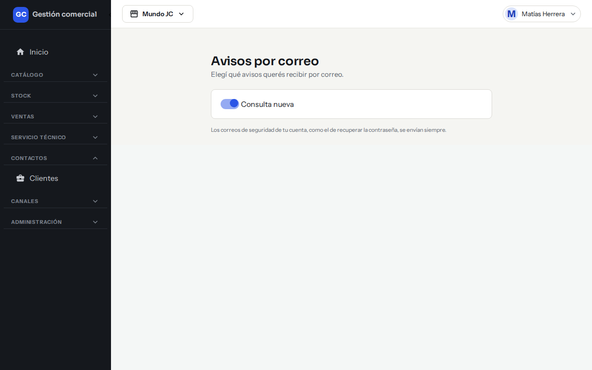
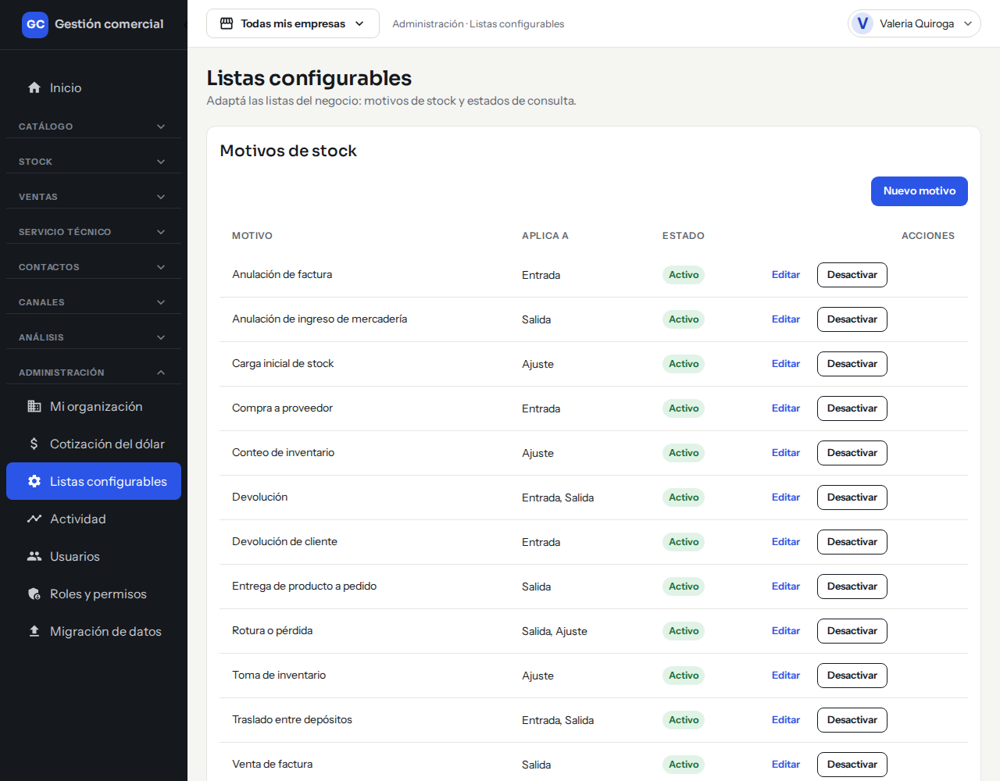
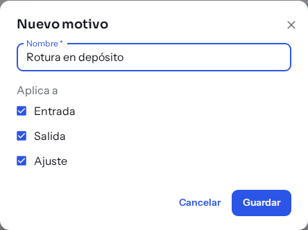
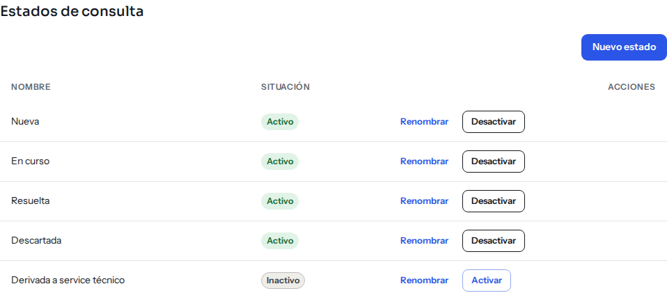
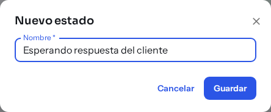
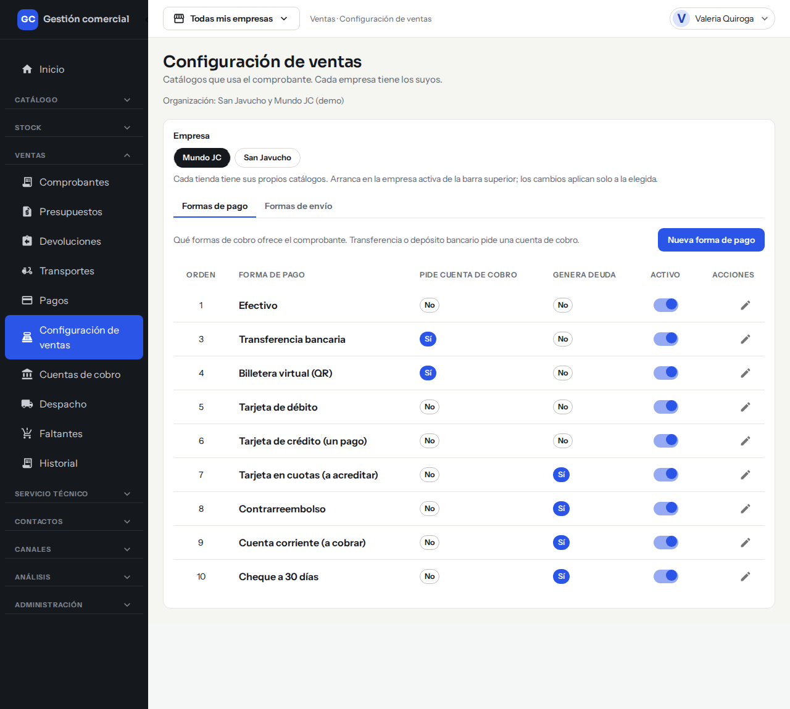
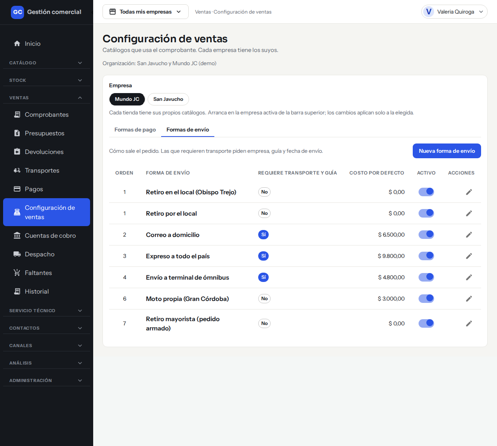
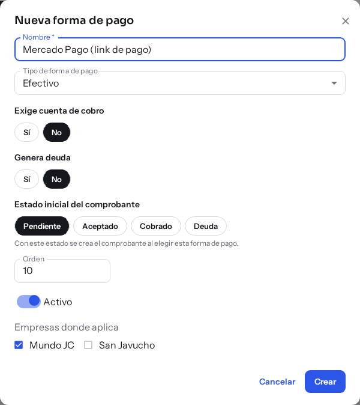
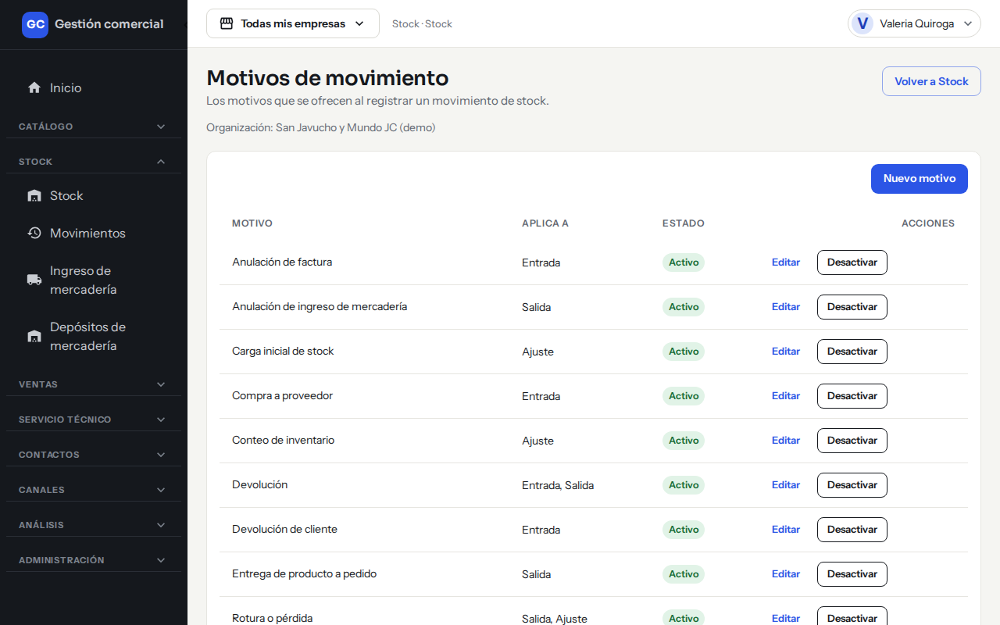

# Avisos por correo y listas configurables

## Para qué sirve

Esta página tiene dos partes. La primera explica cómo cada persona elige qué avisos recibe por correo. La segunda, dónde se administran las listas del negocio (estados, formas de pago, formas de envío, motivos de stock) para que se adapten a cómo trabajan.

## Avisos por correo

### Qué avisos hay

En **Avisos por correo** ves un interruptor por cada tipo de aviso que corresponde a las secciones a las que tenés acceso. Hoy el aviso disponible es:

| Aviso | Cuándo llega |
|---|---|
| **Consulta nueva** | Cuando una persona escribe desde una tienda online. Lo ven quienes tienen acceso a Consultas. Si entran varias seguidas, se juntan en un solo correo. |

Mirá cómo se atienden en [Consultas](consultas.md).

### Cómo activarlos o desactivarlos

1. Hacé clic en tu nombre, arriba a la derecha.
2. Elegí **Avisos por correo**.
3. Prendé o apagá el interruptor del aviso. Se guarda al instante y ves «Vas a recibir…» o «Dejaste de recibir los avisos de «Consulta nueva» por correo.»

*El interruptor del aviso «Consulta nueva»: se guarda al instante.*

Si no tenés acceso a ninguna sección que genere avisos, ves «Todavía no tenés avisos para configurar». Mientras no cambies nada, todos los avisos están activados.

Los correos de seguridad de tu cuenta, como el de recuperar la contraseña, se envían siempre y no se pueden apagar.

Si el cambio no se guarda, ves el mensaje de error en pantalla. Probá de nuevo o recargá la página.

## Listas configurables

### Listas del Administrador

El Administrador administra dos listas juntas en **Administración → Listas configurables**:

**Motivos de stock**: los motivos que se ofrecen al registrar un movimiento de stock.

*Listas configurables: arriba, los motivos de stock con a qué movimientos aplican.*

- **Nuevo motivo**: escribí el **Nombre** y marcá a qué tipos de movimiento aplica. **Guardar**.
- **Editar** cambia el nombre o a qué aplica.

*El alta de un motivo, antes de guardar.*

- **Desactivar** / **Activar** lo quita o lo vuelve a ofrecer. Los motivos no se borran.

**Estados de consulta**: una lista de nombres que se pueden agregar, renombrar, activar y desactivar.

*Los estados de consulta; los inactivos se pueden volver a activar.*

- **Nuevo estado**: escribí el **Nombre** y **Guardar**.
- **Renombrar**, **Desactivar** o **Activar** sobre cada fila.

*El alta de un estado de consulta, antes de guardar.*

- Un nombre repetido da el mensaje «Ya existe un estado con ese nombre.» y uno vacío, «El nombre no puede estar vacío.».

Los demás roles que entren a esta pantalla ven que no tienen acceso.

### Otras listas, dónde está cada una

| Lista | Dónde se administra | Qué rol |
|---|---|---|
| **Formas de pago** y **Formas de envío** | **Ventas → Configuración de ventas**, solapas «Formas de pago» y «Formas de envío». Cada empresa tiene las suyas. | Quien tiene edición en Ventas |
| **Modelos** y **Estados de reparación** | **Servicio técnico → Modelos** / **Estados de reparación** | Quien tiene edición en Servicio técnico |
| **Motivos de movimiento** | También en **Stock**, botón **Motivos de movimiento** | Quien puede editar Stock |

*Ventas → Configuración de ventas, solapa «Formas de pago».*

*La solapa «Formas de envío».*

En las formas de pago y de envío podés crear una nueva con **Nueva forma de pago** (o de envío), editarla, cambiar su **Orden** y activarla o desactivarla con **Activo**. Una forma desactivada deja de ofrecerse en los comprobantes nuevos.

*El alta de una forma de pago, antes de crearla.*

*Los motivos de movimiento también se administran desde Stock.*

En todas las listas, el criterio es el mismo: no se borra nada, se desactiva, así el historial queda intacto. Para la configuración de ventas mirá [Comprobantes](ventas-comprobantes.md); para el servicio técnico, [Service técnico](service-listado-items-impresion.md).
