# Productos y categorías

## Para qué sirve

Acá cargás y ordenás todo lo que vendés: cada producto con su nombre, su precio, su costo, sus fotos y las tiendas donde se vende. Las **categorías** agrupan los productos y arman el menú de las tiendas online. El catálogo es uno solo para todo el negocio: cada producto se publica en las tiendas que vos elijas.

## Quién puede hacerlo

Con los permisos que trae el sistema por defecto (el Administrador puede cambiarlos en [Usuarios y roles](usuarios-y-roles.md)):

| Tarea | Quién |
|---|---|
| Ver productos | Todos los roles |
| Crear, editar, activar y desactivar productos | Administrador y Operador |
| Ver y cargar el **costo** de un producto | El costo solo lo ve quien tiene acceso a [Rentabilidad](rentabilidad.md): el Administrador (que además lo carga) y Administración (que solo lo ve) |
| Ver categorías | Administrador, Operador, Consulta |
| Crear, editar, ordenar y eliminar categorías | Administrador y Operador |

Si tu rol solo puede mirar, la ficha del producto se abre sin botón de guardar y los botones «Nuevo producto», «Editar» y «Desactivar» no aparecen.

## Dónde lo encontrás

En el menú de la izquierda: **Catálogo → Productos** y **Catálogo → Categorías**.

## El listado de productos

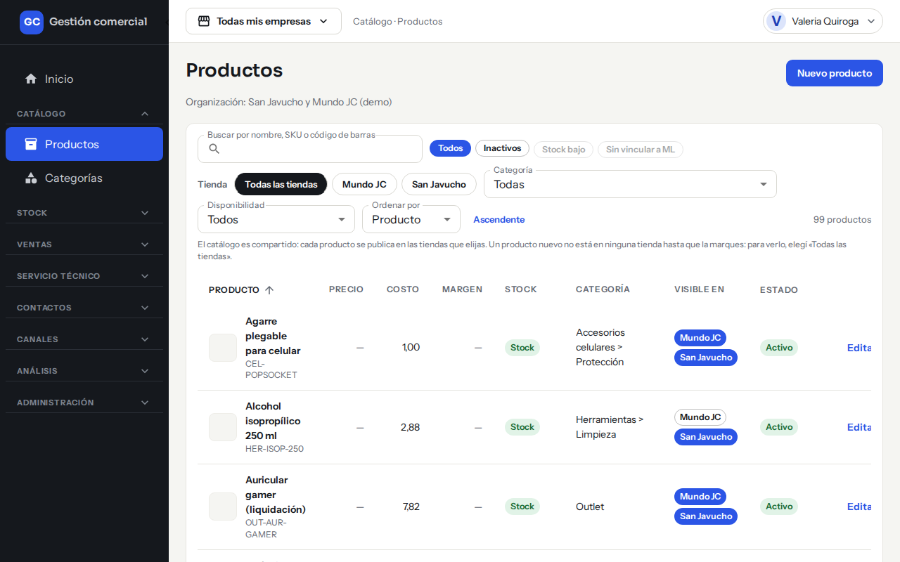

*Catálogo → Productos: buscador, filtros y la tabla con una fila por producto.*

### Cómo buscar y filtrar

| Filtro | Qué hace |
|---|---|
| **Buscar por nombre, SKU o código de barras** | Busca mientras escribís. Si tenés un lector de códigos de barras, escaneá y apretá Enter. |
| **Todos / Inactivos** | «Todos» muestra los productos activos e inactivos. «Inactivos» muestra solo los que están desactivados. |
| **Tienda** | «Todas las tiendas» o una tienda en particular: muestra los productos que se venden ahí. |
| **Categoría** | Muestra los productos de esa categoría. |
| **Disponibilidad** | Stock, Sin stock, A pedido o Stock entrante en breve. |
| **Ordenar por** | Producto, SKU o Estado. El botón **Ascendente / Descendente** invierte el orden. |
| **Limpiar filtros** | Aparece cuando hay algún filtro puesto y vuelve al listado completo. |

Los botones **Stock bajo** y **Sin vincular a ML** se ven apagados: por ahora no se pueden usar.

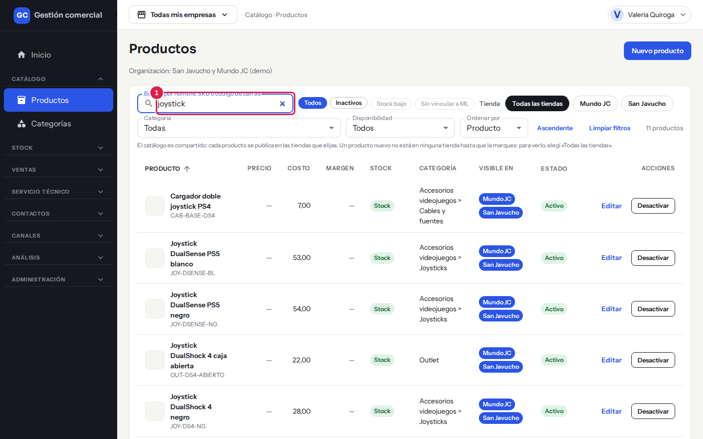

*El buscador resaltado con el número 1: escribí parte del nombre, del SKU o del código de barras y la lista se acorta sola.*

Arriba a la derecha de los filtros ves cuántos productos hay (por ejemplo, «99 productos»). La lista se muestra de a páginas; abajo tenés los controles para pasar de una a otra.

> **Ojo:** un producto nuevo no está en ninguna tienda hasta que lo marcás en «Empresas que lo venden». Si buscás un producto recién creado y no aparece, elegí **Todas las tiendas**.

### Qué significa cada columna

| Columna | Qué muestra |
|---|---|
| **Producto** | Foto en miniatura, nombre y SKU (el código interno del producto). |
| **Precio** | Por ahora se ve «—». El precio se carga y se consulta en la ficha del producto. |
| **Costo** | Lo que te cuesta el producto, en la moneda en que lo cargaste. Solo aparece si tu rol puede ver costos. |
| **Margen** | Por ahora se ve «—». Para ver márgenes usá [Rentabilidad](rentabilidad.md). |
| **Stock** | La disponibilidad del producto (ver más abajo). |
| **Categoría** | La categoría y, si tiene, la subcategoría (por ejemplo, «Herramientas > Limpieza»). |
| **Visible en** | Una etiqueta por tienda: **rellena** si el producto se vende ahí, **con contorno** si no. |
| **Estado** | **Activo** o **Inactivo**. |

### Qué significa la disponibilidad

| Disponibilidad | Qué quiere decir |
|---|---|
| **Stock** | Hay unidades. Lo calcula el sistema según las existencias. |
| **Sin stock** | No hay unidades; las tiendas lo muestran agotado. También lo calcula el sistema. |
| **A pedido** | Lo conseguís bajo pedido. La elegís vos a mano. |
| **Stock entrante en breve** | Llega pronto. La elegís vos a mano. |

Cuando elegís «A pedido» o «Stock entrante en breve» en un producto, esa elección manda sobre las existencias. Las tiendas online, en cambio, solo muestran «Disponible» o «Sin stock», según las unidades reales.

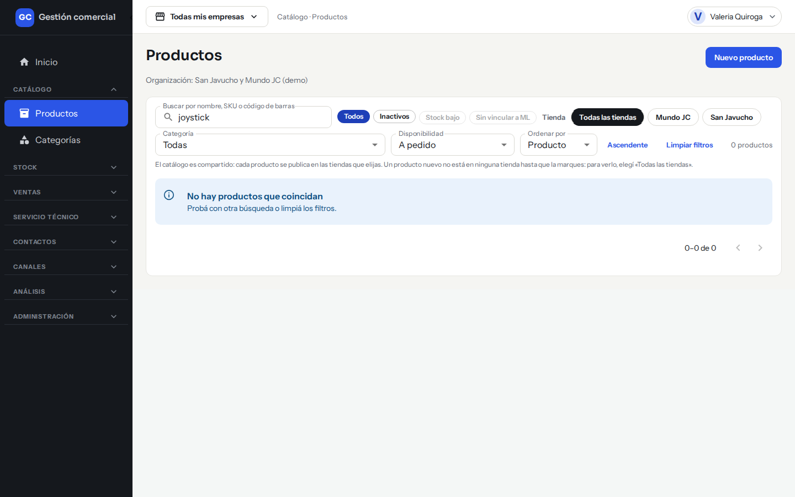

*Con el filtro **Disponibilidad** en «A pedido», la lista muestra solo los productos que lo conseguís bajo pedido.*

## Crear un producto

1. Entrá a **Catálogo → Productos** y hacé clic en **Nuevo producto**.

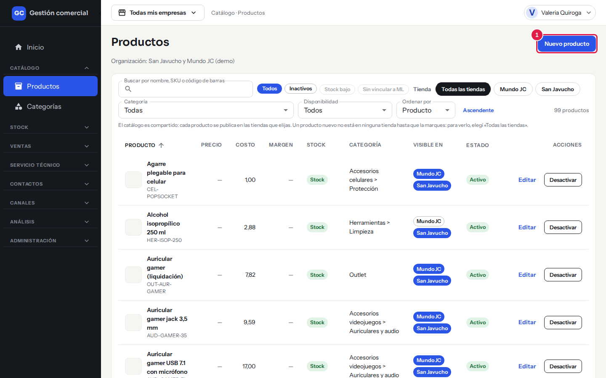

*Paso 1: el botón **Nuevo producto** está arriba a la derecha.*

2. Completá los datos (los marcados con asterisco son obligatorios):
   - **Nombre** (obligatorio).
   - **Descripción**.
   - **SKU**: si lo dejás vacío, el sistema le pone uno solo (empieza con «PRD-»). No puede haber dos productos con el mismo SKU.
   - **Compatible con**: por ejemplo, las consolas con las que funciona. Separá los valores con comas: «PS5, Xbox».
   - **Proveedor**: opcional. Solo se ofrecen proveedores activos (ver [Proveedores](proveedores.md)).
   - **Código del proveedor**: cómo lo identifica tu proveedor. Se habilita cuando elegís un proveedor.
   - **Código de barras (EAN-13)**: 13 dígitos, o escanealo. No puede repetirse entre productos.

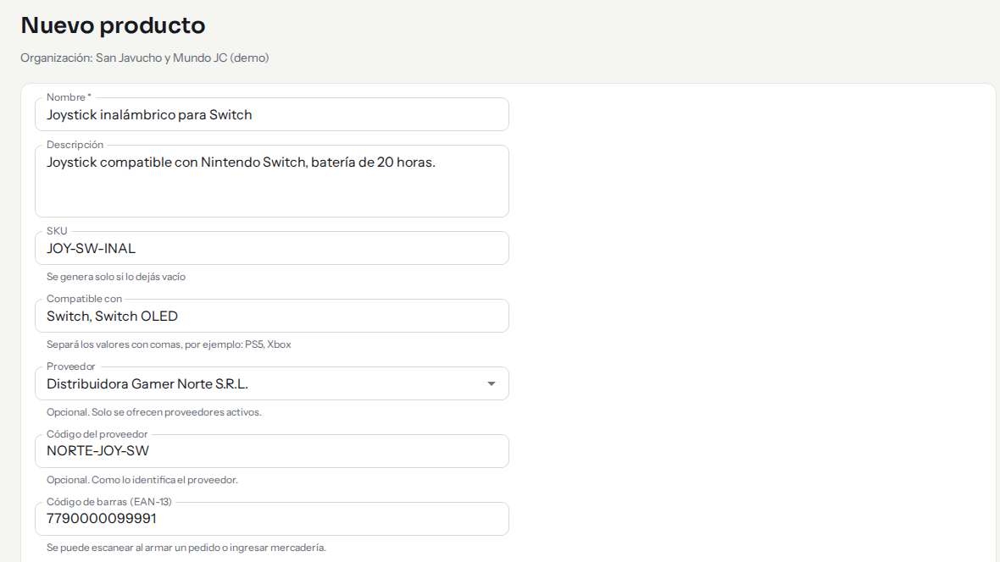

*Paso 2: los datos generales del producto, completados con un ejemplo.*

3. En **Precio y costo**:
   - **Moneda**: «USD · dólares» o «ARS · pesos».
   - **Precio de lista (sin IVA)** (obligatorio): el precio base, sin IVA. Tiene que ser mayor que cero.
   - **Precio en pesos**: lo calcula el sistema. Si el producto está en dólares, usa la cotización vigente. Si todavía no cargaste el dólar, te avisa «Cargá la cotización» (ver [Cotización del dólar](precios-dolar.md)).
   - **Costo**: solo si tu rol puede verlo. Si lo dejás vacío al editar, se conserva el costo anterior.

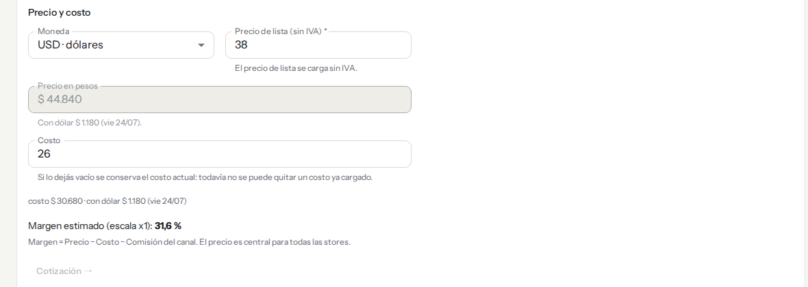

*Paso 3: el precio en pesos y el margen estimado se calculan solos a medida que escribís.*

4. En **Precios por escala · sin IVA** podés cargar precios distintos por cantidad (ver [Precios e IVA](precios-e-iva.md)).
5. En **Disponibilidad**, dejá la opción automática o elegí «A pedido» o «Stock entrante en breve». Para volver a lo automático, usá **Quitar la elección manual**.
6. Elegí la **Categoría** (opcional; hasta dos niveles: categoría y subcategoría).
7. En **IVA** dejá «Heredar de la categoría» o elegí una alícuota propia para este producto.

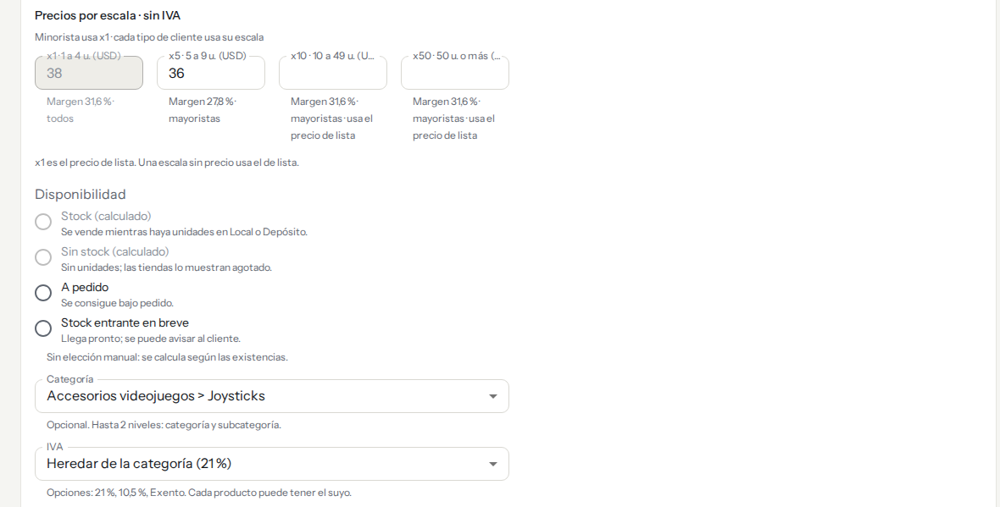

*Pasos 4 a 7: precios por escala, disponibilidad, categoría e IVA.*

8. En **Imágenes** hacé clic en **Agregar imágenes**: hasta 4 fotos JPG, PNG o WebP de hasta 2 MB cada una. La primera es la principal. Las fotos se suben al guardar.
9. En **Empresas que lo venden**, activá el interruptor de cada tienda donde querés vender el producto. Debajo se lee en qué tiendas va a estar visible («Visible en San Javucho y Mundo JC»). Si no activás ninguna, el producto no aparece en ninguna tienda online.
10. Hacé clic en **Crear producto**. Vas a ver «Producto creado» y la opción **Cargar otro producto**.

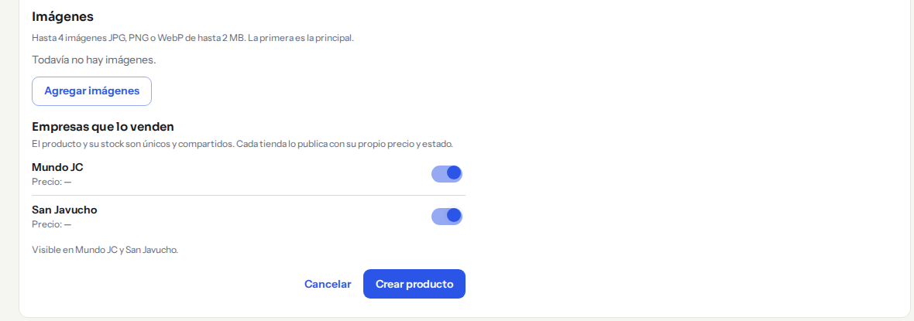

*Pasos 8 a 10: las imágenes, las empresas que lo venden y el botón **Crear producto**.*

Si salís del formulario con datos sin guardar, el sistema pregunta «Descartar cambios»: elegí **Seguir editando** o **Descartar cambios**.

## Editar un producto

1. En el listado, hacé clic en **Editar** en la fila del producto.
2. Cambiá lo que necesites.

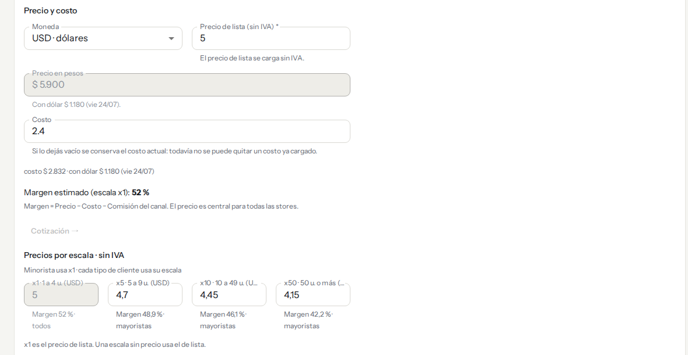

*Al editar un producto que ya tiene precios por escala, ves cada escala con su margen.*

3. Hacé clic en **Guardar cambios**. Vas a ver «Producto guardado» y podés **Seguir editando**.

## Activar o desactivar un producto

Un producto **no se borra**: se desactiva. Un producto inactivo no se muestra en las tiendas, pero conserva todos sus datos y su historial, y lo podés activar de nuevo cuando quieras.

1. En el listado, hacé clic en **Desactivar** (o **Activar**, si ya está inactivo) en la fila del producto. También lo podés hacer desde la ficha. El cambio se aplica enseguida: el sistema no pide confirmación.

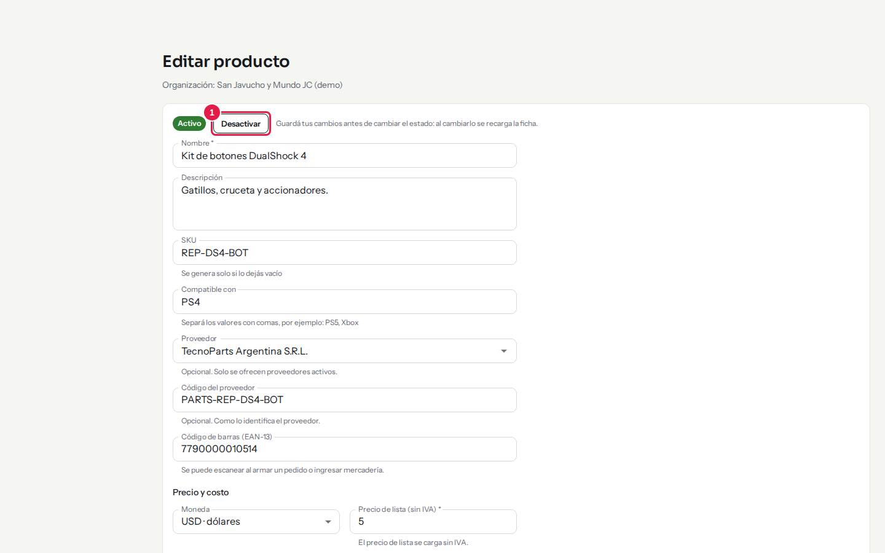

*Paso 1: en la ficha, el estado **Activo** y el botón **Desactivar** están arriba del formulario.*

2. Si estás en la ficha, guardá tus cambios antes: al cambiar el estado la ficha se recarga y lo no guardado se pierde.

## Categorías

Las categorías se ordenan en un árbol de **dos niveles**: categorías y subcategorías. Se ven en **Catálogo → Categorías**.

### Qué ves en la pantalla

| Columna | Qué muestra |
|---|---|
| **Categoría** | El nombre; las subcategorías aparecen sangradas debajo. Con la flecha las expandís o contraés. |
| **Productos** | Cuántos productos tiene. |
| **IVA** | El IVA de la categoría. |
| **Visible en** | En qué tiendas se ve la categoría (con relleno si se ve, con contorno si no). |
| **Acciones** | Agregar subcategoría, subir, bajar, editar y eliminar. |

Podés filtrar por tienda con los botones de arriba, y usar **Expandir todo** y **Contraer todo**. También podés arrastrar una categoría para cambiarle el orden.

*Catálogo → Categorías: categorías y subcategorías con sus productos, IVA y tiendas.*

### Crear una categoría

1. Hacé clic en **Nueva categoría**.

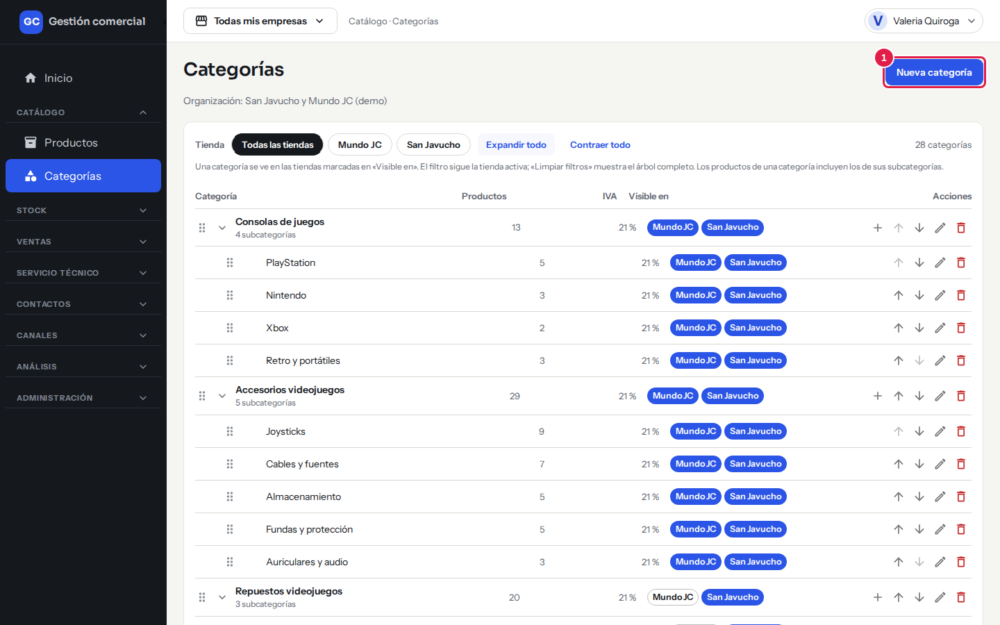

*Paso 1: **Nueva categoría** está arriba a la derecha.*

2. Escribí el **Nombre** (hasta 100 caracteres).
3. En **Categoría padre (opcional)** elegí «Ninguna (categoría raíz)» o la categoría de la que va a colgar. Solo se ofrecen categorías principales: no hay un tercer nivel.
4. En **IVA de la categoría** elegí la alícuota (21 %, 10,5 % o Exento). Los productos de la categoría la usan, salvo que tengan una propia.
5. En **Visible en** marcá las tiendas a las que pertenece la categoría. La pantalla avisa que, sin ninguna tienda marcada, la categoría no se ve en ninguna. Para mostrar u ocultar una categoría en el menú de una tienda online, usá también la pestaña **Catálogo visible** de esa tienda (ver [Tiendas online](tiendas-online.md)).
6. Hacé clic en **Guardar**.

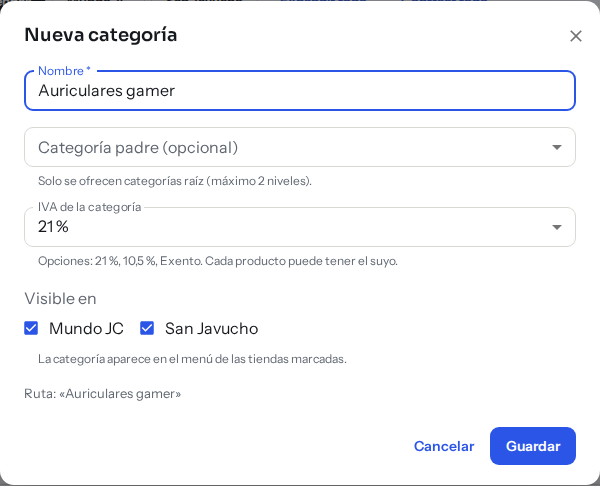

*Pasos 2 a 6: el cuadro para crear una categoría, con el nombre completado.*

Para agregar una subcategoría directamente, usá el ícono «Agregar subcategoría» en la fila de la categoría. Para cambiar una categoría, usá el ícono de editar.

### Eliminar una categoría

1. Hacé clic en el ícono de eliminar de la categoría.
2. El sistema te avisa cuántos productos y subcategorías tiene. Al eliminarla, **los productos quedan sin categoría** y **las subcategorías suben un nivel**.
3. Confirmá con **Eliminar**, o con **Cancelar** si te arrepentís.

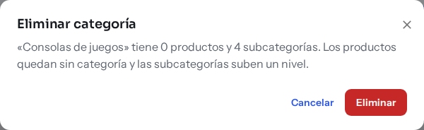

*El aviso antes de eliminar: los productos quedan sin categoría y las subcategorías suben un nivel.*

## Casos comunes

- **No encuentro un producto que acabo de crear.** Elegí «Todas las tiendas» en el filtro: un producto nuevo no está en ninguna tienda hasta que lo marcás en «Empresas que lo venden».
- **Quiero sacar un producto de una tienda pero no de la otra.** Editá el producto y desactivá el interruptor de esa tienda en «Empresas que lo venden».
- **Quiero que un producto deje de venderse en todos lados.** Desactivalo.
- **Mi producto está en dólares y el precio en pesos dice «Cargá la cotización».** Falta cargar el dólar del día: ver [Cotización del dólar](precios-dolar.md).

## Si algo no sale

| Mensaje | Qué significa y qué hacer |
|---|---|
| **Faltan datos obligatorios** | Hay campos sin completar (se listan en el aviso). Completalos y volvé a guardar. |
| **Ese SKU ya existe** | Otro producto usa ese SKU. Escribí otro o dejalo vacío para que se genere solo. |
| **Ese código de barras ya existe** | Otro producto tiene ese código. Revisalo. |
| **El código de barras debe tener 13 dígitos** | Corregí el número o escanealo de nuevo. |
| **Un importe es demasiado grande** | Revisá el precio y el costo. |
| **Otra persona modificó este producto mientras lo editabas** | No se guardó nada tuyo. Hacé clic en **Recargar producto** para ver los cambios de la otra persona y volvé a cargar los tuyos. |
| **«…» pesa más de 2 MB** o **Ya hay 4 imágenes** | Usá una foto más liviana o quitá una de las que ya están. |
| **No pudimos subir las imágenes** | El producto quedó guardado. Usá **Reintentar subida**. |
| **No pudimos guardar las empresas / la categoría / el IVA / los precios por escala** | El producto se guardó pero ese dato no. Usá el botón **Reintentar** que aparece junto al aviso. |
| **No tenés permiso para esta acción** | Tu rol no puede hacerlo. Pedile al Administrador que revise tus permisos. |
| **No pudimos eliminar la categoría** | Probá de nuevo; si sigue, avisale a soporte. |
