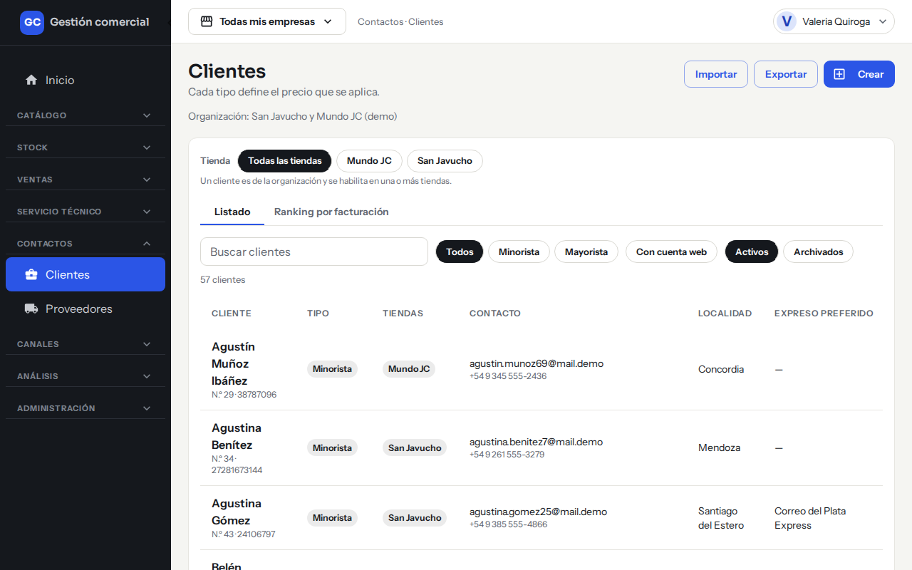
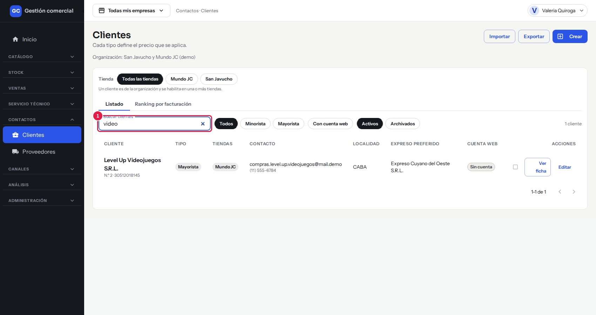
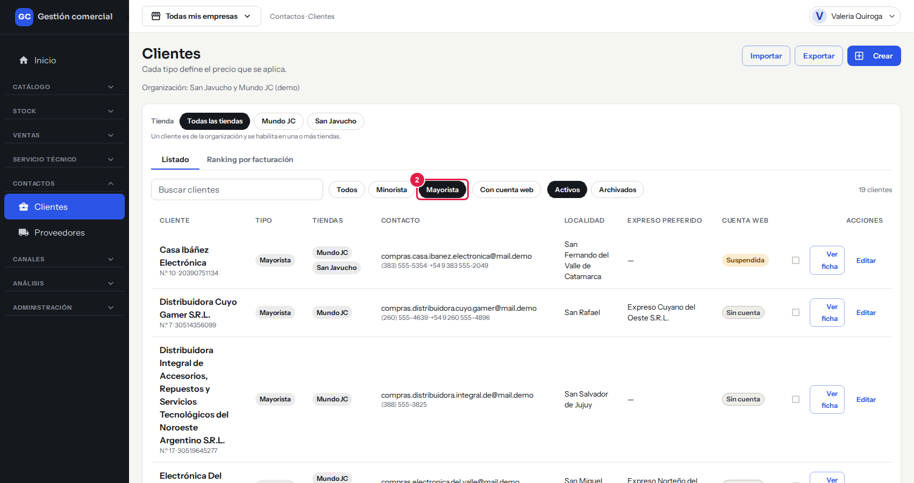
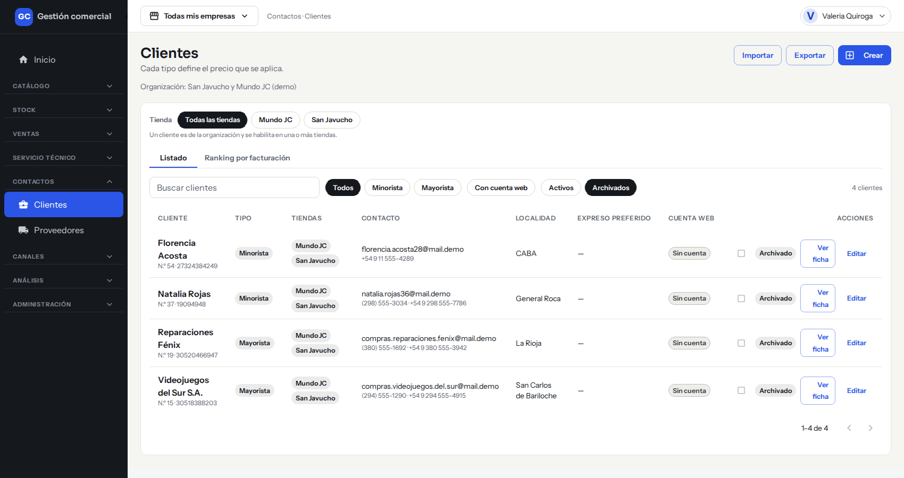
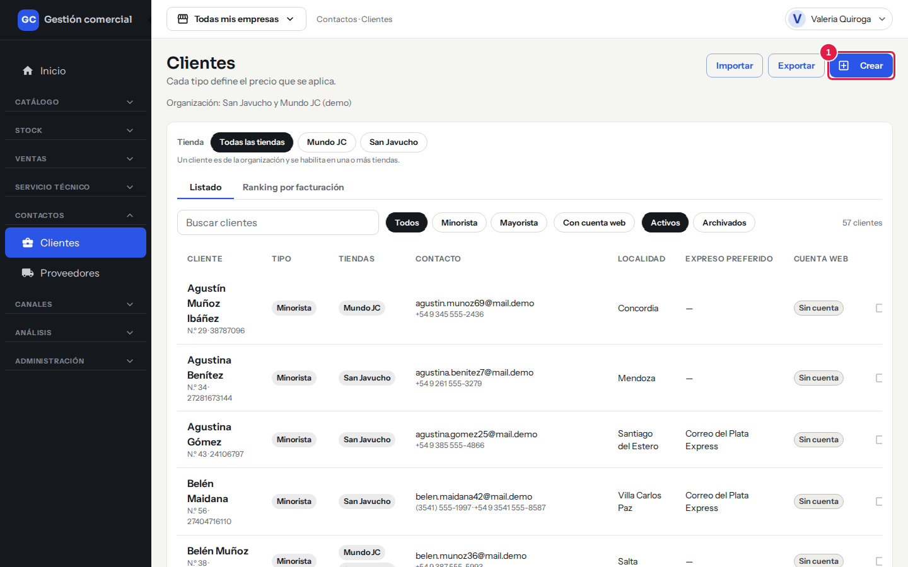
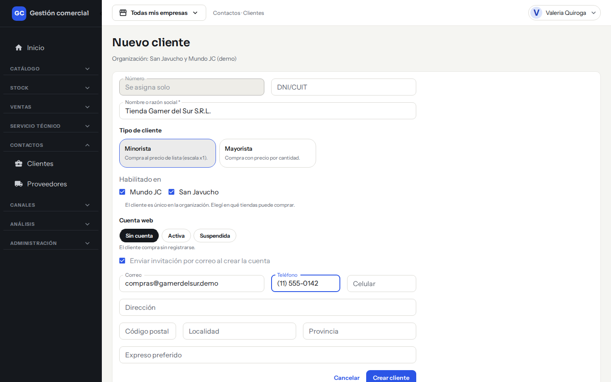
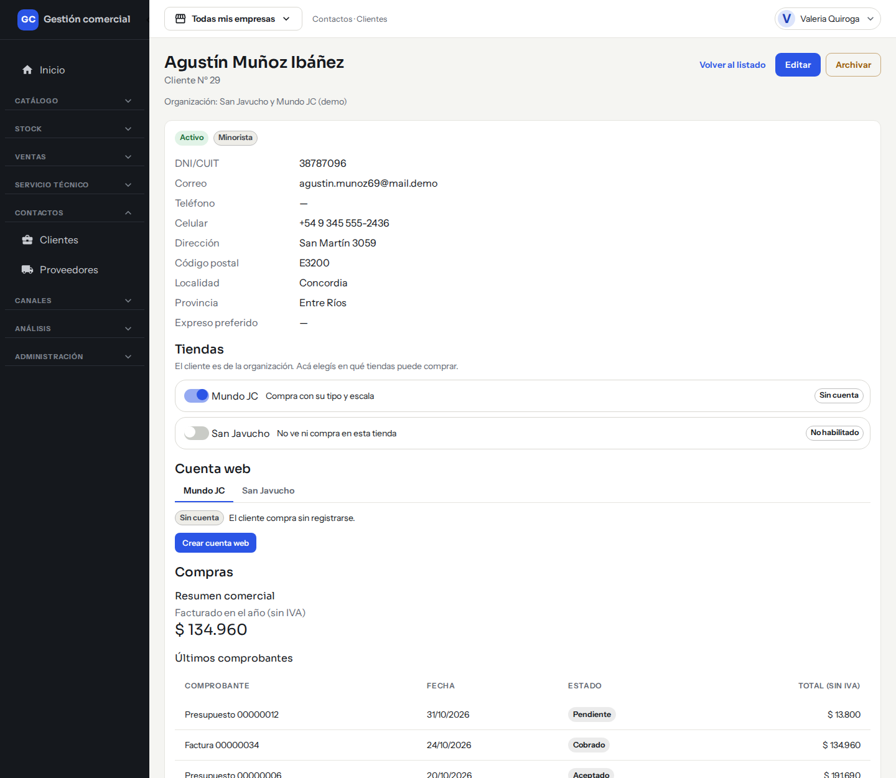
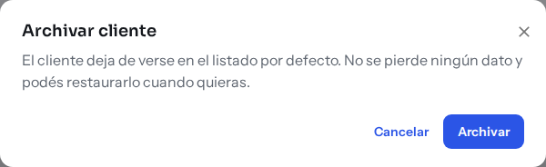
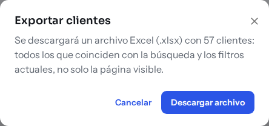
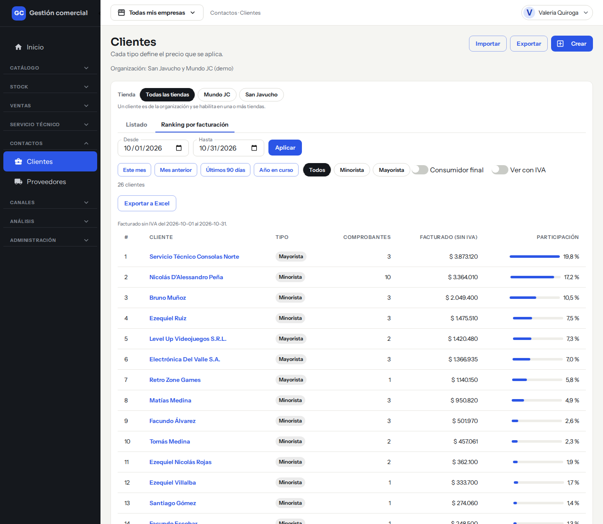

# Clientes

## Para qué sirve

Acá llevás la agenda de tus clientes: sus datos de contacto, su documento, si son minoristas o mayoristas y en qué tiendas pueden comprar. El tipo de cliente define qué precio se le aplica en las ventas. También podés ver cuánto compró cada cliente y quiénes son los que más facturan.

## Quién puede hacerlo

Con los permisos que trae el sistema por defecto (el Administrador puede ajustarlos en [Usuarios y roles](usuarios-y-roles.md)):

| Tarea | Quién |
|---|---|
| Ver el listado, las fichas y el ranking | Administrador, Operador, Mostrador, Administración, Consulta y Técnico |
| Crear, editar, archivar y restaurar clientes | Administrador, Operador, Mostrador y Administración |
| Exportar a Excel | Administrador, Operador y Administración |
| Importar clientes desde otro sistema | Administrador (ver [Migración inicial de datos](migracion-inicial-de-datos.md)) |
| No ve Clientes | Depósito |

## Dónde lo encontrás

En el menú de la izquierda: **Contactos → Clientes**.

*Contactos → Clientes: pestañas Listado y Ranking por facturación, buscador y filtros.*

## El listado

Arriba, a la derecha, están los botones **Importar** (solo Administrador), **Exportar** y **Crear**, según tu rol. Debajo ves dos pestañas: **Listado** y **Ranking por facturación** (esta última, para quienes pueden ver clientes).

### Cómo buscar y filtrar

| Filtro | Qué hace |
|---|---|
| **Tienda** | «Todas las tiendas» o una en particular: muestra los clientes habilitados en esa tienda. |
| **Buscar clientes** | Busca por nombre, DNI/CUIT, correo, teléfono, localidad o número de cliente. Admite partes del texto y no distingue mayúsculas. |
| **Todos / Minorista / Mayorista** | Filtra por tipo de cliente. |
| **Con cuenta web** | Deja solo los clientes con cuenta web activa (ver [Cuenta web del cliente](cuenta-web-cliente.md)). |
| **Activos / Archivados** | «Activos» es lo que ves por defecto. «Archivados» muestra los clientes dados de baja. |

*El buscador, resaltado con el número 1: escribí parte del nombre, documento, correo o teléfono.*

*El filtro de tipo, resaltado con el número 2: aquí solo se ven los mayoristas.*

*Con **Archivados** ves los clientes dados de baja.*

El listado muestra de a 25 clientes por página y cuántos hay en total (por ejemplo, «57 clientes»).

### Qué significa cada columna

| Columna | Qué muestra |
|---|---|
| **Cliente** | Nombre o razón social, y debajo el número de cliente y el DNI/CUIT. |
| **Tipo** | Minorista o Mayorista. |
| **Tiendas** | En qué tiendas está habilitado el cliente. |
| **Contacto** | Correo y teléfonos. |
| **Localidad** | Localidad del cliente. |
| **Expreso preferido** | El transporte que suele usar. |
| **Cuenta web** | Si tiene cuenta para ingresar a las tiendas: Activa, Suspendida o Sin cuenta. |

En cada fila tenés **Ver ficha** y, si podés editar, **Editar**. Los clientes archivados llevan la etiqueta **Archivado**.

## Crear un cliente

1. Entrá a **Contactos → Clientes** y hacé clic en **Crear**.

*Paso 1: el botón **Crear** está arriba a la derecha.*

2. Completá el formulario:
   - **Número**: lo asigna el sistema solo («Se asigna solo»).
   - **DNI/CUIT**: opcional, pero no puede repetirse entre clientes.
   - **Nombre o razón social** (obligatorio).
   - **Tipo de cliente**: **Minorista** (compra al precio de lista, escala x1) o **Mayorista** (compra con precio por cantidad). Ver [Precios e IVA](precios-e-iva.md).
   - **Habilitado en**: las tiendas donde el cliente puede comprar. El cliente es único para todo el negocio.
   - **Cuenta web**: **Sin cuenta**, **Activa** o **Suspendida** (ver [Cuenta web del cliente](cuenta-web-cliente.md)).
   - **Correo**, **Teléfono**, **Celular**, **Dirección**, **Código postal**, **Localidad**, **Provincia** y **Expreso preferido**.
3. Guardá. Vas a ver «Cliente creado» y se abre la ficha del cliente.

*Paso 2: el formulario de alta, con un cliente de ejemplo (todavía sin guardar).*

## Editar un cliente

1. En el listado, hacé clic en **Editar** (o en **Editar** dentro de la ficha).
2. Cambiá lo que necesites y guardá. Vas a ver «Cliente guardado».
3. Si cambiás el **Tipo**, el sistema te avisa: «Al cambiar el tipo, las próximas ventas usarán la escala de precios del nuevo tipo. Lo ya vendido no cambia.»

## La ficha del cliente

Al hacer clic en **Ver ficha** ves el nombre, el número («Cliente Nº …»), el estado (Activo o Archivado), el tipo, y todos los datos de contacto y domicilio. Más abajo:

- **Tiendas** y **Cuenta web**: en qué tiendas puede comprar y el estado de su cuenta.
- **Compras**: un **Resumen comercial** con lo facturado en el año (sin IVA) y los **Últimos comprobantes**, con **Comprobante**, **Fecha**, **Estado** y **Total (sin IVA)**.

Arriba tenés los botones **Editar**, **Archivar** (o **Restaurar**) y **Volver al listado**.

*La ficha de un cliente minorista: datos, tiendas, cuenta web y compras.*

## Consumidor final

El sistema ya trae un cliente llamado **Consumidor final**, de tipo minorista, para vender en el mostrador sin cargar un cliente cada vez. En su ficha aparece como «Cliente de mostrador». No se puede editar ni archivar.

## Archivar y restaurar

Un cliente **no se borra**: se archiva.

1. Abrí la ficha del cliente y hacé clic en **Archivar**.
2. Confirmá en el cuadro «Archivar cliente». El cliente deja de verse en el listado por defecto; no se pierde ningún dato y podés restaurarlo cuando quieras.

*El cuadro de confirmación de **Archivar**.*

3. Para recuperarlo, en el listado elegí el filtro **Archivados**, abrí su ficha y hacé clic en **Restaurar**. Vuelve al listado activo con sus datos y su número.

## Exportar a Excel

1. Poné la búsqueda y los filtros que quieras.
2. Hacé clic en **Exportar**.
3. El sistema te dice cuántos clientes va a exportar: **todos los que coinciden con la búsqueda y los filtros**, no solo los de la página que ves.
4. Hacé clic en **Descargar archivo**. Se baja una planilla de Excel (.xlsx). Mientras se arma ves el avance y podés usar **Cancelar exportación**. Al terminar dice «Listo: el archivo se descargó.»

*Paso 3: el cuadro de **Exportar** avisa cuántos clientes se descargan.*

## Ranking por facturación

En la pestaña **Ranking por facturación** ves quiénes son los clientes que más facturaron en un período.

1. Elegí el período con las fechas **Desde** y **Hasta** y hacé clic en **Aplicar**, o usá los atajos **Este mes**, **Mes anterior**, **Últimos 90 días** o **Año en curso**.
2. Si querés, filtrá por **Todos / Minorista / Mayorista** y por tienda.
3. Activá **Consumidor final** si querés incluirlo (por defecto no está) y **Ver con IVA** si querés los importes con IVA (por defecto, sin IVA).
4. La tabla muestra la posición (**#**), el **Cliente**, el **Tipo**, la cantidad de **Comprobantes**, lo **Facturado** y su **Participación** sobre el total.
5. Con **Exportar a Excel** te llevás el ranking en una planilla.

Si no hubo facturación en esas fechas, ves «Sin facturación en el período».

*La pestaña **Ranking por facturación**.*

## Preguntas frecuentes

**¿Puedo borrar un cliente?** No: se archiva. Así conservás su historial de compras.

**¿Puedo tener dos clientes con el mismo nombre?** Sí, pero no con el mismo DNI/CUIT.

**¿Qué diferencia hay entre minorista y mayorista?** El minorista siempre paga el precio de lista. El mayorista paga según la cantidad que compra (escalas x1, x5, x10 y x50).

**¿Los clientes son de una tienda en particular?** No: el cliente es del negocio y lo habilitás en una o más tiendas con **Habilitado en**.

**¿Dónde cargo la condición de IVA del cliente?** Por ahora la ficha solo guarda el DNI/CUIT; no hay un campo para la condición de IVA.

## Si algo no sale

| Mensaje | Qué significa y qué hacer |
|---|---|
| **Ingresá el nombre o la razón social.** | El nombre es obligatorio. |
| **Ya existe un cliente con ese DNI/CUIT** | Otro cliente (incluso uno archivado) ya usa ese documento. Buscalo con el filtro **Archivados** si no lo ves en el listado. |
| **Ingresá un correo con formato válido.** | Revisá el correo. |
| **No se guardó el cliente** | Lo que escribiste se conserva: probá de nuevo con **Guardar**. |
| **No se puede editar: El Consumidor final es del mostrador y no se edita.** | Ese cliente es fijo. |
| **No encontramos clientes con esos criterios.** | Probá con otro texto o quitá algún filtro. |
| **Todavía no hay clientes cargados.** | Creá el primero con **Crear** o importalos (ver [Migración inicial de datos](migracion-inicial-de-datos.md)). |
| **No pudimos exportar los clientes.** | Usá **Reintentar**. |
| **Tu rol no puede crear clientes / editar clientes.** | Pedile al Administrador que revise tus permisos. |
