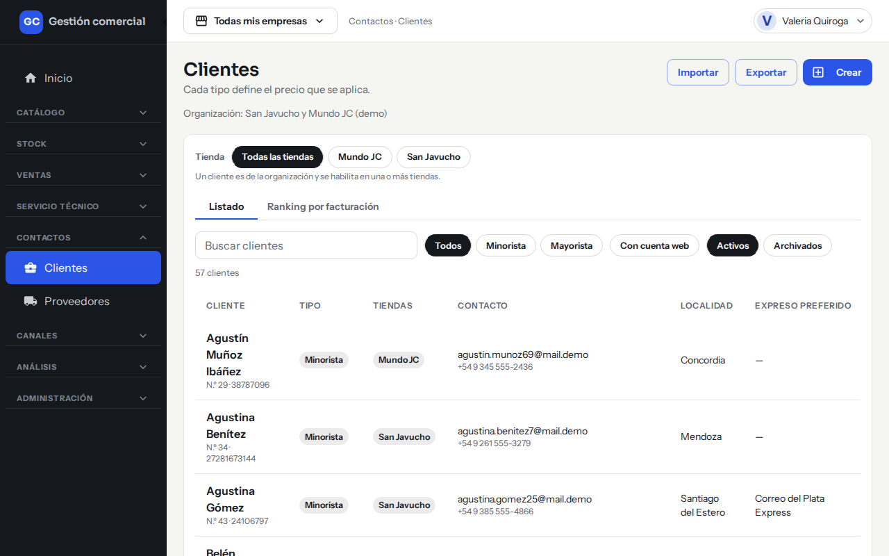
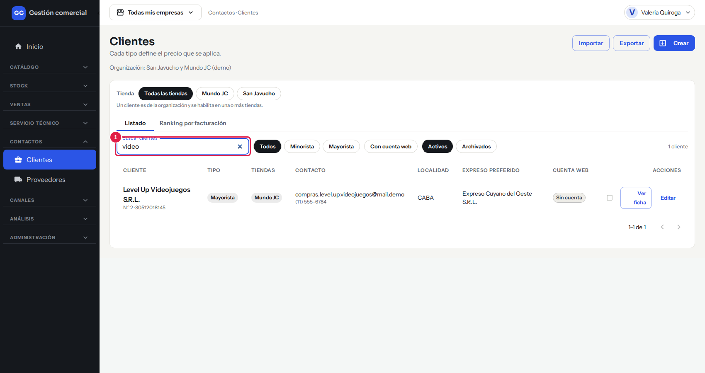
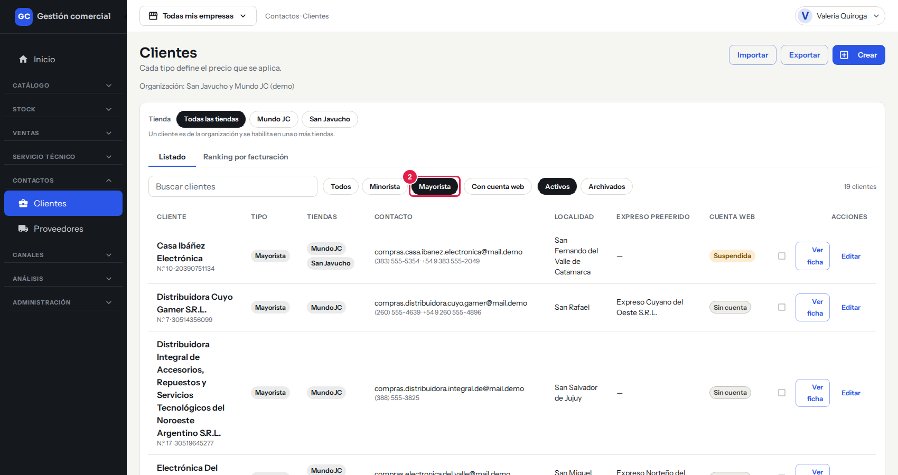
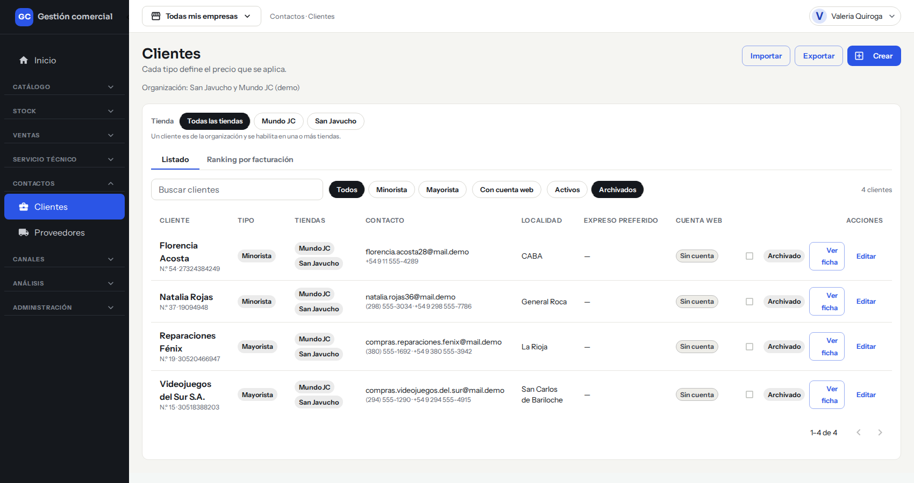
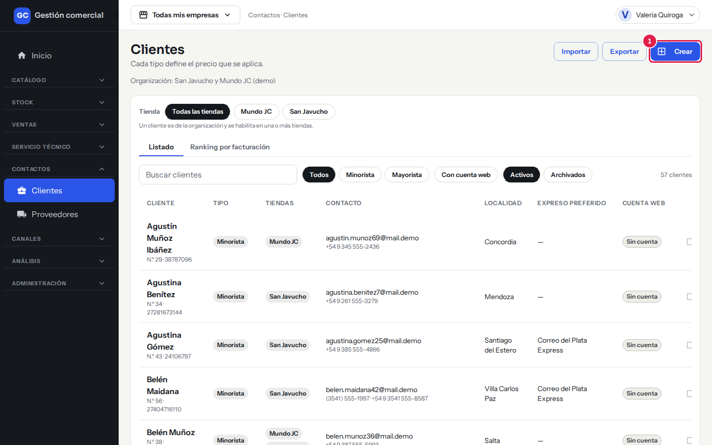
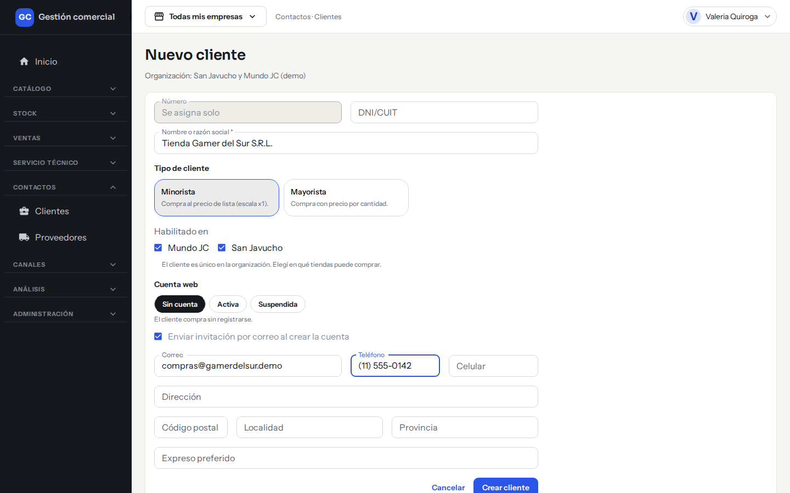
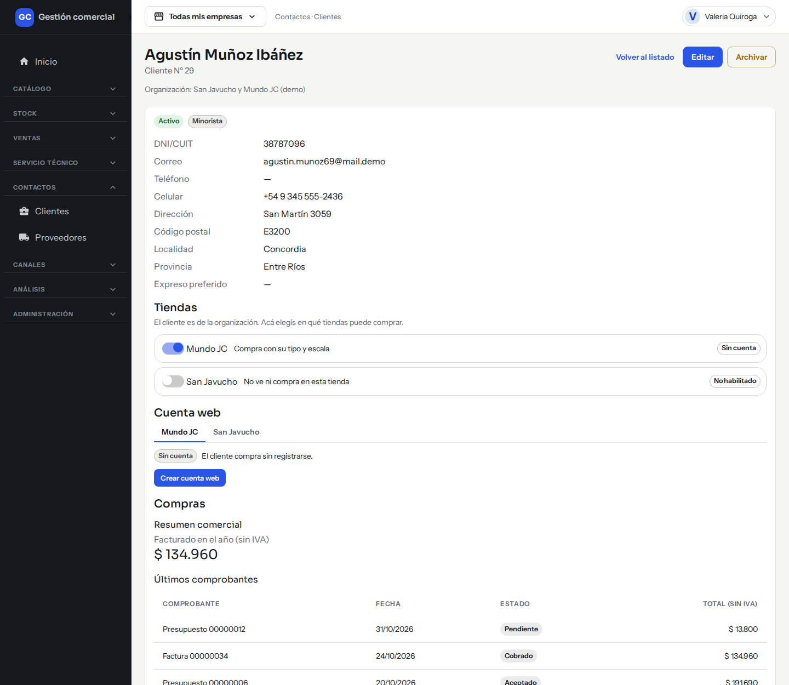
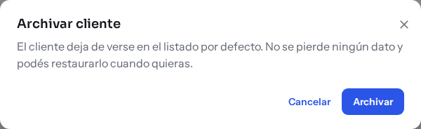
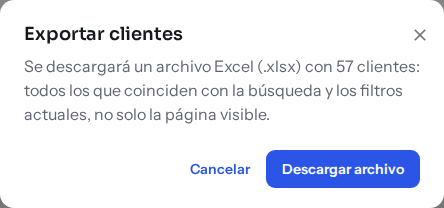
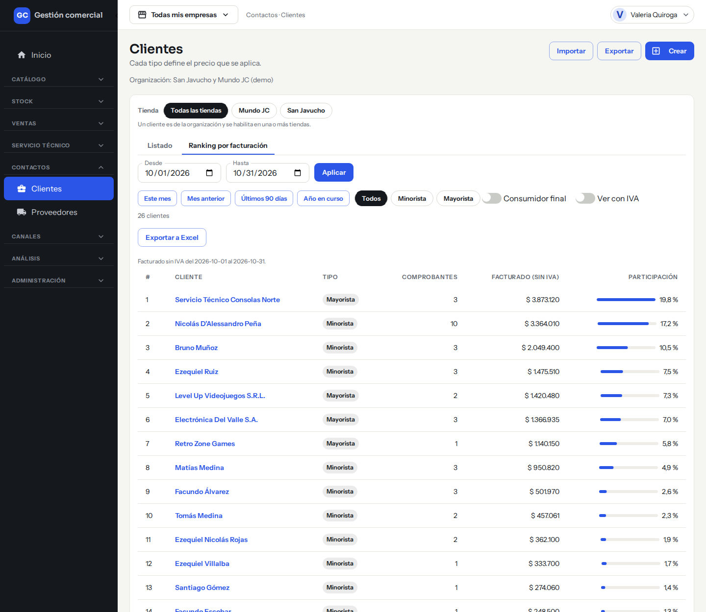

# Clientes

## Para qué sirve

Acá llevás la agenda de tus clientes: sus datos de contacto, su documento, si son minoristas o mayoristas y en qué tiendas pueden comprar. El tipo de cliente define qué precio se le aplica en las ventas. También podés ver cuánto compró cada cliente, cuánto te debe ahora y quiénes son los que más facturan.

## Quién puede hacerlo

Con los permisos que trae el sistema por defecto (el Administrador puede ajustarlos en [Usuarios y roles](usuarios-y-roles.md)):

| Tarea | Quién |
|---|---|
| Ver el listado, las fichas y el ranking | Administrador, Operador, Mostrador, Administración, Consulta y Técnico |
| Ver el **saldo deudor** y la **cuenta corriente** de un cliente | Los mismos que pueden ver la ficha |
| Crear, editar, archivar y restaurar clientes | Administrador, Operador, Mostrador y Administración |
| **Fijar o cambiar el descuento de un cliente** | Administrador |
| Imprimir la etiqueta de envío de un cliente | Cualquiera que pueda ver la ficha |
| Imprimir las etiquetas de varios clientes del listado | Administrador, Operador, Mostrador y Administración |
| Unir dos fichas del mismo cliente | Solo Administrador |
| Exportar a Excel | Administrador, Operador y Administración |
| Importar clientes desde otro sistema | Administrador (ver [Migración inicial de datos](migracion-inicial-de-datos.md)) |
| No ve Clientes | Depósito |

## Dónde lo encontrás

En el menú de la izquierda: **Contactos → Clientes**.

*Contactos → Clientes: pestañas Listado y Ranking por facturación, buscador y filtros.*

## El listado

Arriba, a la derecha, están los botones **Importar** (solo Administrador), **Exportar** y **Crear**, según tu rol. Debajo ves dos pestañas: **Listado** y **Ranking por facturación** (esta última, para quienes pueden ver clientes).

### Cómo buscar y filtrar

| Filtro | Qué hace |
|---|---|
| **Tienda** | «Todas las tiendas» o una en particular: muestra los clientes habilitados en esa tienda. |
| **Buscar clientes** | Busca por nombre, DNI/CUIT, correo, teléfono, localidad o número de cliente. Admite partes del texto y no distingue mayúsculas. |
| **Todos / Minorista / Mayorista** | Filtra por tipo de cliente. |
| **Con cuenta web** | Deja solo los clientes con cuenta web activa (ver [Cuenta web del cliente](cuenta-web-cliente.md)). |
| **Activos / Archivados** | «Activos» es lo que ves por defecto. «Archivados» muestra los clientes dados de baja. |

*El buscador, resaltado con el número 1: escribí parte del nombre, documento, correo o teléfono.*

*El filtro de tipo, resaltado con el número 2: aquí solo se ven los mayoristas.*

*Con **Archivados** ves los clientes dados de baja.*

El listado carga de a 25 clientes y dice cuántos hay en total (por ejemplo, «57 clientes»). Cuando llegás al final se siguen cargando solos, o apretá **Cargar más** al pie. Ver [Cómo se muestran las listas](listados.md).

### Qué significa cada columna

| Columna | Qué muestra |
|---|---|
| **Cliente** | Nombre o razón social, y debajo el número de cliente y el DNI/CUIT. |
| **Tipo** | Minorista o Mayorista. |
| **Tiendas** | En qué tiendas está habilitado el cliente. |
| **Contacto** | Correo y teléfonos. |
| **Localidad** | Localidad del cliente. |
| **Expreso preferido** | El transporte que suele usar. |
| **Cuenta web** | Si tiene cuenta para ingresar a las tiendas: Activa, Suspendida o Sin cuenta. |

En cada fila tenés **Ver ficha** y, si podés editar, **Editar**. Los clientes archivados llevan la etiqueta **Archivado**.

## Crear un cliente

1. Entrá a **Contactos → Clientes** y hacé clic en **Crear**.

*Paso 1: el botón **Crear** está arriba a la derecha.*

2. Completá el formulario:
   - **Número**: lo asigna el sistema solo («Se asigna solo»).
   - **DNI/CUIT**: opcional, pero no puede repetirse entre clientes.
   - **Nombre o razón social** (obligatorio).
   - **Tipo de cliente**: **Minorista** (compra al precio de lista, escala x1) o **Mayorista** (compra con precio por cantidad). Ver [Precios e IVA](precios-e-iva.md).
   - **Habilitado en**: las tiendas donde el cliente puede comprar. El cliente es único para todo el negocio.
   - **Cuenta web**: **Sin cuenta**, **Activa** o **Suspendida** (ver [Cuenta web del cliente](cuenta-web-cliente.md)).
   - **Correo**, **Teléfono**, **Celular**, **Dirección**, **Código postal**, **Localidad**, **Provincia** y **Expreso preferido**.
3. Guardá. Vas a ver «Cliente creado» y se abre la ficha del cliente.

*Paso 2: el formulario de alta, con un cliente de ejemplo (todavía sin guardar).*

## Editar un cliente

1. En el listado, hacé clic en **Editar** (o en **Editar** dentro de la ficha).
2. Cambiá lo que necesites y guardá. Vas a ver «Cliente guardado».
3. Si cambiás el **Tipo**, el sistema te avisa: «Al cambiar el tipo, las próximas ventas usarán la escala de precios del nuevo tipo. Lo ya vendido no cambia.»

## La ficha del cliente

Al hacer clic en **Ver ficha** ves el nombre, el número («Cliente Nº …»), el estado (Activo o Archivado), el tipo, y todos los datos de contacto y domicilio. Más abajo:

- **Tiendas** y **Cuenta web**: en qué tiendas puede comprar y el estado de su cuenta.
- **Compras**: un **Resumen comercial** con lo facturado en el año (sin IVA) y el **Saldo deudor** (lo que el cliente te debe, con IVA), los **Últimos comprobantes** (con **Comprobante**, **Fecha**, **Estado** y **Total (sin IVA)**) y la **Cuenta corriente** (los comprobantes que el cliente tiene abiertos, con lo que se cobró y lo que falta).

Arriba tenés los botones **Editar**, **Archivar** (o **Restaurar**) y **Volver al listado**. También está **Etiqueta**, que abre la hoja de envío del cliente (ver abajo), y, si sos Administrador, **Fusionar con otro cliente…**.

*La ficha de un cliente minorista: datos, tiendas, cuenta web y compras.*

## El saldo del cliente y su cuenta corriente

En la tarjeta **Resumen comercial** de la ficha hay dos números distintos, y conviene no confundirlos:

| Número | Qué es | Con IVA |
|---|---|---|
| **Facturado en el año (sin IVA)** | Lo que el cliente compró en lo que va del año. Es un número de **ventas**, no de deuda. | No |
| **Saldo deudor** | Lo que el cliente te debe **hoy**. Es el número de la **deuda**. | Sí |

Debajo, la tarjeta **Cuenta corriente** lista los comprobantes que el cliente tiene **abiertos**: **Comprobante**, **Fecha**, **Estado**, **Total**, **Cobrado** y **Saldo**, del más reciente al más antiguo.

- El **Saldo deudor** es la suma de los saldos de esa lista. Si el cliente no debe nada, ves `$ 0` y el mensaje «Este cliente no tiene comprobantes con saldo».
- El **Saldo deudor** se pinta de **ámbar** cuando el cliente debe y de **verde** cuando no debe nada.
- En la columna **Estado**, «Deuda» va en ámbar, «Cobrado» en verde y «Armando» en azul; los demás estados van en neutro.

### Qué entra y qué no

- Entra solo lo que está en **factura** y todavía no está saldado. Una factura cobrada por completo, una factura anulada y un borrador **no** son deuda y no aparecen.
- Un **presupuesto** no es deuda: no aparece.
- Una **nota de crédito** todavía **no descuenta** del saldo.
- Si le pagaste de más a un cliente, **no hay saldo a favor**: el saldo queda en `$ 0`.
- El saldo va **con IVA**; el «Facturado en el año» va **sin IVA**. Son dos números distintos y cada uno dice en qué base está.

### De qué tiendas es la deuda

El saldo suma lo que el cliente debe en **las tiendas a las que tenés acceso**, no solo en la tienda de la barra superior. Si sos Administrador, ves la deuda de todas las tiendas; si tu usuario tiene asignada una sola tienda, ves solo la de esa tienda.

### Si la cuenta corriente no carga

Si la base no responde, el bloque muestra «No pudimos cargar la cuenta corriente del cliente.» con un botón **Reintentar** y el **Saldo deudor** queda en «—». El resto de la ficha sigue mostrando los datos del cliente: un error en la cuenta corriente no borra nada.

<!-- TODO (dueño: documentación de producto): capturas de la tarjeta «Resumen comercial» con el «Saldo deudor» y de la tabla «Cuenta corriente» (y de la ficha con el saldo deudor en ámbar) en docs/producto/img/clientes/. No se pudieron generar porque la herramienta de capturas del manual (`pnpm docs:capturas` y `pnpm demo:dataset`) no existe en este repo y el código de la épica todavía no está en `main`; ver la página técnica. La captura `07-ficha-minorista.png` es anterior a la tarjeta y hay que regenerarla. -->

## Descuento por cliente

Un cliente puede tener un **descuento propio**: un porcentaje que se le descuenta del precio de escala en
cada venta. Lo usa el Administrador para no editar los precios línea por línea.

### Fijar el descuento

1. Entrá a **Contactos → Clientes** y abrí la edición del cliente.
2. En el campo **Descuento (%)** escribí el porcentaje (por ejemplo `5`). Va de 0 a 100 y admite hasta
   dos decimales.
3. Guardá. Vas a ver «Cliente guardado».

El campo dice: «Se resta del precio de escala en cada venta. Vacío = sin descuento.»

- El campo **solo le aparece al Administrador**. Con otros roles no se ve y no se puede cambiar.
- Si el valor está mal (fuera de 0 a 100, más de dos decimales o no es un número), el campo avisa:
  «Ingresá un porcentaje entre 0 y 100, con hasta 2 decimales.»
- Para sacarle el descuento, borrá el contenido del campo y guardá: queda **sin descuento**.

### Ver el descuento

En la ficha del cliente, la fila **Descuento** muestra el porcentaje (por ejemplo `5 %`). Si el cliente no
tiene descuento, muestra «—».

### Cómo se aplica en las ventas

- El descuento se resta **del precio de escala** de cada línea, **antes** del IVA.
- Si el cliente es mayorista, primero se aplica la escala por cantidad y después el descuento.
- Si en una línea el precio está **cargado a mano**, ese precio **no** lleva descuento: el precio manual
  es una decisión explícita de quien lo cargó.
- En la línea del comprobante se lee de dónde salió el precio: «escala x1 · 5 % de descuento».
- **Lo ya vendido no cambia**: si después editás el descuento del cliente, las facturas viejas siguen
  con el precio con el que se hicieron. El descuento nuevo se aplica a las ventas siguientes.

Ver más en [Presupuestos y facturas](ventas-comprobantes.md#descuento-por-cliente).

## Imprimir la etiqueta de envío

La etiqueta es la hoja que se pega en el paquete: trae el nombre del cliente, la dirección, el código postal, la localidad, la provincia, el teléfono y el transporte que suele usar.

### Desde la ficha de un cliente

1. Abrí la ficha del cliente.
2. Hacé clic en **Etiqueta** (arriba) o en **Imprimir etiqueta de envío** (más abajo, en el bloque de la ficha).
3. Se abre la hoja **Etiquetas de envío** con una sola etiqueta. Hacé clic en **Imprimir**: se abre el diálogo de impresión del sistema, donde podés elegir la impresora o **Guardar como PDF**.
4. Cuando volvés al listado o a la ficha, el sistema te avisa «Etiqueta enviada a imprimir».

Si el cliente **no tiene dirección cargada**, no se genera la hoja: el sistema te avisa que falta la dirección y te pide que la cargues en **Editar** antes de volver a imprimir.

Si le falta algún dato menos importante (código postal, localidad, provincia, teléfono o transporte), la etiqueta sale igual: ese dato simplemente no se imprime.

### Desde el listado, con varios clientes

1. En **Contactos → Clientes**, marcá la casilla de las filas que querés y, si querés todas las de la página, **Seleccionar todos**.
2. Arriba a la derecha aparece **Imprimir etiquetas (2)** (el número es la cantidad de clientes marcados). Hacé clic.
3. Se abre la hoja **Etiquetas de envío** con una etiqueta por cliente, en el mismo orden en que los marcaste.
4. Hacé clic en **Imprimir** y elegí la impresora o **Guardar como PDF**.

Si alguno de los clientes marcados no tiene dirección, se omite y el sistema lo nombra: «Algunos clientes no tienen etiqueta.» y abajo, por ejemplo, «Pérez, Juan (falta dirección)». Si **ninguno** de los marcados tiene dirección, no se genera ninguna hoja.

Si cambiás la empresa activa de la barra superior con la selección hecha, la selección se descarta y el listado se recarga: volvé a marcar los clientes.

## Unir dos fichas del mismo cliente

A veces el mismo cliente quedó cargado dos veces (por ejemplo, una con el nombre y otra con el nombre y el apellido). Esta función **une las dos fichas en una sola**, sin perder el historial.

Solo el **Administrador** puede hacerlo, y **no se puede deshacer**.

1. Abrí la ficha del cliente que querés conservar y hacé clic en **Fusionar con otro cliente…**.
2. En el cuadro **Fusionar clientes**, buscá el otro cliente y elegilo.
3. El sistema te muestra cuántas compras tiene cada uno y **qué ficha se conserva**. Elegí con las opciones **Ficha que se conserva**.
4. Si **los dos clientes tienen cuenta web activa**, el sistema te pide que elijas **cuál cuenta web se mantiene**; la que no elijas se da de baja. Tenés que elegir una para poder seguir.
5. Hacé clic en **Fusionar clientes**.

Qué pasa después:

- La ficha que se conserva suma las compras de las dos (por ejemplo, si una tenía 3 y la otra 5, quedan 8).
- La ficha que se descartó **queda archivada**, no se borra: conserva sus datos y se puede ver con el filtro **Archivados**.
- El sistema registra el movimiento en **Actividad**.

Si algo no sale:

| Mensaje | Qué significa y qué hacer |
|---|---|
| «Solo el Administrador puede fusionar clientes» | La acción es del Administrador; pedile que la haga |
| «No se puede fusionar un cliente consigo mismo» | Elegí otro cliente distinto |
| «Alguno de los clientes no existe» | La ficha elegida no está; buscá otro |
| «Alguno de los clientes ya está archivado (¿la fusión ya se hizo?)» | Una de las dos fichas ya fue archivada; elegí otra |
| «Los dos clientes tienen cuenta web activa: elegí cuál se mantiene» | Elegí con qué cuenta web te quedás en el paso 4 |
| «No pudimos fusionar los clientes. No se cambió nada; probá de nuevo.» | No se movió nada; reintentá |

!!! note "Lo que no se une"
    La función une **las compras** y **la cuenta web**. Los datos de ficha (nombre, DNI/CUIT, dirección, teléfono) de cada cliente se quedan donde estaban: el que se descarta queda archivado con los suyos.

## Consumidor final

El sistema ya trae un cliente llamado **Consumidor final**, de tipo minorista, para vender en el mostrador sin cargar un cliente cada vez. En su ficha aparece como «Cliente de mostrador». No se puede editar ni archivar.

## Archivar y restaurar

Un cliente **no se borra**: se archiva.

1. Abrí la ficha del cliente y hacé clic en **Archivar**.
2. Confirmá en el cuadro «Archivar cliente». El cliente deja de verse en el listado por defecto; no se pierde ningún dato y podés restaurarlo cuando quieras.

*El cuadro de confirmación de **Archivar**.*

3. Para recuperarlo, en el listado elegí el filtro **Archivados**, abrí su ficha y hacé clic en **Restaurar**. Vuelve al listado activo con sus datos y su número.

## Exportar a Excel

1. Poné la búsqueda y los filtros que quieras.
2. Hacé clic en **Exportar**.
3. El sistema te dice cuántos clientes va a exportar: **todos los que coinciden con la búsqueda y los filtros**, no solo los que ya cargaste.
4. Hacé clic en **Descargar archivo**. Se baja una planilla de Excel (.xlsx). Mientras se arma ves el avance y podés usar **Cancelar exportación**. Al terminar dice «Listo: el archivo se descargó.»

*Paso 3: el cuadro de **Exportar** avisa cuántos clientes se descargan.*

## Ranking por facturación

En la pestaña **Ranking por facturación** ves quiénes son los clientes que más facturaron en un período.

1. Elegí el período con las fechas **Desde** y **Hasta** y hacé clic en **Aplicar**, o usá los atajos **Este mes**, **Mes anterior**, **Últimos 90 días** o **Año en curso**.
2. Si querés, filtrá por **Todos / Minorista / Mayorista** y por tienda.
3. Activá **Consumidor final** si querés incluirlo (por defecto no está) y **Ver con IVA** si querés los importes con IVA (por defecto, sin IVA).
4. La tabla muestra la posición (**#**), el **Cliente**, el **Tipo**, la cantidad de **Comprobantes**, lo **Facturado** y su **Participación** sobre el total.
5. Con **Exportar a Excel** te llevás el ranking en una planilla.

Si no hubo facturación en esas fechas, ves «Sin facturación en el período».

*La pestaña **Ranking por facturación**.*

## Preguntas frecuentes

**¿Cuál es la diferencia entre «Facturado en el año» y «Saldo deudor»?** «Facturado en el año» es lo que el cliente compró en el año (sin IVA); el «Saldo deudor» es lo que te debe hoy (con IVA). Un cliente puede haber comprado mucho y no deberte nada.

**¿Por qué no coinciden con los «Últimos comprobantes»?** «Últimos comprobantes» muestra los últimos documentos del cliente, estén abiertos o no (incluye presupuestos y anuladas). El saldo solo cuenta las **facturas con saldo pendiente**.

**¿Las notas de crédito descuentan del saldo?** Todavía no: la nota de crédito no se descuenta de la cuenta corriente.

**¿Le puedo descontar un saldo a favor?** No hay saldo a favor: si le pagaste de más, el saldo se muestra en `$ 0`.

**¿El saldo es de una tienda o de todas?** De todas las tiendas a las que tenés acceso. No depende de la tienda que tengas elegida en la barra superior.

**¿Puedo borrar un cliente?** No: se archiva. Así conservás su historial de compras.

**¿Puedo tener dos clientes con el mismo nombre?** Sí, pero no con el mismo DNI/CUIT.

**¿Qué diferencia hay entre minorista y mayorista?** El minorista siempre paga el precio de lista. El mayorista paga según la cantidad que compra (escalas x1, x5, x10 y x50).

**¿Los clientes son de una tienda en particular?** No: el cliente es del negocio y lo habilitás en una o más tiendas con **Habilitado en**.

**¿Dónde cargo la condición de IVA del cliente?** Por ahora la ficha solo guarda el DNI/CUIT; no hay un campo para la condición de IVA.

**¿Se puede deshacer una unión de dos clientes?** No. La ficha que se descarta queda archivada con todos sus datos, pero las compras ya están en la ficha que se conserva.

**¿La etiqueta se puede guardar como PDF?** Sí: en el diálogo de impresión elegí «Guardar como PDF» en el destino.

**¿Por qué no imprime la etiqueta de un cliente?** Le falta la dirección. Cargala en **Editar** y volvé a imprimir.

## Si algo no sale

| Mensaje | Qué significa y qué hacer |
|---|---|
| **Ingresá el nombre o la razón social.** | El nombre es obligatorio. |
| **Ya existe un cliente con ese DNI/CUIT** | Otro cliente (incluso uno archivado) ya usa ese documento. Buscalo con el filtro **Archivados** si no lo ves en el listado. |
| **Ingresá un correo con formato válido.** | Revisá el correo. |
| **No se guardó el cliente** | Lo que escribiste se conserva: probá de nuevo con **Guardar**. |
| **No se puede editar: El Consumidor final es del mostrador y no se edita.** | Ese cliente es fijo. |
| **No encontramos clientes con esos criterios.** | Probá con otro texto o quitá algún filtro. |
| **Todavía no hay clientes cargados.** | Creá el primero con **Crear** o importalos (ver [Migración inicial de datos](migracion-inicial-de-datos.md)). |
| **No pudimos exportar los clientes.** | Usá **Reintentar**. |
| **Tu rol no puede crear clientes / editar clientes.** | Pedile al Administrador que revise tus permisos. |
| **No se puede imprimir la etiqueta: falta dirección.** | Cargá la dirección del cliente en **Editar** y probá de nuevo. |
| **Algunos clientes no tienen etiqueta.** | A esos clientes les falta la dirección: el sistema los nombra y arma la hoja solo con los que la tienen. |
| **No hay clientes para imprimir.** | Volvé al listado y marcá al menos un cliente con dirección. |
| **No pudimos fusionar los clientes. No se cambió nada; probá de nuevo.** | No se movió nada: reintentá. |
| **No pudimos cargar la cuenta corriente del cliente.** | No se pudo leer la deuda del cliente. Tocá **Reintentar**: el resto de la ficha sigue visible y el **Saldo deudor** queda en «—». |
