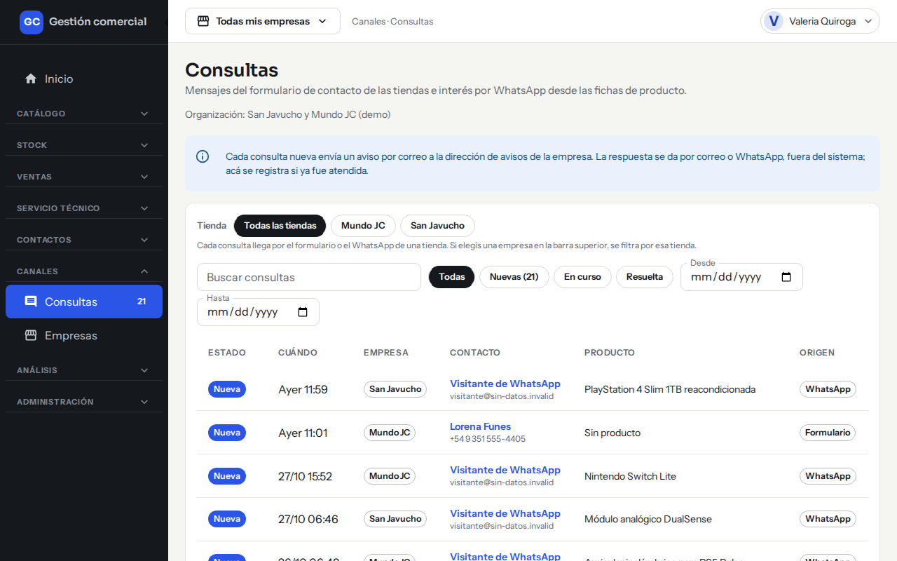
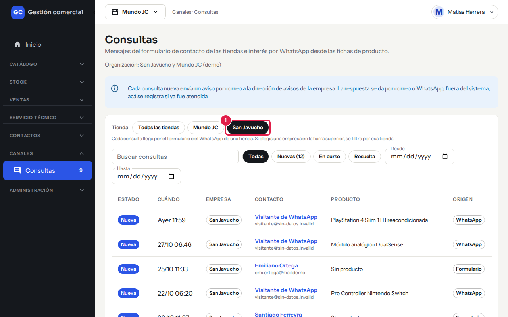
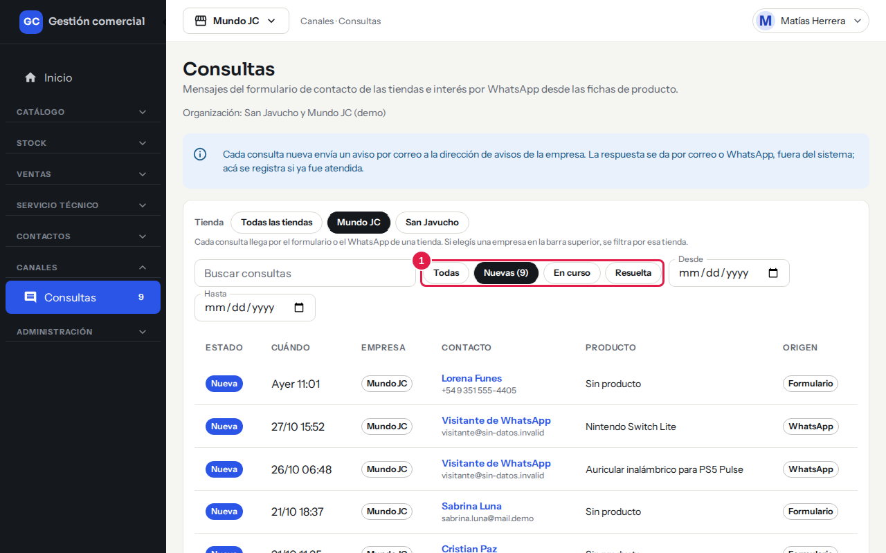
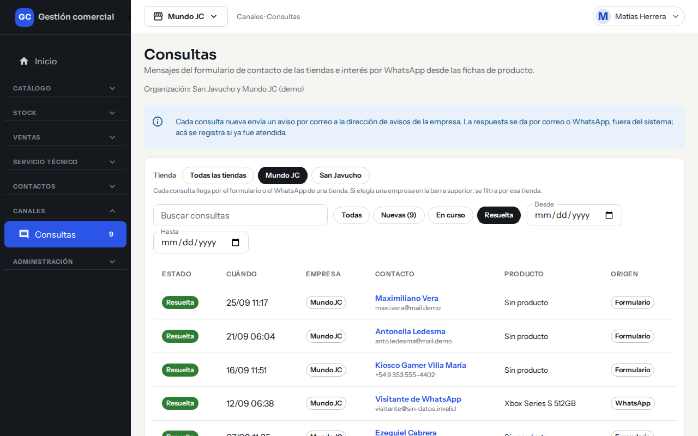
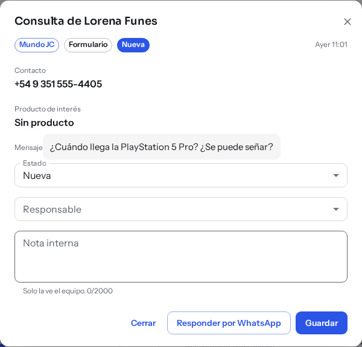
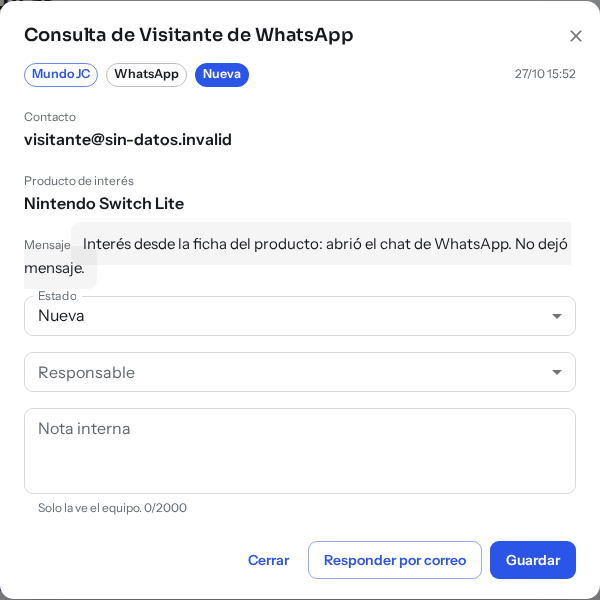
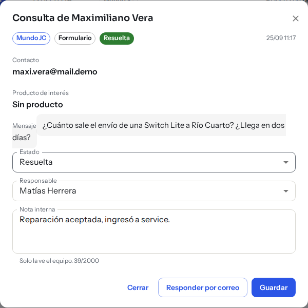

# Consultas de las tiendas online

## Para qué sirve

Cuando alguien te escribe desde la tienda online, el mensaje llega acá. La bandeja de Consultas junta todo en un solo lugar para que el equipo sepa qué consultas llegaron, quién se está ocupando y cuáles ya se resolvieron.

## Qué es una consulta

Hay dos formas de que llegue una:

- **Formulario**: la persona completó el formulario de contacto de la tienda con su nombre, un dato de contacto y un mensaje.
- **WhatsApp**: la persona tocó el botón de WhatsApp de un producto en la tienda. Queda registrado el producto que le interesaba, aunque no haya dejado mensaje.

Las respuestas **se dan por fuera del sistema**, por correo o por WhatsApp. En Consultas solo registrás si ya fue atendida.

## Quién puede hacerlo

| Rol | Qué puede hacer |
|---|---|
| Quien tiene permiso de edición en Consultas | Ver todo, asignar responsable, cambiar el estado, anotar y responder. |
| Quien tiene solo lectura | Ve la bandeja y el detalle, sin cambiar nada («Solo lectura: tu rol puede ver las consultas pero no cambiarlas.»). |

El Administrador define el permiso de cada rol en **Administración → Roles y permisos**. Si tu rol no incluye Consultas, no vas a ver la opción en el menú.

## Dónde lo encontrás

Menú lateral **Canales → Consultas**. Al lado del nombre aparece el número de consultas nuevas sin atender.

*La bandeja de Consultas, con datos de ejemplo.*

## Cómo se ve la bandeja

Cada fila es una consulta, de la más nueva a la más vieja (25 por página).

| Columna | Qué muestra |
|---|---|
| **Estado** | Nueva, En curso o Resuelta. |
| **Cuándo** | Día y hora en que llegó. |
| **Empresa** | La tienda a la que le escribieron. |
| **Contacto** | El nombre (hacé clic para abrir la consulta) y su correo o teléfono. |
| **Producto** | El producto de interés, o «Sin producto». |
| **Origen** | Formulario o WhatsApp. |

## Filtrar y buscar

- **Tienda**: «Todas las tiendas» o una en particular. También se filtra con la empresa elegida en la barra superior.

*Elegí una tienda (1) para ver solo sus consultas.*

- **Buscar consultas**: escribí parte del nombre, del producto o del mensaje.
- **Todas / Nuevas / En curso / Resuelta**: filtra por estado. En «Nuevas» ves entre paréntesis cuántas hay.

*Con «Nuevas» (1) ves solo las que nadie tomó.*

*Con «Resuelta» ves las que ya fueron atendidas.*

- **Desde** y **Hasta**: acotan por fecha.

Si no hay coincidencias ves «Sin resultados para el filtro». Si todavía no llegó ninguna, «Todavía no hay consultas».

## Atender una consulta

1. Hacé clic en el nombre de la persona para abrir la consulta. Se abre una ventana con la tienda, el origen, el estado, el contacto, el producto de interés y el mensaje.

*Una consulta del formulario: tiene mensaje y el botón para responder por WhatsApp, porque dejó un teléfono.*

*Una consulta de WhatsApp: muestra el producto que le interesaba y no trae mensaje propio.*

2. En **Responsable** elegí quién se ocupa, o «Sin responsable».
3. En **Estado** elegí Nueva, En curso o Resuelta.
4. En **Nota interna** anotá lo que el equipo necesite saber. Solo la ve el equipo, nunca la persona que escribió.
5. Hacé clic en **Guardar**.

### Responder desde la consulta

Si el contacto es un correo o un teléfono, aparece el botón **Responder por correo** o **Responder por WhatsApp**. Se abre tu aplicación de correo o WhatsApp con un mensaje inicial. El sistema no envía nada por vos: mandás el mensaje desde esa aplicación.

Al responder, una consulta Nueva pasa a **En curso** y, si no tenía responsable, queda a tu nombre. Una consulta En curso o Resuelta conserva su estado.

## Avisos de consultas nuevas

Cada consulta nueva genera un aviso por correo para las personas que tienen acceso a Consultas y mantienen activado el aviso «Consulta nueva». Si llegan varias seguidas, se juntan en un solo correo. Cada persona activa o desactiva este aviso desde su cuenta; mirá [Avisos y listas configurables](avisos-y-listas.md).

## Estados

En la bandeja se usan tres estados:

| Estado | Cuándo usarlo |
|---|---|
| **Nueva** | Llegó y nadie la tomó. |
| **En curso** | Alguien se está ocupando. |
| **Resuelta** | Ya fue atendida. |

*Una consulta resuelta: queda con su responsable y la nota interna del equipo.*

El Administrador también tiene una lista de estados de consulta en **Administración → Listas configurables**. Por ahora los cambios que hagas ahí no modifican estos tres estados de la bandeja.

## Si algo no sale

| Mensaje | Qué hacer |
|---|---|
| «La consulta cambió.» | Otra persona la modificó mientras la editabas. Hacé clic en **Recargar** y volvé a cargar tus cambios. |
| «No se guardó la consulta.» / «No pudimos guardar la consulta. Intentá de nuevo.» | Reintentá; si sigue, recargá la página. |
| «No se registró la respuesta.» | Se abrió tu aplicación, pero el cambio de estado no quedó guardado. Hacé clic en **Reintentar**. |
| «No encontramos esa consulta o no tenés acceso a ella.» | El enlace es viejo o es de otra tienda a la que no tenés acceso. |
| «No pudimos cargar las consultas.» | Hacé clic en **Reintentar**. |
