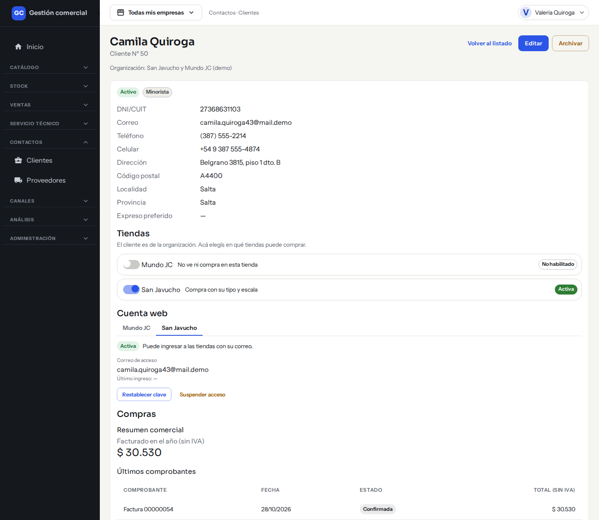
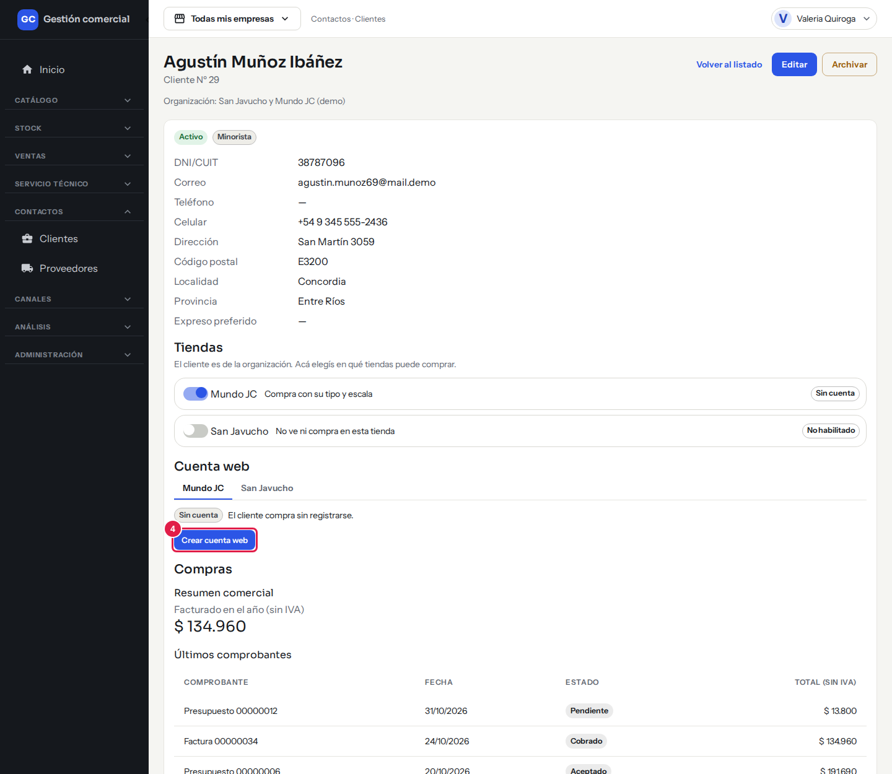
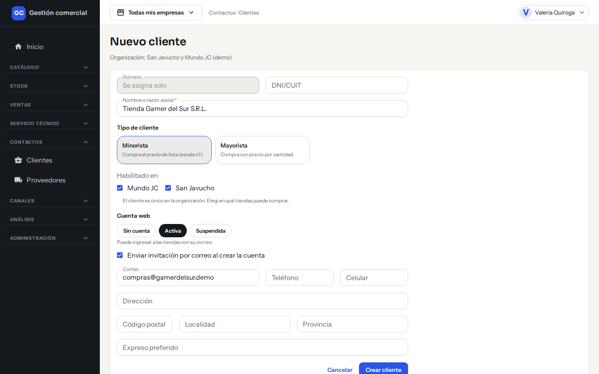
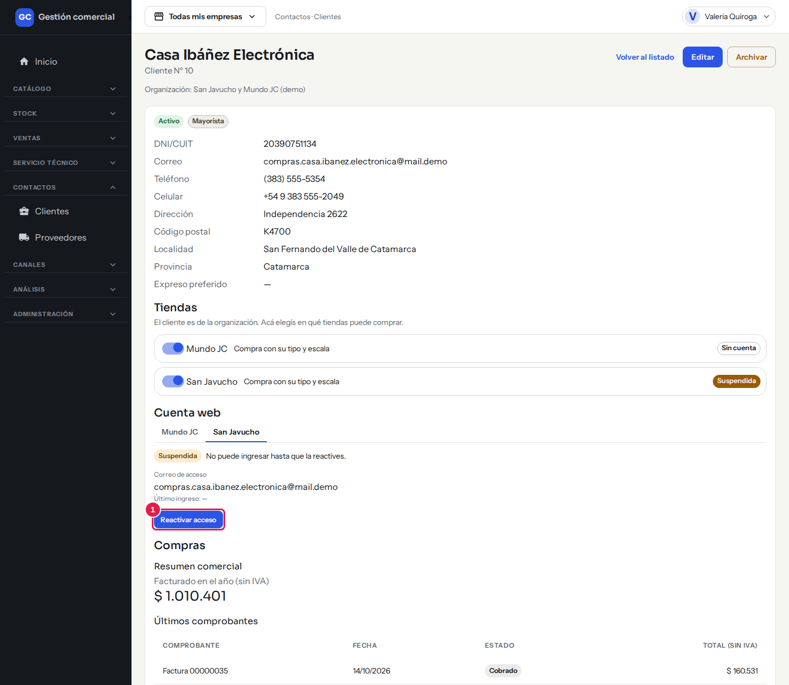
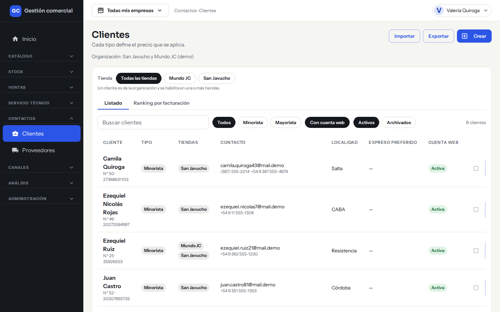
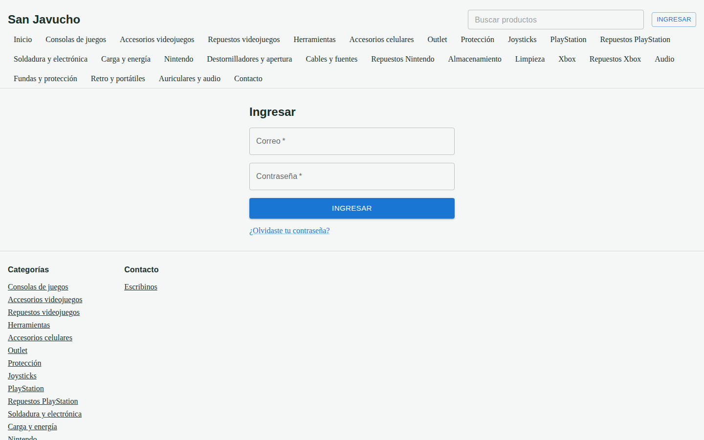

# La cuenta web de un cliente

## Para qué sirve

La cuenta web le permite a un cliente **ingresar a tu tienda online con su correo y su contraseña** y ver los precios que le corresponden (por ejemplo, los precios por cantidad de un mayorista). Vos creás la cuenta desde la ficha del cliente, y el cliente recibe un correo para elegir su contraseña. No hay registro libre: sin invitación tuya, nadie puede crearse una cuenta.

## Quién puede hacerlo

Con los permisos que trae el sistema por defecto:

| Tarea | Quién |
|---|---|
| Crear la cuenta, suspenderla, reactivarla, restablecer la clave y habilitar tiendas | Administrador, Operador, Mostrador y Administración |
| Ver el estado de la cuenta (sin cambiarla) | Consulta y Técnico |
| No ven Clientes | Depósito |

## Cómo funciona

- Cada cliente puede tener **una cuenta por tienda**. Usa su correo y **la misma contraseña** en las tiendas donde su cuenta esté activa.
- Para que un cliente pueda ingresar a una tienda, tiene que estar **habilitado** en esa tienda y su cuenta tiene que estar **activa**.
- La cuenta web **no es un usuario del sistema**: el cliente no puede entrar al sistema de gestión, solo a la tienda.
- El correo de acceso es el **Correo** que tenga cargado el cliente en su ficha. Sin correo no se puede crear la cuenta.
- Un mismo correo no puede ser a la vez de un usuario del sistema y de un cliente.

### Estados de la cuenta

| Estado | Qué significa | Qué podés hacer |
|---|---|---|
| **Activa** | Puede ingresar a las tiendas con su correo. | **Restablecer clave** o **Suspender acceso** |
| **Suspendida** | No puede ingresar hasta que la reactives. | **Reactivar acceso** |
| **Sin cuenta** | El cliente compra sin registrarse. | **Crear cuenta web** |
| **No habilitado** | El cliente no puede comprar en esa tienda. | **Habilitar en** esa tienda |

*En la ficha, cada tienda muestra el estado de la cuenta: aquí **Activa** en San Javucho y **No habilitado** en Mundo JC.*

## Crear la cuenta web de un cliente

### Desde la ficha del cliente

1. Entrá a **Contactos → Clientes** y abrí la ficha del cliente con **Ver ficha**.
2. En el bloque **Tiendas**, verificá que el interruptor **Habilitado en la tienda** esté activado para la tienda que corresponda. Si está apagado, el cliente no ve ni compra en esa tienda.
3. En el bloque **Cuenta web**, elegí la pestaña de la tienda.
4. Hacé clic en **Crear cuenta web**. Si el botón está apagado y dice «Cargá un correo para crear la cuenta», primero editá el cliente y cargale un correo.

*Paso 4: en el bloque **Cuenta web**, el botón **Crear cuenta web** de la tienda elegida.*

5. Vas a ver «Cuenta creada en <Tienda>: se envió el enlace para definir la clave». El cliente recibe un correo con un enlace para elegir su contraseña.

### Al crear o editar el cliente

En el formulario del cliente, el campo **Cuenta web** tiene tres opciones: **Sin cuenta**, **Activa** y **Suspendida**.

1. En **Habilitado en** marcá las tiendas donde el cliente puede comprar.
2. En **Cuenta web** elegí **Activa**.
3. Dejá tildada la casilla **Enviar invitación por correo al crear la cuenta** si querés que el cliente reciba el correo ahora. Si la destildás, la cuenta se crea sin mandar el correo.
4. Guardá el cliente. La cuenta se crea en cada tienda marcada. Vas a ver «Cliente creado · invitación enviada».

*El formulario del cliente con **Cuenta web** en **Activa** y la invitación por correo tildada.*

Si el cliente se guarda pero falla la cuenta en alguna tienda, lo vas a ver en un aviso («no se pudo crear la cuenta web en N tiendas») y podés repetirlo desde la ficha.

## Suspender, reactivar y restablecer la clave

Estas acciones se hacen en la ficha del cliente, en **Cuenta web**, con la pestaña de la tienda.

- **Suspender acceso**: el cliente no puede ingresar a esa tienda. Se aplica enseguida, aunque tenga la sesión abierta. Aviso: «Cuenta web suspendida en <Tienda>».
- **Reactivar acceso**: el cliente vuelve a poder ingresar. Aviso: «Cuenta web reactivada en <Tienda>».

*Una cuenta **Suspendida**: el cliente no puede ingresar hasta que usés **Reactivar acceso**.*

- **Restablecer clave**: le llega un correo con un enlace para elegir una contraseña nueva. Aviso: «Enlace para definir una nueva clave enviado».

Para cambiar las tiendas donde el cliente puede comprar, usá el interruptor **Habilitado en la tienda** del bloque **Tiendas**. Deshabilitar una tienda **no borra la cuenta**: el estado pasa a «No habilitado» y, al volver a habilitarla, la cuenta recupera su estado anterior.

En la ficha también ves el **Correo de acceso** y el **Último ingreso** del cliente a la tienda. En el listado de Clientes, la columna **Cuenta web** resume el estado, y el filtro **Con cuenta web** deja solo los clientes con cuenta activa.

*Con el filtro **Con cuenta web** el listado muestra solo los clientes con cuenta activa.*

## Qué ve el cliente

1. **Define su contraseña.** Abre el enlace del correo, escribe una **Nueva contraseña** que cumpla las reglas que se muestran en pantalla, la confirma y hace clic en **Guardar y entrar**. Si el enlace venció o ya se usó, le sale «El enlace venció o ya se usó. Pedí uno nuevo para continuar.» con un enlace a **Recuperar contraseña**.
2. **Ingresa.** En la tienda, hace clic en **Ingresar**, escribe su **Correo** y su **Contraseña**. Después de entrar, el encabezado muestra **Salir**.

*La pantalla de ingreso de la tienda que ve el cliente.*

3. **Si se olvida la contraseña**, hace clic en **¿Olvidaste tu contraseña?**, escribe su correo y recibe un enlace para elegir una nueva. La tienda siempre responde lo mismo («Si existe una cuenta para ese correo en esta tienda, enviamos un enlace…»), exista o no la cuenta.
4. **Ve sus precios.** Un cliente **minorista** ve su precio en la ficha de cada producto («Tu precio»). Un cliente **mayorista** ve «Tus precios por cantidad», con el precio de cada tramo: 1 a 4, 5 a 9, 10 a 49 y 50 o más unidades. Si un precio no se puede calcular, dice «Consultar».
5. En el catálogo, las tarjetas de producto muestran el precio de lista para todos.

Quien no tiene cuenta, o la tiene suspendida, sigue viendo los precios públicos de la tienda. La tienda no cobra ni tiene carrito: la cuenta sirve para ver los precios que le corresponden.

## Casos comunes

- **Un cliente dice que no puede ingresar.** Revisá en su ficha que esté **Habilitado en la tienda**, que la cuenta esté **Activa** (no **Suspendida**) y que el correo de acceso sea el que usa. Si dudás, usá **Restablecer clave**.
- **Quiero que un cliente deje de ver precios de mayorista.** Cambiale el **Tipo** a Minorista en su ficha (ver [Clientes](clientes.md)); rige desde la próxima vez que abra la tienda.
- **El cliente no recibió el correo.** Pedile que revise la carpeta de correo no deseado, y si hace falta usá **Restablecer clave** para enviarlo de nuevo.

## Si algo no sale

| Mensaje | Qué significa y qué hacer |
|---|---|
| **Correo o contraseña incorrectos.** | El cliente escribió mal los datos, o su cuenta no está activa en esa tienda. Por seguridad la tienda no aclara cuál de las dos cosas pasó. |
| **Cargá un correo para crear la cuenta.** | Editá el cliente y cargá su correo. |
| **No tenés permiso para gestionar cuentas web de esta tienda.** | Tu rol no puede hacerlo. Pedile ayuda al Administrador. |
| **Las contraseñas no coinciden.** | El cliente tiene que escribir la misma contraseña en las dos casillas. |
| **No pudimos completar la operación.** | Probá de nuevo. Si el correo ya está en uso por un usuario del sistema, la invitación no se puede enviar: usá otro correo. |
| **Cliente creado · no se pudo crear la cuenta web en N tiendas** | El cliente quedó guardado pero falló la cuenta. Abrí su ficha y usá **Crear cuenta web** en esa tienda. |

Por ahora, el cliente no puede ver su historial de compras ni cambiar su correo desde la tienda.
