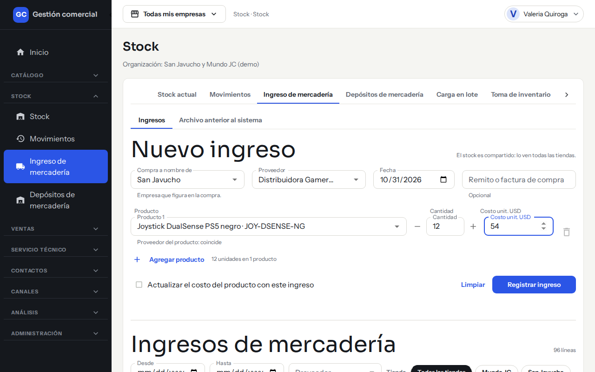
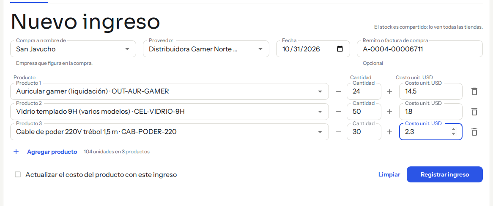
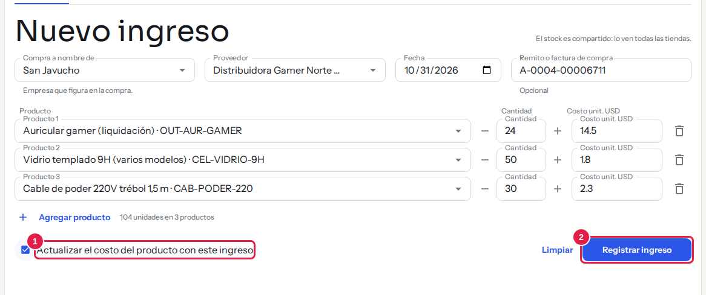
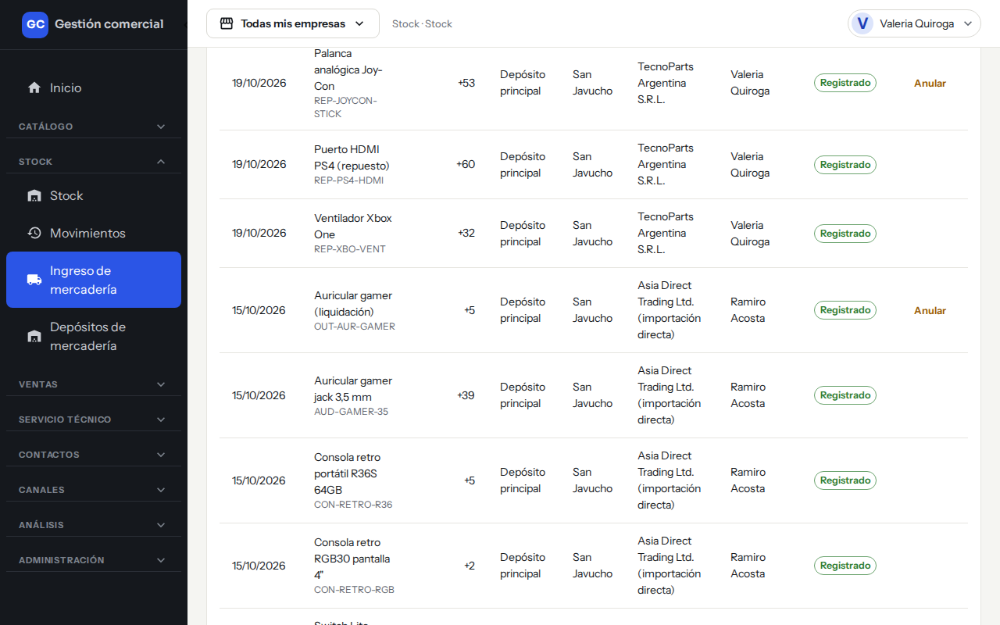
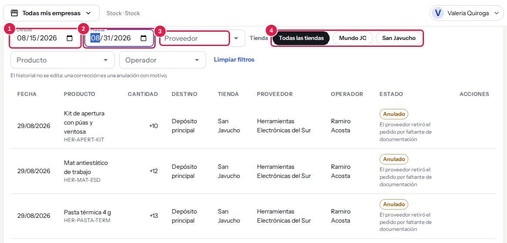
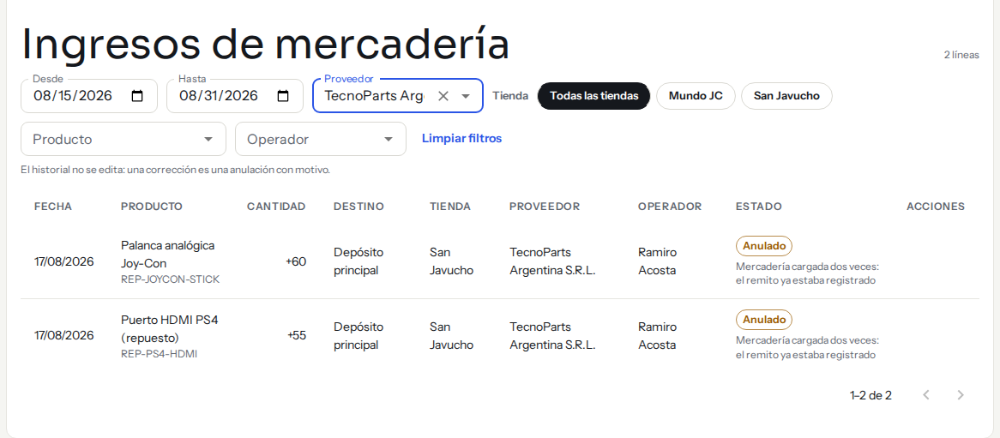
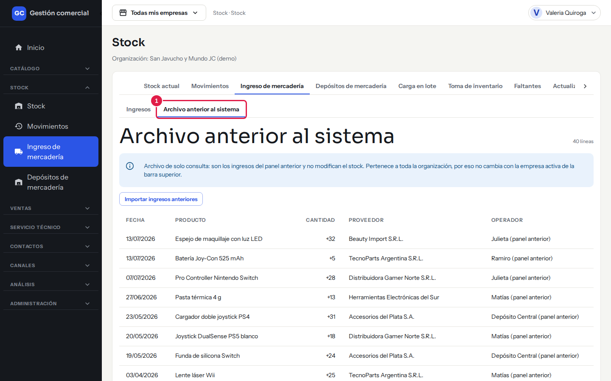
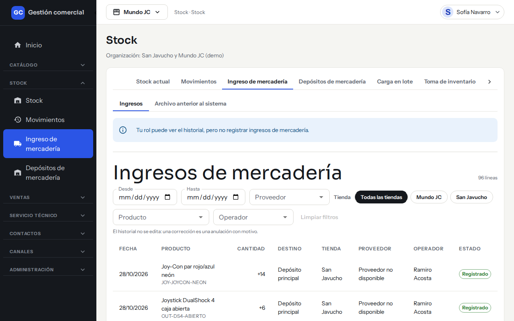
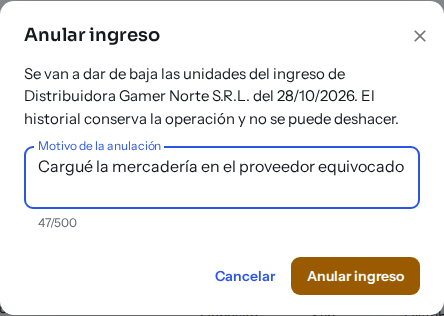

# Registrar un ingreso de mercadería

## Para qué sirve

Cuando llega mercadería de un proveedor, la registrás acá y el stock sube en el momento. Queda un historial con la fecha, el producto, la cantidad, la tienda, el proveedor y quién lo cargó. Si te equivocás, el ingreso se **anula con un motivo**: no se edita ni se borra.

## Quién puede hacerlo

| Rol | Qué puede hacer |
|---|---|
| Administrador, Operador, Depósito | Registrar y anular ingresos |
| Administrador | Además, actualizar el costo de los productos desde el ingreso (ver más abajo) |
| Consulta, Mostrador, Administración | Ver el historial. No ven el formulario ni el botón **Anular** |

## Dónde lo encontrás

**Stock → Ingreso de mercadería**. La pantalla tiene dos solapas: **Ingresos** (el formulario **Nuevo ingreso** y el historial) y **Archivo anterior al sistema** (ingresos viejos, solo para consultar).

*Nuevo ingreso: tienda, proveedor, fecha, remito y las líneas de productos con su cantidad y costo.*

## Registrar un ingreso

1. En **Compra a nombre de** elegí la empresa a nombre de la que se hizo la compra. Viene la que tenés elegida en la barra superior.
2. Elegí el **Proveedor**.
3. Revisá la **Fecha** (hoy por defecto; no puede ser futura).
4. Si querés, escribí el **Remito o factura de compra** (opcional, hasta 100 caracteres).
5. En **Producto 1** buscá y elegí el producto. Cargá la **Cantidad** (podés usar los botones + y − ) y el **Costo unit. USD**.
6. Para agregar más productos, hacé clic en **Agregar producto**. Con el ícono del tacho quitás una línea. Debajo ves el total, por ejemplo «12 unidades en 1 producto». Un ingreso admite hasta 100 productos y un producto no se puede repetir.
7. Si tu rol lo permite, marcá **Actualizar el costo del producto con este ingreso** (ver abajo).
8. Hacé clic en **Registrar ingreso**. Aparece «Ingreso registrado» con las unidades, y el ingreso aparece en el historial de abajo.

**Limpiar** vacía el formulario sin tocar lo que ya registraste.

*Un ingreso con tres productos: cada línea lleva su cantidad y su costo. Abajo ves el total de unidades.*

El registro es todo o nada: si una línea tiene un problema, no se guarda ninguna. Un doble clic no registra el ingreso dos veces.

### Datos que tenés que tener en cuenta

- **Cantidad**: número entero, de 1 en adelante.
- **Costo unit. USD**: el costo de una unidad en dólares, de cero en adelante, con hasta dos decimales.
- **Compra a nombre de** solo indica a nombre de quién se compró. El stock es uno solo y lo ven todas las tiendas: no se separa por empresa.
- El producto no tiene que estar asignado al proveedor elegido. Si coincide, la pantalla lo indica: «Proveedor del producto: coincide».
- La mercadería entra al **depósito por defecto**. Si la necesitás en otro depósito, después la trasladás ([ver cómo](stock-depositos-y-reservas.md)).
- El proveedor tiene que estar activo (ver [Proveedores](proveedores.md)).

### Actualizar el costo del producto

Si marcás **Actualizar el costo del producto con este ingreso**, el costo de cada producto del ingreso pasa a ser el que cargaste. El precio de venta **no cambia**. Esta casilla solo aparece para quien tiene permiso sobre la rentabilidad (hoy, el Administrador). Más sobre costos y márgenes en [Rentabilidad](rentabilidad.md).

*Paso 7: la casilla de costo (1). Paso 8: **Registrar ingreso** (2) confirma; hasta ahí no se guarda nada.*

### Si algo no sale

| Mensaje | Qué significa y qué hacer |
|---|---|
| «Elegí la empresa de la compra.» / «Elegí el proveedor.» / «Elegí la fecha del ingreso.» | Falta completar ese campo |
| «Agregá al menos un producto para registrar el ingreso.» | Cargá al menos una línea |
| «Elegí un producto.» / «No repitas el mismo producto.» | Revisá las líneas |
| «Costo en USD con hasta dos decimales.» | Corregí el costo |
| «La fecha no puede ser futura.» | Elegí hoy o una fecha anterior |
| «El comprobante admite hasta 100 caracteres.» | Acortá el remito o factura |
| «Tu rol no puede actualizar el costo de los productos. Destildá la opción e intentá de nuevo.» | Desmarcá la casilla del costo y registrá igual |
| «Elegí un proveedor activo de la organización.» | El proveedor está desactivado; elegí otro o reactivalo |
| «Revisá los productos: alguno no existe, está inactivo o es de otra organización.» | Cambiá el producto que corresponda |
| «Este ingreso ya fue registrado. Recargá el historial para verlo.» | No lo cargues de nuevo: ya está en el historial |
| «No pudimos registrar el ingreso. Intentá de nuevo.» | No se guardó nada; reintentá |

## Ver el historial de ingresos

Debajo del formulario está **Ingresos de mercadería**, de lo más reciente a lo más antiguo, con una fila por producto. Arriba a la derecha ves cuántas líneas hay.

*Historial: cada línea muestra su estado y, si corresponde, el botón Anular.*

| Columna | Qué significa |
|---|---|
| **Fecha** | Día del ingreso |
| **Producto** | Nombre y SKU |
| **Cantidad** | Unidades que entraron (por ejemplo +53) |
| **Destino** | Depósito al que entró (el principal) |
| **Tienda** | La empresa de «Compra a nombre de» |
| **Proveedor** | A quién se le compró |
| **Operador** | Quién lo registró |
| **Estado** | **Registrado** o **Anulado** (con su motivo) |

Para encontrar un ingreso usá los filtros **Desde**, **Hasta**, **Proveedor**, **Producto**, **Operador** y **Tienda**; se pueden combinar. **Limpiar filtros** vuelve a la lista completa. Si no hay resultados, ves «No hay ingresos con esos filtros.» La lista se muestra de a 25 líneas.

*Filtros del historial: **Desde** (1), **Hasta** (2), **Proveedor** (3) y **Tienda** (4). Se combinan entre sí.*

*Un ingreso **Anulado** muestra su motivo debajo del estado y ya no tiene el botón **Anular**.*

La solapa **Archivo anterior al sistema** muestra los ingresos del sistema anterior (Fecha, Producto, Cantidad, Proveedor, Operador). Es solo de consulta y no modifica el stock.

*Archivo anterior al sistema (1): ingresos viejos, solo para consultar.*

Con el rol Consulta (o cualquier rol que solo pueda mirar) la pantalla muestra el aviso «Tu rol puede ver el historial, pero no registrar ingresos de mercadería.» y el historial, sin formulario ni botón **Anular**. En la columna **Proveedor** puede aparecer «Proveedor no disponible» si tu rol no tiene acceso a Proveedores.

*Así se ve la pantalla con el rol Consulta.*

## Anular un ingreso

Sirve cuando cargaste algo mal o la mercadería nunca llegó.

1. En el historial, buscá la línea y hacé clic en **Anular** (solo aparece en ingresos **Registrado**).
2. Se abre **Anular ingreso**: te avisa que se van a dar de baja las unidades del ingreso y que no se puede deshacer.
3. Escribí el **Motivo de la anulación** (entre 3 y 500 caracteres).
4. Hacé clic en **Anular ingreso**. Aparece «Ingreso anulado».

*Pasos 2 y 3: el diálogo avisa que no se puede deshacer y pide el motivo. **Cancelar** cierra sin anular.*

El stock baja en todas las cantidades del ingreso, descontando del depósito donde habían entrado. El ingreso queda en el historial como **Anulado**, con su motivo.

| Mensaje | Qué significa y qué hacer |
|---|---|
| «No hay stock suficiente para anular: parte de la mercadería ya se movió.» | Parte de esas unidades ya se vendió o se movió. No se anula nada; corregí con un movimiento de stock |
| «Ese ingreso ya está anulado.» | No hay nada más que hacer |

## Preguntas frecuentes

**¿Puedo editar un ingreso?** No. Se anula con motivo y se carga de nuevo correctamente.

**¿Puedo cargar un ingreso con la fecha de otro día?** Sí, de hoy o anterior; no futura.

**Mi rol no ve el formulario.** Solo quienes editan el stock pueden registrar ingresos.
