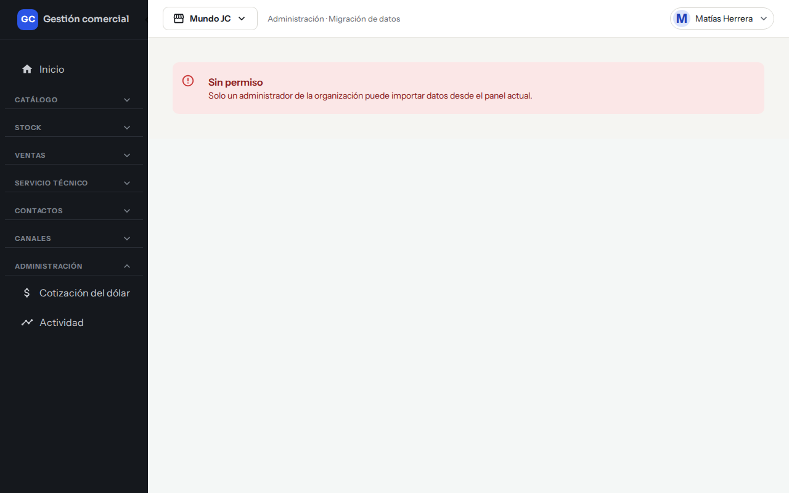
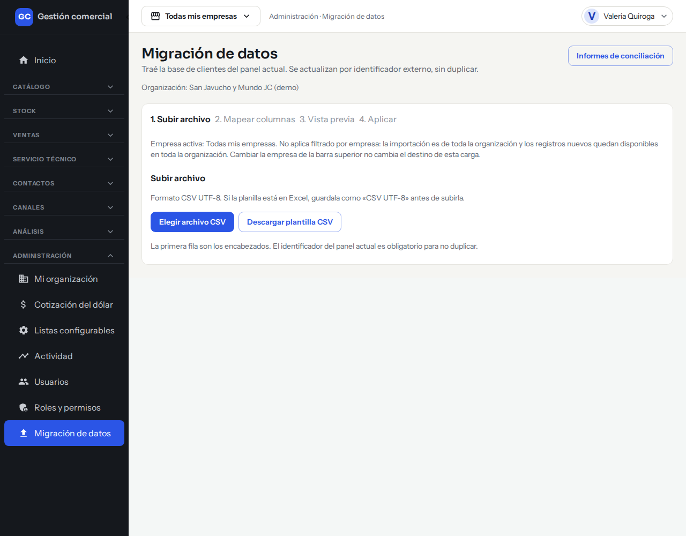
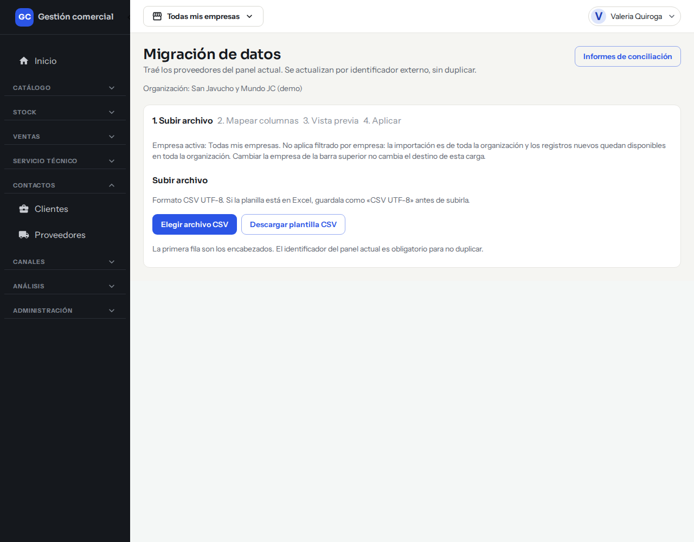
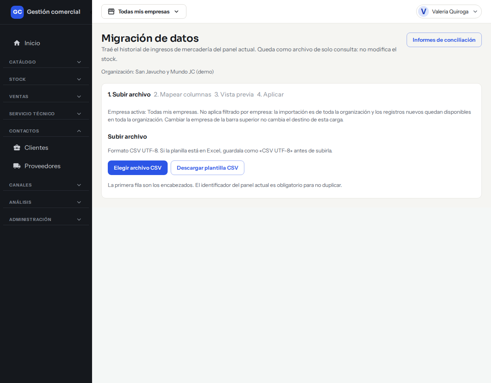
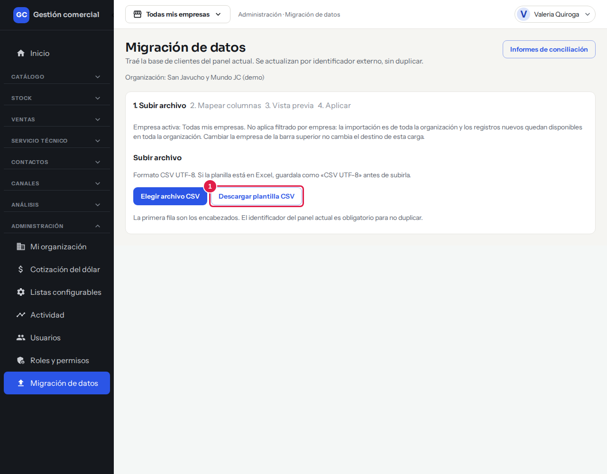
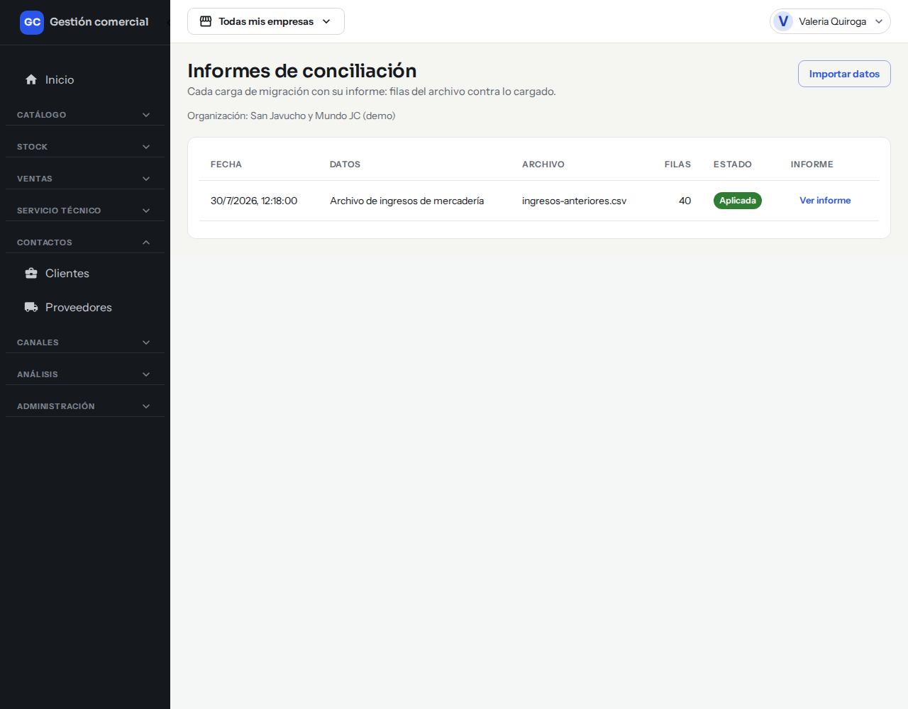
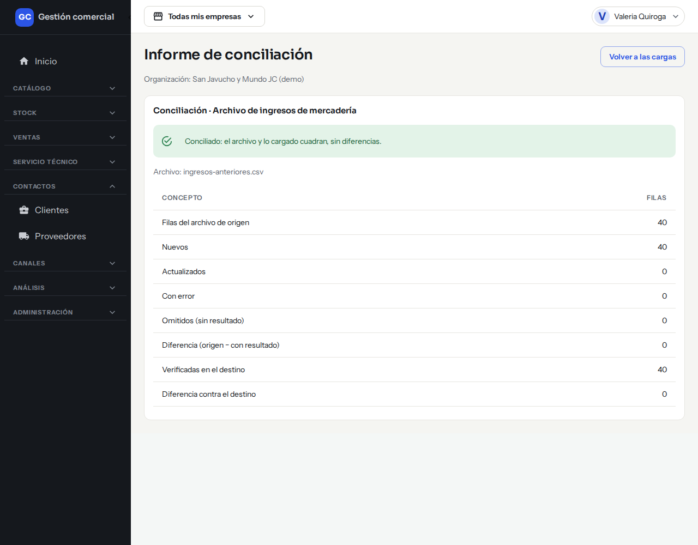

# Migración inicial de datos

## Para qué sirve

Es la herramienta para traer al sistema los datos que tenías en el sistema anterior, a partir de planillas: **clientes**, **proveedores**, los **vínculos entre cada producto y su proveedor** y el **historial de ingresos de mercadería**. Se usa al arrancar, una sola vez por tipo de dato, aunque podés repetirla si necesitás corregir algo.

## Quién puede hacerlo

Solo el **Administrador**. Los demás roles no ven la opción; si entran igual ven «Sin permiso».

*Lo que ve un rol sin permiso.*

## Dónde lo encontrás

Menú lateral **Administración → Migración de datos**. Abre la importación de clientes. Al terminar la de proveedores, el botón **Seguir con los vínculos proveedor ↔ producto** te lleva a la siguiente. Para los demás tipos de datos, pedile a quien te asiste en la puesta en marcha que te pase el acceso directo a cada importación. También hay atajos: el botón **Importar** de Proveedores y el botón de importar ingresos anteriores en Stock.

*La importación de clientes, en Administración → Migración de datos.*

## Qué se puede importar

| Datos | Qué trae | Qué hace falta en el archivo |
|---|---|---|
| **Clientes** | La base de clientes. Si ya los cargaste, se actualizan sin duplicarse. | Obligatorios: **Identificador del panel actual** y **Nombre o razón social**. También: DNI / CUIT, Tipo de cliente, Correo, Teléfono, Celular, Dirección, CP, Localidad, Provincia, Expreso preferido. |
| **Proveedores** | Los proveedores, sin duplicar. | Obligatorios: **Identificador del panel actual**, **Razón social** y **CUIT**. También: Persona de contacto, Correo, Teléfono, Dirección, Observaciones. |
| **Vínculos proveedor ↔ producto** | Qué proveedor tiene cada producto del catálogo. Cargá antes los proveedores y el catálogo. | Obligatorios: **SKU del producto** e **Identificador del proveedor en el panel actual**. Opcional: **Código del proveedor**. |
| **Ingresos anteriores** | El historial de ingresos de mercadería del sistema anterior. Queda solo para consultar y **no modifica el stock**. | Obligatorios: **Identificador del panel actual**, **Fecha**, **Producto** y **Cantidad**. También: Proveedor, Operador. |

Cada tipo de dato tiene su propia pantalla de importación, con los mismos pasos:

*Importación de proveedores.*

*Importación de vínculos proveedor ↔ producto.*

*Importación de ingresos anteriores.*

El **Identificador del panel actual** es el código que cada registro tenía en el sistema anterior. Con él, el sistema reconoce qué ya cargó y no duplica nada si volvés a subir el mismo archivo.

## Importar una planilla paso a paso

La pantalla te muestra los cuatro pasos arriba: **1. Subir archivo**, **2. Mapear columnas**, **3. Vista previa** y **4. Aplicar**.

1. **Preparar el archivo.** Tiene que ser un CSV en formato UTF-8. Si tu planilla está en Excel, guardala como «CSV UTF-8». La primera fila son los encabezados. Si querés partir de un modelo, hacé clic en **Descargar plantilla CSV**.

*El botón para descargar la plantilla (1).*

2. Hacé clic en **Elegir archivo CSV** y seleccioná tu planilla.
3. **Mapear columnas.** Para cada columna de tu archivo, elegí a qué dato corresponde. Si usaste la plantilla o nombres parecidos, el sistema las asocia solo. Las columnas que dejes en «No importar» se ignoran. Los datos obligatorios llevan un asterisco (*) y no podés usar el mismo dato en dos columnas.
4. Hacé clic en **Continuar a la vista previa**.
5. **Vista previa.** El sistema revisa todas las filas sin guardar nada y te muestra cuántas son **nuevas**, cuántas **a actualizar** y cuántas **con error**.
6. Si todo está bien, hacé clic en **Importar N clientes** (o proveedores, vínculos, ingresos). Con **Volver a mapear** corregís las columnas y con **Cancelar** salís sin importar nada.
7. **Aplicar.** Una barra de progreso muestra el avance («Aplicando lote 1 de 3…»). No cierres la ventana hasta que termine.
8. **Resultado.** Ves el resumen («Importación lista: 120 clientes nuevos, 4 actualizados, 0 con error») y el informe de conciliación.

El sistema procesa las filas de a tandas de hasta 500, por eso ves «Aplicando lote 1 de 3…».

## Qué hacer con las filas con error

En la **Vista previa** aparece un aviso con las filas que tienen error, el motivo y el número de fila de tu planilla. **Esas filas no se importan**; las demás sí. Tenés dos caminos:

- Corregí la planilla y volvé a subirla. Como el sistema reconoce el identificador, las filas ya cargadas se actualizan y no se duplican.
- O importá las filas válidas ahora y después subí un archivo solo con las filas corregidas.

Errores típicos: un identificador repetido dentro del archivo («El identificador está repetido en el archivo»), un SKU repetido («El SKU está repetido en el archivo»), un CUIT inválido o repetido, o un SKU o proveedor que todavía no existe (por eso conviene cargar antes proveedores y catálogo).

Si se corta la conexión mientras se aplica, aparece «No pudimos aplicar la importación». Hacé clic en **Reintentar**: lo que ya se cargó no se duplica.

## Informes de conciliación

Sirven para comprobar que lo que cargaste coincide con tu planilla.

- Al terminar, **Ver informe de conciliación** abre el informe de esa carga.
- **Informes de conciliación** (botón en la pantalla de importación) lista todas las cargas con **Fecha**, **Datos**, **Archivo**, **Filas** y **Estado**: «Aplicada», «En curso» o «Incompleta». Hacé clic en **Ver informe** para ver el detalle.

*La lista de cargas realizadas.*

*El informe de una carga: todas las diferencias en cero.*

El informe compara las **Filas del archivo de origen** con **Nuevos**, **Actualizados** y **Con error**, y verifica cuántas quedaron realmente cargadas. Si todo cierra, las diferencias son cero. Si alguna diferencia no es cero, se marca para que la revises. Abajo ves la tabla de **Filas con error** con su **Motivo**.

Una carga «Incompleta» quedó a medias: volvé a subir el mismo archivo y se completa lo que faltaba.

## Cosas a tener en cuenta

- La importación es de toda la organización: los registros nuevos quedan disponibles para todas las tiendas, sin importar la empresa elegida arriba.
- Los ingresos anteriores no suman ni restan stock: son solo historial. Podés consultar los ingresos nuevos en [Ingreso de mercadería](ingreso-de-mercaderia.md).
- Después de importar, podés revisar los datos en [Clientes](clientes.md) y [Proveedores](proveedores.md).

## Si algo no sale

| Mensaje | Qué hacer |
|---|---|
| «No pudimos leer el archivo. Elegilo de nuevo.» | Revisá que sea CSV UTF-8 y volvé a elegirlo. |
| «Sin permiso» / «Solo un administrador puede importar datos.» | Pedile a un Administrador que lo haga. |
| «No pudimos revisar las filas. Intentá de nuevo.» | Reintentá desde **Continuar a la vista previa**. |
| «El lote supera el máximo de 500 filas.» | Dividí el archivo en partes más chicas. |
| «La carga ya no existe en tu organización.» | Elegí otra carga en **Informes de conciliación**. |
