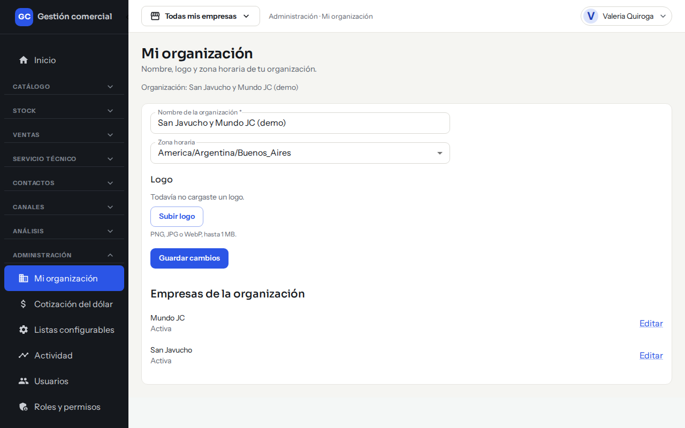
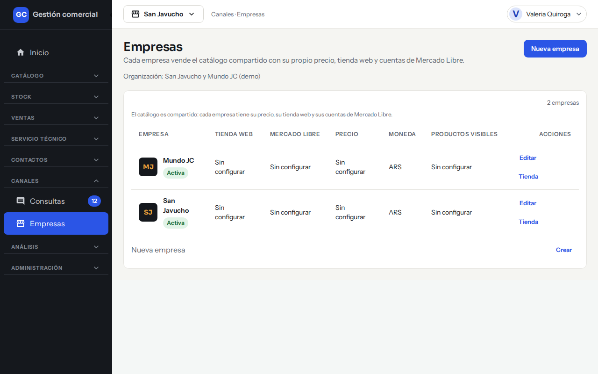
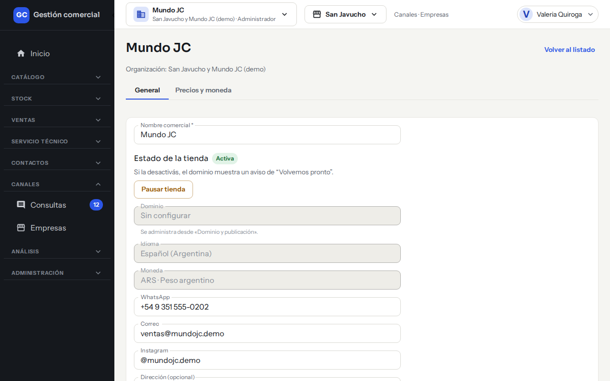
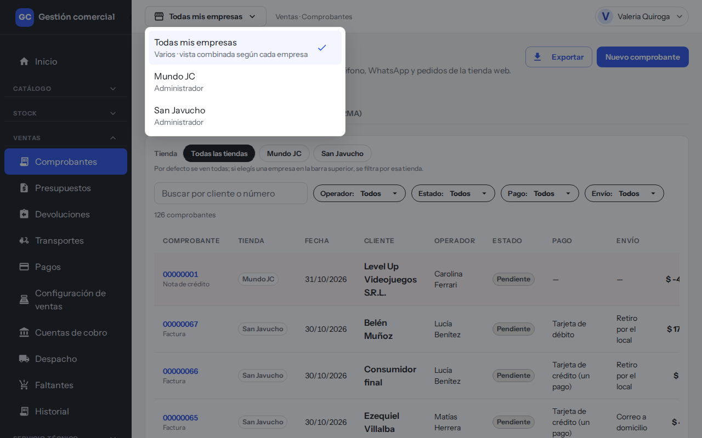
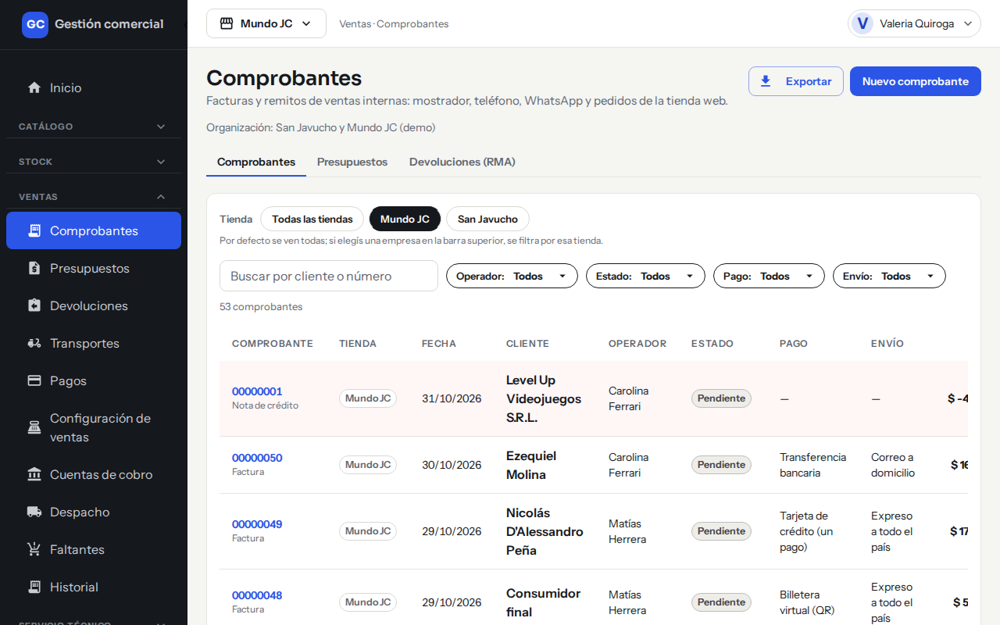

# Tu organización y tus empresas

## Para qué sirve

La **organización** es el negocio completo; las **empresas** son sus tiendas (por ejemplo, San Javucho y Mundo JC). El catálogo, el stock y los clientes se comparten; cada empresa tiene sus propios precios y su tienda online. Esta página explica cómo editar los datos de la organización y de cada empresa, y cómo elegir con qué empresa trabajar.

## Quién puede hacerlo

- **Editar la organización y las empresas:** solo el **Administrador**. Los demás no ven **Mi organización** ni **Empresas** en el menú.
- **Elegir la empresa activa:** cualquier persona, entre las empresas a las que tiene acceso.

## Datos de la organización

Entrá a **Administración → Mi organización**.

| Campo | Qué se carga |
|---|---|
| **Nombre de la organización** | Obligatorio. |
| **Zona horaria** | La de tu negocio (por defecto, Buenos Aires). |
| **Logo** | Imagen PNG, JPG o WebP de hasta 1 MB. Botones **Subir logo** / **Cambiar logo** y **Quitar logo**. |

*Mi organización: datos del negocio y acceso rápido a cada empresa.*

Hacé clic en **Guardar cambios**; vas a ver «Cambios guardados». Más abajo aparece la lista **Empresas de la organización**, con el estado de cada una (Activa o Pausada) y un enlace **Editar**.

## Las empresas

Entrá a **Canales → Empresas**. El listado muestra, por empresa: **Empresa** (con su estado Activa o Pausada), **Tienda web**, **Mercado Libre**, **Precio**, **Moneda** y **Productos visibles**. Lo que todavía no se configuró dice «Sin configurar».

*Canales → Empresas: una fila por empresa.*

En cada fila tenés **Editar** y **Tienda** (la gestión de la tienda online está en [Tiendas online](tiendas-online.md)).

### Crear una empresa nueva

1. Hacé clic en **Nueva empresa**.
2. Escribí el **Nombre** (no puede repetirse).
3. Si querés partir de otra tienda, elegí **Copiar configuración de** (los precios, la tienda web y las reglas de Mercado Libre se copian como punto de partida). Si no, dejá **Sin copiar**.
4. Hacé clic en **Crear empresa**. Vas a ver «Empresa creada como borrador».

### Editar los datos de una empresa

En **Empresas**, hacé clic en **Editar** en la fila. Podés cargar:

| Campo | Para qué se usa |
|---|---|
| **Nombre comercial** | Obligatorio. |
| **WhatsApp**, **Correo**, **Instagram**, **Dirección (opcional)** | Datos de contacto de la tienda. |
| **Horarios de atención** | Se muestran en la página de Contacto de la tienda. |
| **Razón social** y **CUIT** | Se imprimen en la factura y el remito. |

**Dominio**, **Idioma** (Español, Argentina) y **Moneda** (pesos) se muestran solo para lectura. Guardá con **Guardar cambios**.

*Editar una empresa: las pestañas General y Precios y moneda están arriba.*

### Pausar o reactivar una tienda

En la misma pantalla, la sección **Estado de la tienda** muestra si está **Activa** o **Pausada**. El botón **Pausar tienda** (o **Reactivar tienda**) actúa de inmediato, sin necesidad de guardar. Con la tienda pausada, quien entra al sitio ve un aviso de «Volvemos pronto».

## La empresa activa

Arriba, en la barra superior, el botón **Empresa activa** indica con qué tienda trabajás. Al abrirlo ves las empresas a las que tenés acceso y, si tenés más de una, la opción **Todas mis empresas**.

1. Hacé clic en el botón de empresa activa.

*Con Todas mis empresas, el listado mezcla los comprobantes de las dos tiendas.*

2. Elegí la empresa (o **Todas mis empresas**).

*Con una empresa elegida, el mismo listado muestra solo sus comprobantes.*

Qué cambia:

- Pantallas como Ventas, Consultas, Stock o Actividad muestran los datos de la empresa elegida, o de todas tus empresas juntas.
- Tu rol es el que tenés en esa empresa: puede cambiar lo que podés editar (ver [Usuarios y roles](usuarios-y-roles.md)).
- Tu elección se guarda: la próxima vez que entres, incluso desde otro equipo, seguís con la misma.
- Si tenés una sola empresa, el selector es solo una etiqueta.
- Si estabas editando algo sin guardar, el sistema pregunta «¿Cambiar de empresa?» con **Seguir acá** o **Cambiar igual**.

Algunas secciones son compartidas por todas las tiendas, como Productos, Stock, Clientes y Proveedores.

## Alta de organizaciones nuevas

Crear una organización nueva no se hace desde el sistema del cliente: lo hace el equipo de la plataforma, que invita al responsable por correo. Esa persona queda como Administrador y desde ahí crea sus empresas y usuarios.
