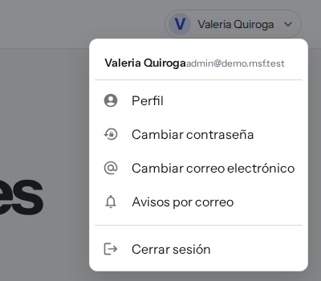
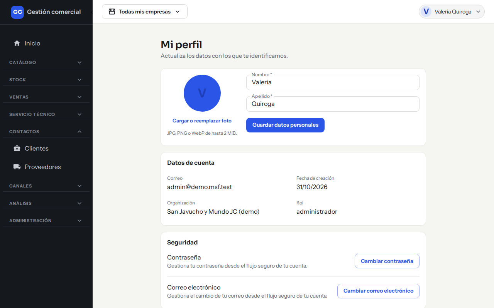
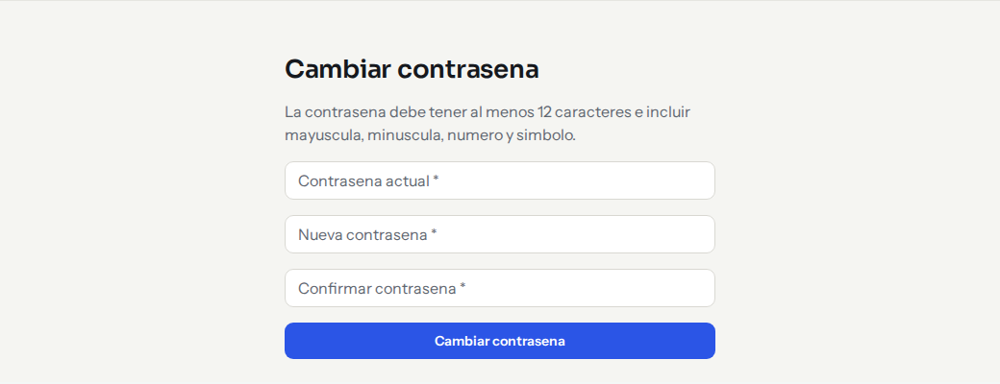
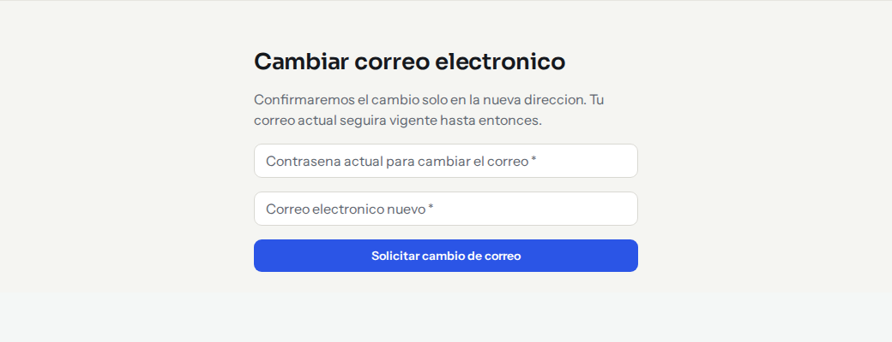
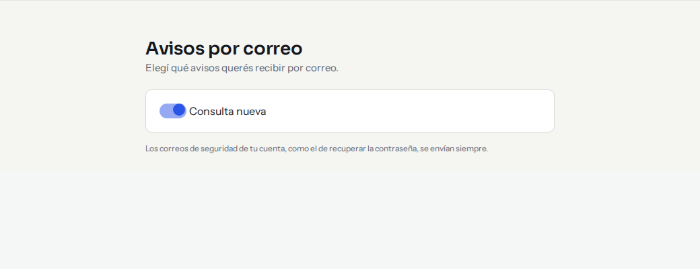

# Tu perfil: nombre, foto, contraseña y correo

## Para qué sirve

Cada persona mantiene sus propios datos sin pedirle nada a un Administrador: cambiar el nombre, la foto, la contraseña o el correo de ingreso.

## Quién puede hacerlo

Todos los roles, cada uno sobre su propia cuenta. Tu rol y tu organización se ven en el perfil pero no se cambian ahí: eso lo hace un Administrador desde [Usuarios y roles](usuarios-y-roles.md).

## Dónde lo encontrás

Arriba a la derecha, hacé clic en tu nombre. Se abre un menú con:

- **Perfil**
- **Cambiar contraseña**
- **Cambiar correo electrónico**
- **Avisos por correo**
- **Cerrar sesión**

*Menú con tu nombre, arriba a la derecha.*

## Cambiar tu nombre o tu foto

1. Abrí el menú con tu nombre y elegí **Perfil**.
2. Para el nombre, editá **Nombre** y **Apellido** (los dos son obligatorios) y hacé clic en **Guardar datos personales**. Vas a ver «Tus datos personales fueron guardados».
3. Para la foto, hacé clic en **Cargar o reemplazar foto** y elegí una imagen JPG, PNG o WebP de hasta 2 MiB. Si no querés foto, usá **Quitar foto**: se muestra la inicial de tu nombre.

*Mi perfil: editás tu nombre y tu foto; los datos de cuenta son de solo lectura.*

En la misma pantalla ves, solo para lectura, tu correo, la fecha de creación de tu cuenta, tu organización y tu rol, y una lista con tus últimas acciones de seguridad (inicios de sesión, cambios de contraseña o de correo).

## Cambiar tu contraseña

1. En el menú con tu nombre, elegí **Cambiar contraseña** (o hacé clic en ese botón dentro del perfil).
2. Escribí tu contraseña actual, la nueva y repetí la nueva en la confirmación.
3. Hacé clic en **Cambiar contraseña**.

*Cambiar contraseña: tres campos y un botón.*

La contraseña nueva tiene que tener al menos 12 caracteres, con una mayúscula, una minúscula, un número y un símbolo. Al cambiarla se cierran tus sesiones abiertas en otros dispositivos y volvés a la pantalla de inicio.

**Si algo no sale**

| Mensaje | Qué hacer |
|---|---|
| «La contraseña actual no coincide» | Revisala. Si no la recordás, usá el enlace **Recuperar acceso**. Tu contraseña anterior sigue vigente. |
| «Las contraseñas no coinciden» | Escribí igual la nueva y su confirmación. |
| «No pudimos modificar la contraseña. La anterior sigue vigente» | Probá de nuevo en unos minutos. |

## Cambiar tu correo

1. Elegí **Cambiar correo electrónico** en el menú con tu nombre.
2. Escribí tu contraseña actual y el correo nuevo (tiene que ser distinto del actual).
3. Hacé clic en **Solicitar cambio de correo**.

*Cambiar correo: pide tu contraseña actual y el correo nuevo.*

Te llega un mensaje de confirmación al correo **nuevo**. Hasta que lo confirmes, sigue valiendo el correo actual.

## Cerrar sesión

Menú con tu nombre → **Cerrar sesión**. Volvés a la pantalla de ingreso. Más detalles en [Ingresar y recuperar el acceso](acceso-y-sesion.md).

## Avisos por correo

En **Avisos por correo** elegís qué avisos querés recibir con un interruptor por cada uno (por ejemplo, **Consulta nueva**, cuando entra una consulta de una tienda).

*Avisos por correo: activá o apagá cada aviso.*

 Los avisos de seguridad de tu cuenta no se pueden apagar. Si todavía no tenés avisos para configurar, la pantalla lo indica.

## Preguntas frecuentes

**¿Puedo cambiar mi rol?** No. Pedíselo a un Administrador.

**¿La empresa activa cambia mi perfil?** No, el perfil es tuyo y es el mismo en todas las tiendas.
