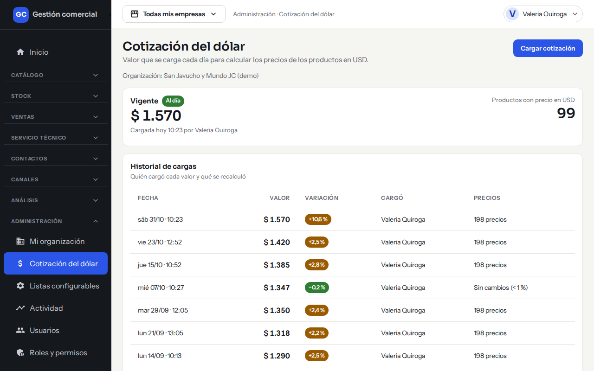
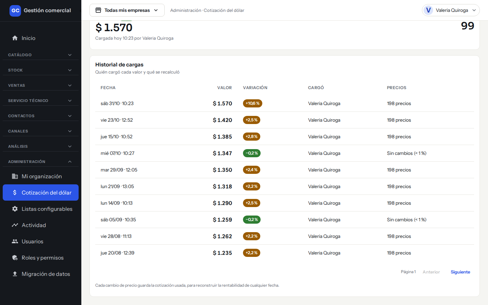
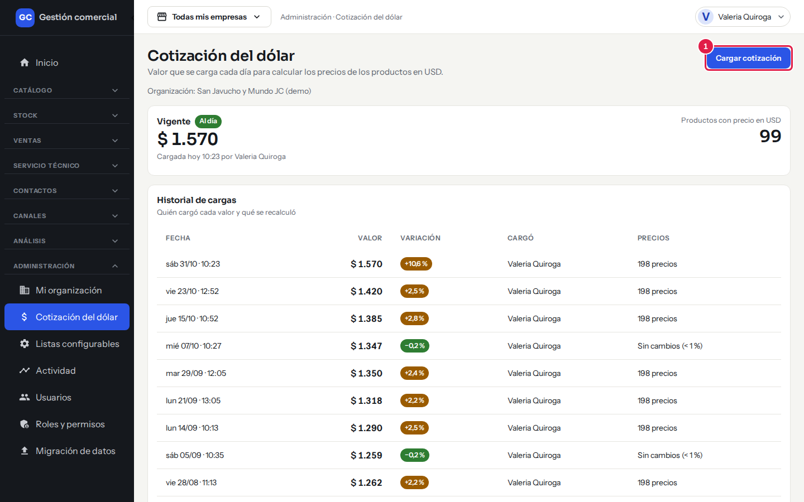
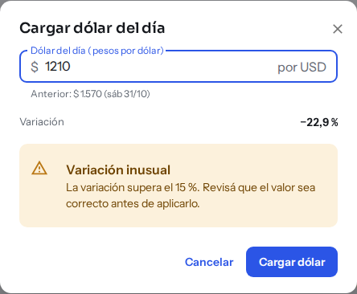
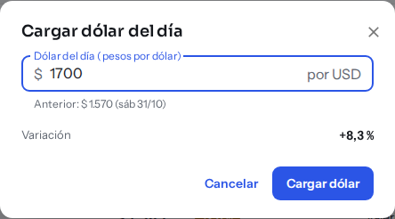

# Cargar la cotización del dólar

## Para qué sirve

Los productos cargados en dólares tienen su precio en pesos según la cotización del día. Una vez por día cargás cuánto vale el dólar, ves qué precios van a cambiar y confirmás. Así todas las tiendas pasan a los precios nuevos al mismo tiempo. Los productos cargados en pesos no se tocan.

## Quién puede hacerlo

Con los permisos que trae el sistema por defecto:

| Tarea | Quién |
|---|---|
| Cargar y confirmar la cotización | Administrador y Administración |
| Ver la cotización vigente y el historial | Operador, Mostrador y Consulta |
| Entrar a la pantalla | Depósito y Técnico no la ven |

El Administrador puede ajustar esto en [Usuarios y roles](usuarios-y-roles.md).

## Dónde lo encontrás

En el menú de la izquierda: **Administración → Cotización del dólar**.

*Administración → Cotización del dólar: valor vigente arriba e historial de cargas debajo.*

## Qué ves en la pantalla

- **Vigente**: el valor del dólar con el que se calculan hoy los precios, quién lo cargó y cuándo («Cargada hoy 10:58 por…»).
- **Al día** o **Sin cargar hoy**: te dice si ya cargaste la cotización de hoy. Cuando falta, aparece además un aviso «Todavía no se cargó el dólar de hoy» con el valor que se sigue usando y un botón **Cargar ahora**.
- **Productos con precio en USD**: cuántos productos dependen del dólar.
- **Historial de cargas**: cada valor que se cargó, con **Fecha**, **Valor**, **Variación** respecto de la carga anterior, quién lo **Cargó** y qué pasó con los **Precios** («198 precios» recalculados, o «Sin cambios (< 1 %)»). Las más nuevas van primero; usá **Anterior** y **Siguiente** para recorrerlo. El historial no se puede editar ni borrar.

*El historial de cargas: cada valor con su variación y los precios que se recalcularon.*

La cotización es una sola para todo el negocio: no cambia según la empresa que tengas elegida arriba.

## Cargar la cotización del día

1. Entrá a **Administración → Cotización del dólar**.
2. Hacé clic en **Cargar cotización** (o en **Cargar ahora**, en el aviso).

*Paso 2: **Cargar cotización** está arriba a la derecha.*

3. En **Dólar del día (pesos por dólar)** escribí el valor. Sirven los formatos «1490», «1490,50» o «1.490,5». Debajo ves el valor **Anterior** y la **Variación**.

*Paso 3: el valor escrito y, debajo, la comparación con el anterior.*

4. Si la variación supera el 15 %, aparece «Variación inusual». Es solo un aviso: revisá que el valor esté bien escrito y seguí.

*Paso 4: si el valor se aleja más del 15 % del anterior, aparece el aviso amarillo.*

5. Hacé clic en **Cargar dólar**. Todavía no cambió ningún precio.
6. Se abre el paso siguiente con **Qué va a cambiar**: un cuadro por empresa con la cantidad de precios que se modifican y una muestra de productos con «<Empresa> hoy» y «Nuevo». Los precios se redondean al $ 10 más cercano.
7. Si estás de acuerdo, hacé clic en **Aplicar y recalcular**. Vas a ver «Cotización aplicada · N precios recalculados». Si no, hacé clic en **Cancelar**: se descarta lo que cargaste y todo queda como estaba.

### Cuando el cambio es muy chico

Si el dólar varió menos de un 1 % respecto del valor vigente, el sistema no recalcula precios: avisa «Sin recálculo» y el botón dice **Registrar cotización**. El valor queda anotado en el historial, pero los precios siguen igual.

## Cuándo se recalculan los precios en pesos

- Solo cuando confirmás con **Aplicar y recalcular**. Hasta entonces rigen los precios del último dólar confirmado.
- Se recalculan todas las tiendas juntas, para que ninguna quede con un valor distinto de otra.
- Si no confirmás en un día, la cotización cargada vence y hay que volver a cargarla.
- Los productos en pesos no cambian con el dólar.

## Preguntas frecuentes

**¿Me equivoqué al escribir el valor, qué hago?** Si todavía no confirmaste, hacé clic en **Cancelar** y cargalo de nuevo. Si ya aplicaste, cargá la cotización correcta: queda en el historial y se recalcula otra vez.

**¿Por qué mis precios en pesos no cambiaron?** Puede ser que el dólar haya variado menos de un 1 %, o que todavía no hayas hecho clic en **Aplicar y recalcular**.

**¿Qué pasa con las tiendas online?** Muestran el precio nuevo en cuanto confirmás.

## Si algo no sale

| Mensaje | Qué significa y qué hacer |
|---|---|
| **Ingresá un valor válido, por ejemplo 1490 o 1490,50.** | El valor está vacío, es cero o tiene letras. Corregilo. |
| **La cotización cargada venció; volvé a cargarla.** | Pasó demasiado tiempo desde que la cargaste sin confirmarla. Cargala de nuevo. |
| **Tu rol no puede cargar la cotización del dólar.** | Pedile al Administrador que te dé el permiso, o pedile que la cargue. |
| **No pudimos cargar / confirmar la cotización. Intentá de nuevo.** | Falló la conexión. Probá otra vez. |
| **No pudimos calcular qué va a cambiar.** | Usá el botón **Reintentar** del paso de vista previa. |

Ver también: [Precios e IVA](precios-e-iva.md) y [Productos y categorías](catalogo-productos.md).
