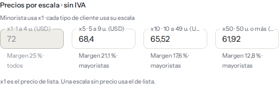
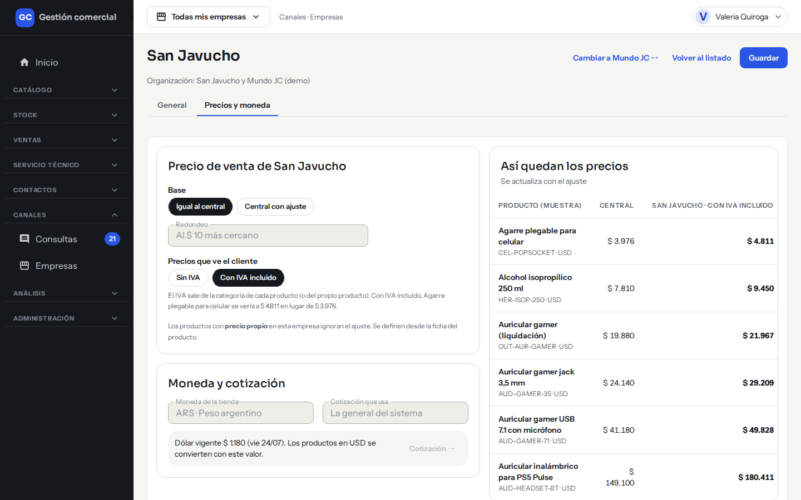
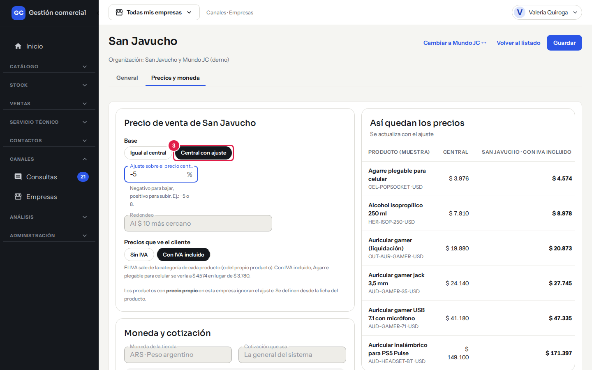
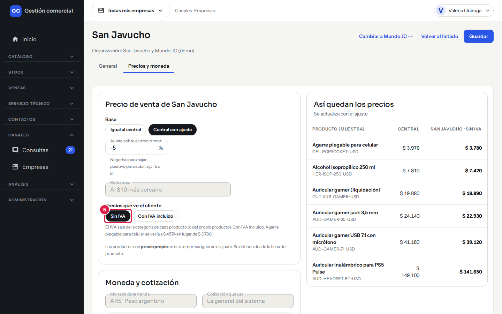
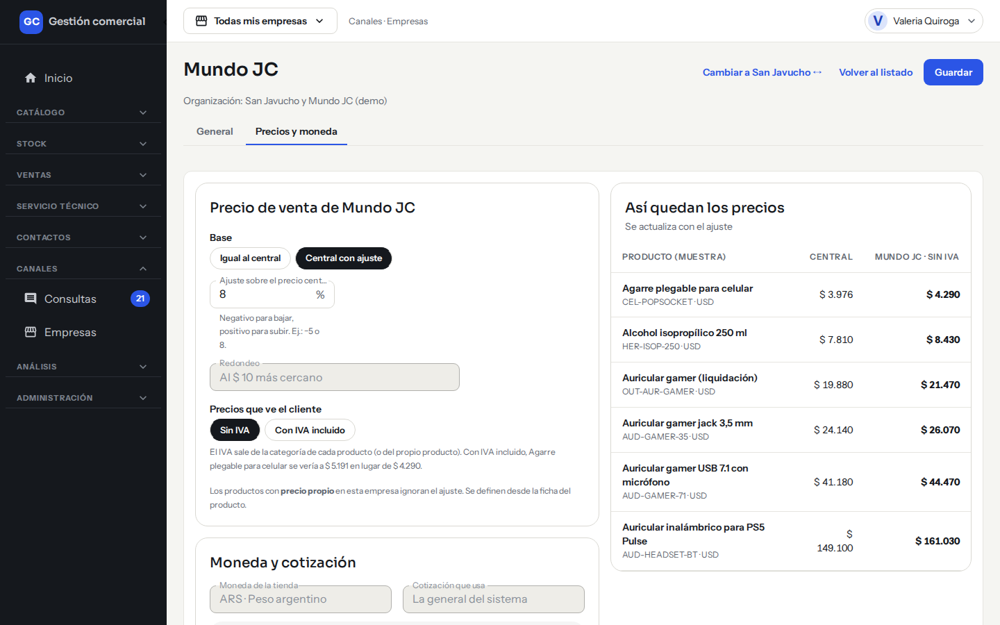
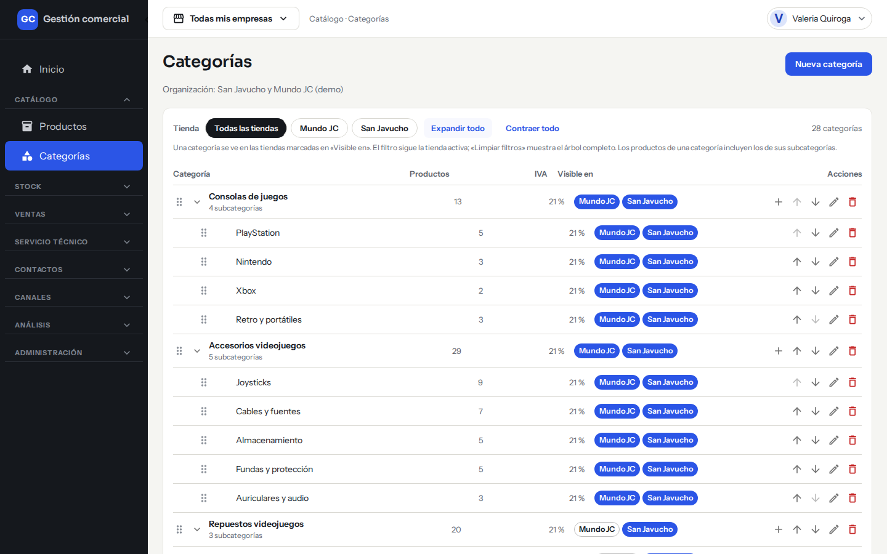
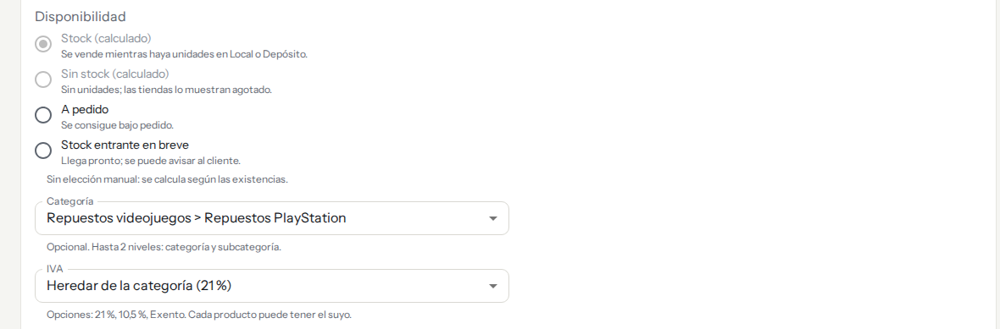

# Cómo se calcula el precio final

## Para qué sirve

Esta guía explica de dónde sale el precio que ve cada cliente: el precio de lista que cargás en el producto, las escalas por cantidad, el ajuste de cada tienda y el IVA. También cómo decidir si cada tienda muestra los precios con o sin IVA.

## Quién puede hacerlo

Con los permisos que trae el sistema por defecto:

| Tarea | Quién |
|---|---|
| Cargar precio de lista, escalas e IVA de un producto | Administrador y Operador |
| Cargar el costo del producto | Administrador |
| Ver el costo y el margen | Administrador y Administración |
| Elegir el IVA de una categoría | Administrador y Operador |
| Definir el ajuste de precio y el IVA de una tienda | Administrador |

## El camino del precio, paso a paso

1. **Precio de lista (sin IVA).** Es el precio base de cada producto. Lo cargás en la ficha, en pesos o en dólares.
2. **Si está en dólares**, el sistema lo pasa a pesos con la [cotización del dólar](precios-dolar.md) vigente. Los precios en pesos no se guardan fijos: se calculan con el dólar de cada momento, por eso al confirmar una cotización nueva todo queda actualizado.
3. **Escala por cantidad.** Si el cliente es mayorista, el precio depende de cuántas unidades compra (ver abajo).
4. **Ajuste de la tienda.** Cada tienda puede vender al mismo precio que el central o con un porcentaje de más o de menos.
5. **Redondeo.** El precio de la tienda se redondea al $ 10 más cercano.
6. **IVA.** Si la tienda muestra precios con IVA incluido, se suma el IVA del producto.

## Precio y costo de un producto

En **Catálogo → Productos**, en el bloque **Precio y costo** del formulario del producto:

- **Moneda**: «USD · dólares» o «ARS · pesos».
- **Precio de lista (sin IVA)**: obligatorio y mayor que cero. El precio de lista siempre se carga sin IVA.
- **Precio en pesos**: es solo informativo. Si el producto está en dólares, muestra el valor convertido («Con dólar $ 1.570…»). Si no hay cotización cargada, dice «Cargá la cotización» y no inventa un precio.
- **Costo**: solo lo ven quienes pueden ver costos. El margen se calcula sobre el precio sin IVA, así que mostrar o no el IVA no cambia el margen.

*El bloque **Precio y costo** del formulario de producto.*

## Precios por escala

*Bloque «Precios por escala · sin IVA» del formulario de producto.*

En el formulario del producto, el bloque **Precios por escala · sin IVA** tiene cuatro escalas:

| Escala | Para cuántas unidades |
|---|---|
| **x1** | De 1 a 4 unidades |
| **x5** | De 5 a 9 unidades |
| **x10** | De 10 a 49 unidades |
| **x50** | 50 unidades o más |

- **x1 es el precio de lista**: no se escribe acá, se toma del campo «Precio de lista (sin IVA)».
- Las escalas **x5, x10 y x50** las cargás vos, en la misma moneda del producto. Si dejás una vacía, esa escala usa el precio de lista.
- Debajo de cada escala ves el **margen** (solo si tu rol puede ver costos).
- Los precios de escala también se cargan sin IVA.

*Un producto con las cuatro escalas cargadas: cada una muestra su margen.*

### Quién usa cada escala

| Tipo de cliente | Qué precio se le aplica |
|---|---|
| **Minorista** | Siempre el precio de lista (x1). |
| **Mayorista** | La escala que corresponde a la cantidad que compra: x1, x5, x10 o x50. |

El tipo de cliente se define en la ficha de cada cliente (ver [Clientes](clientes.md)). Si le cambiás el tipo, las próximas ventas usan la escala del nuevo tipo; lo ya vendido no cambia. En la tienda online, un mayorista con cuenta activa ve todas las escalas en la ficha del producto (ver [Cuenta web del cliente](cuenta-web-cliente.md)).

## Ajuste de precio de cada tienda

1. Entrá a **Canales → Empresas** y hacé clic en **Editar** en la tienda que querés.
2. Elegí la pestaña **Precios y moneda**.

*Paso 2: la pestaña **Precios y moneda** de la empresa, con la tabla «Así quedan los precios» a la derecha.*

3. En **Base** elegí:
   - **Igual al central**: la tienda vende al precio central.
   - **Central con ajuste**: escribí el **Ajuste sobre el precio central** en porcentaje. Un número negativo baja el precio (por ejemplo, −5) y uno positivo lo sube (por ejemplo, 8).

*Paso 3: con «Central con ajuste» aparece el campo del porcentaje y la tabla de la derecha se actualiza al escribir.*

4. El **Redondeo** es siempre «Al $ 10 más cercano».
5. En **Precios que ve el cliente** elegí **Sin IVA** o **Con IVA incluido**. Es una decisión de cada tienda: dos tiendas pueden mostrar el mismo producto de forma distinta.

*Paso 5: con «Sin IVA» la tabla muestra el precio de la tienda sin sumar el impuesto.*

6. Mirá la tabla **Así quedan los precios**: muestra una muestra de productos con el precio **Central** y el de la tienda. Se actualiza mientras escribís el ajuste, antes de guardar.
7. Hacé clic en **Guardar**. Vas a ver «Precios de la empresa guardados».

Esta pantalla también te muestra la moneda de la tienda («ARS · Peso argentino») y la cotización que usa («La general del sistema», con el dólar vigente). Esos dos datos no se cambian desde acá.

Para pasar a otra tienda sin volver al listado, usá el botón **Cambiar a… ↔** de la parte de arriba.

*La otra tienda, Mundo JC, tiene su propia configuración: el mismo producto puede tener un precio distinto en cada una.*

## IVA

El IVA se define por categoría y, si hace falta, por producto:

- **IVA de la categoría**: al crear o editar una categoría elegís la alícuota (21 %, 10,5 % o Exento). Ver [Productos y categorías](catalogo-productos.md).

*En **Catálogo → Categorías**, la columna **IVA** muestra la alícuota de cada categoría.*

- **IVA del producto**: en el campo **IVA** del formulario del producto elegís «Heredar de la categoría (21 %)» o una alícuota propia.

*El campo **IVA** del producto: por defecto hereda el de su categoría.*

- Un producto usa su IVA propio si lo tiene; si no, el de su categoría. **Exento** significa que el precio final es igual al precio sin IVA.
- Si falta el IVA (el producto no tiene alícuota ni su categoría), la tabla «Así quedan los precios» no puede mostrar el precio con IVA y lo indica.

## Casos comunes

- **Quiero que una tienda venda 10 % más caro.** En su pestaña **Precios y moneda**, elegí «Central con ajuste» y escribí 10.
- **Quiero que una tienda muestre los precios con IVA.** En **Precios que ve el cliente**, elegí «Con IVA incluido».
- **Un mayorista compra 12 unidades.** Se le aplica el precio de la escala x10 (de 10 a 49 unidades).
- **No cargué precio en x10.** Esa escala usa el precio de lista.

## Si algo no sale

| Mensaje | Qué significa y qué hacer |
|---|---|
| **Ingresá el ajuste en %. Ej.: −5 o 8.** | El campo de ajuste está vacío. |
| **El ajuste debe ser mayor a −100 %.** | Un ajuste de −100 % o menos dejaría el precio en cero. |
| **Ingresá un número válido, con hasta 3 decimales. Usá coma para los decimales.** | Corregí el número. |
| **Otra persona modificó los precios de esta empresa.** | Recargá la pantalla para ver los cambios y volvé a intentar. |
| **Solo el Administrador puede editar los precios de la empresa.** | Pedile al Administrador que lo haga. |
| **Sin precio: falta cargar la cotización** (en la tabla) | El producto está en dólares y no hay dólar cargado. Ver [Cotización del dólar](precios-dolar.md). |
| **Tu rol no puede cambiar el IVA.** | Pedile al Administrador que lo cambie. |
| **Esa alícuota no está activa. Elegí otra.** | Elegí otra de la lista. |
