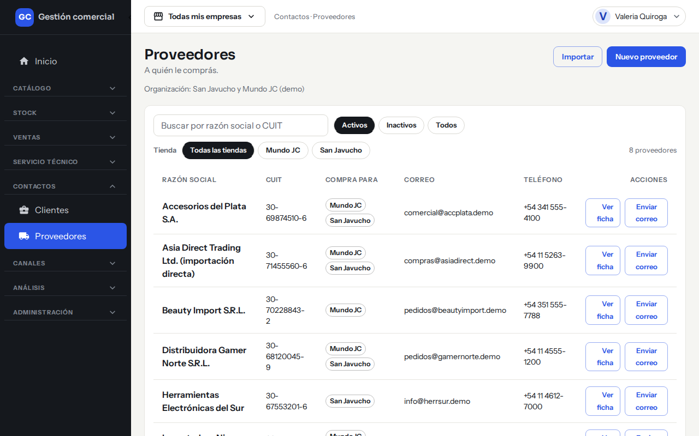
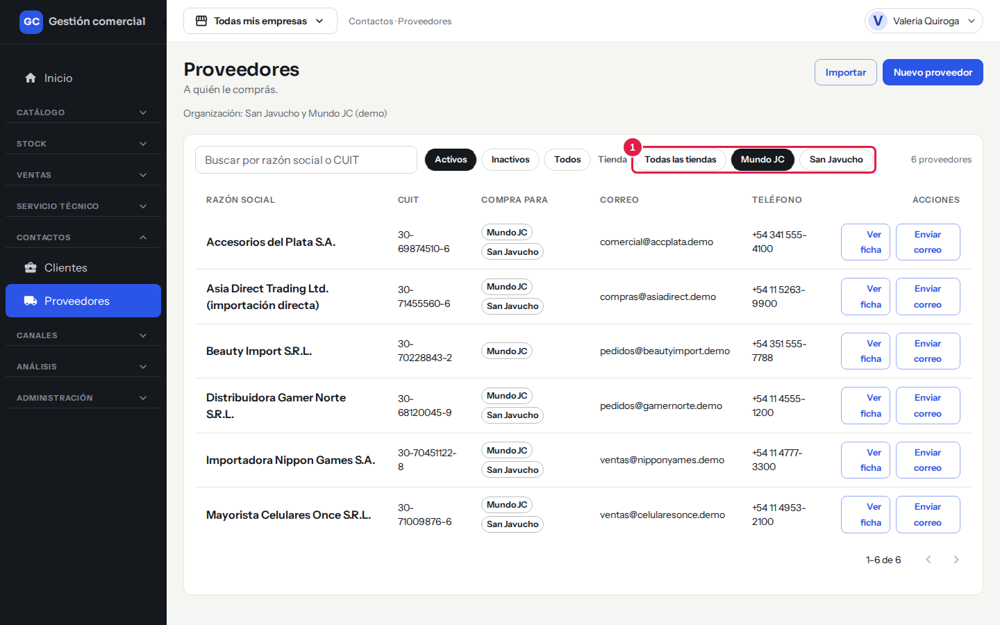
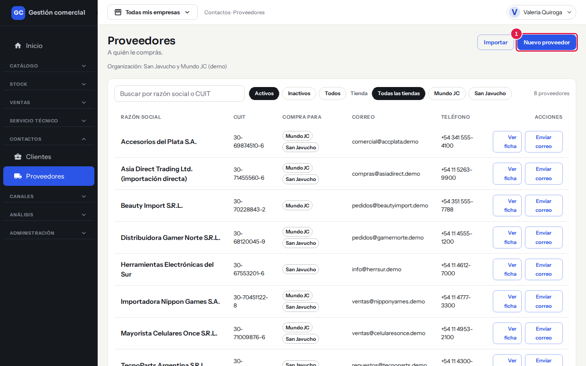
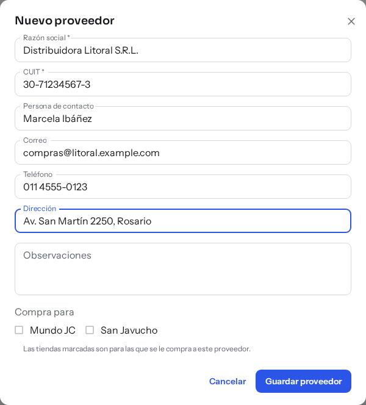
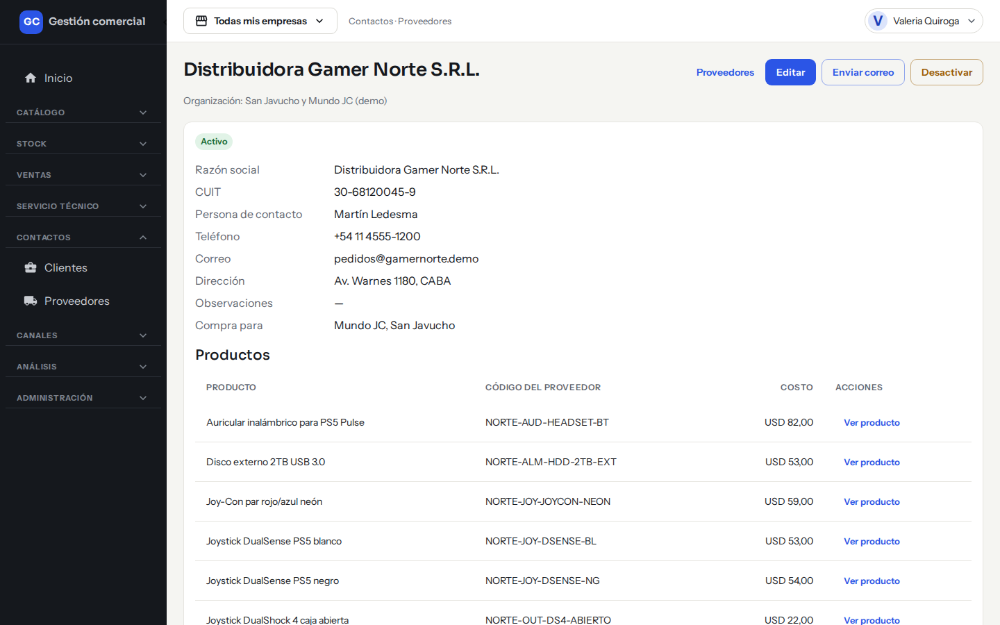
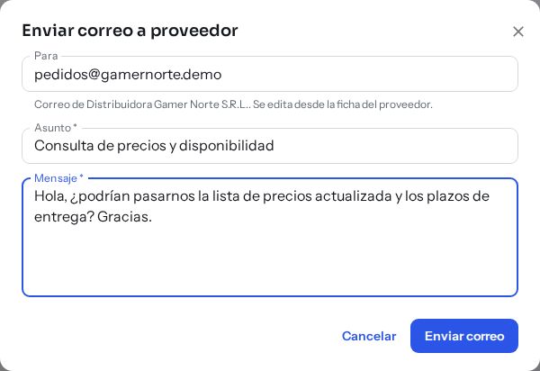

# Proveedores

## Para qué sirve

Guardás los datos de las empresas a las que les comprás: razón social, CUIT y contacto. Cada producto puede tener asignado el proveedor que lo abastece y el código con que ese proveedor lo conoce. Los proveedores se usan al [registrar un ingreso de mercadería](ingreso-de-mercaderia.md).

## Quién puede hacerlo

| Rol | Qué puede hacer |
|---|---|
| Administrador, Administración | Crear, editar, desactivar y reactivar proveedores, y enviarles correos |
| Roles con acceso de solo lectura a Proveedores | Ver el listado y la ficha, sin botones de cambio |
| Operador, Depósito | Elegir proveedor al cargar un producto o un ingreso. No ven el CUIT ni los datos de contacto |
| Mostrador y otros roles sin acceso | No ven la sección Proveedores |

## Dónde lo encontrás

En el menú **Contactos → Proveedores**.

*Proveedores: búsqueda, filtros por estado y tienda, y una fila por proveedor.*

## El listado

| Columna | Qué muestra |
|---|---|
| **Razón social** | Nombre legal del proveedor |
| **CUIT** | Con el formato XX-XXXXXXXX-X |
| **Compra para** | Las tiendas para las que se le compra a ese proveedor |
| **Correo** | Correo de contacto |
| **Teléfono** | Teléfono de contacto |

Cada fila tiene **Ver ficha** y, si podés editar y el proveedor tiene correo, **Enviar correo**. Arriba ves la cantidad de proveedores.

Para encontrar uno:
- **Buscar por razón social o CUIT**: escribí parte del nombre o el CUIT, con o sin guiones. No distingue mayúsculas ni tildes.
- **Activos / Inactivos / Todos**: por defecto ves solo los activos.
- **Tienda**: **Todas las tiendas** o una tienda puntual (según «Compra para»).

*El filtro **Tienda** (1) deja solo los proveedores a los que se les compra para esa tienda.*

El listado se muestra de a 25 proveedores. Si no hay coincidencias dice «Sin resultados».

## Crear un proveedor

1. Hacé clic en **Nuevo proveedor** (arriba a la derecha).

    

    *Paso 1: el botón **Nuevo proveedor**. Al lado, **Importar** lleva a la carga masiva.*

2. Completá los datos:

| Campo | Notas |
|---|---|
| **Razón social** | Obligatorio |
| **CUIT** | Obligatorio. Podés escribirlo con guiones, puntos o espacios. Tiene que tener 11 dígitos y ser válido. No puede repetirse |
| **Persona de contacto** | Opcional |
| **Correo** | Opcional, con formato válido (por ejemplo nombre@empresa.com) |
| **Teléfono** | Opcional |
| **Dirección** | Opcional |
| **Observaciones** | Opcional, texto libre |
| **Compra para** | Marcá las tiendas para las que se le compra a este proveedor. Es informativo |

3. Hacé clic en **Guardar proveedor**.

*El formulario completo (ejemplo). Abajo elegís las tiendas de **Compra para**. **Cancelar** cierra sin guardar.*

### Si algo no sale

| Mensaje | Qué hacer |
|---|---|
| «Ingresá la razón social.» / «Ingresá el CUIT.» | Completá el campo |
| «El CUIT debe tener 11 dígitos.» | Revisá la cantidad de números |
| «El CUIT solo admite números (con o sin guiones).» | Sacá las letras |
| «El CUIT no es válido: revisá el dígito verificador.» | Hay un error de tipeo en el CUIT |
| «Ya existe un proveedor con ese CUIT en tu organización (también si está desactivado).» | Ese proveedor ya está cargado. Buscalo en **Todos** y reactivalo si hace falta |
| «Ingresá un correo con formato válido, por ejemplo nombre@empresa.com.» | Corregí el correo |
| «Otra persona modificó este proveedor mientras lo editabas. Recargá para ver sus cambios; no se guardó nada tuyo.» | Recargá la ficha y repetí tu cambio |
| «El proveedor se guardó, pero no pudimos guardar «Compra para»…» | Los datos quedaron guardados; editá el proveedor y volvé a marcar las tiendas |

## La ficha del proveedor

Con **Ver ficha** ves todos los datos del proveedor, las tiendas de «Compra para» y la sección **Productos**, con la lista de productos que abastece (**Producto**, **Código del proveedor**, **Costo** y un enlace **Ver producto**). Si no tiene productos, dice «Este proveedor todavía no tiene productos.»

*Ficha del proveedor: arriba a la derecha están **Editar**, **Enviar correo** y **Desactivar**.*

Desde la ficha, si podés editar:
- **Editar**: abre el mismo formulario con los datos cargados. Cambiás y hacés clic en **Guardar proveedor**. Aparece «Proveedor guardado».
- **Enviar correo**: abre un formulario con **Para** (el correo del proveedor), **Asunto** y **Mensaje**. Hacé clic en **Enviar correo** y aparece «Correo enviado al proveedor». Si querés cambiar el destinatario, editá antes el correo del proveedor.

    

    *Enviar correo: **Cancelar** cierra sin enviar nada.*
- **Desactivar**: pide confirmación en **Desactivar proveedor**. Queda archivado: no se puede elegir en nuevos ingresos ni productos, pero conserva sus datos y sus productos, y podés volver a activarlo con **Reactivar**. Aparecen «Proveedor desactivado» o «Proveedor reactivado».

Los proveedores no se borran: se desactivan.

## Vincular un producto con su proveedor

En la ficha del producto (**Catálogo → Productos**, al crear o editar) hay dos campos opcionales:

- **Proveedor**: se busca por razón social. Solo se ofrecen proveedores activos.
- **Código del proveedor**: el código con que ese proveedor conoce al producto (hasta 80 caracteres). Solo se puede cargar si hay un proveedor elegido; si quitás el proveedor, el código se borra.

Si un proveedor se desactiva, los productos ya asignados lo conservan. Ver [Productos](catalogo-productos.md).

## A qué empresas se asignan

Los proveedores pertenecen al negocio, no a una empresa: los comparten todas las tiendas y no cambian al elegir otra empresa en la barra superior. El campo **Compra para** indica para qué tiendas se le compra a cada uno y permite filtrar el listado por **Tienda**.

## Importar proveedores

Si tenés permiso, el botón **Importar** del listado te lleva a la carga masiva de proveedores. Ver [Migración inicial de datos](migracion-inicial-de-datos.md).

## Preguntas frecuentes

**¿Puedo eliminar un proveedor?** No, solo desactivarlo.

**No me aparece el proveedor al cargar un ingreso.** Probablemente está desactivado: reactivalo desde su ficha.

**¿Puedo tener varios proveedores por producto?** Por ahora cada producto tiene un solo proveedor.
