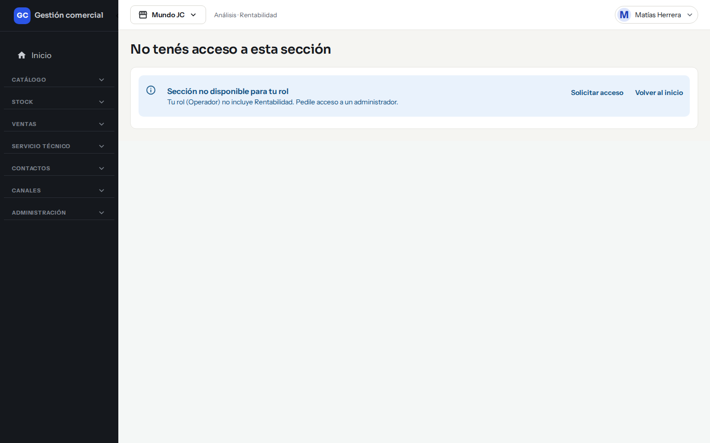
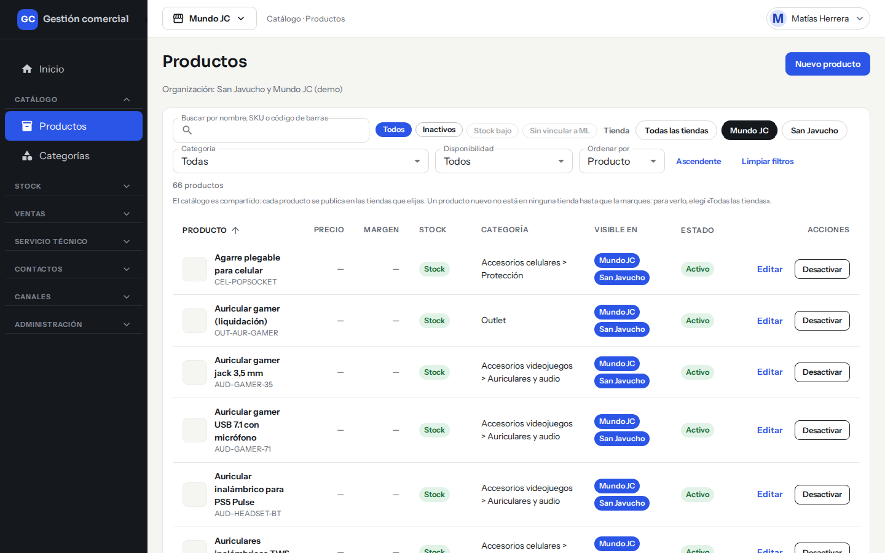
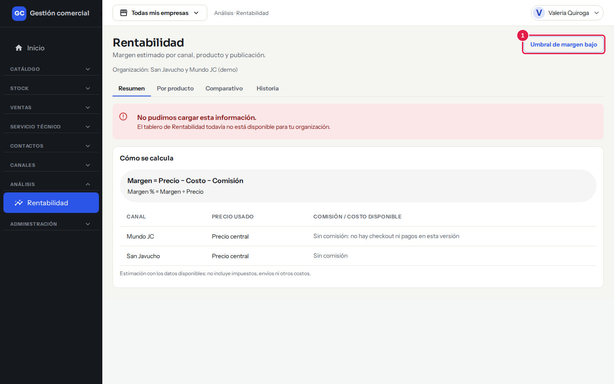
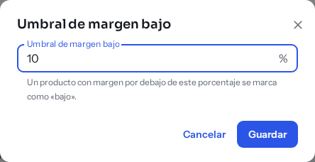
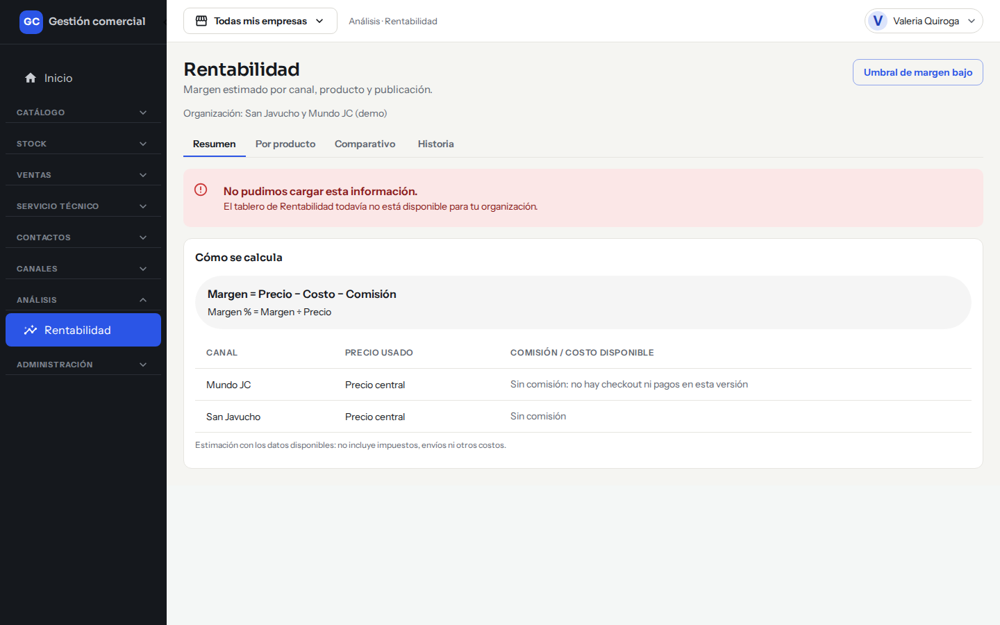

# Ver la rentabilidad: costos y márgenes

## Para qué sirve

La pantalla **Rentabilidad** te muestra cuánto ganás con cada producto en cada tienda: el margen, comparado con el costo. Te avisa cuando algo se vende por debajo del costo o casi, para que lo corrijas a tiempo.

## Quién puede hacerlo

Con los permisos que trae el sistema por defecto:

| Rol | Qué puede hacer |
|---|---|
| **Administrador** | Ver todas las pestañas y cambiar el **umbral de margen bajo**. Es quien carga los costos. |
| **Administración** | Ver todas las pestañas, sin cambiar el umbral. |
| **Operador, Mostrador, Depósito, Técnico y Consulta** | No acceden: ven el aviso «No tenés acceso a esta sección». Tampoco ven el costo de los productos en el listado ni en la ficha. |

Los costos y los márgenes son datos sensibles: solo los ve quien tiene acceso a esta pantalla. El Administrador puede cambiar esto en [Usuarios y roles](usuarios-y-roles.md).

*Un usuario con rol Operador que intenta entrar a Rentabilidad ve este aviso.*

*El mismo listado de Productos visto con rol Operador: no aparece la columna **Costo**.*

## Dónde lo encontrás

En el menú de la izquierda: **Análisis → Rentabilidad**. La pantalla tiene cuatro pestañas: **Resumen**, **Por producto**, **Comparativo** e **Historia**.

La pantalla compara todas las empresas del negocio juntas: no cambia con la empresa que tengas elegida arriba.

## Cómo se calcula el margen

El margen es lo que te queda de cada venta, sobre el precio sin IVA:

- **Margen** = Precio − Costo − Comisión
- **Margen %** = Margen ÷ Precio

Algunas aclaraciones:

- El **precio** es el que tiene la tienda, sin IVA. El **costo** es el del producto en pesos, sin IVA (si está en dólares, se pasa a pesos con la cotización de hoy).
- Las tiendas propias no cobran comisión, así que hoy la comisión es cero.
- Es una **estimación con los datos disponibles**: no incluye impuestos, envíos ni otros costos.
- Si a un producto le falta el costo (o la cotización, si está en dólares), no aparece con margen: no se inventa un número.
- Solo cuentan los productos y las tiendas activos.
- Se calcula en el momento: si cambia el costo, el dólar o el ajuste de precio de una tienda, el margen cambia solo.

### Qué significa el estado

| Estado | Cuándo |
|---|---|
| **OK** | El margen % es igual o mayor que el umbral de margen bajo. |
| **Bajo** | El margen % es positivo pero menor que el umbral. |
| **Negativo** | El margen % es menor que cero: se vende por debajo del costo. |

## Pestaña Resumen

Muestra:

- Una **tarjeta por empresa** con la cantidad de productos, el margen promedio en porcentaje y en pesos por unidad, y cuántos productos tienen margen bajo o negativo.
- Un bloque **Consolidado** con el total del negocio.
- La tarjeta **Cómo se calcula**, con las fórmulas.
- Un aviso en amarillo: «Hay productos que se venden por debajo del costo o casi. Revisalos en Por producto.», con el botón **Ver detalle**. Si no hay productos en riesgo, el aviso no aparece.

Si todavía no hay productos con margen, ves el mensaje «Todavía no hay productos con margen calculado»: cargá el costo de tus productos (y la cotización del dólar, si están en USD).

### Cambiar el umbral de margen bajo

Es el porcentaje por debajo del cual un producto se marca como «Bajo». Viene en 10 %.

1. En **Resumen**, hacé clic en **Umbral de margen bajo** (solo lo ve el Administrador).

*Paso 1: el botón **Umbral de margen bajo** está arriba a la derecha.*

2. Escribí el porcentaje, por ejemplo «10» o «12,5». Tiene que ser mayor que 0 y hasta 100.
3. Hacé clic en **Guardar**. Vas a ver «Umbral de margen bajo guardado.» y el tablero se actualiza.

*Pasos 2 y 3: el porcentaje actual (10 %) y el botón **Guardar**.*

## Pestaña Por producto

Una fila por producto y por tienda, con **Producto** (nombre y SKU), **Canal**, **Precio**, **Costo**, **Comisión**, **Margen**, **Margen %** y **Estado**. Arriba aparece el total de filas. Los márgenes negativos se resaltan.

Usá los filtros de la parte superior para ver «Todos», «Bajo o negativo» o «Solo negativo», y para elegir una tienda. Si llegás desde **Ver detalle**, el filtro «Bajo o negativo» ya viene puesto. Si no hay coincidencias, ves «Sin resultados».

## Pestaña Comparativo

Pone el **mismo producto lado a lado en cada tienda**, para ver dónde ganás de más o de menos. Cada fila muestra el margen % de cada empresa, la **diferencia** entre la mejor y la peor (en puntos porcentuales) y cuál es la mejor y la peor.

- Solo entran productos con margen calculado en **dos o más** empresas.
- Podés buscar por producto o SKU y ordenar por «Mayor diferencia primero» o «Menor diferencia primero».
- Usa los valores de hoy. Para ver cómo cambió en el tiempo, usá **Historia**.

## Pestaña Historia

Elegís **un producto** y ves cómo evolucionó su margen, con la cotización del dólar y el costo que regían en cada fecha. Sirve para entender si el margen cambió por el dólar o por un cambio de costo.

- Un gráfico con el margen % de cada empresa a lo largo del tiempo, y una tabla con **Fecha**, **Empresa**, **Cotización**, **Costo**, **Neto**, **Margen** y **Margen %**.
- Los puntos de la serie son cada cambio de costo y cada carga de la cotización del dólar.
- Un producto en pesos no se mueve con el dólar: su línea solo cambia si cambia el costo.
- Se usa el precio de hoy de la tienda: no se reconstruyen precios de lista pasados.
- Si falta información, ves «Sin historia para este producto».

## Casos comunes

- **Quiero saber qué productos pierden plata.** Entrá a **Por producto** y filtrá por «Solo negativo», o hacé clic en **Ver detalle** en el aviso del Resumen.
- **Cambió el dólar y quiero ver cómo afectó el margen.** Usá **Historia** con el producto que te interesa.
- **Un producto no aparece.** Revisá que tenga costo cargado y que esté activo (ver [Productos y categorías](catalogo-productos.md)). Si está en dólares, verificá que haya una [cotización cargada](precios-dolar.md).

## Si algo no sale

| Mensaje | Qué significa y qué hacer |
|---|---|
| **No pudimos cargar esta información.** | Usá el botón **Reintentar**, si aparece. Si sigue fallando, avisá al equipo de soporte. |
| **El tablero de Rentabilidad todavía no está disponible para tu organización.** | Pedíselo al equipo de soporte. |
| **Ingresá un porcentaje mayor a 0 y hasta 100, por ejemplo 10 o 12,5.** | Corregí el umbral. |
| **Otra persona cambió el umbral mientras lo editabas.** | Cerrá el cuadro y volvé a abrirlo. |
| **Tu rol no puede cambiar el umbral de margen bajo.** | Solo lo cambia el Administrador. |
| **No tenés acceso a esta sección** | Tu rol no incluye Rentabilidad. Usá **Solicitar acceso** o pedile acceso al Administrador. |

*Si el tablero todavía no está disponible para tu organización, ves este aviso; la tarjeta «Cómo se calcula» se muestra igual.*

Por ahora no se incluyen las publicaciones de Mercado Libre.
