# Service técnico: registrar y seguir las reparaciones

## Para qué sirve

Acá anotás cada equipo que llega al taller (consola, joystick, etc.), seguís por qué etapa va, cargás la mano de obra y los repuestos, lo entregás y le das al cliente sus papeles impresos. Todo queda en una sola ficha por reparación, con su número (por ejemplo «R-0238»).

## Quién puede hacerlo

| Rol | Qué puede hacer |
|---|---|
| Administrador, Operador, Técnico | Todo: ingresar equipos, editar, cargar ítems, cambiar el estado, entregar, anular, imprimir y administrar modelos y estados. |
| Mostrador, Administración, Consulta | Ver el listado y cada ficha e imprimir los papeles. No pueden modificar nada. |
| Depósito | No ve la sección Servicio técnico. |

El Técnico trabaja solo con las tiendas que tiene asignadas: si no tiene ninguna asignada, el listado le aparece vacío. En el día a día lo opera el Operador, y el Administrador también entra.

Si tu rol no incluye Servicio técnico, el sistema te lo avisa con el mensaje «No tenés acceso a esta sección». Pedile acceso a un administrador.

## Dónde lo encontrás

En el menú lateral, grupo **Servicio técnico**, hay tres pantallas (también como solapas arriba):

- **Reparaciones**: el listado y las fichas.
- **Modelos**: las consolas y equipos que se reparan.
- **Estados de reparación**: las etapas por las que pasa un equipo.

## El listado de reparaciones

Entrá en **Servicio técnico → Reparaciones**. Ves los equipos que ingresaron al taller, de la reparación más nueva a la más antigua, de a 25 por página. El listado respeta la tienda elegida arriba, en el selector de empresa: con una tienda ves solo sus reparaciones; con «Todas mis empresas», las de todas.

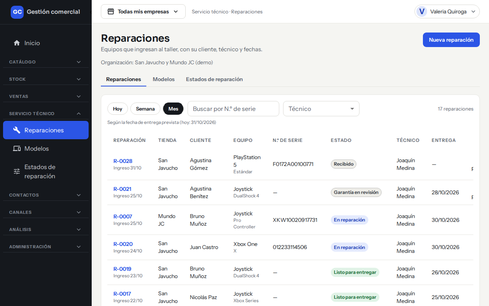

*El listado de reparaciones, con los filtros Hoy, Semana y Mes arriba.*

### Columnas

| Columna | Qué muestra |
|---|---|
| **Reparación** | El número (R-0238) y la fecha de ingreso. Hacé clic para abrir la ficha. |
| **Tienda** | La tienda donde ingresó. |
| **Cliente** | A nombre de quién está. |
| **Equipo** | La consola o el equipo, con el modelo debajo. |
| **N.º de serie** | El número de serie, o «—» si no se cargó. |
| **Estado** | La etapa actual. |
| **Técnico** | Quién la tiene asignada, o «—». |
| **Entrega** | La fecha de entrega prevista. |
| **Total** | Lo que se le cobra al cliente. Si todavía no cargaste ítems dice «A presupuestar». |

### Filtros

- **Hoy / Semana / Mes**: filtra por la **fecha de entrega prevista** (por defecto, Mes). Debajo del título se aclara el período que estás viendo.

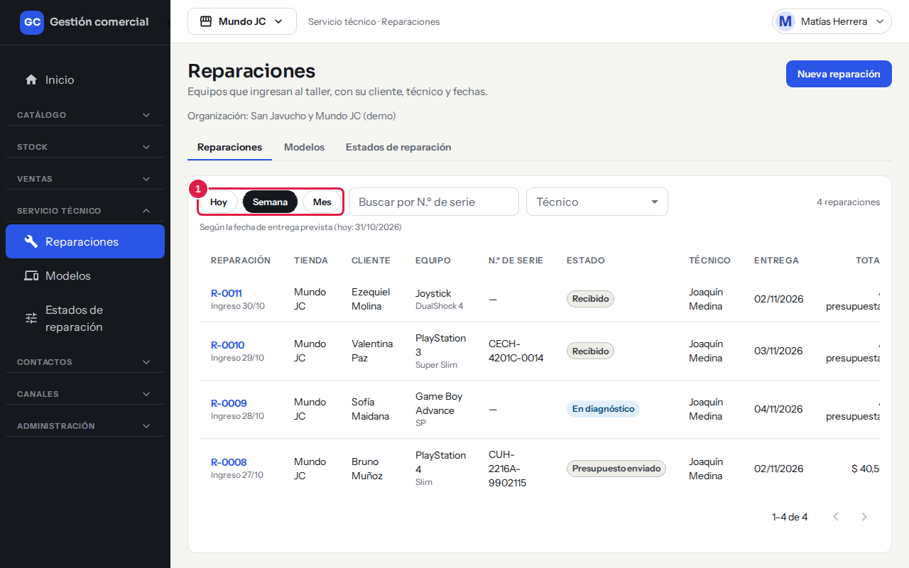

*Hacé clic en Hoy, Semana o Mes (1) para cambiar el período.*

- **Buscar por N.º de serie**: escribí el número entero o una parte. Esta búsqueda ignora el período, así encontrás cualquier reparación.

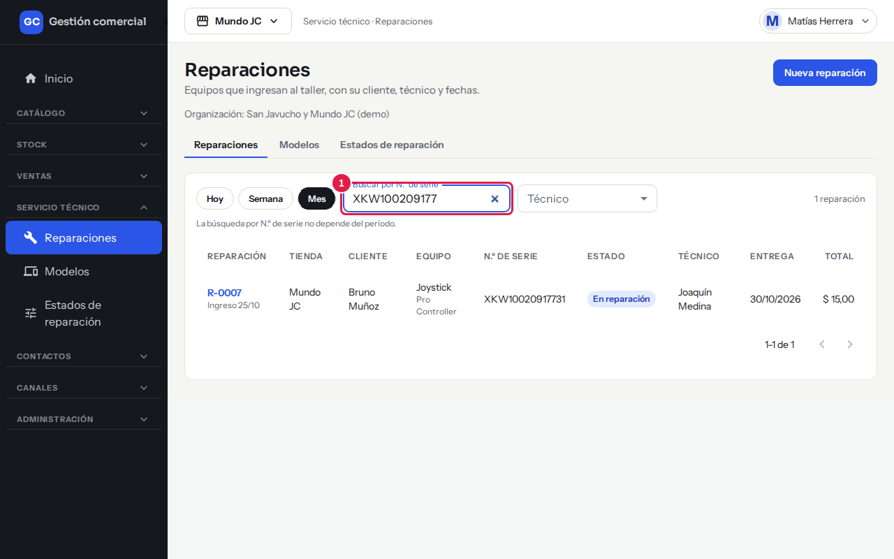

*Al buscar por serie (1) el listado muestra la reparación sin importar el período.*

- **Técnico**: elegí una persona o «Todos los técnicos».

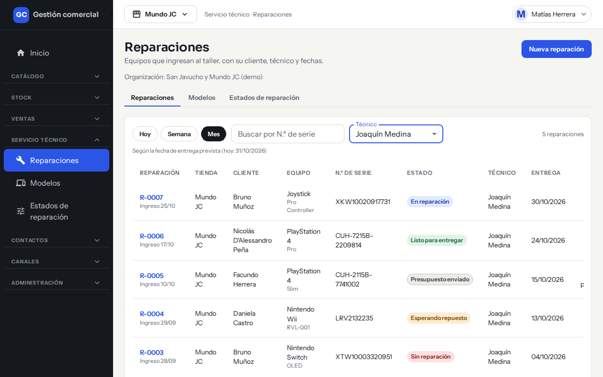

*Con un técnico elegido, el listado muestra solo sus reparaciones.*

Si no hay resultados ves «No hay reparaciones en este período» o, buscando por serie, «No hay reparaciones con ese número de serie».

## Ingresar un equipo

1. Entrá en **Servicio técnico → Reparaciones** y hacé clic en **Nueva reparación**.
2. En **Tienda** dejá la que viene o elegí otra. Cada tienda tiene su propia numeración y después no se puede cambiar.
3. En **Cliente** escribí el nombre y elegilo de la lista. Si es un cliente nuevo, hacé clic en **Nuevo cliente**, completá nombre o razón social, celular y correo, y **Crear cliente**.
4. En **Contacto** podés anotar un teléfono o dato de contacto para esta reparación.
5. Elegí la **Consola o equipo** y después el **Modelo** (la lista de modelos depende del equipo que elegiste).
6. Completá el **N.º de serie**, los **Accesorios recibidos** (cargador, funda, etc.) y la **Falla informada**.
7. En **Técnico** elegí quién se encarga, o dejá «Sin asignar».
8. En **Entrega prevista** poné la fecha que le prometés al cliente. No puede ser anterior al ingreso. El **Ingreso** se registra con la fecha de hoy.
9. Si tenés permiso para ver costos, también aparece la tarjeta **Costo interno** (ver más abajo).
10. Hacé clic en **Guardar**. Te lleva a la ficha de la reparación con el aviso «Reparación R-… creada».

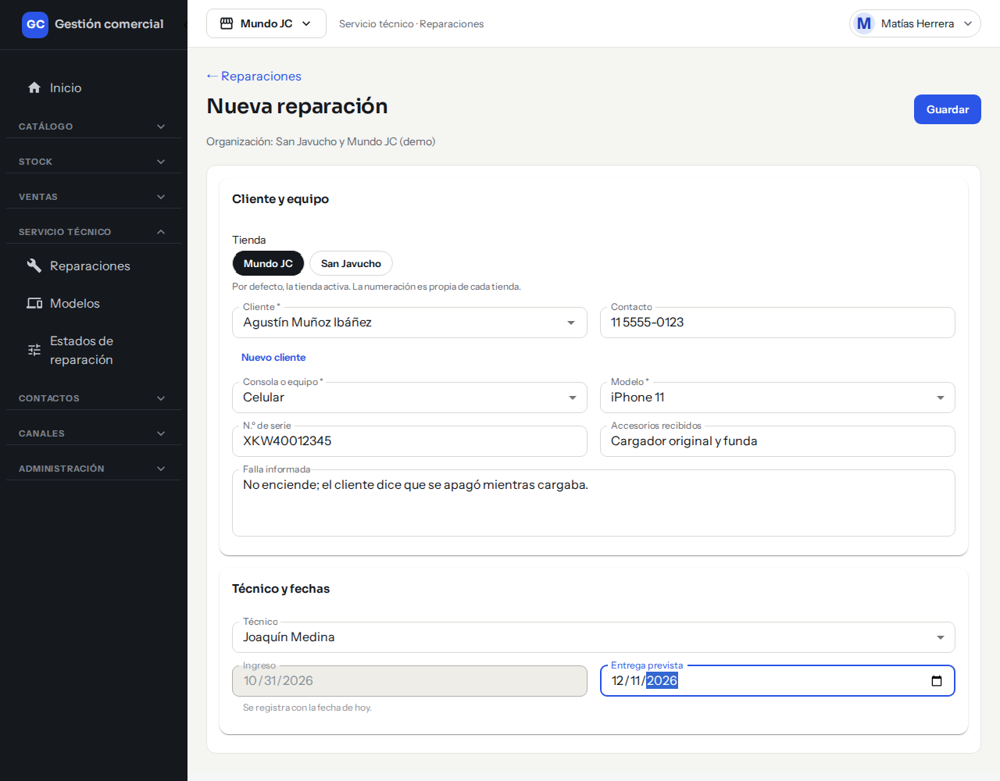

*El formulario completo antes de guardar (en la captura no se guardó).*

Los campos **Cliente**, **Consola o equipo** y **Modelo** son obligatorios. Para corregir algo más adelante, abrí la ficha, cambiá el dato y hacé **Guardar** de nuevo.

## La ficha de la reparación

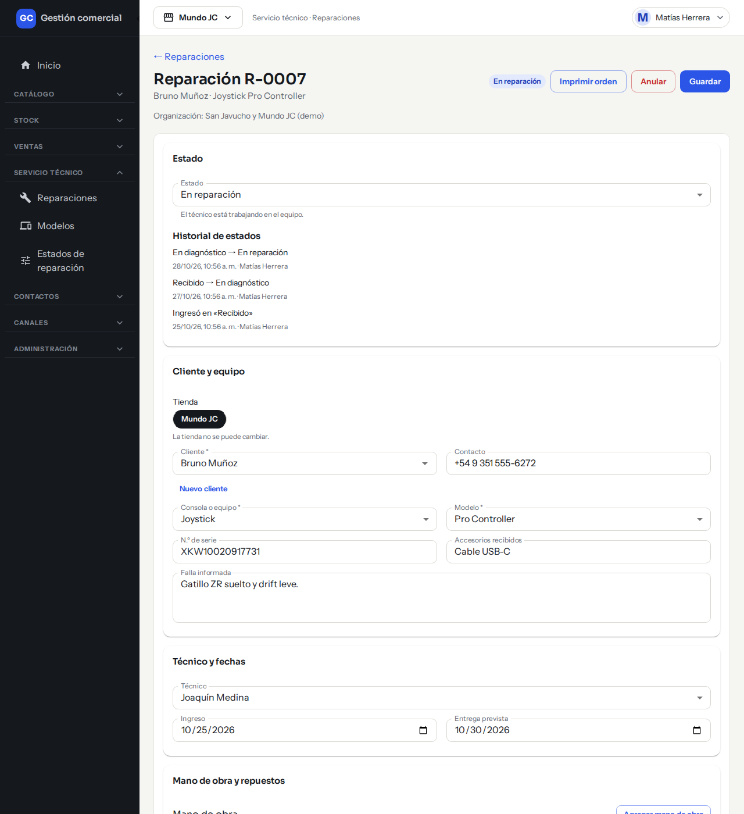

*La ficha reúne el estado, el historial, los datos del equipo, el técnico y, más abajo, los ítems.*

## Cargar mano de obra y repuestos

En la ficha, la sección **Mano de obra y repuestos** tiene dos tablas. Allí armás lo que se le cobra al cliente.

**Para agregar mano de obra**

1. Hacé clic en **Agregar mano de obra**.
2. Escribí el **Concepto** (por ejemplo «Cambio de pantalla»), el **Precio** y la **Cantidad**.
3. Hacé clic en **Agregar**.

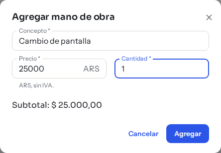

*El diálogo de mano de obra completado (en la captura se cerró con Cancelar).*

**Para agregar un repuesto**

1. Hacé clic en **Agregar repuesto**.
2. En **Buscar producto del catálogo** escribí el nombre o el código (SKU) y elegí el producto. Si el repuesto no está en el catálogo, escribí su descripción y se carga como repuesto libre.
3. Escribí el **Precio** (no se completa solo) y la **Cantidad**.
4. Hacé clic en **Agregar**.

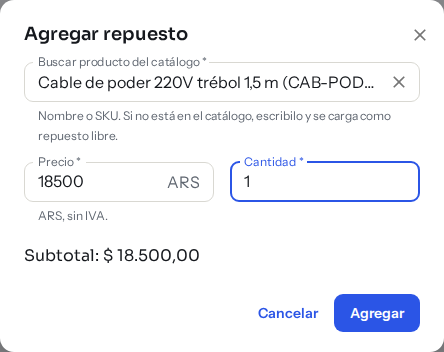

*El diálogo de repuesto con un producto del catálogo elegido.*

Los importes se cargan en pesos, sin IVA. Abajo de las tablas ves **Mano de obra**, **Repuestos** y **Total al cliente**. Podés seleccionar ese total con un clic para copiarlo: el cobro de la reparación se registra a mano desde Ventas.

Si cargaste algo por error, hacé clic en el tachito de esa fila y confirmá en **Quitar**. Los totales se recalculan. Los ítems no se editan: se quitan y se vuelven a cargar. Para saber cómo se relacionan los repuestos con tu stock, mirá [Repuestos, stock y costos](service-repuestos-y-stock.md).

## Cambiar el estado de una reparación

1. Abrí la ficha.
2. En la tarjeta **Estado**, elegí el nuevo estado en la lista.
3. Debajo, **Historial de estados** guarda cada cambio.

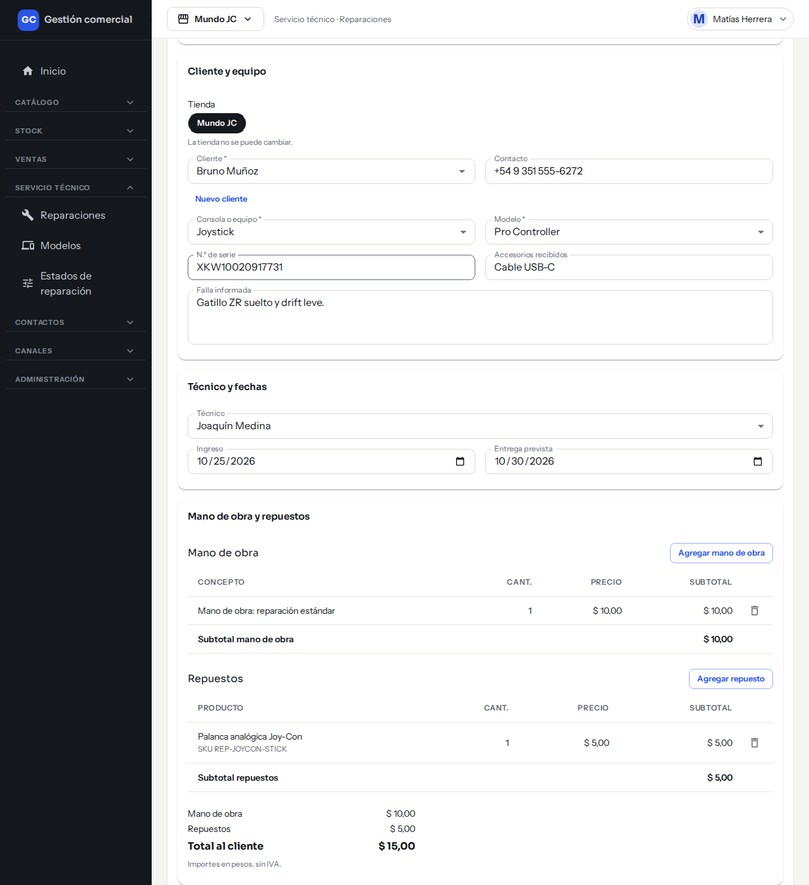

*El selector de estado (1) de la ficha.*

Los estados que vienen cargados son: Recibido, En diagnóstico, Esperando repuesto, En reparación, Listo para entregar, Entregado y Sin reparación. Podés cambiarlos desde **Servicio técnico → Estados de reparación** (ver más abajo).

## Entregar el equipo

1. En la tarjeta **Estado**, elegí el estado que cierra la reparación (en los estados iniciales, «Entregado» o «Sin reparación»).
2. Se abre el cuadro **Entrega**. Completá la **Fecha de entrega** (no puede ser anterior al ingreso ni futura) y **Quién entregó**: el nombre de la persona que retira o recibe el equipo.
3. Hacé clic en **Registrar entrega**. Aparece «Reparación R-… entregada».

*El cuadro de entrega, antes de confirmar.*

Una reparación entregada queda cerrada: ya no admite cambios de estado ni de ítems. En la ficha ves la **Entrega real**.

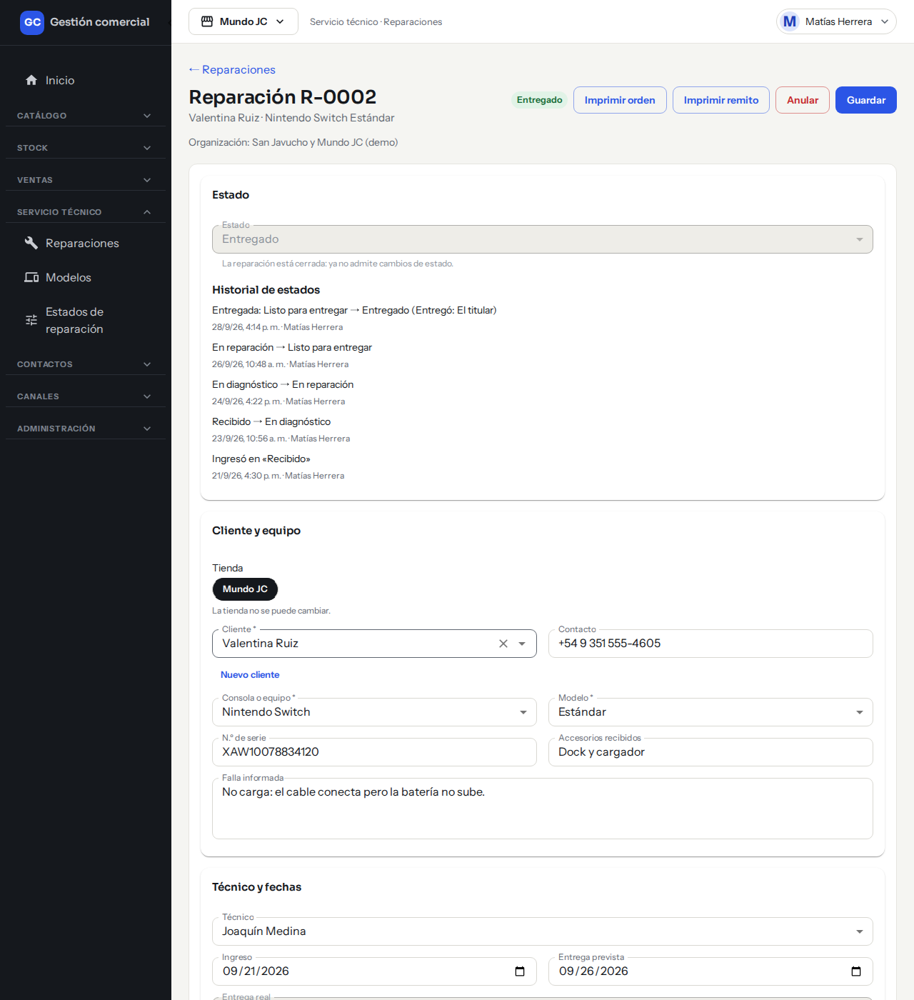

*Una reparación entregada: el estado queda bloqueado y aparecen los botones Imprimir orden e Imprimir remito.*

## Anular una reparación

1. En la ficha, hacé clic en **Anular**.
2. Escribí el **Motivo de la anulación** (es obligatorio).
3. Confirmá con **Anular reparación**.

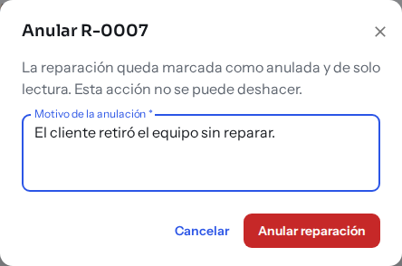

*El cuadro de anulación pide el motivo antes de confirmar.*

La anulación no se puede deshacer: la reparación queda marcada como anulada y solo se puede consultar.

## Imprimir los papeles

Desde la ficha:

- **Imprimir orden**: la orden de ingreso, para darle al cliente cuando deja el equipo. Lleva la tienda, el número, la fecha de ingreso, el cliente, el equipo, el número de serie, los accesorios, la falla informada, el técnico, la entrega prevista y las condiciones. No muestra importes. Está disponible siempre. Si todavía no se cargaron las condiciones del servicio, el documento dice «Condiciones del servicio: pendiente de confirmar.».
- **Imprimir remito**: el remito de entrega. Aparece solo cuando la reparación ya fue entregada y no está anulada. Muestra la mano de obra y los repuestos con sus subtotales, el total sin IVA y los datos de la entrega. Nunca muestra costos internos ni ganancia.

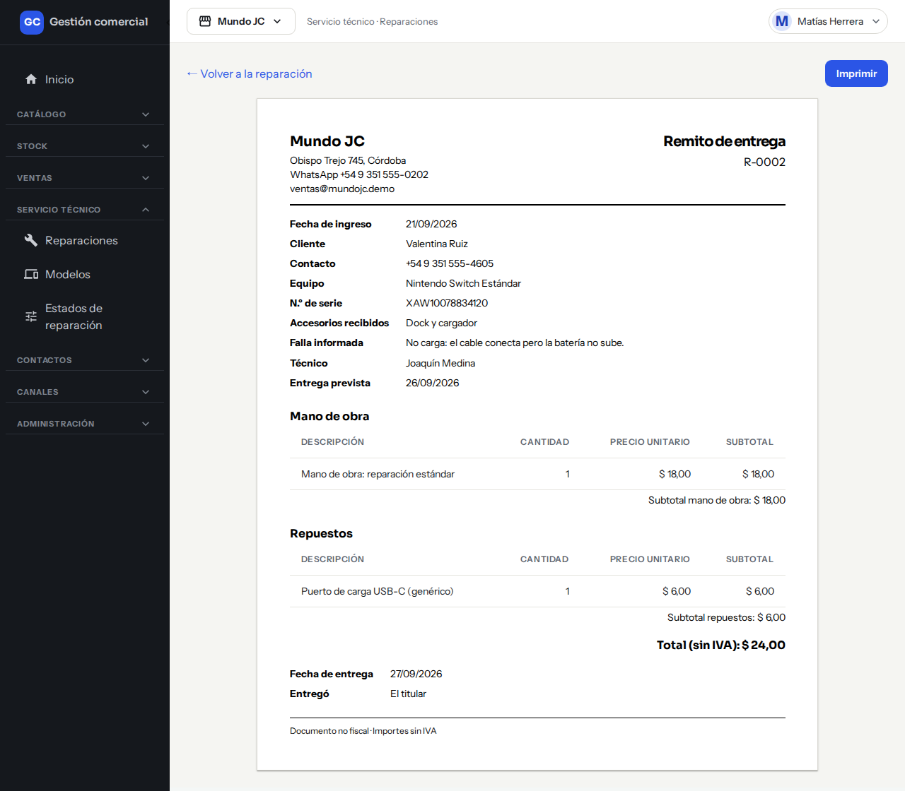

*El remito de entrega: detalle de mano de obra, repuestos y total sin IVA.*

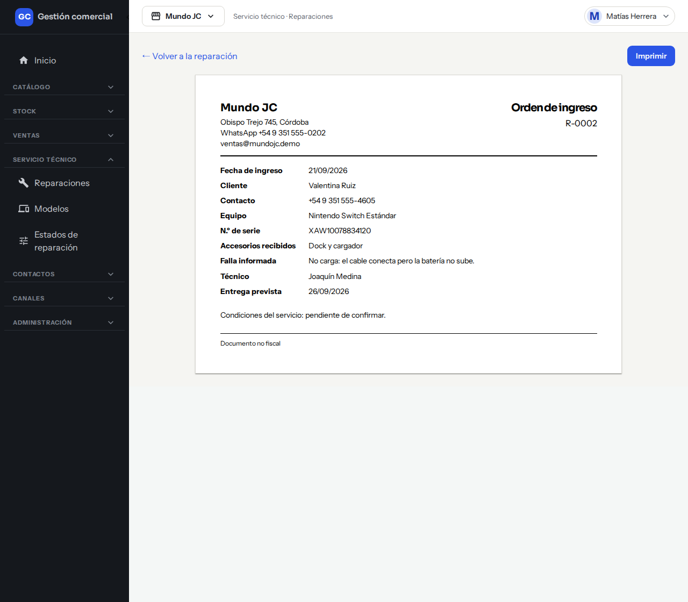

*La orden de ingreso que se le da al cliente cuando deja el equipo.*

Cada botón abre el documento en formato A4; hacé clic en **Imprimir** para mandarlo a la impresora. Con **← Volver a la reparación** regresás a la ficha.

## Modelos y estados configurables

**Modelos** (Servicio técnico → Modelos): cada fila es un modelo de equipo, con su **Mano de obra base** y la cantidad de reparaciones que lo usan.

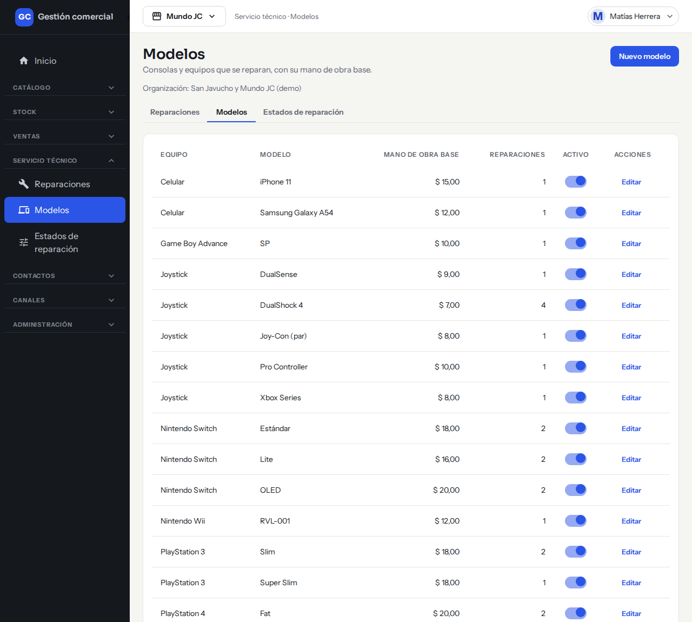

*La lista de modelos.*

- **Nuevo modelo**: completá **Equipo**, **Modelo** y **Mano de obra base** (sin IVA) y hacé clic en **Crear modelo**.

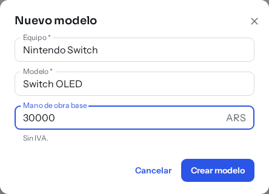

*El alta de un modelo, antes de crearlo.*

- **Editar**: cambia esos datos con **Guardar cambios**.
- El interruptor **Activo** lo oculta o lo vuelve a ofrecer al ingresar equipos. Un modelo desactivado sigue viéndose en las reparaciones que ya lo tenían.

**Estados de reparación** (Servicio técnico → Estados de reparación): las etapas del taller, en orden.

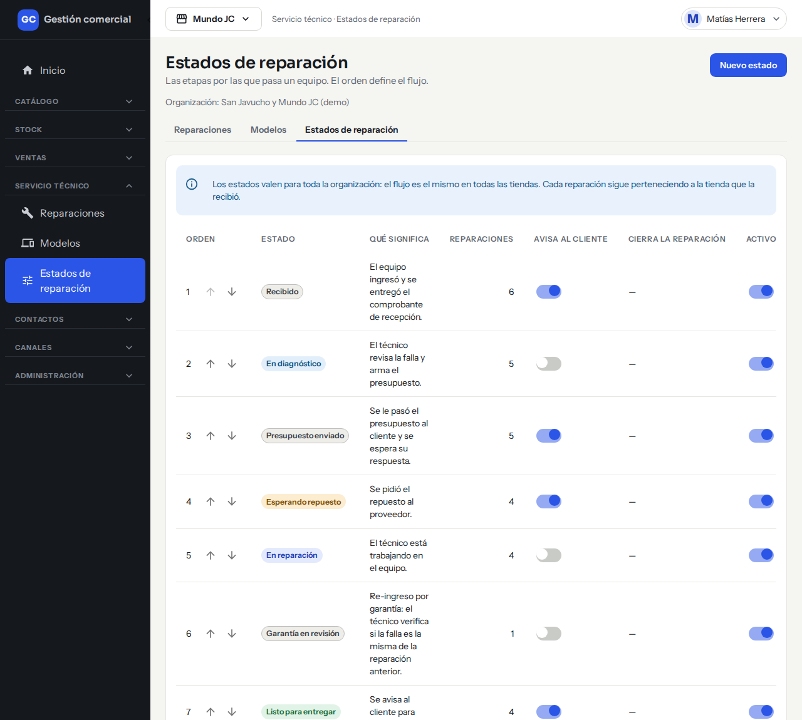

*Las etapas del taller, con su orden.*

- **Nuevo estado**: escribí el **Nombre** y **Qué significa**, y marcá **Avisar al cliente al pasar a este estado** si corresponde. Creá con **Crear estado**.

*El alta de un estado, antes de crearlo.*

- Con las flechas subís o bajás un estado para cambiar el orden.
- **Editar** y el interruptor **Activo** sirven para renombrar o desactivar.
- La columna **Cierra la reparación** indica qué estados dan por terminado el trabajo y piden los datos de entrega.

Por ahora el sistema no envía avisos al cliente al cambiar de estado: la marca «Avisa al cliente» solo queda registrada.

## Si algo no sale

| Mensaje | Qué hacer |
|---|---|
| «Revisá los campos marcados antes de guardar.» | Hay datos obligatorios o inválidos; completalos. |
| «Otra persona modificó esta reparación mientras la editabas. Recargá para ver sus cambios; no se guardó nada tuyo.» | Hacé clic en **Recargar** y volvé a cargar tus cambios. |
| «No tenés permiso para esta acción. Puede que tu rol haya cambiado: recargá la página.» | Recargá; si sigue, pedile acceso a un administrador. |
| «Tu rol puede ver esta reparación, no modificarla.» | Es solo lectura. |
| «Esta reparación está anulada: solo se puede consultar.» | No se puede reabrir; cargá una nueva. |
| «El remito de entrega solo existe para reparaciones entregadas.» | Primero registrá la entrega. |
