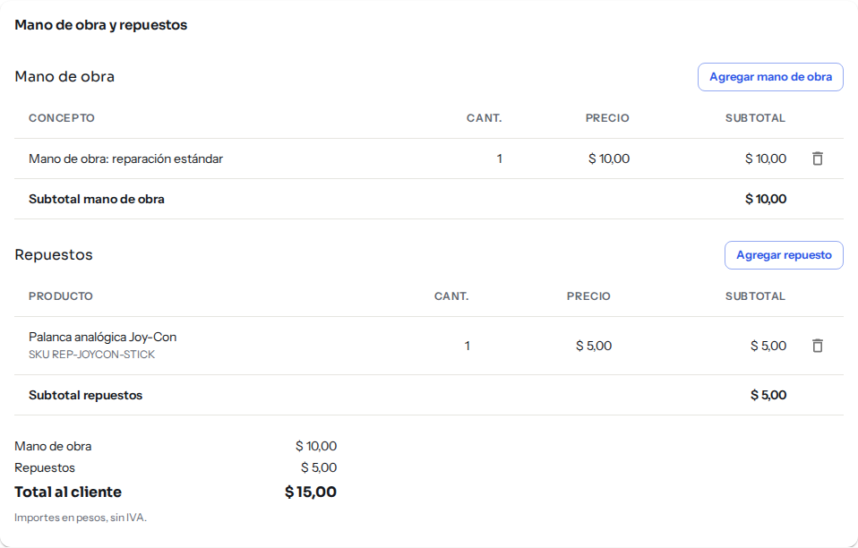
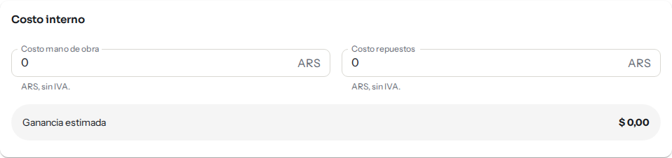
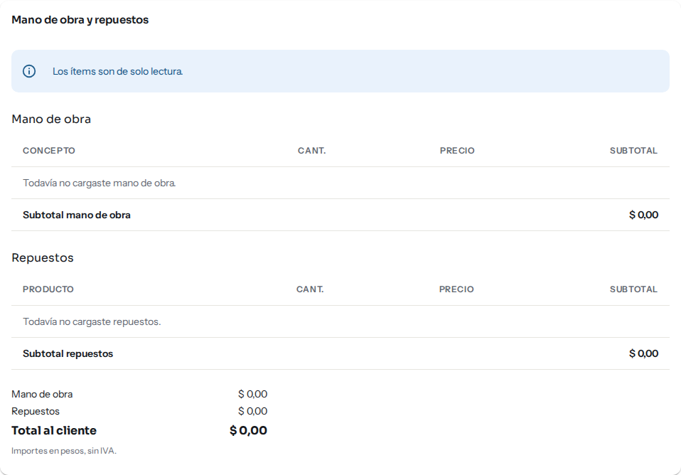

# Service técnico: repuestos, stock y costos

## Para qué sirve

Esta página explica qué pasa con los repuestos que cargás en una reparación: cómo suman al precio que paga el cliente, qué relación tienen con tu stock y quién ve los costos internos y la ganancia.

## Lo más importante: los repuestos no mueven el stock

Cuando agregás un repuesto a una reparación, **el sistema no descuenta nada del stock**, ni lo devuelve si después quitás el repuesto o anulás la reparación. Cargar un repuesto es anotar lo que se le cobra al cliente.

Si usaste una pieza que tenés en un depósito, tenés que descontarla vos desde Stock, con un movimiento de salida (mirá [Movimientos de stock](stock-movimientos.md)). Si no, el stock del depósito va a seguir mostrando esa unidad como disponible.

Por ahora el sistema tampoco avisa si falta stock de un repuesto ni permite elegir de qué depósito sale.

## Quién puede hacerlo

| Rol | Qué puede hacer |
|---|---|
| Administrador, Operador, Técnico | Agregar y quitar repuestos y mano de obra de reparaciones abiertas. |
| Mostrador, Administración, Consulta | Ver los ítems, sin modificarlos («Los ítems son de solo lectura.»). |
| Quien tiene el permiso de ver costos | Además ve el costo interno y la ganancia estimada. |

## Cómo se carga un repuesto

1. Abrí la reparación en **Servicio técnico → Reparaciones**.
2. En **Mano de obra y repuestos**, sección **Repuestos**, hacé clic en **Agregar repuesto**.
3. En **Buscar producto del catálogo** escribí el nombre o el código (SKU) del producto y elegilo. Solo aparecen productos activos de tu organización. Si el repuesto no está en el catálogo, escribí su descripción y se carga como repuesto libre.
4. Completá el **Precio** (en pesos, sin IVA; no se completa solo) y la **Cantidad**.
5. Hacé clic en **Agregar**.

*El diálogo para agregar un repuesto: producto del catálogo, precio y cantidad.*

El repuesto aparece en la tabla con su código SKU (si es del catálogo), la cantidad, el precio y el subtotal. Para detalles del resto de la ficha, mirá [Service técnico: registrar y seguir las reparaciones](service-listado-items-impresion.md).

## Cómo se relacionan con precios y totales

*Los ítems de una reparación con sus subtotales y el total al cliente.*

- El **precio del repuesto lo escribís vos** en cada reparación. No se toma automáticamente del precio de venta del producto en el catálogo (mirá [Precios e IVA](precios-e-iva.md) si querés consultarlo antes de cargarlo).
- **Subtotal repuestos** y **Subtotal mano de obra** se suman en **Total al cliente**. Todo en pesos, sin IVA.
- El total sale en el listado, en la columna **Total**, y en el remito de entrega.
- Si todavía no cargaste ningún ítem, el listado dice «A presupuestar».
- Los ítems solo se agregan o quitan mientras la reparación está abierta. Una reparación entregada o anulada queda cerrada.

## Costos internos y ganancia

En la ficha hay una tarjeta aparte, **Costo interno**, con dos campos: **Costo mano de obra** y **Costo repuestos** (en pesos, sin IVA). Sirve para anotar cuánto te cuesta a vos la reparación, no lo que paga el cliente.

Cuando hay costos cargados se muestra la **Ganancia estimada**: el total al cliente menos el costo interno.

| Quién | Qué ve |
|---|---|
| Quien tiene el permiso de ver costos | La tarjeta **Costo interno**, sus campos y la **Ganancia estimada**. |
| El resto de los roles (por ejemplo, el Técnico) | No ve esa tarjeta ni la ganancia, ni puede cargar costos. |

*Con el permiso de ver costos aparece la tarjeta Costo interno y la ganancia estimada.*

*Sin permiso para modificar, los ítems se ven en solo lectura: no hay botones para agregar ni quitar.*

El Administrador define quién tiene ese permiso en **Administración → Roles y permisos**. El remito y la orden de ingreso que se imprimen nunca muestran costos internos ni ganancia.

## Si algo no sale

| Mensaje | Qué hacer |
|---|---|
| «Los ítems son de solo lectura.» | Tu rol, o el estado de la reparación (entregada o anulada), no permite cambiar ítems. |
| «No pudimos buscar en el catálogo. Podés escribir el repuesto y cargarlo libre.» | Escribí la descripción y seguí: se carga como repuesto libre. |
| «No pudimos agregar el ítem.» / «No pudimos quitar el ítem.» | Probá de nuevo; si sigue, recargá la página. |
| «No tenés permiso para esta acción. Puede que tu rol haya cambiado: recargá la página.» | Pedile acceso a un administrador. |
