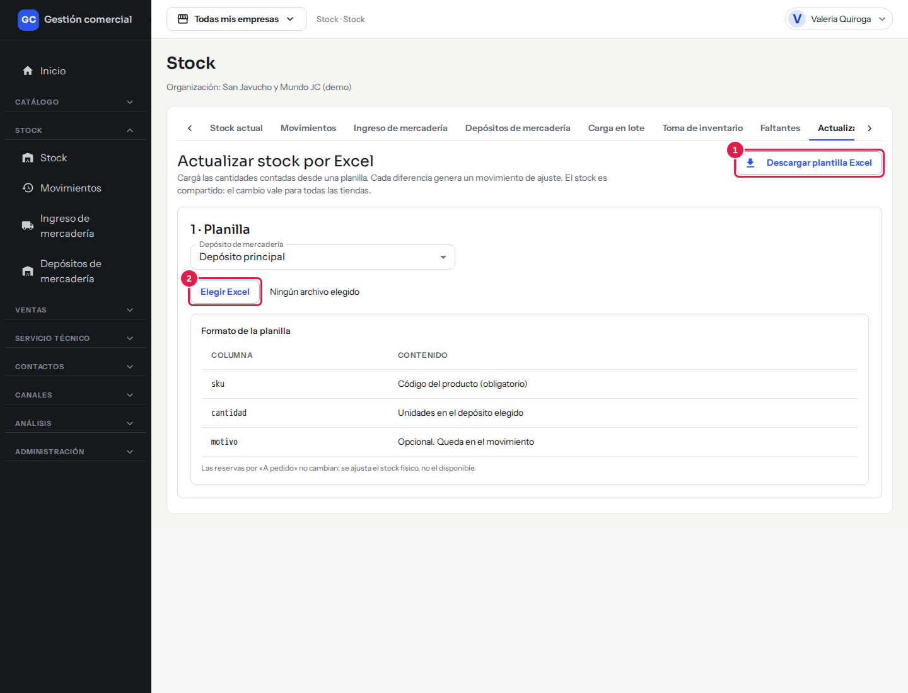
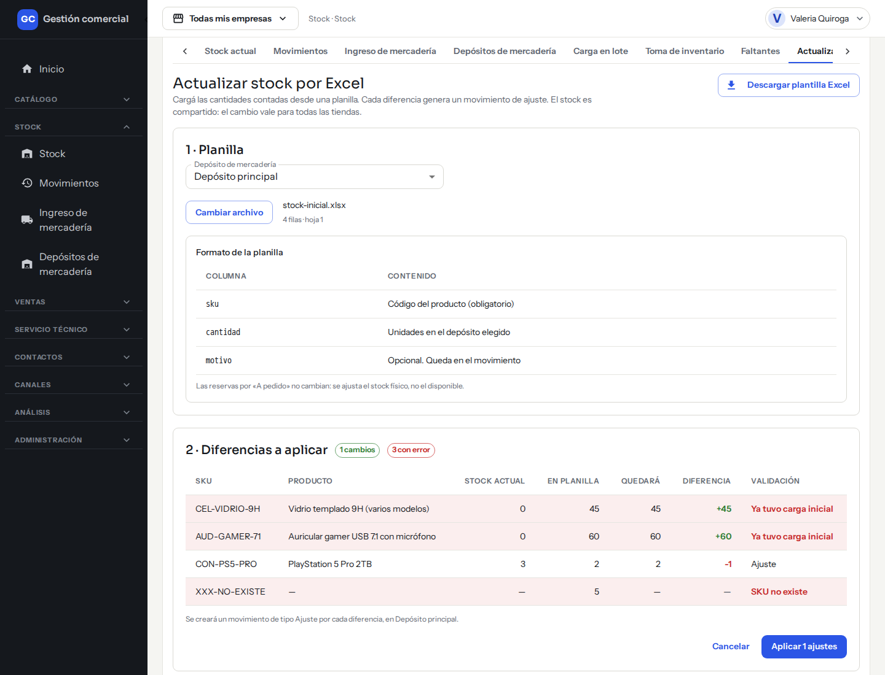
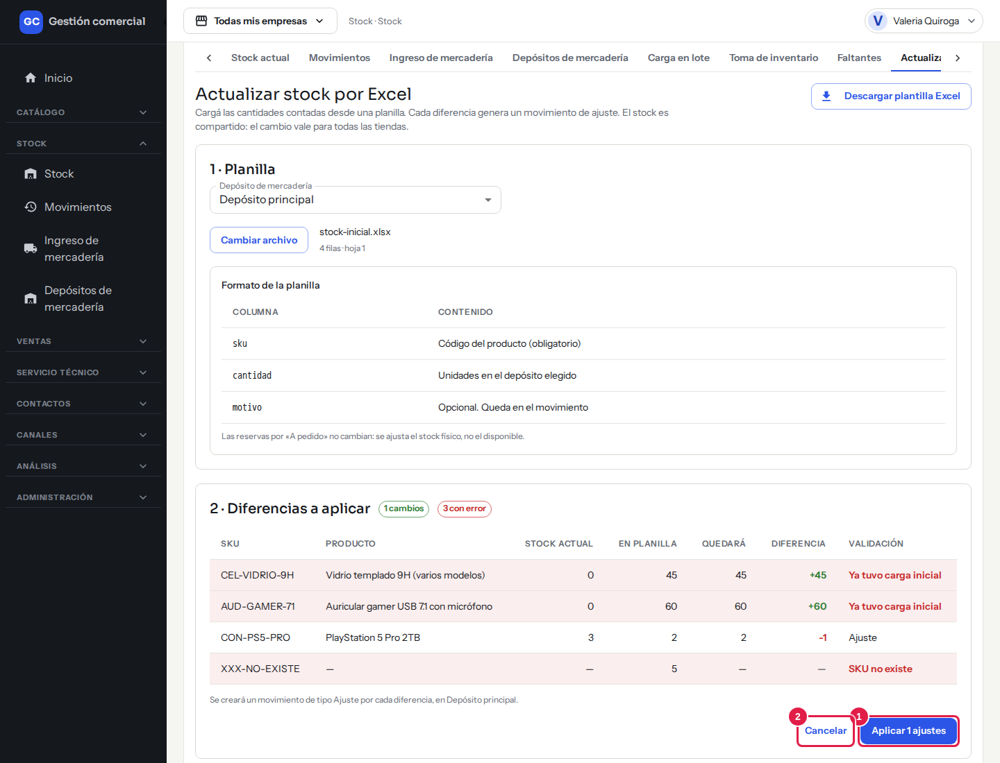
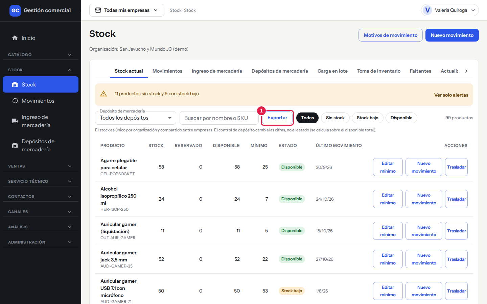
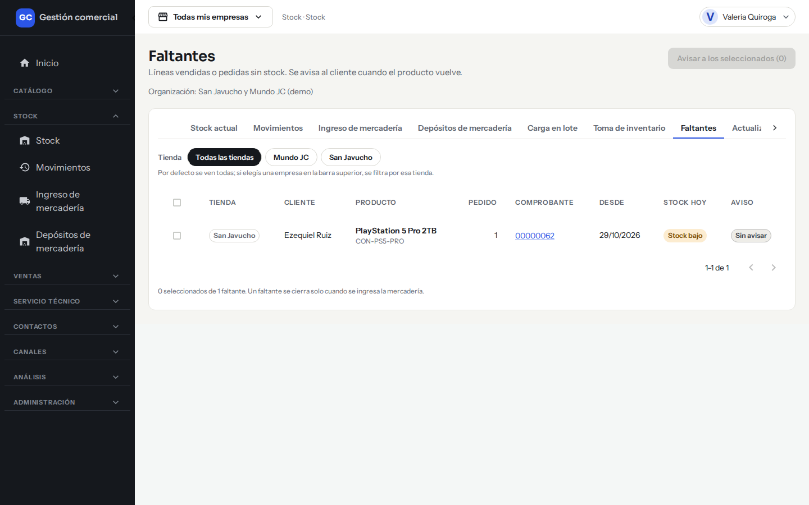
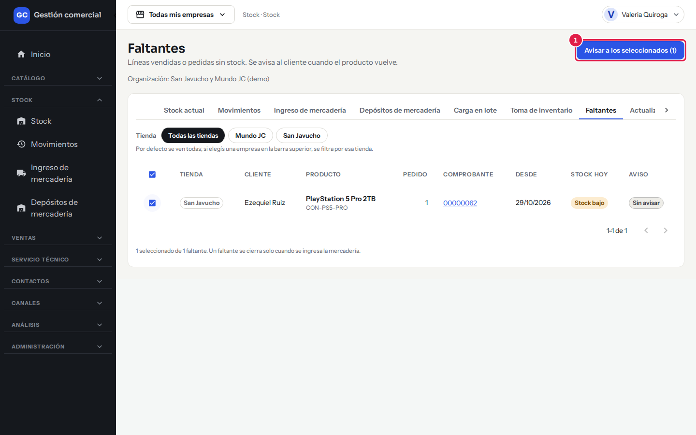
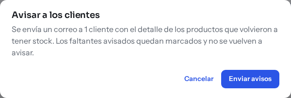
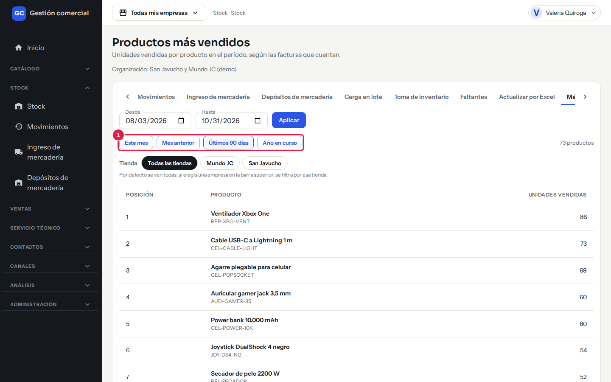

# Cargar stock desde una planilla, exportar y recibir avisos

## Para qué sirve

- Arrancar con el inventario real cargado desde una planilla de Excel, sin tipear producto por producto.
- Bajar el stock y los movimientos a un archivo.
- Enterarte de qué productos hay que reponer sin tener que entrar a mirar.
- Saber qué ventas «a pedido» están esperando mercadería, avisar a los clientes y ver qué productos se venden más.

## Quién puede hacerlo

| Rol | Qué puede hacer |
|---|---|
| Administrador, Operador, Depósito | Cargar stock por planilla, exportar y recibir el resumen de reposición |
| Consulta, Mostrador, Administración | Exportar y ver **Más vendidos**. Ven **Faltantes** si tienen acceso a las ventas de esa tienda |
| Quien puede editar ventas | Avisar a los clientes desde **Faltantes** |

## Cargar el stock inicial desde una planilla

### Dónde lo encontrás

**Stock → Stock actual**, pestaña **Actualizar por Excel** (solo aparece si podés editar el stock).

### Paso a paso

1. En **Depósito de mercadería** elegí a qué depósito corresponde la planilla (viene el depósito por defecto).
2. Hacé clic en **Descargar plantilla Excel** (arriba a la derecha) para bajar el modelo, o preparate tu propio archivo con el mismo formato.

    

    *Pasos 2 y 4: **Descargar plantilla Excel** (1) baja el modelo y **Elegir Excel** (2) abre tu archivo. Abajo ves el formato que tiene que tener la planilla.*

3. Completá la planilla (ver abajo) y guardala como `.xlsx`.
4. Hacé clic en **Elegir Excel** y seleccioná el archivo. Podés cambiarlo con **Cambiar archivo**.
5. El sistema revisa la planilla y muestra una **vista previa**: **SKU**, **Producto**, **Stock actual**, **En planilla**, **Quedará**, **Diferencia** y **Validación**. Arriba ves los contadores «N cambios» y «N con error». Las filas con error se marcan en rojo.

*Vista previa de una planilla de ejemplo: una fila válida (se aplicará como un ajuste) y tres con error, marcadas en rojo con el motivo en la columna **Validación**.*
6. Si está bien, hacé clic en **Aplicar N ajustes**. Si no querés seguir, **Cancelar**.
7. Aparece «Stock actualizado. Se registraron N movimientos de ajuste. Podés verlos en Stock · Movimientos.» Si alguna fila tenía error, agrega «Se omitieron N filas con error.»

*Paso 6: **Aplicar** (1) registra los ajustes de las filas válidas; **Cancelar** (2) descarta la planilla sin cambiar nada.*

Nada se aplica hasta que confirmás en el paso 6. Se aplican solo las filas válidas; las demás quedan sin tocar.

### Formato de la planilla

Usá la primera hoja y poné los títulos en la primera fila.

| Columna | Qué poner |
|---|---|
| **sku** | Código del producto (obligatorio) |
| **cantidad** | Unidades que debe tener el depósito elegido (número entero, cero o más) |
| **motivo** | Opcional. Queda como nota del movimiento (hasta 500 caracteres) |

La planilla **reemplaza** la cantidad del depósito: si ponés 20, el depósito queda con 20 (no suma 20). Cada diferencia se registra como un **Ajuste**. Las unidades reservadas para productos «a pedido» no cambian.

### Qué hace el sistema con cada fila

| Situación | Resultado |
|---|---|
| El SKU está vacío o repetido en la planilla | Fila con error |
| El SKU no existe | Fila con error («SKU no existe») |
| El producto está inactivo | Fila con error («Producto inactivo») |
| La cantidad no es un entero de cero o más | Fila con error |
| La cantidad es menor a lo que está reservado | Fila con error: el stock no puede quedar por debajo de lo reservado |
| El producto ya tuvo su carga inicial | Fila con error («Ya tuvo carga inicial») |
| La cantidad es igual a la actual | Sin cambios: no genera movimiento |

**Un producto admite una sola carga inicial.** Después, el stock se corrige con movimientos, una toma de inventario o una carga en lote ([ver cómo](stock-lotes-e-inventario.md)).

### Si el archivo no se puede leer

| Mensaje | Qué hacer |
|---|---|
| «El archivo debe ser una planilla Excel (.xlsx).» | Guardá el archivo en formato .xlsx |
| «La primera fila debe tener los encabezados «sku» y «cantidad».» | Revisá los títulos de la primera fila |
| «La planilla está vacía.» / «La planilla no tiene filas con datos.» | Cargá al menos una fila |
| «La planilla tiene más de 2.000 filas. Dividila en archivos más chicos.» | Partí el archivo |
| «El archivo pesa más de 5 MB…» | Partí el archivo |
| «No pudimos aplicar la carga. No se guardó ningún ajuste: probá de nuevo.» | No se cambió nada; reintentá |

## Exportar el stock y los movimientos

El botón **Exportar** está en **Stock actual** y en **Movimientos**.

- Baja un archivo con **todas las filas del filtro que tengas aplicado** (no solo la página que ves), con las mismas columnas que la tabla.
- El archivo se llama `stock-actual-AAAA-MM-DD` o `movimientos-stock-AAAA-MM-DD` (con la fecha de hoy) y es de tipo CSV: se abre con Excel y con cualquier planilla.
- Mientras se prepara, el botón dice «Exportando…».

*El botón **Exportar** (1) está junto a los filtros, en Stock actual y en Movimientos.*

- Si no hay filas, el archivo trae solo los títulos y aparece «No hay filas para exportar. El archivo trae solo los encabezados.»
- Hay un tope de 100.000 filas: si hay más, se exportan las primeras y se avisa que afines los filtros.
- Si falla, no se descarga nada y aparece un aviso con **Reintentar**.

## Avisos de reposición y de stock bajo

### En pantalla

Al entrar a **Stock actual**, si hay productos en alerta aparece el aviso «N productos sin stock y M con stock bajo» con **Ver solo alertas**. Lo que cuenta como «stock bajo» depende del mínimo que definiste ([cómo definirlo](stock-movimientos.md)).

### Por correo

Una vez por día el sistema te manda un resumen por correo con los productos que **entraron en alerta**:

- **Qué se avisa**: los productos que pasaron a «Stock bajo» o «Sin stock» y todavía no se habían avisado, o que estaban en «Stock bajo» y se quedaron sin stock. Un producto que vuelve a «Disponible» puede avisarse de nuevo si más adelante vuelve a caer.
- **Cuándo**: una vez por día. Si ese día no hay novedades, no llega ningún correo.
- **A quién**: a las personas activas que pueden editar el stock.
- **Qué trae**: el asunto con el total («N productos sin stock y M con stock bajo») y, por producto, nombre, SKU, stock, disponible, mínimo y estado. Primero los que están sin stock. Un correo incluye hasta 50 productos.
- Si el envío falla, los productos no se dan por avisados y entran en el próximo resumen.

Por ahora no hay una pantalla para elegir los destinatarios ni la hora del resumen.

## Ver los faltantes y avisar a los clientes

**Stock → Stock actual**, pestaña **Faltantes**: lista las ventas confirmadas de productos «a pedido» que siguen esperando mercadería (con la reserva activa).

| Columna | Qué muestra |
|---|---|
| **Tienda** | La empresa que vendió |
| **Cliente** | A quién se le vendió |
| **Producto** | Nombre y SKU |
| **Pedido** | Unidades pedidas |
| **Comprobante** | Número del comprobante de la venta |
| **Desde** | Desde cuándo está pendiente |
| **Stock hoy** | Estado actual del producto: Sin stock, Stock bajo o Disponible |
| **Aviso** | «Sin avisar» o «Avisado» |

*Faltantes: arriba podés filtrar por **Tienda**. Cada fila es un producto «a pedido» vendido que sigue esperando mercadería.*

Un faltante desaparece solo cuando la mercadería se entrega o la reserva se libera: no hay botón para cerrarlo a mano.

Para avisar:

1. Marcá las filas de los productos que ya volvieron a tener stock (o usá la casilla para seleccionar todos).
2. Hacé clic en **Avisar a los seleccionados (N)**.
3. En **Avisar a los clientes** leé el detalle y hacé clic en **Enviar avisos**.

*Paso 2: con las filas marcadas, el botón **Avisar a los seleccionados** (1) muestra cuántas elegiste.*

*Paso 3: el diálogo explica qué se va a enviar. **Cancelar** sale sin enviar nada.*

Se envía un correo por cliente con todos sus productos, y los faltantes quedan **Avisado**: no se vuelve a avisar dos veces. Se omiten los productos que todavía no tienen stock, los que ya se avisaron y los clientes sin correo; el aviso del sistema dice cuántos fueron y por qué («Avisos enviados. Se omitieron: …» o «No se enviaron avisos…»).

## Ver los productos más vendidos

**Stock → Stock actual**, pestaña **Más vendidos**: ranking de productos por unidades vendidas en un período, con **Posición**, **Producto** y **Unidades vendidas**.

1. Elegí el período con los atajos **Este mes**, **Mes anterior**, **Últimos 90 días** o **Año en curso**, o escribí las fechas **Desde** y **Hasta** y hacé clic en **Aplicar**. Por defecto muestra el mes en curso.
2. Para ver una sola tienda, usá el filtro **Tienda** de la pantalla (o la empresa de la barra superior).

*Más vendidos: los atajos de período (1) cambian las fechas Desde y Hasta; abajo está el ranking.*

Cuentan las unidades de las facturas del período. Los presupuestos, borradores y comprobantes anulados no suman. Si no hubo ventas, ves «No hay ventas en el período». Este reporte no se exporta.

## Preguntas frecuentes

**¿Puedo cargar la planilla dos veces?** Un producto solo admite una carga inicial; si ya la tuvo, esa fila se rechaza.

**¿La planilla suma o reemplaza?** Reemplaza la cantidad del depósito elegido.

**¿Dónde veo lo que cargó la planilla?** En **Movimientos**, como ajustes.
