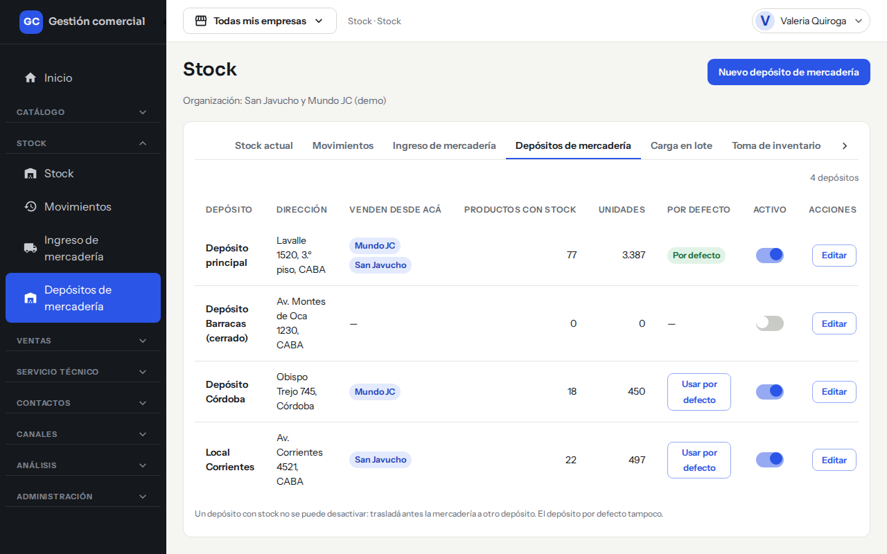
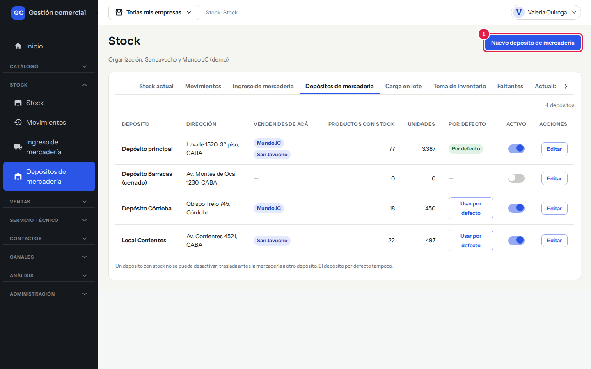
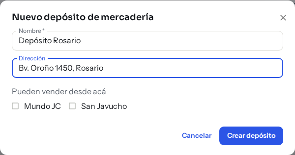
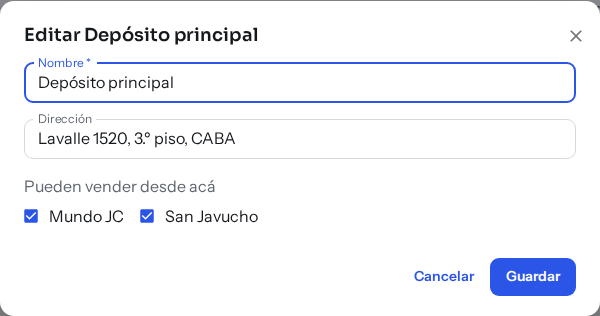
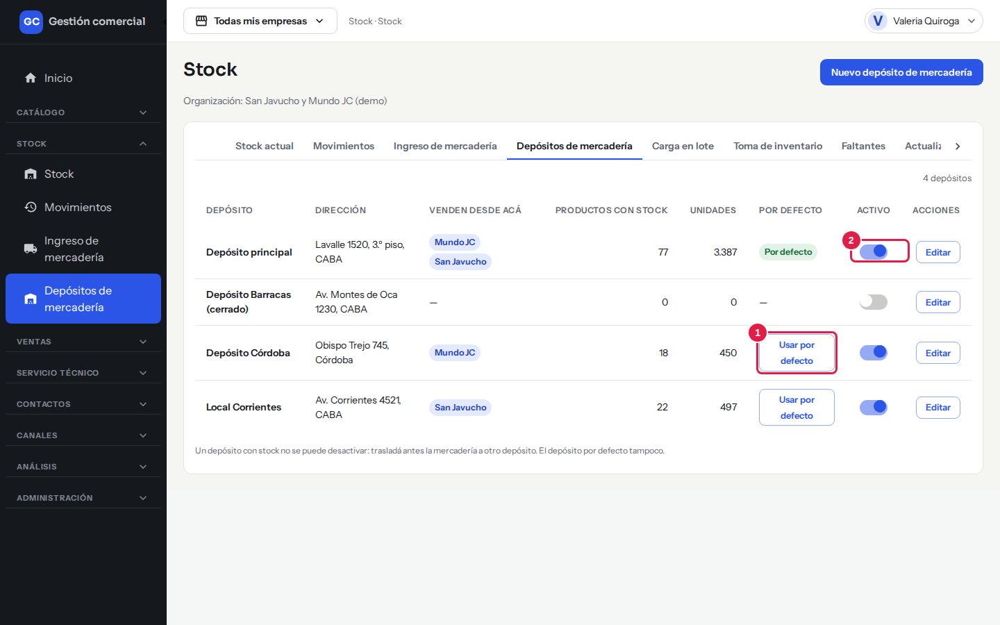
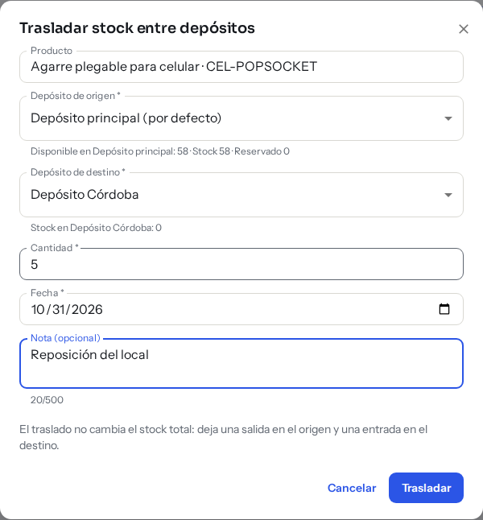
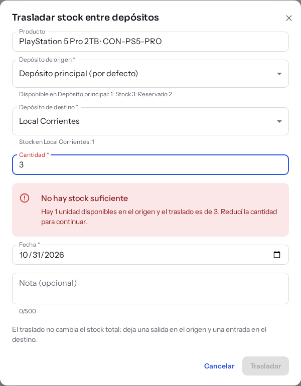
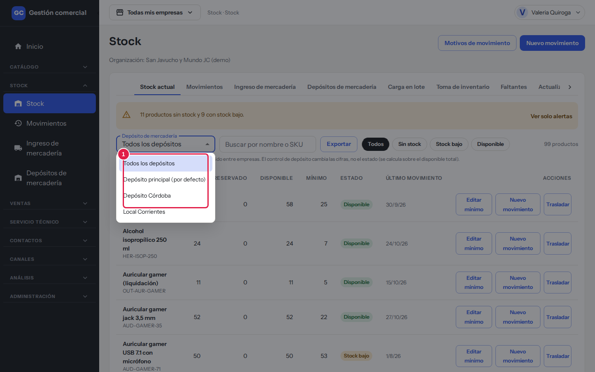
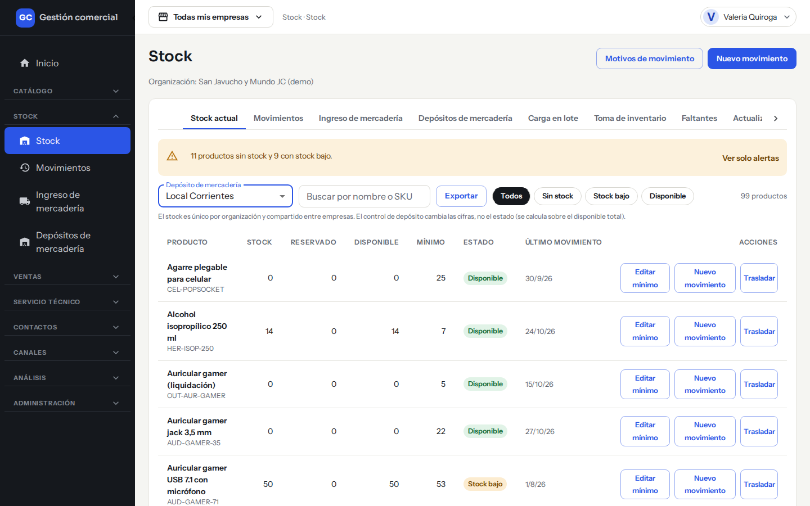
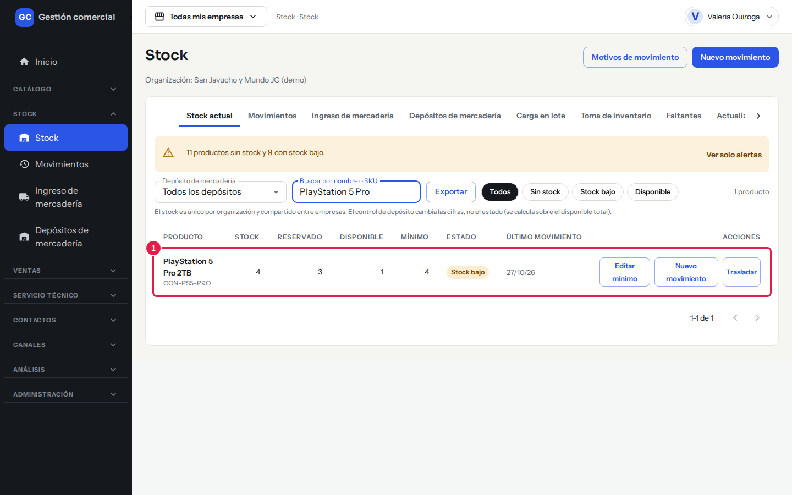

# Depósitos, traslados y reservas de stock

## Para qué sirve

Si guardás mercadería en más de un lugar (un local, un depósito, otra ciudad), podés definir cada lugar como un **depósito**, ver cuánto hay en cada uno y trasladar unidades de uno a otro. Además, los productos vendidos «a pedido» quedan **reservados** hasta que se entregan, así no se venden dos veces.

El stock total del negocio sigue siendo uno solo: los depósitos lo reparten, no lo duplican.

## Quién puede hacerlo

| Rol | Qué puede hacer |
|---|---|
| Administrador | Crear y editar depósitos, elegir el depósito por defecto, activarlos o desactivarlos |
| Operador, Depósito | Elegir el depósito al registrar movimientos y trasladar mercadería entre depósitos |
| Consulta, Mostrador, Administración | Ver los depósitos y el stock de cada uno, sin botones de cambio |

## Dónde lo encontrás

- Los depósitos: **Stock → Depósitos de mercadería**.
- Los traslados: en **Stock → Stock actual**, botón **Trasladar** en la fila del producto.

*Depósitos de mercadería: cuántos productos y unidades hay en cada uno, y cuál es el de por defecto.*

## Qué muestra la tabla de depósitos

| Columna | Qué significa |
|---|---|
| **Depósito** | Nombre del depósito |
| **Dirección** | Dirección, si la cargaste |
| **Venden desde acá** | Las empresas que pueden vender mercadería de ese depósito |
| **Productos con stock** | Cuántos productos tienen unidades ahí |
| **Unidades** | Total de unidades en el depósito |
| **Por defecto** | Marca el depósito por defecto o te deja elegirlo con **Usar por defecto** |
| **Activo** | Interruptor para activar o desactivar el depósito |

Arriba a la derecha ves cuántos depósitos hay. Si en la barra superior elegís una empresa puntual, solo se listan los depósitos desde los que vende esa empresa; con **Todas mis empresas** ves todos.

## Crear un depósito

1. Entrá a **Stock → Depósitos de mercadería**.
2. Hacé clic en **Nuevo depósito de mercadería**.

    

    *Paso 2: el botón está arriba a la derecha.*

3. Completá el **Nombre** (obligatorio, hasta 80 caracteres) y, si querés, la **Dirección** (hasta 200).
4. En **Pueden vender desde acá** marcá las empresas que van a vender mercadería de este depósito. La empresa que tenés elegida en la barra superior viene marcada.
5. Hacé clic en **Crear depósito**. Aparece «Depósito creado».

*Así se ve el formulario completo (ejemplo). Si solo querés mirarlo, cerralo con **Cancelar**.*

## Editar un depósito

En la fila del depósito hacé clic en **Editar**, cambiá lo que necesites y hacé clic en **Guardar**. Aparece «Depósito guardado».

*Editar un depósito: el mismo formulario, con los datos actuales. **Cancelar** cierra sin guardar.*

## El depósito por defecto

Siempre hay un depósito por defecto: es el que el sistema usa cuando un movimiento no indica otro (por ejemplo, el ingreso de mercadería, la carga en lote y la toma de inventario). Para cambiarlo, hacé clic en **Usar por defecto** en la fila del depósito que querés. Aparece «&lt;Nombre&gt; es ahora el depósito por defecto». Solo se puede elegir un depósito activo.

*Usar por defecto (1) aparece en los depósitos que no son el principal; el interruptor **Activo** (2) activa o desactiva el depósito.*

## Desactivar un depósito

Usá el interruptor de la columna **Activo**. Aparece «&lt;Nombre&gt; quedó inactivo». Un depósito inactivo no aparece al elegir depósito y no recibe entradas. Los depósitos no se borran, solo se desactivan, y se pueden volver a activar.

Hay dos casos en que no se puede desactivar:

| Mensaje | Qué hacer |
|---|---|
| «Tiene stock: trasladá la mercadería antes de desactivarlo» | Trasladá todas las unidades a otro depósito y probá de nuevo |
| «El depósito por defecto no se puede desactivar» | Primero elegí otro depósito como por defecto |

### Otros mensajes

| Mensaje | Qué significa |
|---|---|
| «Ya existe un depósito con ese nombre» | Elegí otro nombre |
| «Ingresá el nombre del depósito.» | El nombre es obligatorio |
| «Solo el Administrador puede definir depósitos» | Pedile el cambio al Administrador |
| «Cambiaste de empresa: cerramos el formulario del depósito para no mezclar datos. Volvé a abrirlo si querés seguir» | Cambiaste la empresa de la barra superior con el formulario abierto; abrilo de nuevo |

## Trasladar stock entre depósitos

Sirve para mover unidades de un depósito a otro sin cambiar el stock total. Necesitás **al menos dos depósitos activos**.

1. En **Stock actual**, en la fila del producto, hacé clic en **Trasladar**.
2. Se abre **Trasladar stock entre depósitos**. El **Producto** ya viene elegido.
3. Elegí el **Depósito de origen**. Debajo ves lo que hay: «Disponible en…, Stock…, Reservado…».
4. Elegí el **Depósito de destino**.
5. Escribí la **Cantidad**.
6. Revisá la **Fecha** (hoy por defecto; no puede ser futura) y, si querés, agregá una **Nota (opcional)**.
7. Hacé clic en **Trasladar**. Aparece «Traslado registrado» con lo que queda en cada depósito.

*Trasladar stock entre depósitos: se elige origen, destino y cantidad.*

*Si pedís más de lo disponible en el origen, el sistema avisa «No hay stock suficiente» y el botón **Trasladar** queda deshabilitado. Las unidades reservadas no se pueden trasladar.*

En **Movimientos** el traslado queda como dos renglones: «Traslado · Salida» en el origen y «Traslado · Entrada» en el destino.

| Mensaje | Qué significa y qué hacer |
|---|---|
| «No hay stock suficiente» | La cantidad supera lo disponible en el depósito de origen. Bajala. Las unidades reservadas no se pueden trasladar |
| «Para trasladar necesitás al menos dos depósitos activos. Creá otro en la pestaña «Depósitos de mercadería».» | Solo tenés un depósito activo |
| «La fecha no puede ser futura.» | Elegí hoy o una fecha anterior |

## Disponible y reservado

Para cada producto y cada depósito:

**Disponible = Stock − Reservado**

Ejemplo: un producto con 10 unidades y 3 reservadas tiene 7 disponibles. Una salida o traslado de 8 unidades se rechaza, aunque el total sea 10.

Estas cifras las ves en **Stock actual** (columnas **Stock**, **Reservado** y **Disponible**) y en el resumen de **Movimientos**.

En **Stock actual**, el selector **Depósito de mercadería** te deja ver las cifras de un depósito puntual:

*Elegí «Todos los depósitos» para ver el total del negocio o un depósito para ver solo lo que hay ahí.*

*Con un depósito elegido, **Stock**, **Reservado** y **Disponible** pasan a ser las cifras de ese depósito. El estado sigue calculándose sobre el total.*

## Reservas de productos «a pedido»

Un producto «a pedido» es uno que vendés antes de tenerlo en mano. Funciona así:

1. **Reservar**: al vender el producto, las unidades quedan reservadas en el depósito elegido. El stock total no baja, pero **Reservado** sube y **Disponible** baja.
2. **Descontar al entregar**: cuando el cliente retira o recibe el producto, la reserva se descuenta. El stock baja, el reservado vuelve a cero y en Movimientos queda una salida con el motivo «Entrega de producto a pedido».
3. **Liberar**: si la venta no se concreta, la reserva se libera. El reservado vuelve a cero y el stock no cambia.

No hay una pantalla aparte de reservas: se generan desde la venta y las ves en la columna **Reservado**.

*Un producto «a pedido» con reservas (1): tiene 4 unidades, 3 están reservadas para ventas que todavía no se entregaron y solo 1 está disponible.*

Para saber qué ventas «a pedido» están esperando mercadería, usá la pestaña **Faltantes** (ver [Carga, exportación y avisos](stock-carga-exportacion-y-avisos.md)). Una reserva ya descontada o liberada no se vuelve a usar, y no se puede reservar más que lo disponible («No hay stock suficiente»).

## Preguntas frecuentes

**¿Un depósito tiene su propio stock total?** Cada depósito muestra sus unidades, pero la suma de todos es el stock del negocio.

**¿Al ingresar mercadería puedo elegir el depósito?** No: el [ingreso de mercadería](ingreso-de-mercaderia.md) entra al depósito por defecto. Si después necesitás la mercadería en otro lugar, trasladala. Si anulás el ingreso, la mercadería se descuenta del depósito donde había entrado.

**¿Un traslado cambia el stock total o el estado del producto?** No.
