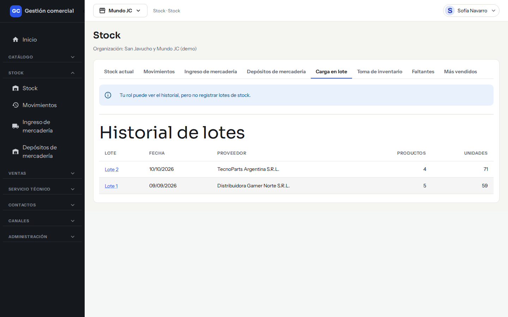
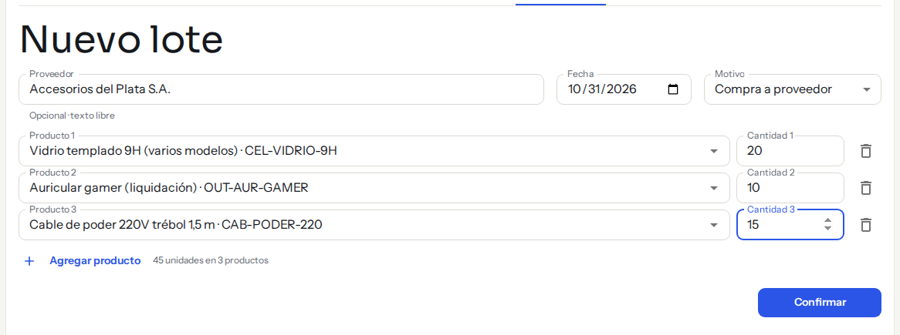
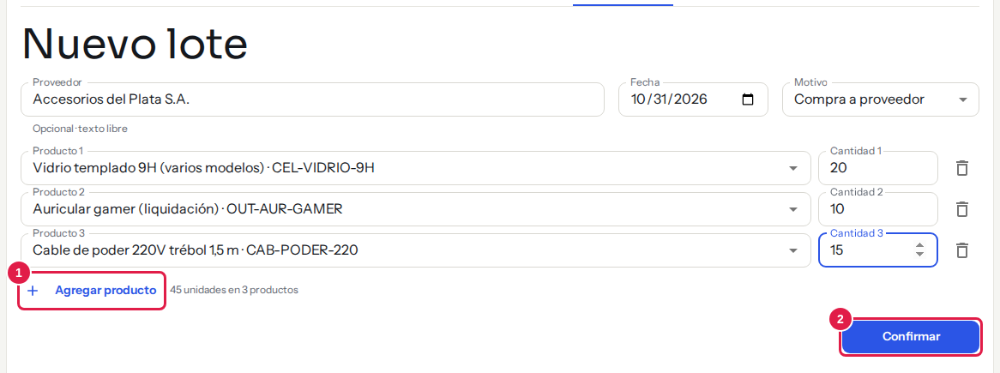
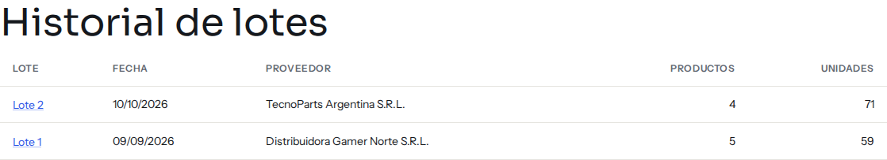
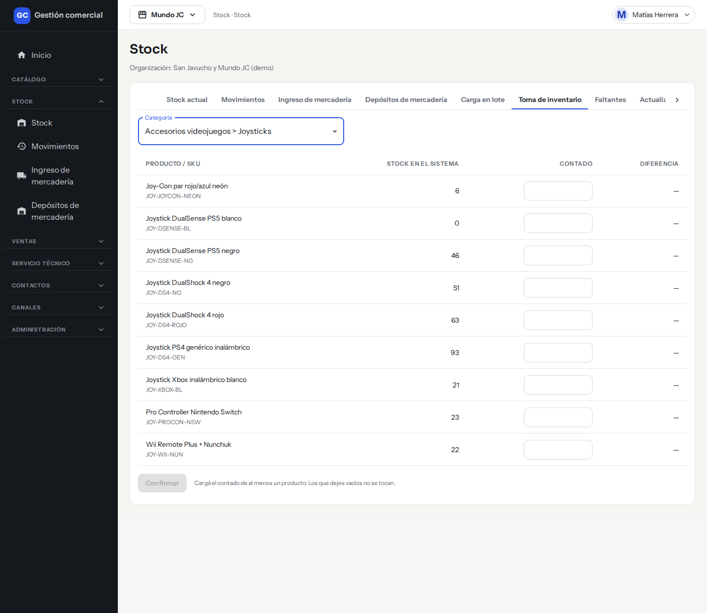
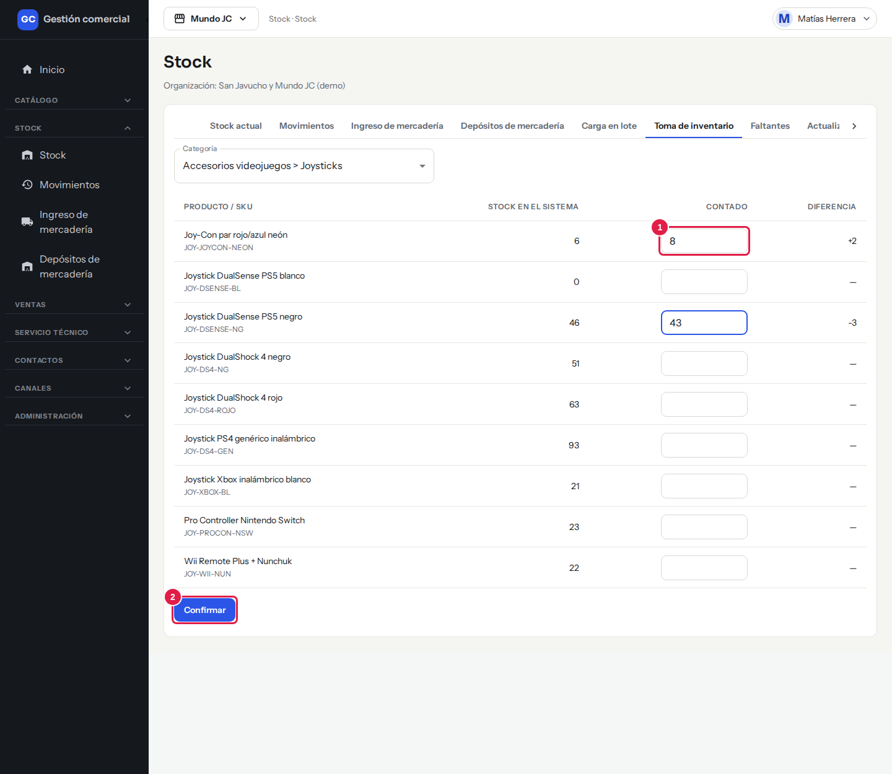

# Cargar mercadería en lote y hacer la toma de inventario

## Para qué sirve

- **Carga en lote**: registrás de una sola vez un remito completo, con varios productos, bajo un mismo número de lote.
- **Toma de inventario**: contás físicamente los productos de una categoría, cargás lo que contaste y el sistema corrige las diferencias con ajustes, sin perder el historial.

## Quién puede hacerlo

| Rol | Qué puede hacer |
|---|---|
| Administrador, Operador, Depósito | Cargar lotes y confirmar tomas de inventario |
| Consulta, Mostrador, Administración | Ver el historial de lotes y la pantalla de la toma. No ven el formulario del lote y no pueden confirmar una toma |

Si tu rol solo mira, la pantalla te avisa: «Tu rol puede ver el historial, pero no registrar lotes de stock.» o «Tu rol puede ver la toma, pero no confirmarla.»

*Así ve la pantalla el rol Consulta: solo el historial, sin formulario.*

## Cargar un lote

### Dónde lo encontrás

**Stock → Stock actual**, pestaña **Carga en lote**. Arriba está el formulario **Nuevo lote** y abajo el **Historial de lotes**.

### Paso a paso

1. Completá el **Proveedor**. Es opcional y es texto libre (hasta 120 caracteres): no hace falta que esté cargado en [Proveedores](proveedores.md).
2. Revisá la **Fecha**. Viene con la de hoy y no puede ser futura.
3. Elegí el **Motivo**. Solo aparecen los motivos que sirven para entradas; viene sugerido «Compra a proveedor».
4. En **Producto 1** elegí el producto y escribí su **Cantidad 1**.
5. Hacé clic en **Agregar producto** por cada producto más. Con el ícono del tacho podés quitar una línea. Debajo ves el total, por ejemplo «12 unidades en 3 productos».
6. Hacé clic en **Confirmar**. Aparece «Lote N registrado».

*Un lote con tres productos (ejemplo): proveedor, fecha, motivo y una línea por producto. Abajo ves «45 unidades en 3 productos».*

*Paso 5: **Agregar producto** (1) suma una línea. Paso 6: **Confirmar** (2) registra el lote; hasta ese momento no cambia nada.*

### Qué pasa al confirmar

- Cada línea suma sus unidades al stock del producto, en el depósito por defecto.
- Todos los movimientos quedan con el mismo número de lote. Los ves en **Movimientos** como entradas.
- **Todo o nada**: si una línea tiene un problema, no se carga ninguna y el stock no cambia.
- Un doble clic o un reintento no carga el lote dos veces.

### Reglas

- Cada línea necesita un producto y una cantidad entera mayor a cero.
- Un mismo producto no puede repetirse dentro del lote («Este producto ya está en el lote.»).
- Si falta algo, el formulario te lo marca: «Agregá al menos un producto.», «Elegí un producto.», «Elegí un motivo.», «Ingresá un entero mayor a cero.», «La fecha no puede ser futura.»
- Si aparece «No pudimos registrar el lote. Intentá de nuevo.», no se guardó nada: probá otra vez.
- La carga en lote es solo para entradas. Para salidas o ajustes usá [Nuevo movimiento](stock-movimientos.md).

### Ver el historial de lotes

Debajo del formulario, **Historial de lotes** lista los lotes del más reciente al más antiguo con **Lote**, **Fecha**, **Proveedor**, **Productos** y **Unidades**. Hacé clic en el número de un lote para ver sus movimientos (producto, cantidad y saldo). Si hay más, usá **Ver más**.

*Historial de lotes: hacé clic en el número de un lote para ver sus movimientos.*

### Corregir un lote

Un lote no se edita, no se anula ni se borra. Si algo quedó mal, corregilo con un movimiento nuevo (una salida o un ajuste) desde **Nuevo movimiento**.

## Hacer una toma de inventario

### Dónde lo encontrás

**Stock → Stock actual**, pestaña **Toma de inventario**.

### Paso a paso

1. Elegí una **Categoría**. Si elegís una categoría principal, entran también sus subcategorías.
2. La tabla muestra **Producto / SKU**, **Stock en el sistema** y una casilla **Contado** por producto.

    

    *Pasos 1 y 2: al elegir la categoría aparecen sus productos con lo que dice el sistema. **Confirmar** está deshabilitado hasta que cargues algún conteo.*

3. Contá la mercadería y escribí en **Contado** lo que hay realmente. Al escribir, la columna **Diferencia** muestra cuánto sobra o falta respecto del sistema (por ejemplo +2 o -3).
4. Los productos que no contaste, dejalos vacíos: **un Contado vacío no toca el producto**.
5. Hacé clic en **Confirmar**.

    

    *Paso 3: escribí lo contado en **Contado** (1) y mirá la **Diferencia**. Paso 5: **Confirmar** (2) aplica los ajustes. Los productos con la casilla vacía no se tocan.*

6. Aparece «Toma de inventario confirmada» con la lista de ajustes generados (**Producto**, **Diferencia**, **Saldo**).

### Qué ajustes genera

- Por cada producto con diferencia se registra un **Ajuste** con el motivo «Toma de inventario», que deja el stock exactamente en lo que contaste.
- Los productos cuyo contado coincide con el sistema no generan ningún movimiento. Si no había diferencias, el sistema avisa «No había diferencias: no se generó ningún ajuste.»
- Los ajustes se ven también en **Movimientos**.
- La toma se aplica sobre el depósito por defecto.

### Reglas y mensajes

| Mensaje | Qué significa y qué hacer |
|---|---|
| «Ingresá un entero de cero o más.» | El contado debe ser un número entero, sin decimales ni signo negativo |
| «Cargá el contado de al menos un producto. Los que dejes vacíos no se tocan.» | Para confirmar necesitás contar al menos un producto |
| «Esta categoría no tiene productos» | Elegí otra categoría |
| «La categoría tiene más de 1000 productos…» | Elegí una subcategoría más chica |
| «El motivo «Toma de inventario» no está disponible: activalo desde Motivos» | Pedile al Administrador que active ese motivo con el botón **Motivos de movimiento** de Stock actual |
| «No pudimos confirmar la toma. No se guardó ningún ajuste: probá de nuevo.» | La toma es todo o nada: si falla, no queda nada guardado |

### Repetir o corregir una toma

- Si confirmás dos veces los mismos números, la segunda vez no genera nada: la diferencia ya es cero.
- Para hacer otra toma, usá **Hacer otra toma** en la pantalla del resultado, o volvé a entrar a la pestaña.
- Si te equivocaste de contado, hacé una toma nueva con los números correctos: genera un ajuste nuevo que corrige el anterior. Los movimientos anteriores quedan en el historial y no se borran.
- La toma no se guarda como borrador: si salís antes de confirmar, perdés lo que escribiste.

## Preguntas frecuentes

**¿Tengo que hacer toda la tienda de una vez?** No. Se hace por categoría, la que quieras.

**¿Puedo imprimir una hoja de conteo?** Por ahora no. Podés usar **Exportar** en [Stock actual](stock-movimientos.md) para bajar la lista y contar con ella.

**¿Se puede elegir otro depósito en la toma o en el lote?** Por ahora no: ambos usan el depósito por defecto.
