# Stock: ver, mover y controlar

## Para qué sirve

Acá ves cuántas unidades hay de cada producto, registrás entradas, salidas y ajustes, consultás el historial completo de movimientos y definís el stock mínimo de cada producto para que el sistema te avise cuando hay que reponer. El stock es uno solo para todo el negocio: lo comparten todas las tiendas y canales.

## Quién puede hacerlo

| Rol | Qué puede hacer |
|---|---|
| Administrador, Operador, Depósito | Ver todo, registrar movimientos y definir el stock mínimo |
| Consulta, Mostrador, Administración | Ver el stock y el historial, sin registrar ni cambiar nada |
| Administrador | Además, editar los motivos de movimiento |

## Dónde lo encontrás

En el menú **Stock → Stock** está la pantalla **Stock actual**. Arriba hay pestañas para pasar a **Movimientos**, **Ingreso de mercadería**, **Depósitos de mercadería**, **Carga en lote**, **Toma de inventario**, **Faltantes**, **Actualizar por Excel** (solo si podés editar el stock) y **Más vendidos**.

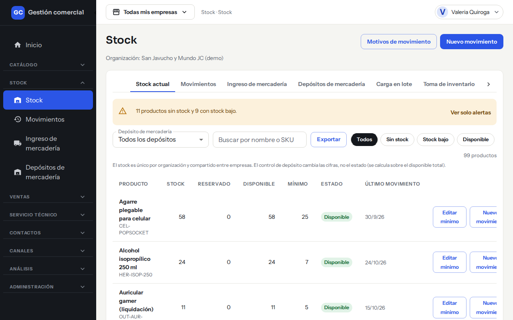

*Stock actual: aviso de alertas, búsqueda, filtros por estado y una fila por producto.*

## Qué muestra cada columna

| Columna | Qué significa |
|---|---|
| **Producto** | Nombre y código (SKU) |
| **Stock** | Unidades que hay físicamente |
| **Reservado** | Unidades comprometidas para ventas de productos «a pedido» que todavía no se entregaron |
| **Disponible** | Lo que realmente se puede vender: Stock menos Reservado |
| **Mínimo** | La cantidad que definiste como piso para ese producto |
| **Estado** | Disponible, Stock bajo o Sin stock (ver abajo) |
| **Último movimiento** | Fecha del último movimiento del producto, o «Sin movimientos» |

## Qué significa cada estado

| Estado | Cuándo aparece |
|---|---|
| **Disponible** | Hay más unidades disponibles que el mínimo |
| **Stock bajo** | Quedan unidades, pero no más que el mínimo |
| **Sin stock** | No quedan unidades disponibles |

El estado se calcula siempre sobre el disponible total del negocio, aunque estés mirando un solo depósito.

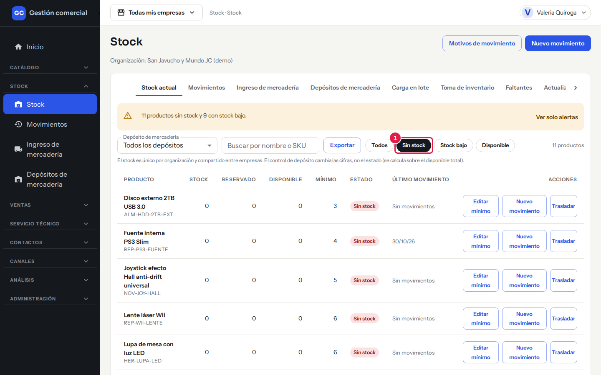

*Con el filtro **Sin stock** (1) la lista muestra solo los productos que no tienen unidades disponibles. Arriba se ve cuántos productos hay.*

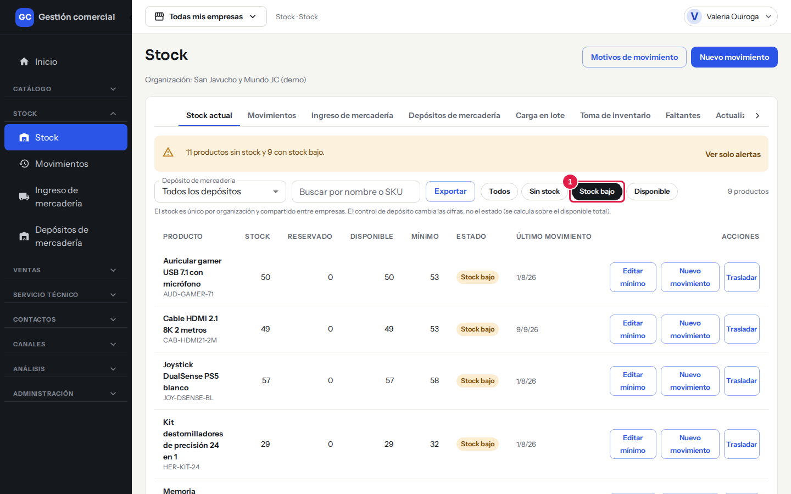

*Con el filtro **Stock bajo** (1) ves los productos que llegaron al mínimo que definiste.*

## Buscar y filtrar

- **Buscar por nombre o SKU**: escribí parte del nombre o del código.
- **Todos / Sin stock / Stock bajo / Disponible**: filtra por estado.
- **Depósito de mercadería**: con «Todos los depósitos» ves los totales del negocio. Si elegís un depósito, las cifras de Stock, Reservado y Disponible pasan a ser las de ese depósito. Ver [Depósitos y reservas](stock-depositos-y-reservas.md).
- **Aviso de alertas**: arriba aparece, por ejemplo, «11 productos sin stock y 9 con stock bajo». Con **Ver solo alertas** la lista se limita a esos productos; con **Ver todos** volvés a la lista completa.
- **Exportar**: baja lo que estás viendo a un archivo. Ver [Carga, exportación y avisos](stock-carga-exportacion-y-avisos.md).

La lista se muestra de a 25 productos por página.

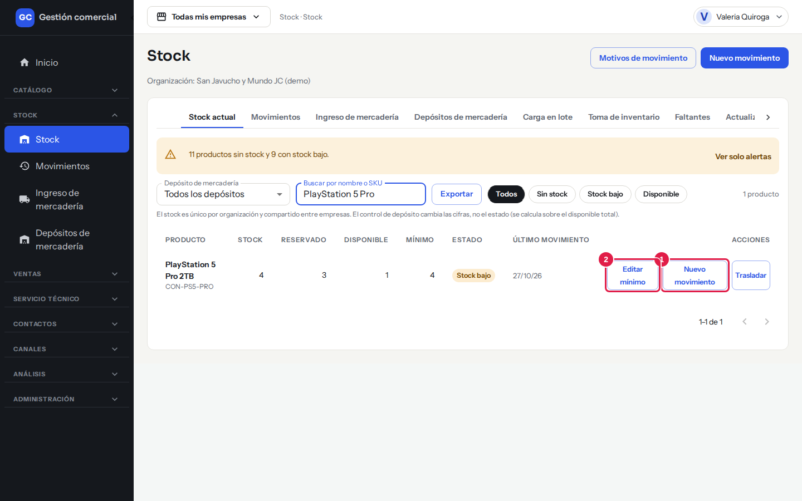

*Al final de cada fila, **Nuevo movimiento** (1) abre el diálogo con ese producto ya elegido y **Editar mínimo** (2) cambia su stock mínimo. **Trasladar** se explica en [Depósitos y reservas](stock-depositos-y-reservas.md).*

## Registrar una entrada, una salida o un ajuste

1. En **Stock actual** hacé clic en **Nuevo movimiento** (arriba a la derecha). Si querés hacerlo sobre un producto puntual, usá el botón **Nuevo movimiento** de su fila: el producto ya queda elegido.

    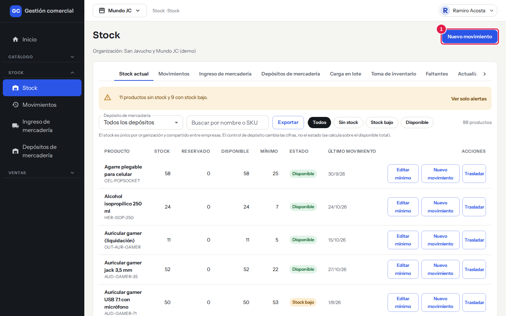

    *Paso 1: el botón **Nuevo movimiento** está arriba a la derecha.*

2. Se abre **Registrar movimiento de stock**. Elegí el tipo: **Entrada**, **Salida** o **Ajuste**.
3. Elegí el **Producto**.
4. Elegí el **Depósito de mercadería**. Viene marcado el depósito por defecto. Debajo ves cuánto hay en ese depósito: stock, reservado y disponible.
5. Escribí la **Cantidad**. En un **Ajuste** el campo se llama **Stock contado**: escribís cuántas unidades hay realmente y el sistema calcula la diferencia.
6. Controlá la **Fecha** (por defecto es hoy; no puede ser futura).
7. Elegí el **Motivo**. La lista cambia según el tipo (por ejemplo, para una entrada ofrece «Compra a proveedor»).
8. Si querés, agregá una **Nota (opcional)** de hasta 500 caracteres.
9. Mirá el «Stock resultante» que aparece debajo de la cantidad y hacé clic en **Registrar**. Aparece «Movimiento registrado».

Quién lo hizo y cuándo queda guardado automáticamente: lo ves en el diálogo como «Responsable».

Así se ve el diálogo completado en cada caso. Para practicar, podés cerrarlo con **Cancelar** sin registrar nada.

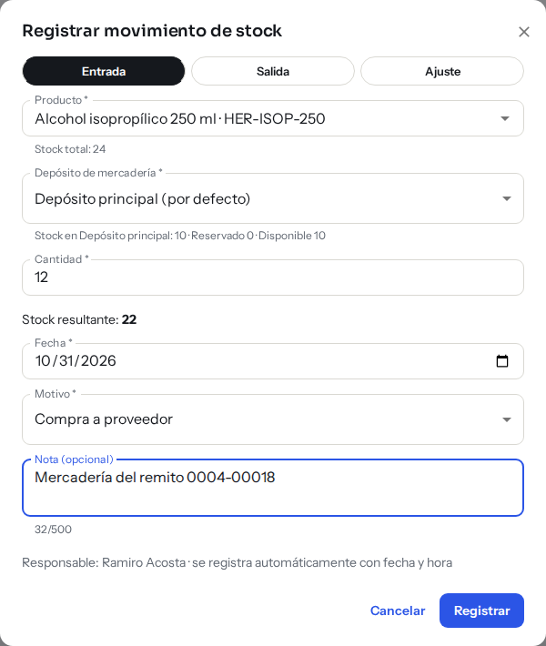

*Entrada: debajo de la cantidad ves el «Stock resultante» antes de confirmar.*

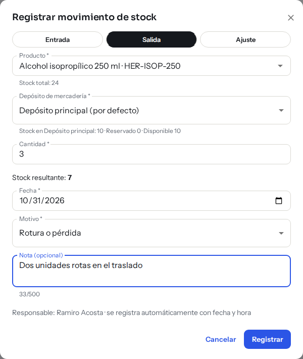

*Salida: arriba del campo Cantidad ves cuánto hay, cuánto está reservado y cuánto disponible en el depósito elegido.*

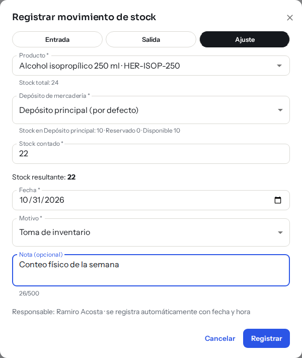

*Ajuste: en vez de Cantidad escribís el **Stock contado** y el sistema calcula la diferencia.*

### Cuándo usar cada tipo

| Tipo | Úsalo cuando… |
|---|---|
| **Entrada** | Sumás unidades (por ejemplo, una devolución o un hallazgo). Para mercadería de un proveedor conviene usar [Ingreso de mercadería](ingreso-de-mercaderia.md) |
| **Salida** | Restás unidades (rotura, pérdida, uso interno) |
| **Ajuste** | Corregís el stock a lo que contaste físicamente |

### Si algo no sale

| Mensaje | Qué significa y qué hacer |
|---|---|
| «No hay stock suficiente» con el detalle «Hay N unidades y la salida es de M» | La salida es mayor que lo disponible en ese depósito. Bajá la cantidad. El botón **Registrar** queda deshabilitado hasta que lo corrijas |
| «No hay stock suficiente. El stock cambió mientras cargabas el movimiento…» | Otra persona movió el producto en el medio. Revisá la cantidad y volvé a intentar |
| «La fecha no puede ser futura.» | Elegí hoy o una fecha anterior |
| «Ingresá una cantidad entera mayor a cero.» | La cantidad tiene que ser un número entero positivo |
| «Elegí un producto.», «Elegí un depósito.», «Elegí un motivo.» | Falta completar ese campo |
| «No pudimos registrar el movimiento. Intentá de nuevo.» | Probá otra vez; si se repite, avisá al administrador |

El stock nunca queda en negativo: el sistema no deja registrar una salida que supere lo disponible.

## Definir el stock mínimo

1. En **Stock actual**, en la fila del producto, hacé clic en **Editar mínimo**.
2. En **Stock mínimo** escribí la **Cantidad mínima**: con esa cantidad o menos, el producto se marca como **Stock bajo**.
3. Hacé clic en **Guardar**.

El mínimo tiene que ser un número entero de cero o más. Si dejás 0, el producto solo se marca cuando se queda **Sin stock**.

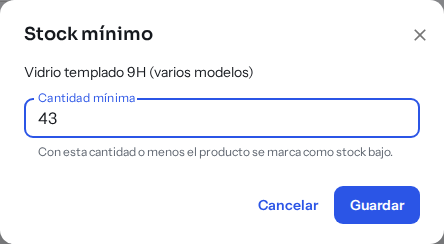

*Stock mínimo: escribí la cantidad mínima y hacé clic en **Guardar** (o **Cancelar** para salir sin cambios).*

## Ver el historial de movimientos

En **Stock → Movimientos** (o la pestaña **Movimientos**) está el historial de todo lo que se movió. Es solo de lectura: **un movimiento no se puede editar ni borrar**. Si te equivocaste, la corrección es un movimiento nuevo (por ejemplo, un ajuste).

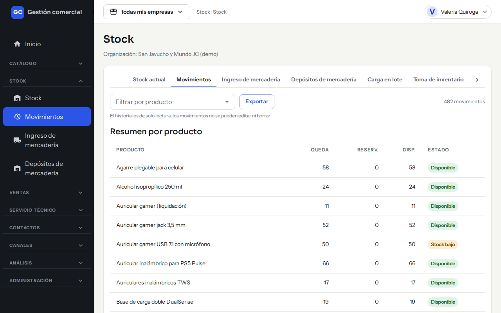

*Movimientos: filtro por producto, botón Exportar y el resumen con lo que queda de cada producto.*

- **Filtrar por producto**: elegí un producto para ver solo sus movimientos. Arriba a la derecha ves cuántos movimientos hay.
- **Resumen por producto**: una tabla con **Queda**, **Reserv.** (reservado), **Disp.** (disponible) y **Estado** de cada producto.
- **Historial**: una fila por movimiento, de la más reciente a la más antigua, con estas columnas:

| Columna | Qué significa |
|---|---|
| **Fecha** | Día del movimiento |
| **Producto** | Nombre y código. Si no tenés acceso al catálogo, dice «Producto no disponible» |
| **Tipo** | Entrada, Salida o Ajuste. Los traslados entre depósitos figuran como «Traslado · Salida» y «Traslado · Entrada» |
| **Motivo / nota** | El motivo elegido y la nota, si hay |
| **Cantidad** | Unidades del movimiento. En un ajuste también se ve la diferencia (por ejemplo «Diferencia -3») |
| **Depósito** | En qué depósito ocurrió |
| **Saldo** | Cuánto quedó después del movimiento |
| **Responsable** | Quién lo registró |

Se muestran de a 25 movimientos por página.

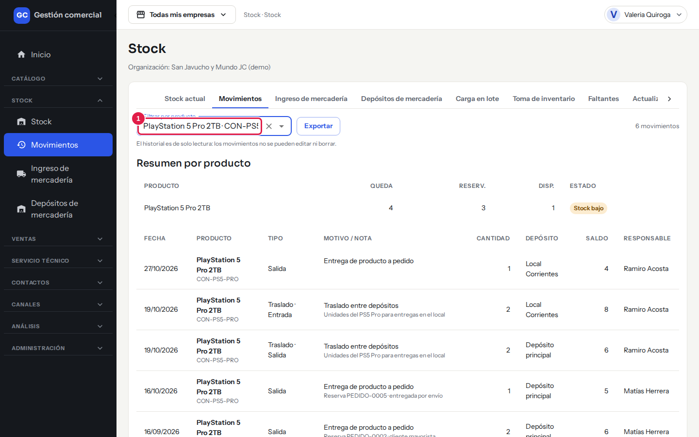

*Con el producto elegido (1), el resumen muestra su situación actual y el historial lista solo sus movimientos, incluidas las entregas de productos «a pedido» y los traslados.*

## Motivos de movimiento

Cada movimiento lleva un motivo. El Administrador puede agregar, renombrar o desactivar motivos con el botón **Motivos de movimiento** de la pantalla Stock actual. Entre los de uso habitual están «Compra a proveedor», «Venta en local», «Devolución» y «Rotura o pérdida».

## Preguntas frecuentes

**¿Por qué no veo los botones «Nuevo movimiento», «Editar mínimo» o «Trasladar»?** Porque tu rol solo puede mirar el stock. Pedile al Administrador que te dé permiso de edición en Stock.

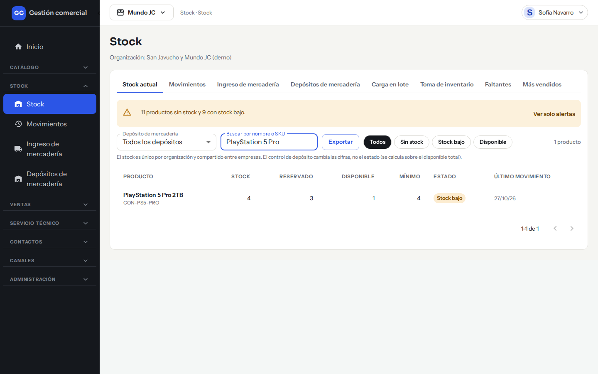

*Así ve Stock actual el rol Consulta: puede mirar y exportar, pero no hay botones para cambiar nada.*

**¿El stock cambia por empresa?** No. Hay un solo stock para todo el negocio; cambiar la empresa de la barra superior no cambia estas pantallas.

**Me equivoqué en un movimiento, ¿cómo lo corrijo?** Registrá un movimiento nuevo que lo compense, o un ajuste con el stock contado.
