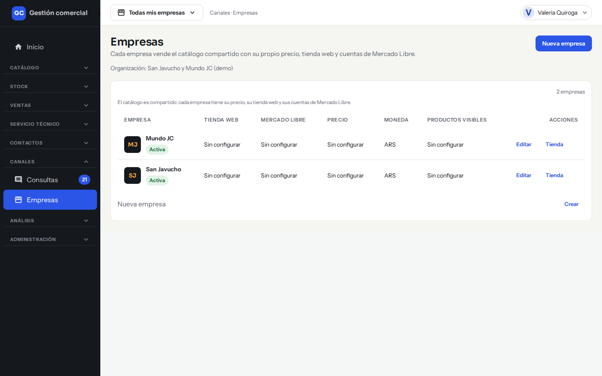
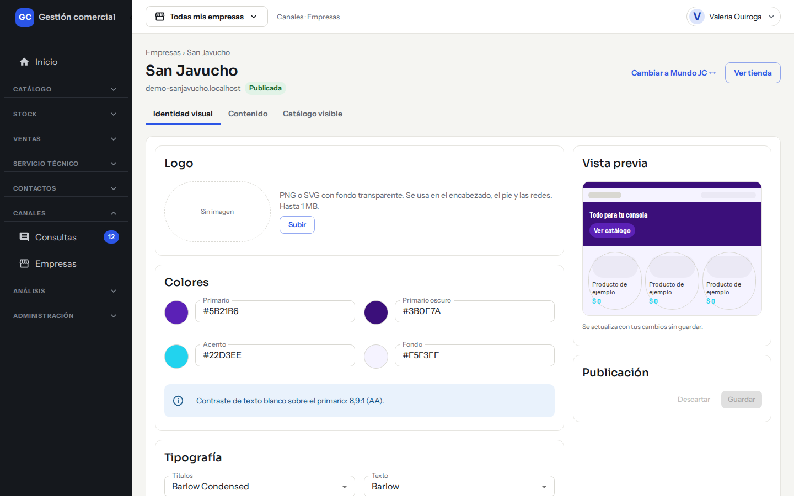
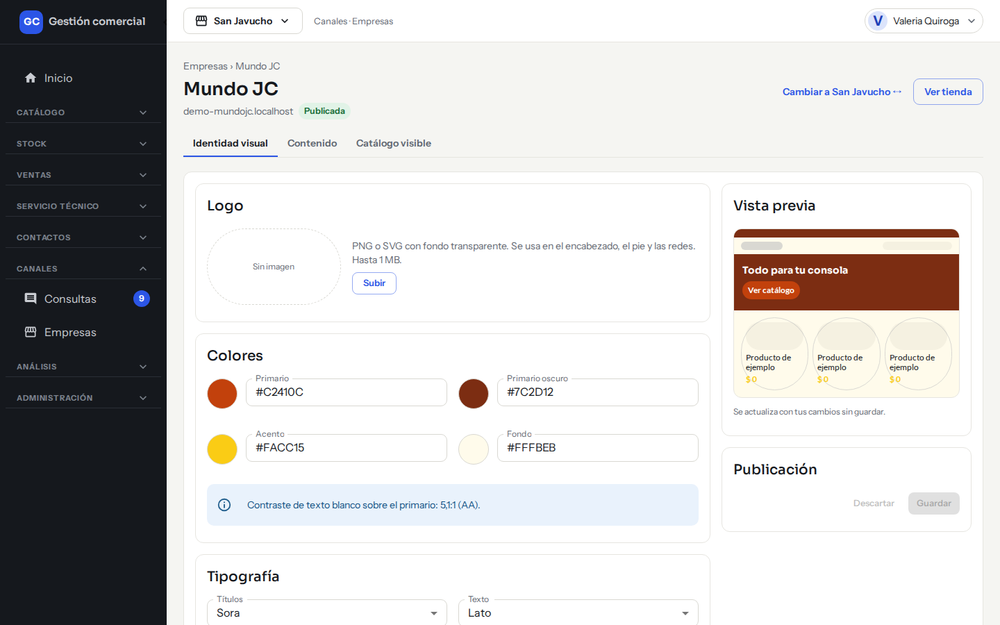
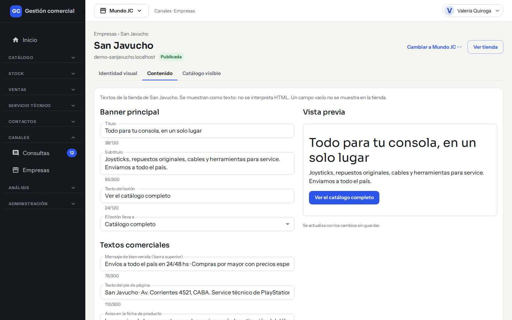
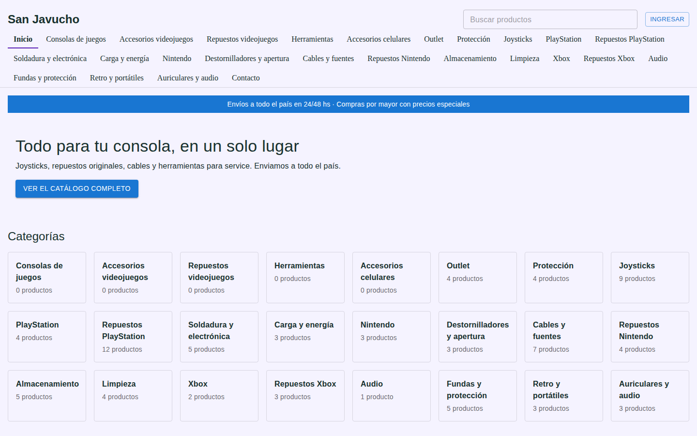
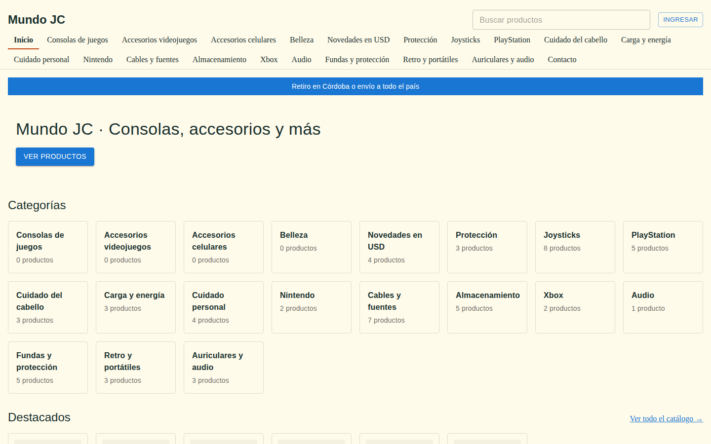

# Identidad, textos y dirección de la tienda

## Para qué sirve

Acá definís cómo se ve y qué dice la tienda online de cada empresa: el logo, los colores, las tipografías, los banners y los textos (título, subtítulo, botones, eslogan, bienvenida y pie). Esa identidad se aplica a **toda** la tienda: la portada, el catálogo, las categorías, las fichas y la página de contacto. También te contamos cómo se relaciona la tienda con su dirección web (el dominio) y dónde se publica lo que preparás.

## Quién puede hacerlo

Solo el **Administrador** administra la tienda. Los demás roles no ven la pantalla de Empresas.

## Dónde lo encontrás

1. Menú **Canales → Empresas**.
2. En la fila de la empresa, hacé clic en **Tienda**.

*Paso 2: el enlace **Tienda** de cada empresa.*

3. Elegí la pestaña **Identidad visual** o **Contenido**.

Arriba de las pestañas ves el nombre de la empresa, su dirección web (o «Sin dominio configurado») y si está **Publicada** o **Pausada**. El botón **Ver tienda** abre la tienda en otra pestaña para que veas cómo quedó.

Cada empresa se configura por separado. Para pasar a otra tienda, usá **Cambiar a… ↔** o **Cambiar de empresa** en la parte superior.

## Cambiar la identidad visual

En la pestaña **Identidad visual** hay cuatro bloques y, a la derecha, una **Vista previa** que se actualiza con tus cambios sin guardar. La tienda no cambia hasta que hacés clic en **Guardar**.

*La pestaña **Identidad visual** de San Javucho (colores violeta), con la **Vista previa** a la derecha.*

*La de Mundo JC, con otros colores (naranja y amarillo): cada tienda se configura por separado.*

### Logo

1. En el bloque **Logo** hacé clic en **Subir** (o **Reemplazar**, si ya hay uno).
2. Elegí un archivo **PNG o SVG** de hasta 1 MB. Usá un logo con **fondo transparente**: en el pie de la tienda se muestra en blanco y, si el archivo tiene fondo sólido, se ve un recuadro. Se usa en el encabezado, el pie y las redes.
3. Con **Quitar** sacás el logo actual. Si la tienda no tiene logo, el encabezado y el pie muestran el nombre de la empresa en texto.

### Colores

En el bloque **Colores** definís cinco colores: **Primario**, **Primario oscuro**, **Acento**, **Fondo** y **Barra superior y pie**. Cada uno se escribe con el formato **#RRGGBB**, por ejemplo #A3111D.

El color **Barra superior y pie** pinta la franja de arriba de la tienda y el pie de página. Si no lo cambiás, se usa un gris oscuro (#222222).

El sistema te muestra qué tan legible queda el texto blanco sobre el color primario y sobre el color de la barra. Si no alcanza la legibilidad recomendada, te lo advierte, pero igual podés guardar.

### Tipografía

En **Tipografía** elegís una letra para los **Títulos** y otra para el **Texto**, de una lista cerrada: Del sistema, Barlow, Barlow Condensed, Playfair Display, Lato, Sora, Instrument Sans, Bricolage Grotesque y DM Sans. Debajo de cada selector ves una muestra.

### Banner e imágenes principales

- **Banner principal**: PNG, JPG o WebP, hasta 3 MB. Medidas sugeridas: 1440×440 píxeles.
- **Banner móvil**: la versión para celulares. PNG, JPG o WebP, hasta 3 MB. Medidas sugeridas: 390×300 píxeles.

### Guardar

En el bloque **Publicación** de esta pestaña (el que lleva los botones de guardar):

- Mientras hay cambios sin guardar ves «Hay cambios sin guardar.».
- **Descartar** vuelve a lo último que guardaste.
- **Guardar** deja los cambios **sin publicar**: vas a ver «Cambios guardados en el borrador. Publicalos desde Dominio y publicación.» La tienda pública sigue mostrando lo que estaba publicado hasta que publiques; la publicación se hace en la pestaña **Dominio y publicación** (ver [Dominio, publicación y versiones de la tienda](tienda-dominio-y-publicacion.md)).

La **Vista previa** de esta pestaña muestra el contenido de la portada. La barra superior, el encabezado, el pie y las fotos de las categorías se ven en la tienda publicada (con **Ver tienda**).

## Cambiar los textos de la tienda

1. Entrá a la pestaña **Contenido**.
2. En **Banner principal** completá **Título**, **Subtítulo** y **Texto del botón**. En **El botón lleva a** hoy solo existe la opción «Catálogo completo».
3. En **Textos comerciales** completá:
   - **Eslogan**: una frase corta que se muestra en la barra superior y en el pie de la tienda. Es lo primero que se ve en la franja de arriba.
   - **Mensaje de bienvenida (barra superior)**: el mensaje que se muestra en la franja de arriba cuando no cargaste un eslogan. Si cargás las dos cosas y son distintas, el eslogan va en la barra superior y la bienvenida sigue en su franja de la portada.
   - **Texto del pie de página**.
   - **Aviso en la ficha de producto**: un texto que se muestra en cada ficha.
   - **Texto del botón de contacto**.
4. A la derecha ves una **Vista previa** del banner. Se actualiza con lo que escribís.
5. Hacé clic en **Guardar**. Vas a ver «Cambios guardados en el borrador. Publicalos desde Dominio y publicación.» Los cambios quedan **sin publicar** hasta que los publiques desde la pestaña **Dominio y publicación** (ver [Dominio, publicación y versiones de la tienda](tienda-dominio-y-publicacion.md)). Con **Descartar** volvés a lo anterior.

*La pestaña **Contenido**: textos del banner y textos comerciales, con su vista previa.*

Los largos máximos son: título y textos de botón, 120 caracteres; eslogan, 80 caracteres; subtítulo, bienvenida, pie y aviso de ficha, 300 caracteres. Debajo de cada campo ves cuántos caracteres llevás. Los textos son texto simple (no se pueden poner enlaces ni formato). Si dejás un campo vacío, ese elemento directamente no se muestra en la tienda.

## La dirección web (dominio)

Cada tienda vive en su propia dirección web. La dirección la cargás vos, desde la pestaña **Dominio y
publicación** de la misma pantalla: escribís el **Dominio principal** (y, si querés, un **Redirigir también**),
copiás los registros que te muestra el sistema en tu proveedor de dominio y hacés clic en **Verificar ahora**.
El sistema te avisa cuándo el dominio y el certificado están listos.

Mientras una tienda no tenga dirección, el botón **Ver tienda** queda apagado y el encabezado dice «Sin dominio
configurado». Si una tienda está pausada o todavía sin dirección, quien entre ve la página «Volvemos pronto».

El paso a paso está en [Dominio, publicación y versiones de la tienda](tienda-dominio-y-publicacion.md).

## Cómo se ven las dos tiendas

Cada tienda toma sus propios colores, tipografías, logo, eslogan y textos. La barra superior y el pie usan el color **Barra superior y pie**, y el encabezado muestra el logo. Así se ven las dos del ejemplo:

*Tienda de San Javucho: fondo lila y sus propios textos.*

*Tienda de Mundo JC: fondo crema y textos distintos.*

## Qué se configura desde el sistema y qué no

| Cosa | Dónde se hace |
|---|---|
| Logo, colores, tipografías y banners | Acá, en **Identidad visual** |
| Título, subtítulo, botón, eslogan, bienvenida, pie y avisos | Acá, en **Contenido** |
| Qué productos y categorías se ven, y cuáles se destacan | Pestaña **Catálogo visible** (ver [Tiendas online](tiendas-online.md)) |
| Dirección web de la tienda y su verificación | Pestaña **Dominio y publicación** (ver [Dominio, publicación y versiones de la tienda](tienda-dominio-y-publicacion.md)) |
| Publicar los cambios o volver a una versión anterior | Pestaña **Dominio y publicación** (ver [Dominio, publicación y versiones de la tienda](tienda-dominio-y-publicacion.md)) |
| Pausar o reactivar la tienda | **Canales → Empresas → Editar** (ver [Tiendas online](tiendas-online.md)) |
| WhatsApp, correo y horarios de atención | **Canales → Empresas → Editar** |
| Ajuste de precios y IVA de la tienda | **Canales → Empresas → Editar → Precios y moneda** (ver [Precios e IVA](precios-e-iva.md)) |

## Casos comunes

- **Cambié el color y la tienda sigue igual.** Guardar deja el cambio **sin publicar**: publicá desde la pestaña **Dominio y publicación**. Si ya publicaste, recargá la tienda en el navegador.
- **Quiero sacar la barra de bienvenida.** Dejá vacío el **Mensaje de bienvenida**, guardá y publicá. Si además cargaste un **Eslogan**, la barra superior lo sigue mostrando.
- **No sé qué color pinta la barra de arriba y el pie.** Es el color **Barra superior y pie**, el quinto del bloque **Colores**.
- **Mi logo se ve mal sobre el encabezado o en el pie.** Usá un PNG o SVG con fondo transparente: en el pie el logo se muestra en blanco.

## Si algo no sale

| Mensaje | Qué significa y qué hacer |
|---|---|
| **Revisá los colores marcados: usá el formato #RRGGBB.** | Algún color no tiene el formato correcto. Corregilo. |
| **«…» no es un formato admitido.** | Usá PNG o SVG para el logo, y PNG, JPG o WebP para los banners. |
| **«…» supera el máximo de 1 MB / 3 MB.** | Usá un archivo más liviano. |
| **«…» contiene código y no se puede usar.** | Ese SVG tiene instrucciones incrustadas. Exportalo de nuevo como SVG simple. |
| **No pudimos subir el logo / el banner… no se guardó nada y la imagen anterior se conserva.** | Revisá tu conexión y probá de nuevo. |
| **… no puede superar los N caracteres.** | Acortá el texto. |
| **No pudimos cargar la identidad visual.** | Usá **Reintentar**. |
