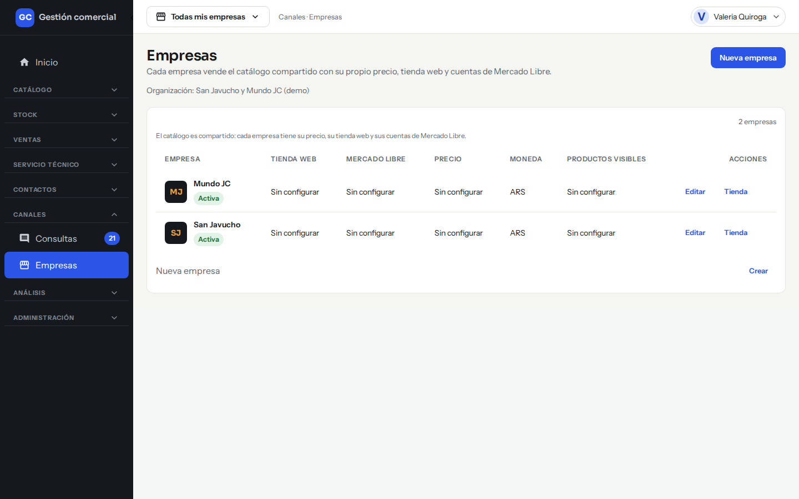
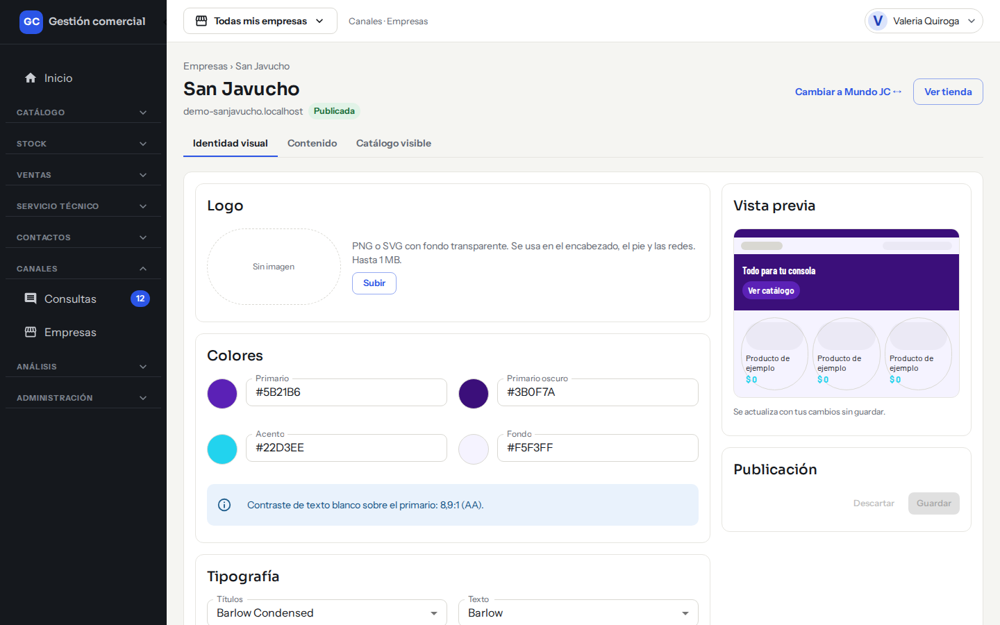
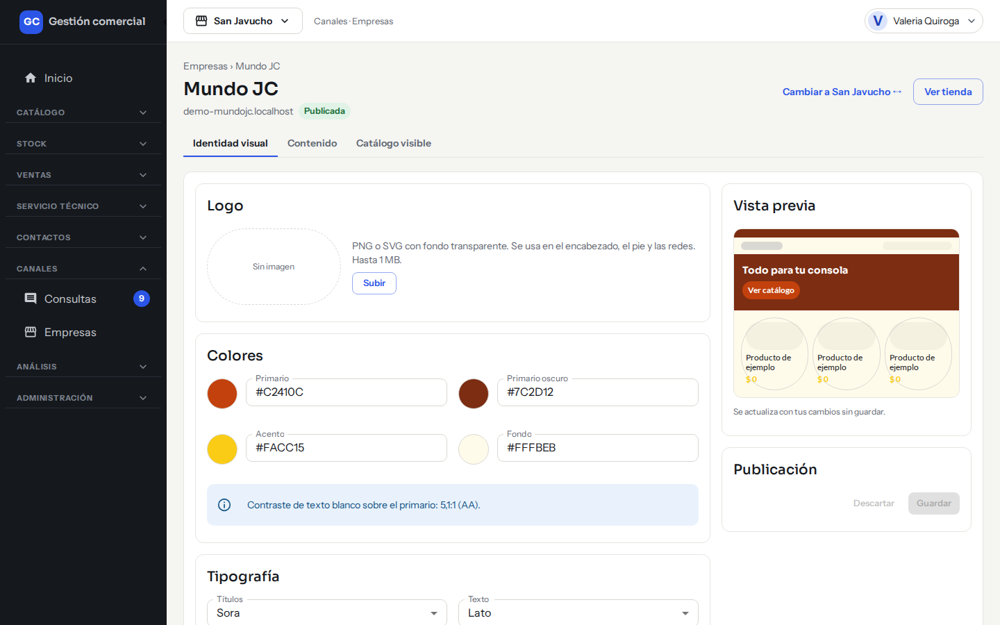
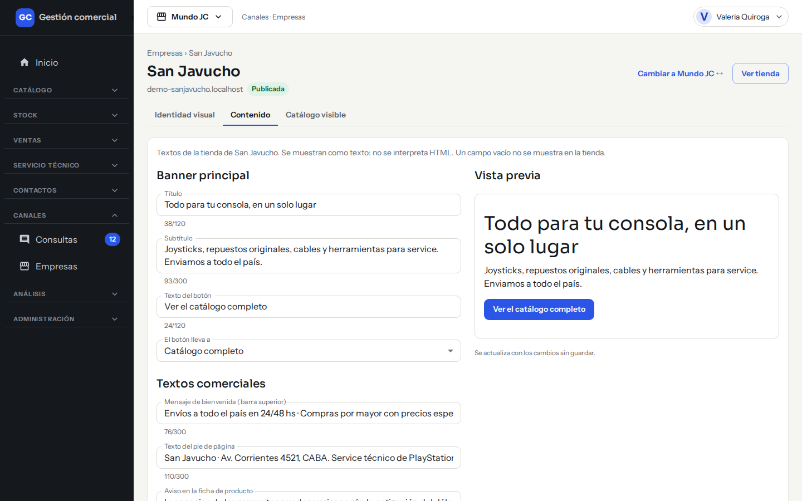
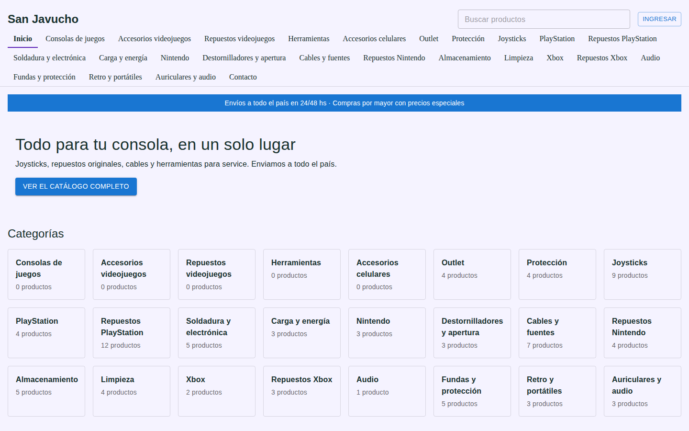
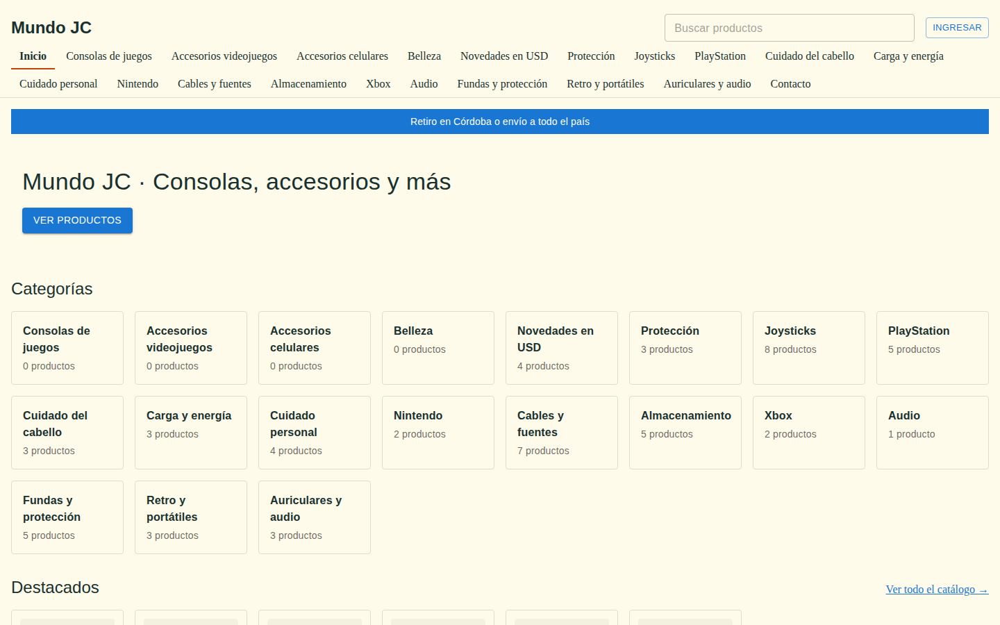

# Identidad, textos y dirección de la tienda

## Para qué sirve

Acá definís cómo se ve y qué dice la tienda online de cada empresa: el logo, los colores, las tipografías, los banners y los textos (título, subtítulo, botones, bienvenida y pie). También te contamos cómo se relaciona la tienda con su dirección web (el dominio) y qué cosas no se hacen desde el sistema.

## Quién puede hacerlo

Solo el **Administrador** administra la tienda. Los demás roles no ven la pantalla de Empresas.

## Dónde lo encontrás

1. Menú **Canales → Empresas**.
2. En la fila de la empresa, hacé clic en **Tienda**.

*Paso 2: el enlace **Tienda** de cada empresa.*

3. Elegí la pestaña **Identidad visual** o **Contenido**.

Arriba de las pestañas ves el nombre de la empresa, su dirección web (o «Sin dominio configurado») y si está **Publicada** o **Pausada**. El botón **Ver tienda** abre la tienda en otra pestaña para que veas cómo quedó.

Cada empresa se configura por separado. Para pasar a otra tienda, usá **Cambiar a… ↔** o **Cambiar de empresa** en la parte superior.

## Cambiar la identidad visual

En la pestaña **Identidad visual** hay cuatro bloques y, a la derecha, una **Vista previa** que se actualiza con tus cambios sin guardar. La tienda no cambia hasta que hacés clic en **Guardar**.

*La pestaña **Identidad visual** de San Javucho (colores violeta), con la **Vista previa** a la derecha.*

*La de Mundo JC, con otros colores (naranja y amarillo): cada tienda se configura por separado.*

### Logo

1. En el bloque **Logo** hacé clic en **Subir** (o **Reemplazar**, si ya hay uno).
2. Elegí un archivo **PNG o SVG** de hasta 1 MB. Conviene que tenga fondo transparente. Se usa en el encabezado, el pie y las redes.
3. Con **Quitar** sacás el logo actual.

### Colores

En el bloque **Colores** definís cuatro colores: **Primario**, **Primario oscuro**, **Acento** y **Fondo**. Cada uno se escribe con el formato **#RRGGBB**, por ejemplo #A3111D.

El sistema te muestra qué tan legible queda el texto blanco sobre el color primario. Si no alcanza la legibilidad recomendada, te lo advierte, pero igual podés guardar.

### Tipografía

En **Tipografía** elegís una letra para los **Títulos** y otra para el **Texto**, de una lista cerrada: Del sistema, Barlow, Barlow Condensed, Playfair Display, Lato, Sora e Instrument Sans. Debajo de cada selector ves una muestra.

### Banner e imágenes principales

- **Banner principal**: PNG, JPG o WebP, hasta 3 MB. Medidas sugeridas: 1440×440 píxeles.
- **Banner móvil**: la versión para celulares. PNG, JPG o WebP, hasta 3 MB. Medidas sugeridas: 390×300 píxeles.

### Guardar

En el bloque **Publicación**:

- Mientras hay cambios sin guardar ves «Hay cambios sin guardar.».
- **Descartar** vuelve a lo último que guardaste.
- **Guardar** aplica los cambios. Vas a ver «Cambios guardados: la tienda ya los muestra.»

## Cambiar los textos de la tienda

1. Entrá a la pestaña **Contenido**.
2. En **Banner principal** completá **Título**, **Subtítulo** y **Texto del botón**. En **El botón lleva a** hoy solo existe la opción «Catálogo completo».
3. En **Textos comerciales** completá:
   - **Mensaje de bienvenida (barra superior)**: la franja de arriba de toda la tienda.
   - **Texto del pie de página**.
   - **Aviso en la ficha de producto**: un texto que se muestra en cada ficha.
   - **Texto del botón de contacto**.
4. A la derecha ves una **Vista previa** del banner. Se actualiza con lo que escribís.
5. Hacé clic en **Guardar**. Vas a ver «Cambios guardados. La tienda ya muestra los textos nuevos.» Con **Descartar** volvés a lo anterior.

*La pestaña **Contenido**: textos del banner y textos comerciales, con su vista previa.*

Los largos máximos son: título y textos de botón, 120 caracteres; subtítulo, bienvenida, pie y aviso de ficha, 300 caracteres. Debajo de cada campo ves cuántos caracteres llevás. Los textos son texto simple (no se pueden poner enlaces ni formato). Si dejás un campo vacío, ese elemento directamente no se muestra en la tienda.

## La dirección web (dominio)

Cada tienda vive en su propia dirección web. **El alta de la dirección la hace el equipo técnico**: desde el sistema no se puede cargar ni cambiar. Si necesitás una dirección nueva o cambiar la actual, pedíselo al equipo de soporte.

Mientras una tienda no tenga dirección, el botón **Ver tienda** queda apagado y el encabezado dice «Sin dominio configurado». Si una tienda está pausada o todavía sin dirección, quien entre ve la página «Volvemos pronto».

## Cómo se ven las dos tiendas

Cada tienda toma sus propios colores y textos. Así se ven las dos del ejemplo:

*Tienda de San Javucho: fondo lila y sus propios textos.*

*Tienda de Mundo JC: fondo crema y textos distintos.*

## Qué se configura desde el sistema y qué no

| Cosa | Dónde se hace |
|---|---|
| Logo, colores, tipografías y banners | Acá, en **Identidad visual** |
| Título, subtítulo, botón, bienvenida, pie y avisos | Acá, en **Contenido** |
| Qué productos y categorías se ven, y cuáles se destacan | Pestaña **Catálogo visible** (ver [Tiendas online](tiendas-online.md)) |
| Pausar o reactivar la tienda | **Canales → Empresas → Editar** (ver [Tiendas online](tiendas-online.md)) |
| WhatsApp, correo y horarios de atención | **Canales → Empresas → Editar** |
| Ajuste de precios y IVA de la tienda | **Canales → Empresas → Editar → Precios y moneda** (ver [Precios e IVA](precios-e-iva.md)) |
| Alta o cambio de la dirección web | El equipo de soporte |

## Casos comunes

- **Cambié el color y la tienda sigue igual.** Revisá que hayas hecho clic en **Guardar**. Si ya guardaste, recargá la tienda en el navegador.
- **Quiero sacar la barra de bienvenida.** Dejá vacío el **Mensaje de bienvenida** y guardá.
- **Mi logo se ve mal sobre el encabezado.** Usá un PNG o SVG con fondo transparente.

## Si algo no sale

| Mensaje | Qué significa y qué hacer |
|---|---|
| **Revisá los colores marcados: usá el formato #RRGGBB.** | Algún color no tiene el formato correcto. Corregilo. |
| **«…» no es un formato admitido.** | Usá PNG o SVG para el logo, y PNG, JPG o WebP para los banners. |
| **«…» supera el máximo de 1 MB / 3 MB.** | Usá un archivo más liviano. |
| **«…» contiene código y no se puede usar.** | Ese SVG tiene instrucciones incrustadas. Exportalo de nuevo como SVG simple. |
| **No pudimos subir el logo / el banner… no se guardó nada y la imagen anterior se conserva.** | Revisá tu conexión y probá de nuevo. |
| **… no puede superar los N caracteres.** | Acortá el texto. |
| **No pudimos cargar la identidad visual.** | Usá **Reintentar**. |
