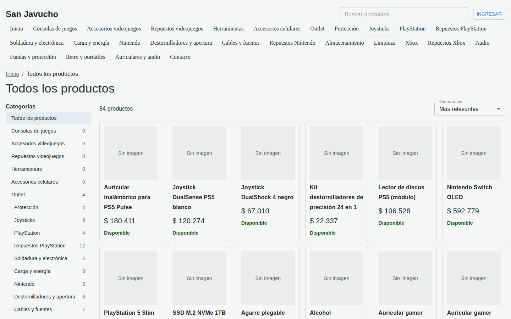
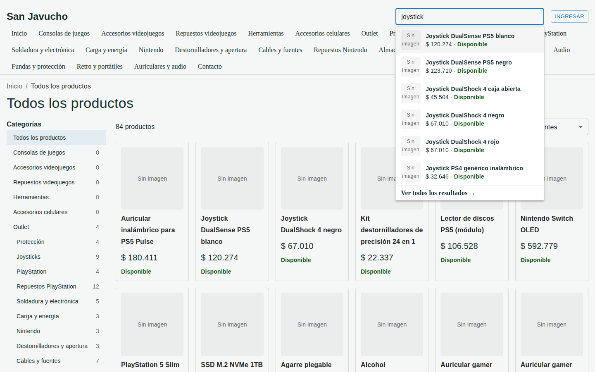
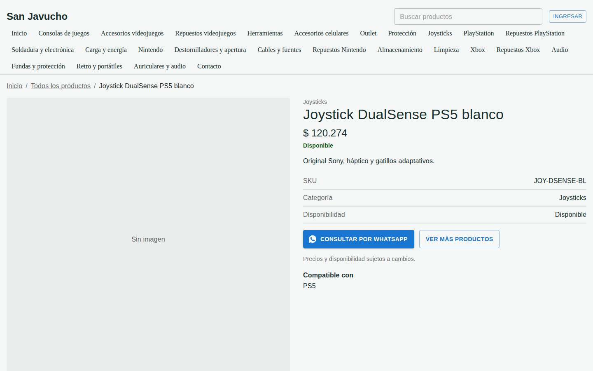
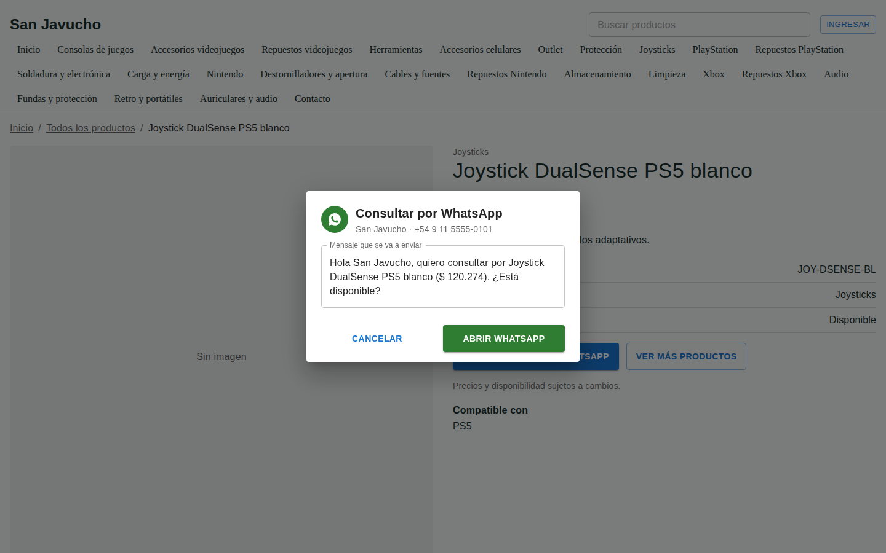
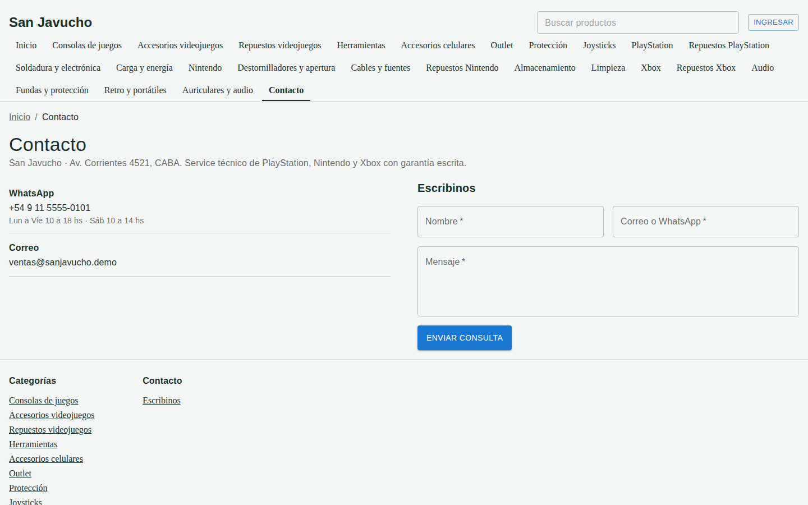
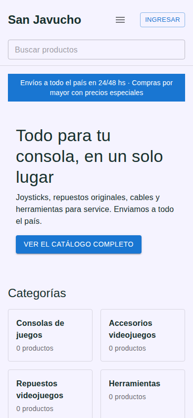
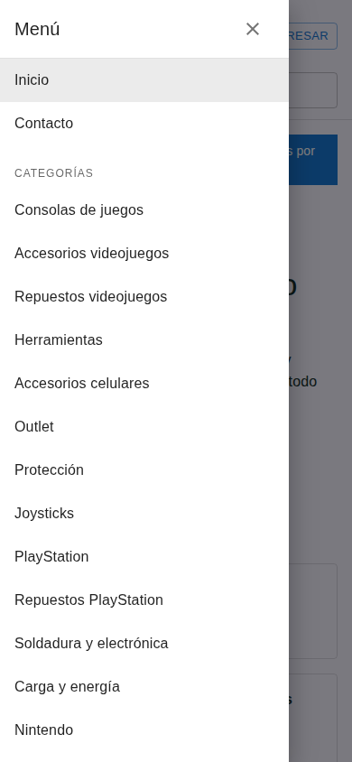
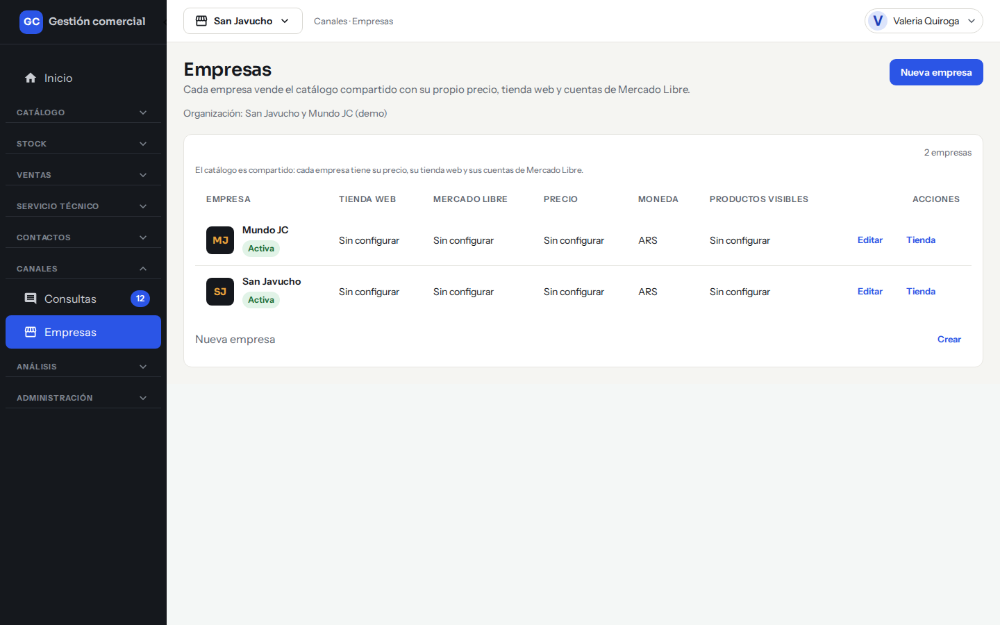
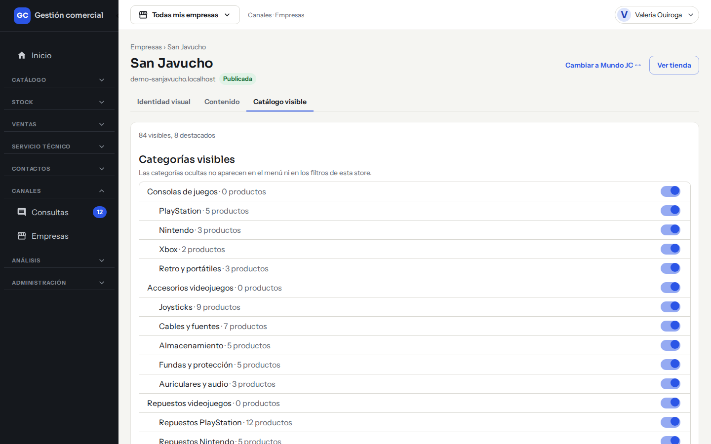
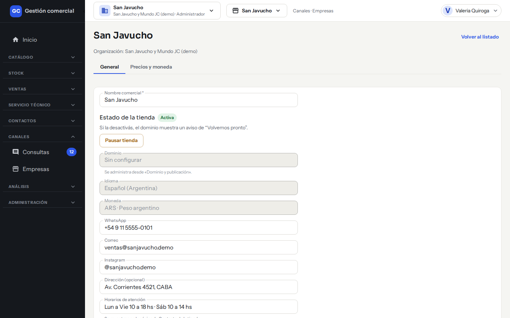

# Las tiendas online de tu negocio

## Para qué sirve

Cada empresa del negocio (por ejemplo, San Javucho y Mundo JC) tiene su propia tienda online, con su dirección web, su aspecto y sus precios. Esta guía te cuenta qué ve la gente cuando entra a una tienda y qué podés manejar vos desde el sistema: qué productos y categorías se publican, cuáles se destacan y cómo pausar la tienda.

En las tiendas **no se puede comprar ni pagar**: el visitante mira el catálogo, consulta por WhatsApp o escribe un mensaje, y esas consultas te llegan a [Consultas](consultas.md).

## Quién puede hacerlo

| Tarea | Quién |
|---|---|
| Administrar la tienda (productos y categorías visibles, destacados, identidad, textos, pausar o reactivar) | Administrador |
| Elegir en qué tiendas se vende cada producto | Administrador y Operador, desde [Productos y categorías](catalogo-productos.md) |
| Recibir y contestar las consultas | Quienes tienen acceso a [Consultas](consultas.md) |

El resto de los roles no ve la pantalla de Empresas.

## Qué ve un visitante

El visitante entra a la dirección de la tienda **sin cuenta y sin usuario**. Ve solo los datos de esa tienda: el precio final en pesos de esa empresa y si el producto está disponible. Nunca ve costos, cantidades exactas ni datos internos.

### Página de inicio

- Una **barra de bienvenida** arriba, con el mensaje que elegiste.
- Un **banner** con título, subtítulo y botón.
- Las **categorías**, con la cantidad de productos de cada una.
- Los **productos destacados** (hasta 8), con foto, nombre, precio y «Disponible» o «Sin stock». Si no marcaste ninguno, ese bloque no aparece.
- El **pie de página** con tus textos y las categorías.

Si la tienda está activa pero todavía no tiene ningún producto visible, el inicio dice «Catálogo en preparación».

*La página de inicio de la tienda de San Javucho.*

### Catálogo y búsqueda

- **Todos los productos**: el listado completo, de a 24 por página, con el total de resultados.
- **Filtros**: por categoría, **Solo con stock** y **Precio máximo** (en pesos, o «Sin límite»). El botón **Limpiar filtros** los saca.
- **Ordenar por**: «Más relevantes» (los destacados primero), «Menor precio» o «Mayor precio».
- **Buscar productos**: el buscador está en el encabezado de todas las pantallas. A partir de 2 letras muestra hasta 6 sugerencias con foto, nombre y precio; con Enter o con «Ver todos los resultados →» se abre el listado completo. Entiende mayúsculas, tildes y algunos errores de tipeo («cargdor» encuentra «cargador»). Si no hay coincidencias dice «No encontramos productos con ese nombre.»
- Si alguien busca demasiado seguido, la tienda le pide esperar unos segundos y sigue sola.

*El catálogo: categorías a la izquierda, orden arriba y una tarjeta por producto.*

*El buscador sugiere productos mientras escribís.*

### Ficha de producto

Muestra la galería de fotos (hasta 4, con ampliación), el nombre, la categoría, el precio, la disponibilidad, la descripción, el SKU y, si lo cargaste, para qué es compatible. Al pie dice «Precios y disponibilidad sujetos a cambios.». Si el producto no tiene foto, se ve «Sin imagen».

*La ficha de un producto, con el botón **Consultar por WhatsApp**.*

La disponibilidad que ve el visitante es solo «Disponible» o «Sin stock», según las unidades reales. Las marcas «A pedido» o «Stock entrante en breve» que cargás en el producto no se muestran en la tienda.

### Contacto por WhatsApp y formulario

- En la ficha aparece el botón **Consultar por WhatsApp** solo si la empresa tiene un número de WhatsApp cargado. Abre una ventana con un mensaje ya armado («Hola Mundo JC, quiero consultar por… ¿Está disponible?») que el visitante revisa antes de abrir WhatsApp.
- La página **Contacto** muestra el WhatsApp con sus horarios y el correo de la tienda, y un formulario **Escribinos** (Nombre, Correo o WhatsApp y Mensaje). Al enviarlo, el visitante ve «¡Gracias! Recibimos tu consulta».
- Todas las consultas llegan a la bandeja de [Consultas](consultas.md) de esa empresa.

*El visitante revisa el mensaje antes de abrir WhatsApp.*

*La página **Contacto**: datos de la tienda y formulario «Escribinos».*

- Cada visitante puede mandar hasta 5 consultas por hora por tienda; después se le pide esperar.

### Celular, clientes con cuenta y páginas especiales

- La tienda se adapta al celular: el menú se despliega con el botón de menú y los filtros se abren en un panel.

*La tienda en un celular.*

*El menú desplegado en el celular.*

- Los clientes con cuenta pueden **Ingresar** y ver los precios que les corresponden. Ver [Cuenta web del cliente](cuenta-web-cliente.md).
- Si la tienda está pausada o todavía no tiene dirección web, se ve la página «Volvemos pronto».
- Una dirección que no existe muestra «No encontramos esta página».

## Qué se publica y cómo se oculta

Un producto aparece en una tienda solo si se cumplen **las cuatro condiciones**:

1. El producto está **activo**.
2. Tiene activada esa tienda en **Empresas que lo venden** (ver [Productos y categorías](catalogo-productos.md)).
3. En la pestaña **Catálogo visible** de la tienda está marcado como **Visible**.
4. Su categoría (y la categoría padre, si es subcategoría) está **visible** en esa tienda.

Para sacar algo de una tienda sin tocar las otras, ocultalo en esa tienda.

## Administrar la tienda paso a paso

### Entrar a la gestión de la tienda

1. En el menú, entrá a **Canales → Empresas**.
2. En la fila de la empresa, hacé clic en **Tienda**.

*Paso 2: en cada fila de **Canales → Empresas** está el enlace **Tienda**.*

3. Arriba ves el nombre de la empresa, su dirección web y si está **Publicada** o **Pausada**. El botón **Ver tienda** abre la tienda en otra pestaña (queda apagado si todavía no tiene dirección). Para pasar a la otra tienda, usá **Cambiar a… ↔** o **Cambiar de empresa**.
4. Usá las pestañas **Identidad visual**, **Contenido** y **Catálogo visible**. La identidad y los textos se explican en [Identidad, textos y dirección de la tienda](tienda-dominio-e-identidad.md).

### Elegir qué categorías y productos se ven

1. Entrá a la pestaña **Catálogo visible**.
2. En **Categorías visibles** activá o desactivá el interruptor de cada categoría. Las categorías ocultas no aparecen en el menú ni en los filtros de esa tienda.

*La pestaña **Catálogo visible**: resumen arriba y un interruptor por categoría.*

3. En **Productos visibles y destacados** buscá un producto con **Buscar producto**. La tabla muestra **Producto**, **Precio**, **Stock**, **Visible** y **Destacado**.
4. Activá o desactivá **Visible**, y hacé clic en la estrella para **Destacar** (o quitar el destacado) de un producto. Arriba ves el resumen, por ejemplo «12 visibles, 3 destacados».
5. Si un producto no se muestra, debajo de su nombre dice por qué: «No se muestra: producto inactivo» o «No se muestra: categoría oculta».
6. Si querés destacar un producto que no se muestra, el sistema pregunta «Este producto no se muestra en la tienda. ¿Destacarlo igual?». Si confirmás con **Destacar igual**, queda destacado pero no se vuelve visible.
7. Los cambios no se aplican hasta que hacés clic en **Guardar** en la franja amarilla de arriba. Con **Descartar** volvés a lo último guardado.

El precio y el stock se ven en esta pantalla pero no se cambian acá.

### Pausar o reactivar la tienda

1. En **Canales → Empresas**, hacé clic en **Editar** en la fila de la empresa.
2. Hacé clic en **Pausar tienda**. Mientras está pausada, los visitantes ven «Volvemos pronto».

*Paso 2: el estado de la tienda y el botón **Pausar tienda**.*

3. Para volver a publicarla, hacé clic en **Reactivar tienda**.

### Cargar el WhatsApp, el correo y los horarios

En **Canales → Empresas → Editar** completá **WhatsApp**, **Correo**, **Instagram**, **Dirección (opcional)** y **Horarios de atención**. Los horarios se muestran en la página de Contacto de la tienda, y el botón de WhatsApp de las fichas aparece cuando hay un número válido.

## Casos comunes

- **Cargué un producto y no aparece en la tienda.** Revisá las cuatro condiciones de arriba: que esté activo, que tenga activada la tienda, que esté **Visible** en **Catálogo visible** y que su categoría esté visible.
- **Quiero destacar los productos de la temporada.** En **Catálogo visible**, tocá la estrella de hasta 8 productos y hacé clic en **Guardar**.
- **La tienda dice «Catálogo en preparación».** Todavía no hay ningún producto visible en esa tienda.
- **Los precios no muestran IVA.** Es una decisión de cada tienda: ver [Precios e IVA](precios-e-iva.md).

## Si algo no sale

| Mensaje | Qué significa y qué hacer |
|---|---|
| **No pudimos cargar el catálogo de esta tienda.** | Usá **Reintentar**. |
| **No tenés empresas para gestionar.** / **No tenés acceso a esta empresa** | Tu usuario no tiene esa empresa. Pedile al Administrador que la asigne. |
| **¿Cambiar de empresa?** | Aparece si cambiás de tienda con cambios sin guardar: **Seguir acá** los conserva y **Cambiar igual** los descarta. |
| **No se cambió el estado.** | No se pudo pausar o reactivar. Probá de nuevo con el botón **Reintentar**. |

Por ahora las tiendas no tienen formas de envío ni carrito: no hay nada para configurar en ese sentido.
