# Las tiendas online de tu negocio

## Para qué sirve

Cada empresa del negocio (por ejemplo, San Javucho y Mundo JC) tiene su propia tienda online, con su dirección web, su aspecto y sus precios. Esta guía te cuenta qué ve la gente cuando entra a una tienda y qué podés manejar vos desde el sistema: qué productos y categorías se publican, cuáles se destacan y cómo pausar la tienda.

En las tiendas **no se puede comprar ni pagar**: el visitante mira el catálogo, consulta por WhatsApp o escribe un mensaje, y esas consultas te llegan a [Consultas](consultas.md).

## Quién puede hacerlo

| Tarea | Quién |
|---|---|
| Administrar la tienda (productos y categorías visibles, destacados, identidad, textos, dirección web, publicación, pausar o reactivar) | Administrador |
| Elegir en qué tiendas se vende cada producto | Administrador y Operador, desde [Productos y categorías](catalogo-productos.md) |
| Recibir y contestar las consultas | Quienes tienen acceso a [Consultas](consultas.md) |

El resto de los roles no ve la pantalla de Empresas.

## Qué ve un visitante

El visitante entra a la dirección de la tienda **sin cuenta y sin usuario**. Ve solo los datos de esa tienda: el precio final en pesos de esa empresa y si el producto está disponible. Nunca ve costos, cantidades exactas ni datos internos.

### La barra superior y el encabezado

Arriba de todo hay una **barra oscura** con el **eslogan** de la tienda (o, si no cargaste uno, el mensaje de bienvenida) y, a la derecha, el **WhatsApp** y el **correo** de la tienda. En el celular la barra muestra solo el eslogan. Si no hay ningún dato para mostrar, la barra no aparece.

Debajo está el **encabezado**: el **logo** de la tienda a la izquierda (si no hay logo, el nombre en texto), el **buscador** y los enlaces **Inicio** y **Contacto**. Debajo, en **una sola línea**, van las **categorías principales** de la tienda y **Más categorías**.

- Las categorías principales son las que tienen más productos publicados: se muestran **hasta seis**.
- La categoría en la que estás aparece **subrayada**.
- Si hay más categorías, el enlace **Más categorías** lleva al catálogo, donde están todas.
- Si los nombres no entran en una línea, la barra se desplaza con el mouse; no se parte en varias líneas.
- En el celular, el menú se abre con el botón de menú y trae lo mismo.

Cada tienda muestra **las suyas**: si a una tienda le ocultás una categoría, esa categoría no aparece en
su barra, ni en su inicio, ni en su pie.

### Página de inicio

- La **barra superior** con el eslogan, el WhatsApp y el correo.
- El **encabezado** con el logo, el buscador y las categorías.
- Un **banner** con título, subtítulo y botón.
- Las **categorías principales** (hasta seis), cada una con una **foto** tomada de un producto de esa categoría y la cantidad de productos. Si la categoría no tiene fotos, se ve un recuadro neutro.
- Los **productos destacados** (hasta 8), con foto, nombre, precio y «Disponible» o «Sin stock». Si no marcaste ninguno, ese bloque no aparece.
- Un bloque de **«Consultas por WhatsApp / Escribinos»** al final: el WhatsApp de la tienda y el enlace para escribir. Sin WhatsApp, queda solo **Escribinos**.
- El **pie oscuro** con el logo, el eslogan, tu texto del pie, las categorías, los datos de contacto, el bloque legal y «© año empresa. Todos los derechos reservados.».

Si la tienda está activa pero todavía no tiene ningún producto visible, el inicio dice «Catálogo en preparación».

Las tarjetas de categoría **no muestran «0 productos»**: si una categoría se queda sin productos
publicados, desaparece de la tienda. El número que aparece es el real: al entrar a la categoría se ven
exactamente esos productos.

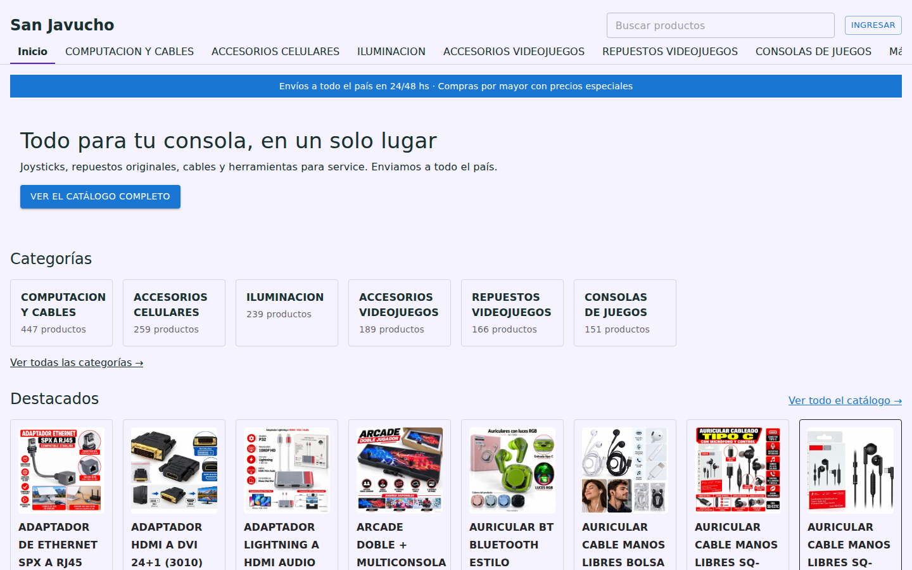

*La página de inicio de la tienda de San Javucho.*

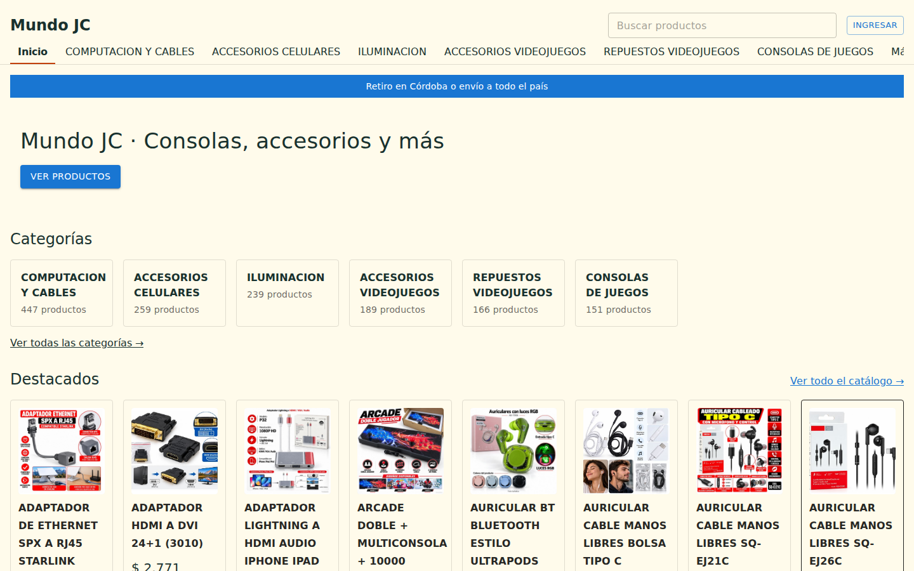

*La misma pantalla en la tienda de Mundo JC: cada tienda con su identidad y sus categorías.*

### Catálogo y búsqueda

- **Todos los productos**: el listado completo, con el total de resultados a la vista. Los productos se cargan por tandas: al abrir ves los primeros y, cuando llegás al final, se suman los siguientes sin cambiar la dirección de la página. Si preferís no bajar, al pie está el botón **Cargar más** (también se usa con el teclado: tabulá hasta el botón y presioná Enter).
- Mientras llegan los siguientes se ve «Cargando más resultados». Si una tanda no se puede cargar, se conserva lo que ya estabas viendo y aparece «No pudimos cargar más resultados.» con **Reintentar**. Cuando no queda ninguno más, dice «No hay más resultados.».
- **No hay páginas numeradas**: si alguien guardó un enlace viejo a una página concreta del catálogo, se abre desde el principio.
- **Filtros**: por categoría, **Solo con stock** y **Precio máximo** (en pesos, o «Sin límite»). El botón **Limpiar filtros** los saca.
- **Ordenar por**: «Más relevantes» (los destacados primero), «Menor precio» o «Mayor precio».
- Al buscar, cambiar un filtro u ordenar, el listado **vuelve a empezar desde la primera tanda**; la búsqueda, los filtros y el orden quedan guardados en el enlace, así que podés compartirlo.
- Si entrás a la ficha de un producto y volvés, el catálogo arranca de nuevo desde la primera tanda: no se conservan las tandas que ya habías cargado.
- **Buscar productos**: el buscador está en el encabezado de todas las pantallas. A partir de 2 letras muestra hasta 6 sugerencias con foto, nombre y precio; con Enter o con «Ver todos los resultados →» se abre el listado completo. Entiende mayúsculas, tildes y algunos errores de tipeo («cargdor» encuentra «cargador»). Si no hay coincidencias dice «No encontramos productos con ese nombre.»
- Si un producto tiene una **promoción vigente** (y las promociones están activadas en el entorno), su precio aparece con el **precio anterior tachado** al lado. Con las promociones apagadas, la tienda muestra siempre el precio normal. Ver [Promociones de precio](promociones.md).
- Si alguien busca demasiado seguido, la tienda le pide esperar unos segundos y sigue sola.

A la izquierda está el panel **Categorías**, con la cantidad de productos de cada una. Ahí están
todas las categorías de primer nivel de la tienda; cuando elegís una, debajo se despliegan sus
subcategorías, con sangría. El número de una categoría **coincide con lo que se ve al entrar**: si dice
447 productos, abajo se listan 447.

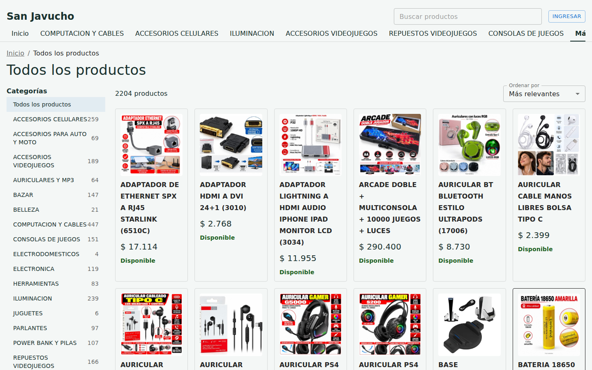

*El catálogo: categorías a la izquierda, orden arriba y una tarjeta por producto.*

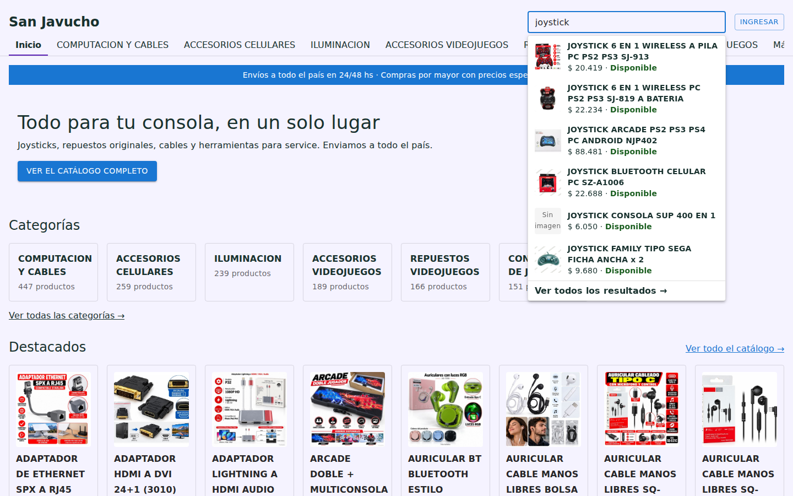

*El buscador sugiere productos mientras escribís.*

### Ficha de producto

Muestra la galería de fotos (hasta 4, con ampliación), el nombre, la categoría, el precio, la disponibilidad, la descripción, el SKU y, si lo cargaste, para qué es compatible. Al pie dice «Precios y disponibilidad sujetos a cambios.». Si el producto no tiene foto, se ve «Sin imagen».

El **nombre se muestra limpio**: si el producto venía de una exportación de otro sistema, no le queda
encima el texto que traía de más (por ejemplo, los signos «&ua» que veías antes). La **descripción**
tampoco repite el nombre: si son lo mismo, se omite.

Si el producto tiene una **promoción vigente** en esa tienda (y las promociones están activadas en el entorno; apagadas, se ve el precio normal), el precio aparece con el **precio anterior tachado** al lado. El tachado solo se muestra cuando el precio anterior era más caro. Ver [Promociones de precio](promociones.md).

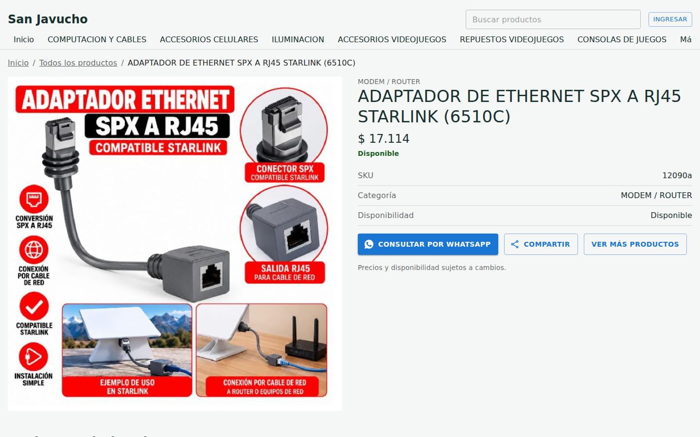

*La ficha de un producto, con el botón **Consultar por WhatsApp**.*

La disponibilidad que ve el visitante es solo «Disponible» o «Sin stock», según las unidades reales. Las marcas «A pedido» o «Stock entrante en breve» que cargás en el producto no se muestran en la tienda.

### Contacto por WhatsApp y formulario

- En la ficha aparece el botón **Consultar por WhatsApp** solo si la empresa tiene un número de WhatsApp cargado. Abre una ventana con un mensaje ya armado («Hola Mundo JC, quiero consultar por… ¿Está disponible?») que el visitante revisa antes de abrir WhatsApp.
- La página **Contacto** muestra el WhatsApp con sus horarios y el correo de la tienda, y un formulario **Escribinos** (Nombre, Correo o WhatsApp y Mensaje). Al enviarlo, el visitante ve «¡Gracias! Recibimos tu consulta».
- Bajo el correo dice **«Respondemos dentro de las 24 h»**.
- Abajo está el bloque **«Retiro y envíos»**, que dice si se coordina por WhatsApp o por correo y aclara que **no hay compra online en esta versión**: el visitante consulta y coordinan.
- Todas las consultas llegan a la bandeja de [Consultas](consultas.md) de esa empresa.

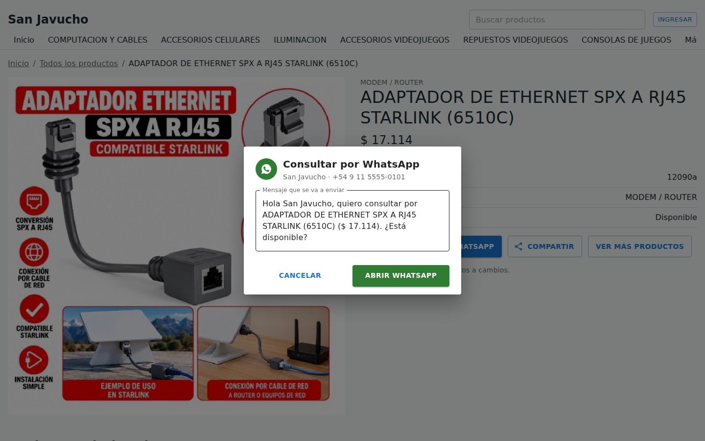

*El visitante revisa el mensaje antes de abrir WhatsApp.*

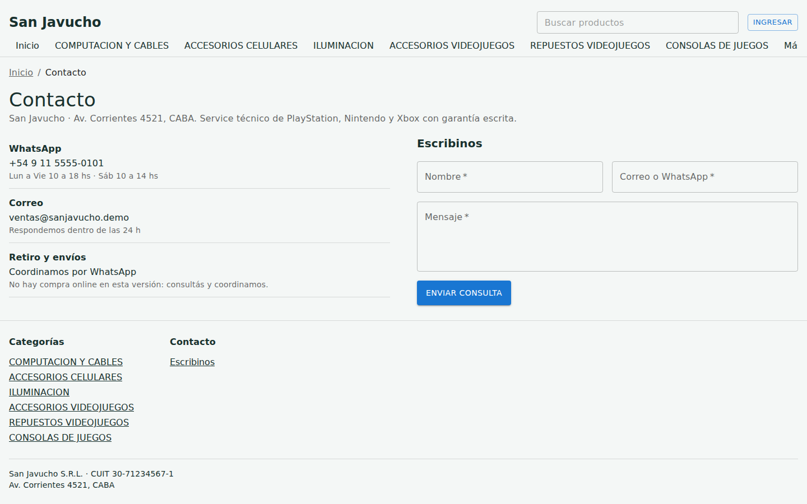

*La página **Contacto**: datos de la tienda, aviso de respuesta y formulario «Escribinos».*

- Cada visitante puede mandar hasta 5 consultas por hora por tienda; después se le pide esperar.

### Celular, clientes con cuenta y páginas especiales

- La tienda se adapta al celular: la barra superior se achica y muestra solo el eslogan (o la bienvenida), el encabezado conserva el logo y el buscador, y el menú se despliega con el botón de menú. Los filtros se abren en un panel. El menú desplegado trae **Inicio**, **Contacto** y las **categorías principales** de la tienda, más **Más categorías**.

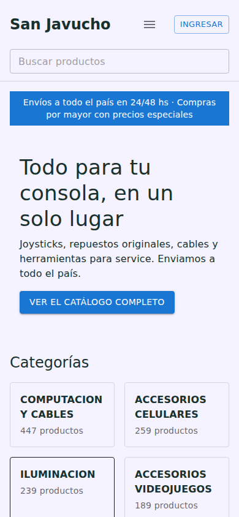

*La tienda en un celular.*

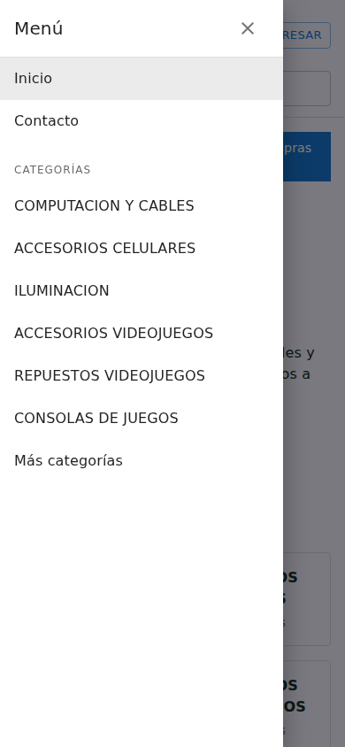

*El menú desplegado en el celular.*

- Los clientes con cuenta pueden **Ingresar** y ver los precios que les corresponden. Ver [Cuenta web del cliente](cuenta-web-cliente.md).
- Si la tienda está pausada o todavía no tiene dirección web, se ve la página «Volvemos pronto».
- Una dirección que no existe muestra «No encontramos esta página».
- Cada tienda puede tener sus propias páginas de texto, medir visitas con Google Analytics y Meta Pixel, y ofrecer el botón **Compartir** en las fichas. Ver [Páginas propias, medición de visitas y botón Compartir](tienda-contenido-y-analitica.md).

## Qué se publica y cómo se oculta

Un producto aparece en una tienda solo si se cumplen **las cuatro condiciones**:

1. El producto está **activo**.
2. Tiene activada esa tienda en **Empresas que lo venden** (ver [Productos y categorías](catalogo-productos.md)).
3. En la pestaña **Catálogo visible** de la tienda está marcado como **Visible**.
4. Su categoría (y la categoría padre, si es subcategoría) está **visible** en esa tienda.

Para sacar algo de una tienda sin tocar las otras, ocultalo en esa tienda.

## Administrar la tienda paso a paso

### Entrar a la gestión de la tienda

1. En el menú, entrá a **Canales → Empresas**.
2. En la fila de la empresa, hacé clic en **Tienda**.

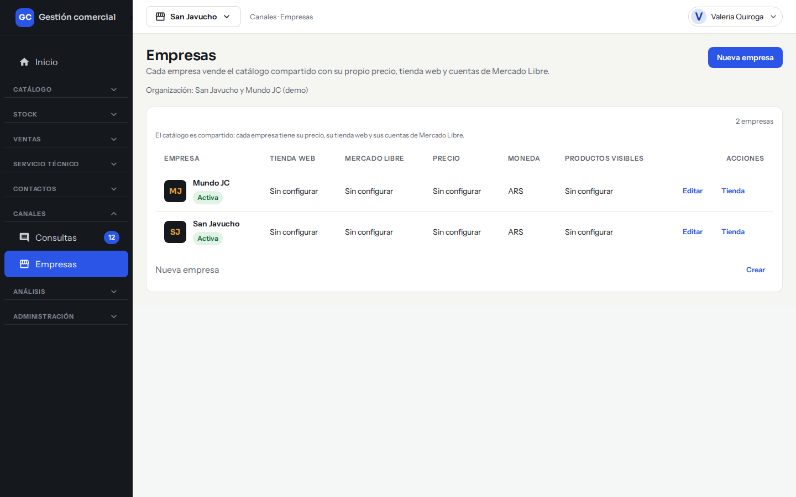

*Paso 2: en cada fila de **Canales → Empresas** está el enlace **Tienda**.*

3. Arriba ves el nombre de la empresa, su dirección web y si está **Publicada** o **Pausada**. El botón **Ver tienda** abre la tienda en otra pestaña (queda apagado si todavía no tiene dirección). Para pasar a la otra tienda, usá **Cambiar a… ↔** o **Cambiar de empresa**.
4. Usá las pestañas **Identidad visual**, **Contenido**, **Catálogo visible** y **Dominio y publicación**. La identidad y los textos se explican en [Identidad, textos y dirección de la tienda](tienda-dominio-e-identidad.md); la dirección web, la publicación y las versiones, en [Dominio, publicación y versiones de la tienda](tienda-dominio-y-publicacion.md).

### Elegir qué categorías y productos se ven

1. Entrá a la pestaña **Catálogo visible**.
2. En **Categorías visibles** activá o desactivá el interruptor de cada categoría. Las categorías ocultas no aparecen en el menú ni en los filtros de esa tienda.

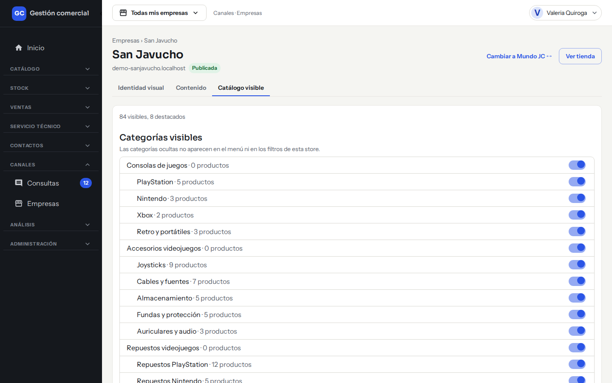

*La pestaña **Catálogo visible**: resumen arriba y un interruptor por categoría.*

3. En **Productos visibles y destacados** buscá un producto con **Buscar producto**. La tabla muestra **Producto**, **Precio**, **Stock**, **Visible** y **Destacado**.
4. Activá o desactivá **Visible**, y hacé clic en la estrella para **Destacar** (o quitar el destacado) de un producto. Arriba ves el resumen, por ejemplo «12 visibles, 3 destacados».
5. Si un producto no se muestra, debajo de su nombre dice por qué: «No se muestra: producto inactivo» o «No se muestra: categoría oculta».
6. Si querés destacar un producto que no se muestra, el sistema pregunta «Este producto no se muestra en la tienda. ¿Destacarlo igual?». Si confirmás con **Destacar igual**, queda destacado pero no se vuelve visible.
7. Los cambios no se aplican hasta que hacés clic en **Guardar** en la franja amarilla de arriba. Con **Descartar** volvés a lo último guardado.

El precio y el stock se ven en esta pantalla pero no se cambian acá.

**Guardar deja los cambios sin publicar.** Recién cuando los publicás desde la pestaña **Dominio y publicación** los ve la tienda. El paso a paso está en [Dominio, publicación y versiones de la tienda](tienda-dominio-y-publicacion.md).

### Pausar o reactivar la tienda

1. En **Canales → Empresas**, hacé clic en **Editar** en la fila de la empresa.
2. Hacé clic en **Pausar tienda**. Mientras está pausada, los visitantes ven «Volvemos pronto».

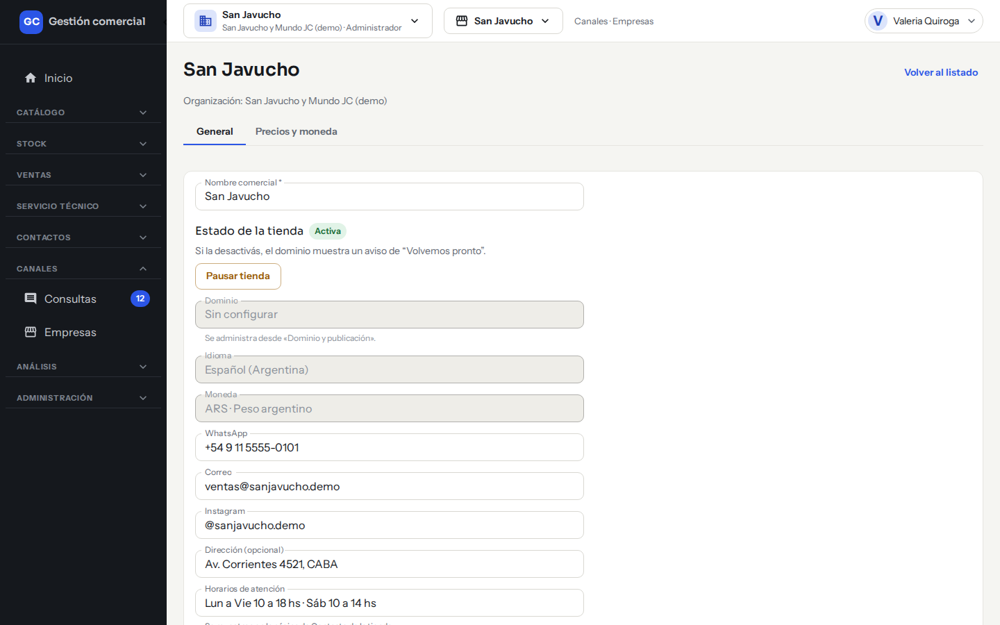

*Paso 2: el estado de la tienda y el botón **Pausar tienda**.*

3. Para volver a publicarla, hacé clic en **Reactivar tienda**.

### Cargar el WhatsApp, el correo y los horarios

En **Canales → Empresas → Editar** completá **WhatsApp**, **Correo**, **Instagram**, **Dirección (opcional)** y **Horarios de atención**. Los horarios se muestran en la página de Contacto de la tienda, y el botón de WhatsApp de las fichas aparece cuando hay un número válido.

## Casos comunes

- **Cargué un producto y no aparece en la tienda.** Revisá las cuatro condiciones de arriba: que esté activo, que tenga activada la tienda, que esté **Visible** en **Catálogo visible** y que su categoría esté visible. Si acabás de guardar el cambio, faltaría **publicarlo**.
- **Quiero destacar los productos de la temporada.** En **Catálogo visible**, tocá la estrella de hasta 8 productos y hacé clic en **Guardar**; después publicá desde **Dominio y publicación**.
- **La tienda dice «Catálogo en preparación».** Todavía no hay ningún producto visible en esa tienda.
- **Los precios no muestran IVA.** Es una decisión de cada tienda: ver [Precios e IVA](precios-e-iva.md).
- **En el menú solo aparecen unas pocas categorías.** El menú muestra las **categorías principales** (las que tienen más productos) y el resto queda en **Más categorías**, que lleva al catálogo. Para cambiar cuáles son, ocultá las que no quieras en **Catálogo visible** de esa tienda.
- **Una categoría desapareció de la tienda.** Quedó sin productos publicados en esa tienda: las categorías sin productos no se muestran. Publicá algún producto en esa categoría y vuelve a aparecer.
- **El nombre de un producto venía con un texto raro de más (por ejemplo «&ua …»).** Ya no sale así: el nombre se limpia al guardarlo. Si seguís viendo el nombre viejo, guardá el producto otra vez para que se actualice.
- **En la ficha el nombre me aparece dos veces.** La descripción que era igual al nombre ya no se muestra; si querés dejar una descripción, escribí una distinta.
- **Las dos tiendas muestran las mismas categorías y los mismos números.** No es un error de la tienda: el sistema muestra los productos publicados **en esa tienda**. Si ambas publican el mismo catálogo, los números coinciden.

## Si algo no sale

| Mensaje | Qué significa y qué hacer |
|---|---|
| **No pudimos cargar el catálogo de esta tienda.** | Usá **Reintentar**. |
| **No pudimos cargar más resultados.** | Se cortó la carga de la tanda siguiente. Lo que ya veías no se pierde: usá **Reintentar** para pedirla de nuevo. |
| **No tenés empresas para gestionar.** / **No tenés acceso a esta empresa** | Tu usuario no tiene esa empresa. Pedile al Administrador que la asigne. |
| **¿Cambiar de empresa?** | Aparece si cambiás de tienda con cambios sin guardar: **Seguir acá** los conserva y **Cambiar igual** los descarta. |
| **No se cambió el estado.** | No se pudo pausar o reactivar. Probá de nuevo con el botón **Reintentar**. |

Por ahora las tiendas no tienen formas de envío ni carrito: no hay nada para configurar en ese sentido.
