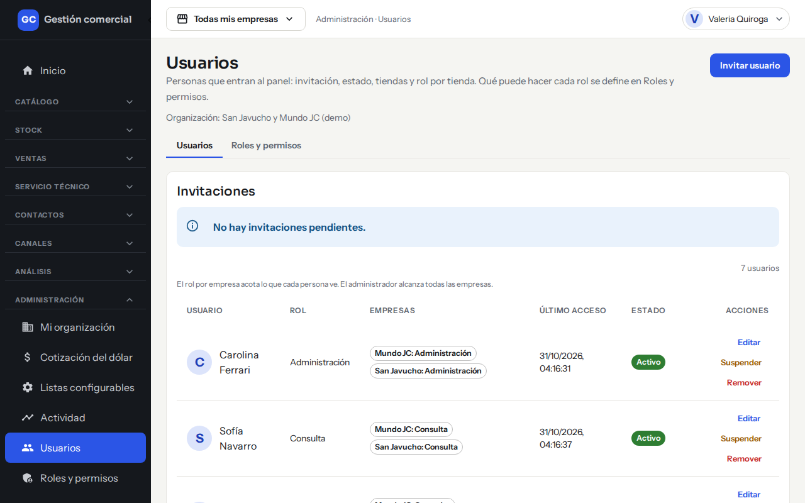
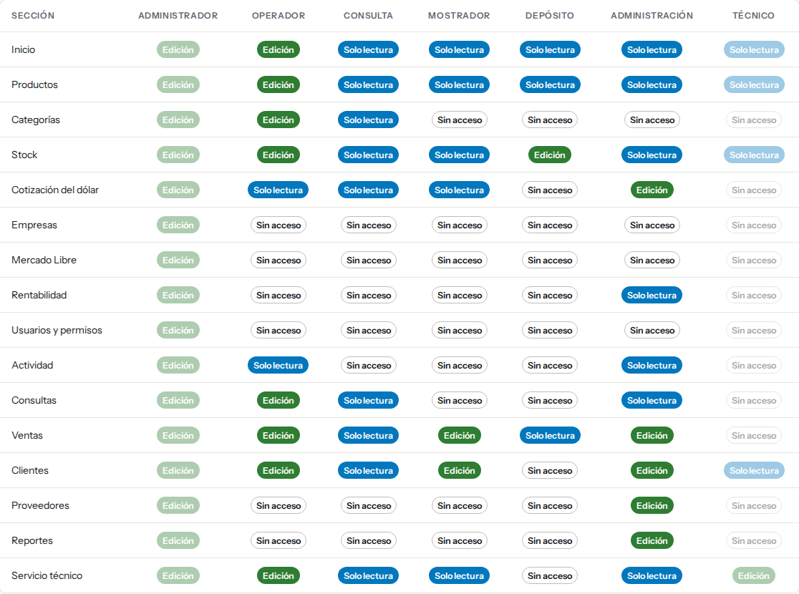
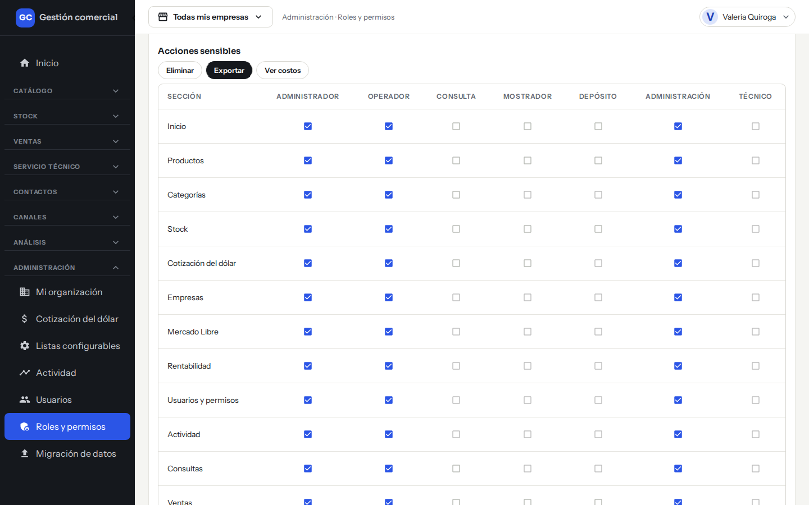
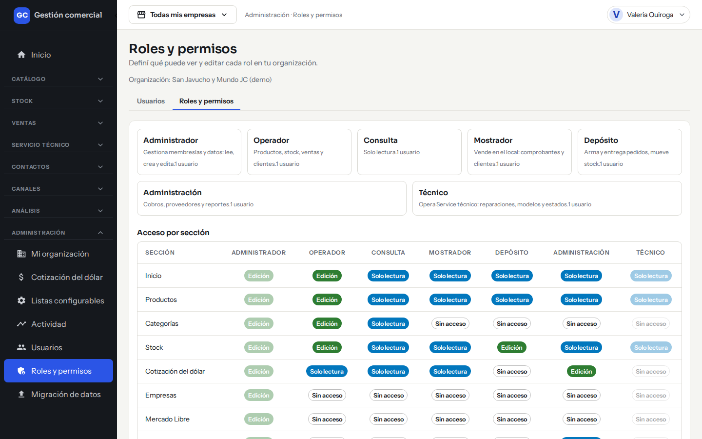
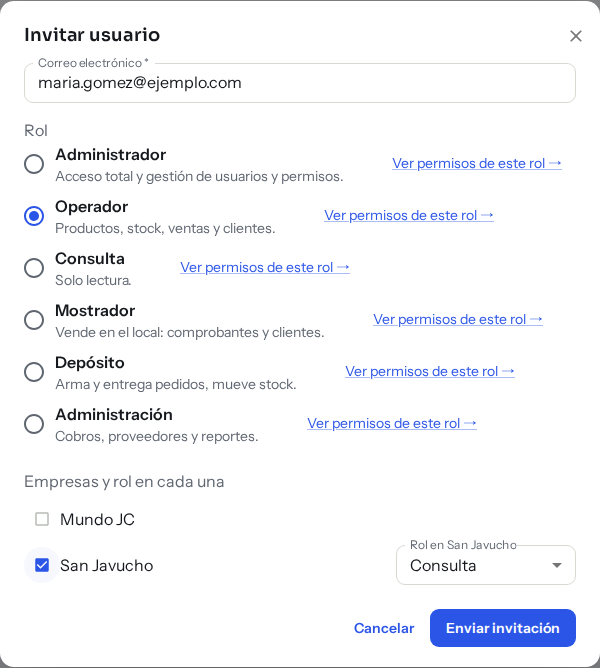
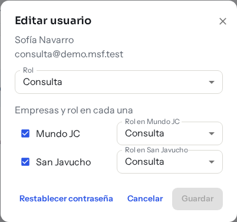
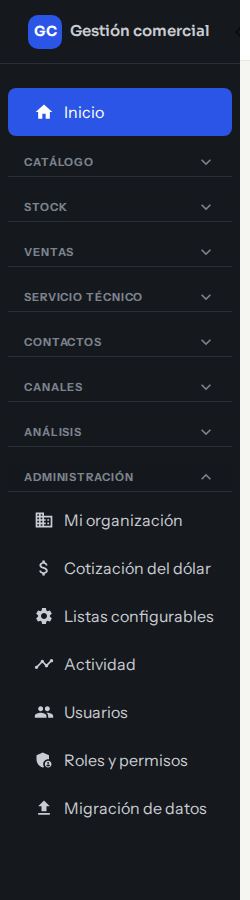

# Usuarios y roles: quién puede qué

## Para qué sirve

Desde **Administración → Usuarios** un Administrador invita personas, les asigna un rol, las suspende o las reactiva. Desde **Administración → Roles y permisos** define qué puede ver y editar cada rol. Cada persona ve solo lo que su rol permite: las secciones sin acceso no aparecen en su menú.

*Administración → Usuarios: arriba las invitaciones pendientes y debajo cada persona, con sus acciones Editar, Suspender y Remover.*

## Quién puede hacerlo

Solo el **Administrador**. Los demás roles no ven las pantallas **Usuarios** ni **Roles y permisos**.

## Los roles

| Rol | Para quién es | Qué hace típicamente |
|---|---|---|
| **Administrador** | Dueños y responsables | Acceso total y gestión de usuarios y permisos. Accede a todas las empresas. |
| **Operador** | Gestión diaria | Productos, stock, ventas, clientes y consultas. |
| **Mostrador** | Atención en el local | Vende en el local: comprobantes, clientes y cobros. |
| **Depósito** | Mercadería | Arma y entrega pedidos y mueve stock. |
| **Administración** | Cobros y control | Cobros, proveedores, cotización del dólar, rentabilidad y reportes. |
| **Técnico** | Taller | Opera el service técnico: reparaciones, modelos y estados. |
| **Consulta** | Solo mirar | Solo lectura de las pantallas habilitadas. |

## Qué ve y qué puede editar cada rol

Para cada sección, el sistema define tres niveles: **Edición** (ve y modifica), **Solo lectura** (ve, no modifica) y **Sin acceso** (no aparece en el menú). La tabla muestra los valores iniciales; el Administrador puede ajustarlos para su organización (los del Administrador y del Técnico son fijos).

E = Edición · L = Solo lectura · — = Sin acceso

| Sección | Administrador | Operador | Mostrador | Depósito | Administración | Técnico | Consulta |
|---|---|---|---|---|---|---|---|
| Inicio | E | E | L | L | L | L | L |
| Productos | E | E | L | L | L | L | L |
| Categorías | E | E | — | — | — | — | L |
| Stock | E | E | L | E | L | L | L |
| Cotización del dólar | E | L | L | — | E | — | L |
| Empresas | E | — | — | — | — | — | — |
| Rentabilidad | E | — | — | — | L | — | — |
| Usuarios y permisos | E | — | — | — | — | — | — |
| Actividad | E | L | — | — | L | — | — |
| Consultas | E | E | — | — | L | — | L |
| Ventas | E | E | E | L | E | — | L |
| Clientes | E | E | E | — | E | L | L |
| Proveedores | E | — | — | — | E | — | — |
| Servicio técnico | E | E | L | — | L | E | L |

También figuran **Mercado Libre** (edición solo para el Administrador) y **Reportes** (edición para el Administrador y Administración; sin acceso para el resto).

*Roles y permisos → Acceso por sección: así se ve la tabla de arriba en pantalla. Las columnas más claras (Administrador y Técnico) no se cambian.*

Algunas pantallas son solo del Administrador aunque otro rol tenga acceso a la sección: **Mi organización**, **Empresas**, **Listas configurables** y la carga inicial de datos.

### Acciones con permiso propio

Dentro de una pantalla, algunas acciones se habilitan por separado. En **Roles y permisos → Acciones sensibles** podés ajustar tres: **Eliminar**, **Exportar** y **Ver costos**. Elegí la acción arriba y la tabla muestra, sección por sección, qué roles la tienen tildada.

*Acciones sensibles: con Exportar elegido se ven los roles que pueden exportar en cada sección.*

Estas son las acciones con permiso propio y quiénes las tienen al empezar (las que no están entre las tres anteriores dependen del rol y no se ajustan en esa pantalla):

| Acción | Quiénes pueden hacerla (valores iniciales) |
|---|---|
| Eliminar | Administrador |
| Exportar | Administrador, Operador, Administración |
| Ver costos | Administrador, Administración |
| Modificar el precio de una línea de venta | Administrador, Operador |
| Anular un comprobante | Administrador, Administración |
| Emitir una nota de crédito | Administrador, Administración |
| Registrar un cobro | Administrador, Administración, Mostrador |
| Conciliar un pago | Administrador, Administración |
| Despachar un pedido | Administrador, Depósito |

## Ver y cambiar los permisos de un rol

1. Entrá a **Administración → Roles y permisos** (o a la pestaña **Roles y permisos** dentro de **Usuarios**). Arriba ves una tarjeta por rol, con cuántas personas lo tienen.

*Roles y permisos: las tarjetas de arriba resumen cada rol y debajo está la tabla de acceso por sección.*
2. En **Acceso por sección**, hacé clic en una celda para rotar entre Edición, Solo lectura y Sin acceso. En **Acciones sensibles** elegí la acción y tildá qué roles pueden hacerla.
3. Hacé clic en **Guardar cambios**. Si quitás permisos, el sistema pide confirmación («¿Guardar cambios que quitan acceso?») porque se aplica de inmediato a todas las personas con ese rol.
4. **Restablecer valores iniciales** descarta tus cambios y vuelve a la tabla original.

Quienes no son Administradores ven esta matriz solo en modo lectura.

## Invitar a una persona

1. Entrá a **Administración → Usuarios** y hacé clic en **Invitar usuario**.
2. Escribí su **Correo electrónico**.
3. Elegí el **Rol**. Cada opción explica en una línea qué hace y tiene un enlace **Ver permisos de este rol** para mirar su detalle.
4. Si el rol no es Administrador, tildá las empresas a las que va a acceder y elegí su rol en cada una (por ejemplo, Operador en San Javucho y Consulta en Mundo JC). Al tildar una empresa aparece su selector **Rol en…**. El Administrador accede a todas.

*Invitar usuario completado: correo, rol y empresa. Todavía no se envió nada hasta que hagas clic en Enviar invitación.*

5. Hacé clic en **Enviar invitación**. Vas a ver «Invitación enviada».

La persona recibe un correo para crear su contraseña ([Ingresar y recuperar el acceso](acceso-y-sesion.md)). La invitación vence a los 7 días y el enlace dura 1 hora.

Mientras no la acepten, las invitaciones aparecen en la sección **Invitaciones** de la misma pantalla, como «Invitación pendiente» o «Invitación vencida». Ahí podés **Reenviar** o **Cancelar** (al cancelar, el enlace deja de funcionar).

Por ahora la invitación no ofrece el rol Técnico: invitá a la persona con otro rol y después cambialo con **Editar**.

## Cambiar el rol o las empresas de una persona

1. En **Usuarios**, hacé clic en **Editar** en su fila.
2. Cambiá el **Rol** o las empresas y su rol en cada una.
3. Hacé clic en **Guardar**. Vas a ver «Usuario guardado».

*Editar usuario: el botón Guardar se habilita cuando cambiás algo.*

En **Editar usuario** también está **Restablecer contraseña**: le envía a la persona un enlace para definir una nueva (no está disponible si está suspendida).

## Suspender, reactivar o remover

| Acción | Qué pasa |
|---|---|
| **Suspender** | La persona no puede entrar hasta que la reactives; su sesión abierta se corta. Lo que hizo antes se conserva en [Actividad](actividad.md). |
| **Reactivar** | Recupera el acceso con su rol anterior. |
| **Remover** | La persona deja de pertenecer a la organización. |

Siempre tiene que quedar al menos un Administrador: si intentás suspender o quitar al último, el sistema te avisa «La organización debe conservar al menos un administrador».

## Qué muestra la lista de usuarios

| Columna | Qué es |
|---|---|
| **Usuario** | Foto y nombre. |
| **Rol** | Su rol. |
| **Empresas** | A qué empresas accede y con qué rol («San Javucho: Operador»). El Administrador figura con «Todas las empresas». |
| **Último acceso** | Cuándo entró por última vez («Nunca» si todavía no ingresó). |
| **Estado** | **Activo** o **Suspendido**. |

## Qué ve cada rol

El menú cambia según el rol. El Administrador ve todos los grupos, incluido **Administración** con Usuarios y Roles y permisos:

*Menú del Administrador.*

Un usuario de Mostrador no ve los grupos Canales ni Análisis, y en Administración solo encuentra lo que su rol incluye:

*Menú de Mostrador.*

Un usuario de Consulta ve los grupos en modo lectura y sin las pantallas de gestión de personas:

*Menú de Consulta.*

## Empresas y roles

Una persona puede tener un rol distinto en cada empresa. En las secciones de cada tienda (como Ventas y Consultas) rige el rol que tiene en la **empresa activa**. Más en [Tu organización y tus empresas](organizacion-y-empresas.md).

Por ahora, una persona pertenece a una sola organización.
