# Registrar cobros y controlar los pagos

## Para qué sirve

Acá registrás lo que el cliente paga por una factura (de una vez o en partes), controlás cuánto te debe, concilias las transferencias contra el banco y seguís el dinero que cobran los transportes al entregar (contrarreembolsos).

## Quién puede hacerlo

| Acción | Quién |
|---|---|
| **Registrar un cobro** en una factura | Mostrador, Administración y Administrador. |
| **Conciliar un pago** (pantalla Pagos) | Administración y Administrador. |
| **Marcar cobrado un contrarreembolso** (pantalla Transportes) | Administración y Administrador. |
| **Crear y editar cuentas de cobro** | Quienes tienen Ventas en edición. |
| Ver cobros, pagos y deudas | Todos los roles con acceso a Ventas. |

El **Operador** puede cargar comprobantes pero, con la configuración inicial, no registra cobros, no concilia ni cobra contrarreembolsos: son permisos aparte que el Administrador puede dar o quitar.

## Dónde lo encontrás

- Los cobros de una factura: en el detalle, tarjeta **Cobros**.
- **Ventas → Pagos**: control de transferencias y depósitos.
- **Ventas → Cuentas de cobro**: las cuentas bancarias y billeteras donde cobrás.
- **Ventas → Transportes**: contrarreembolsos y terminales de retiro.
- **Ventas → Configuración de ventas**: las formas de pago.

## Registrar un cobro

1. Abrí la factura desde **Ventas → Comprobantes**.
2. En la tarjeta **Cobros** ves **Cobrado** (lo ya pagado) y **Saldo** (lo que falta), y la lista de cobros anteriores.
3. Hacé clic en **Registrar cobro**.
4. En **Forma de pago** elegí cómo paga el cliente.
5. En **Cuenta de cobro** elegí la cuenta donde entra la plata. Es opcional, salvo que la forma de pago lo exija (por ejemplo, transferencia o depósito bancario): ahí aparece «La forma de pago elegida exige una cuenta de cobro.»
6. En **Importe** escribí cuánto paga ahora. Abajo se lee «Saldo pendiente: …».
7. Hacé clic en **Registrar cobro**. Aparece «Cobro registrado · importe».

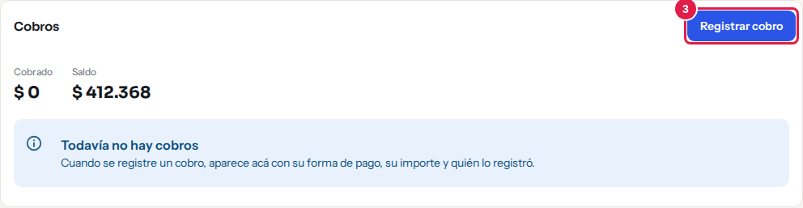

*Paso 3: la tarjeta «Cobros» muestra lo cobrado y el saldo, y desde acá se abre «Registrar cobro».*

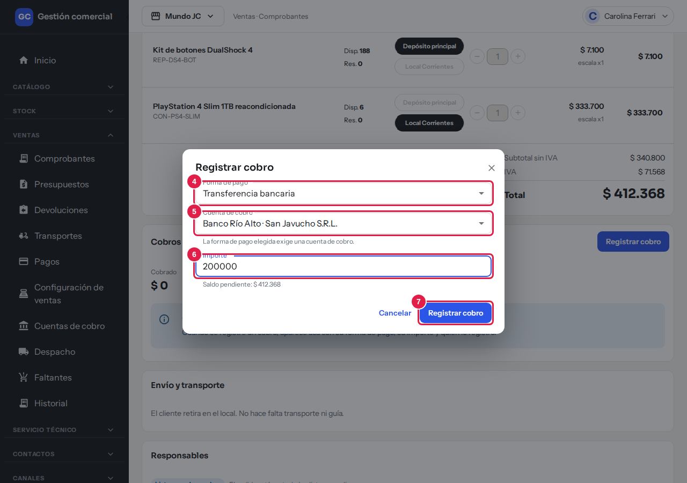

*Pasos 4 a 7: elegí la forma de pago, la cuenta, escribí el importe y confirmá con «Registrar cobro».*

### Cobros parciales y totales

- Podés cobrar una factura en **varias partes**: cada cobro resta del **Saldo**. El importe puede ser menor que el saldo, pero **nunca mayor**.
- Cuando el saldo llega a cero, la factura pasa sola a **Cobrado** y el botón **Registrar cobro** se deshabilita: «No queda saldo pendiente: la factura está cobrada.»
- Si queda saldo y la forma de pago está configurada como «Genera deuda» (por ejemplo, cuenta corriente), la factura pasa a **Deuda**.
- **Cobrado** y **Deuda** los pone el sistema; no se eligen a mano.

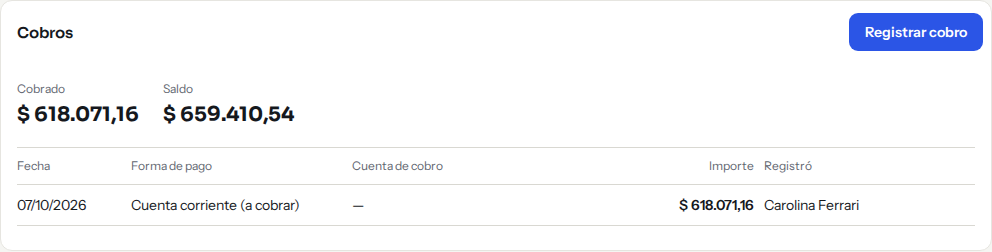

*Una factura con un cobro parcial: arriba se ve lo cobrado y lo que falta, y abajo cada cobro con su forma de pago.*

Solo se pueden registrar cobros en una factura **confirmada**. Un borrador, un presupuesto, una nota de crédito o una factura anulada no admiten cobros.

### Cuenta de cobro en el detalle

En los datos de la factura, el campo **Cuenta de cobro** muestra la cuenta del último cobro con cuenta y una etiqueta que dice si ya está **Conciliado** o **Sin conciliar**, con el enlace **Ir a Pagos →**.

## Formas de pago

Se administran en **Ventas → Configuración de ventas → Formas de pago**. Cada una indica:

| Dato | Para qué sirve |
|---|---|
| **Forma de pago** | El nombre que se ofrece al cobrar (por ejemplo, Efectivo, Tarjeta, Transferencia o depósito bancario, Contrarreembolso). |
| **Pide cuenta de cobro** | Si al cobrar hay que elegir una cuenta (típico de transferencias). |
| **Genera deuda** | Si lo que falta cobrar pasa a **Deuda**. |
| **Activo** | Si se ofrece o no al cobrar. |

Con **Nueva forma de pago** creás una; con el lápiz la editás. Cada forma se habilita por tienda en «Empresas donde aplica».

Al crear una forma de pago completás **Nombre**, **Tipo de forma de pago**, **Exige cuenta de cobro**, **Genera deuda**, **Estado inicial del comprobante** (el estado con el que queda la factura al elegir esta forma de pago), **Orden**, **Activo** y **Empresas donde aplica**.

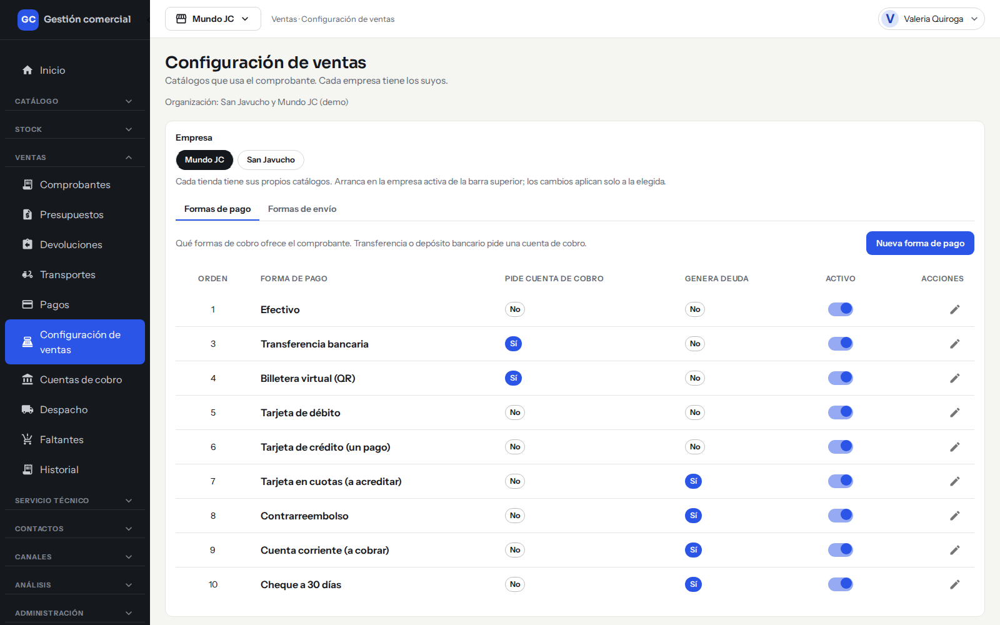

*Ventas → Configuración de ventas → Formas de pago.*

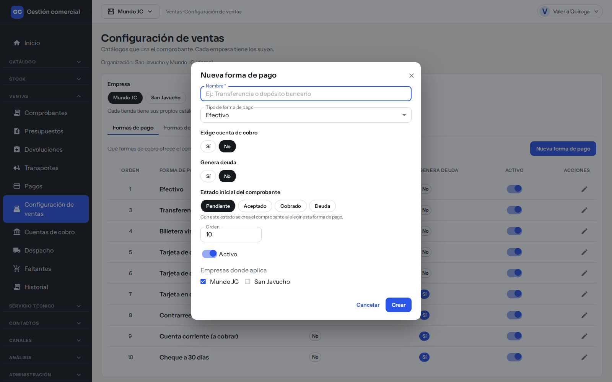

*La ventana «Nueva forma de pago». El botón «Crear» la guarda; «Cancelar» la cierra.*

## Deuda de clientes

- En cada factura, el **Saldo** de la tarjeta **Cobros** es lo que ese cliente todavía debe.
- En **Ventas → Pagos**, la tarjeta **Saldo pendiente de clientes** suma lo que falta cobrar de los comprobantes con pago parcial.
- En **Ventas → Comprobantes** podés filtrar por **Estado: Deuda** para ver las facturas que se entregaron sin cobrar.

## La pantalla Pagos (conciliación)

**Conciliar** es controlar que cada transferencia o depósito realmente entró en la cuenta bancaria. Las ventas en efectivo no aparecen acá: no hay nada que comparar con un extracto.

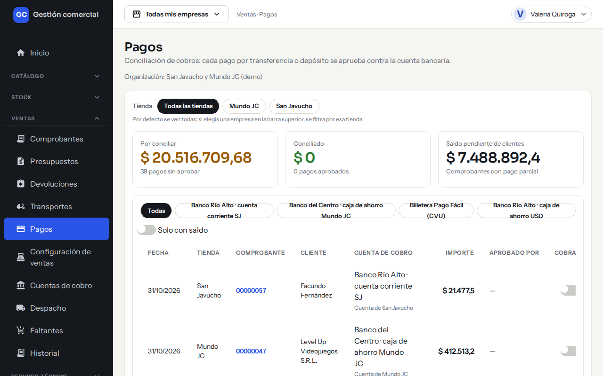

*Ventas → Pagos: tarjetas de resumen arriba, filtro por cuenta y tabla de pagos con el interruptor «Cobrado».*

### Las tarjetas

| Tarjeta | Qué muestra |
|---|---|
| **Por conciliar** | Importe de los pagos todavía sin aprobar y cuántos son. |
| **Conciliado** | Importe de los pagos ya aprobados y cuántos son. |
| **Saldo pendiente de clientes** | Lo que falta cobrar de los comprobantes con pago parcial. |

### Filtros

- **Tienda**: todas o una sola.
- Una fila de botones con **Todas** y las cuentas de cobro más usadas, para ver los pagos de una cuenta.
- **Solo con saldo**: muestra únicamente los pagos cuyo comprobante todavía tiene saldo.

### Columnas

**Fecha**, **Tienda**, **Comprobante** (con enlace), **Cliente**, **Cuenta de cobro**, **Importe**, **Aprobado por**, **Cobrado** (interruptor) y **Saldo**.

### Conciliar un pago

1. Mirá en el extracto del banco que el dinero haya entrado.
2. En la fila del pago, activá el interruptor **Cobrado**.
3. Aparece «Pago conciliado · número» y la fila pasa a mostrar quién lo aprobó.

Para deshacerlo, apagá el interruptor: «Conciliación revertida · número». Si tu rol no puede conciliar, el interruptor aparece deshabilitado.

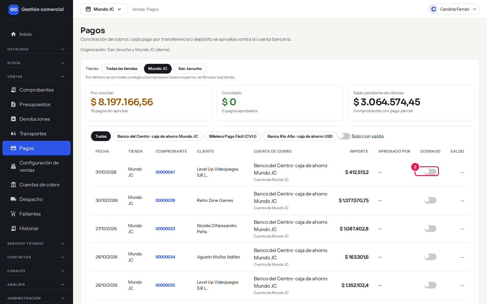

*Paso 2: el interruptor «Cobrado» de la fila concilia el pago.*

!!! note "Conciliar no cambia el estado de la factura"
    La factura pasa a **Cobrado** cuando el saldo llega a cero, no cuando se concilia. La conciliación es un control aparte contra el banco.

## La pantalla Cuentas de cobro

Son las **cuentas bancarias y billeteras** donde cobrás las ventas por transferencia o depósito. No son depósitos de mercadería.

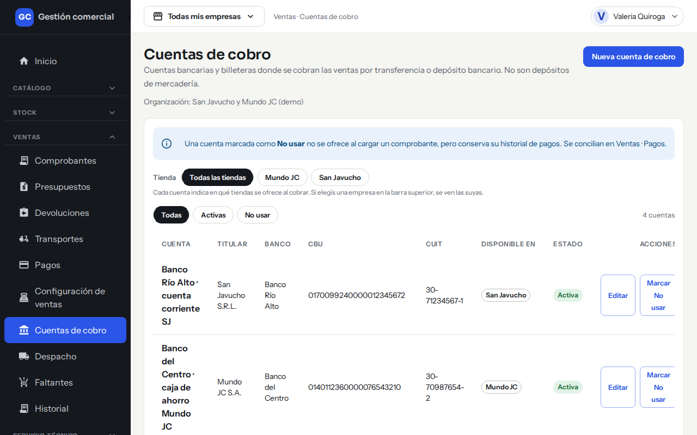

*Ventas → Cuentas de cobro: cada cuenta indica en qué tiendas se ofrece al cobrar.*

### Qué muestra

**Cuenta**, **Titular**, **Banco**, **CBU**, **CUIT**, **Disponible en** (las tiendas donde se ofrece), **Estado** (Activa o No usar) y las acciones. Podés filtrar por tienda y por **Todas**, **Activas** o **No usar**.

### Crear o editar una cuenta

1. Hacé clic en **Nueva cuenta de cobro** (o en **Editar** sobre una cuenta).
2. Completá **Nombre de la cuenta**, **Titular**, **CUIT del titular** y **CBU / CVU** (obligatorios). Opcionales: **Banco**, **Alias** y **Notas internas**.
3. Elegí el **Tipo de cuenta** (**Cuenta corriente**, **Caja de ahorro** o **Billetera virtual**) y la **Moneda** (**ARS** o **USD**).
4. En **Disponible en** marcá las tiendas donde se puede cobrar con esta cuenta.
5. **Orden** define en qué orden se listan. Con **Activa** decidís si se ofrece al cobrar.
6. Hacé clic en **Guardar cuenta**.

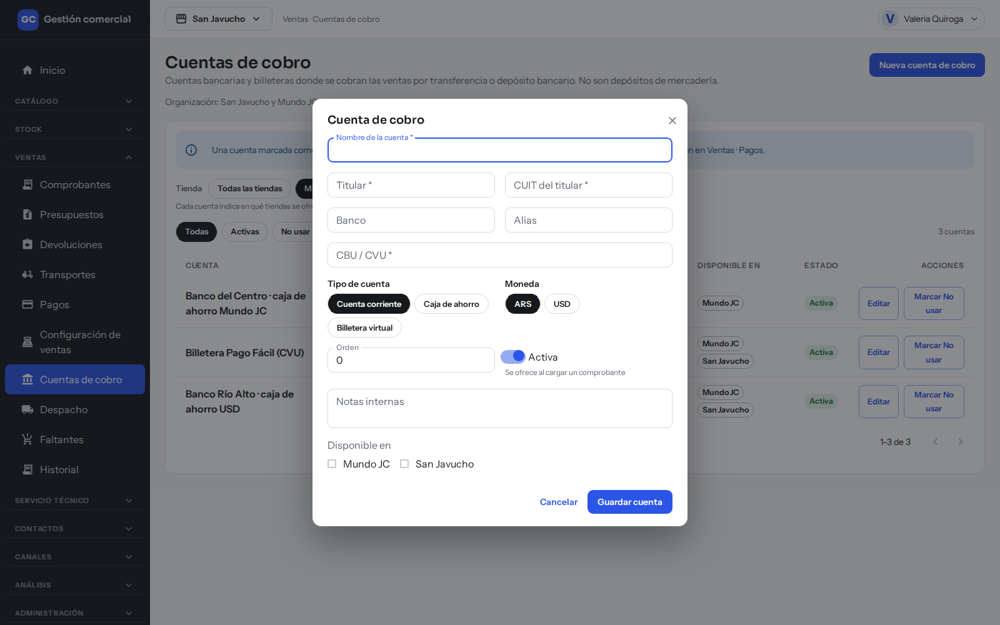

*La ventana «Cuenta de cobro» al crear una nueva. Los campos con asterisco son obligatorios.*

### Dejar de usar una cuenta

Con **Marcar No usar** la cuenta deja de ofrecerse al cargar un cobro, pero **conserva su historial de pagos**, que se sigue conciliando en Pagos. Para volver a usarla, hacé clic en **Reactivar**.

## Contrarreembolsos

Un **contrarreembolso** es cuando el **transporte cobra al cliente al entregar** el paquete y después te rinde esa plata. Hasta que te la rinden, el dinero está «en la calle».

### Cómo se cobra

1. En la factura, registrá el cobro con la forma de pago **Contrarreembolso**. La factura muestra «El transporte cobra al entregar. Queda en Transportes y contrarreembolsos hasta que lo rindan.»
2. Cuando el transporte te rinde el dinero, entrá a **Ventas → Transportes**, pestaña **Contrarreembolsos**.
3. Buscá la fila (Fecha, Tienda, Comprobante, Cliente, Empresa de transporte, Guía, Importe, Estado). Estará **Pendiente**.
4. Hacé clic en **Marcar cobrado**. Aparece «Contrarreembolso cobrado · nombre del transporte» y el estado pasa a **Cobrado**.

Solo Administración y Administrador pueden marcar cobrado. Si ya está cobrado, el botón queda deshabilitado.

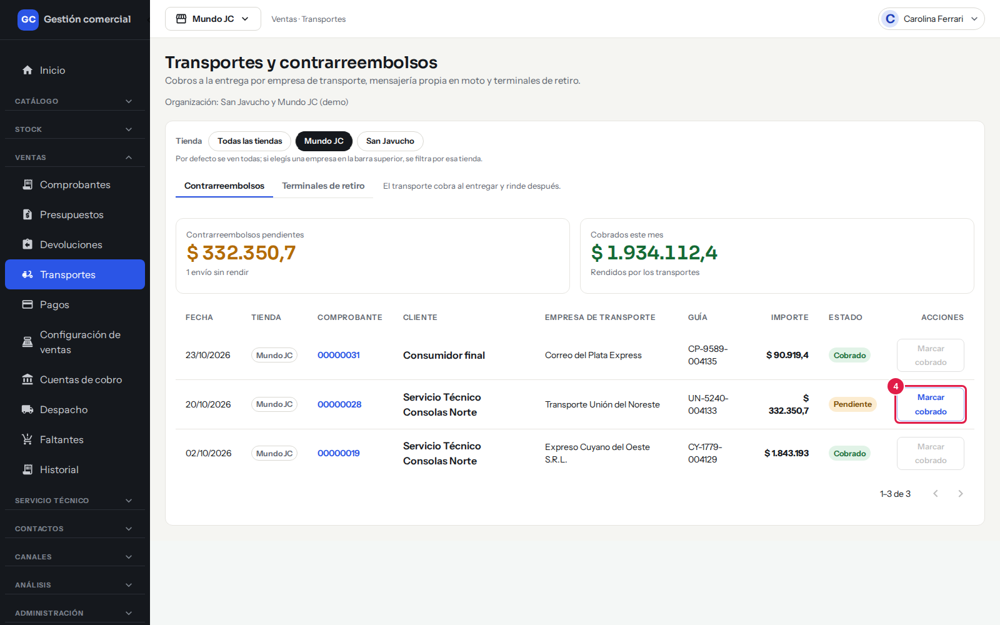

*Paso 4: «Marcar cobrado» solo está activo en el contrarreembolso Pendiente; en los ya Cobrados queda deshabilitado.*

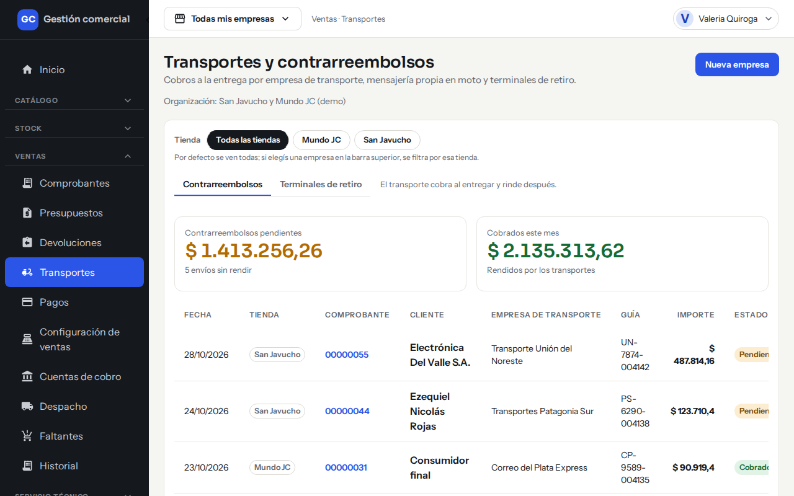

*Ventas → Transportes: las tarjetas muestran lo pendiente de rendir y lo cobrado en el mes.*

Las tarjetas de arriba son **Contrarreembolsos pendientes** (cuántos envíos faltan rendir y por cuánto) y **Cobrados este mes** (lo ya rendido por los transportes). Cómo cargar y editar las empresas de transporte está en [Despacho, faltantes y transportes](ventas-despacho-y-faltantes.md).

## Si algo no sale

| Mensaje | Qué significa y qué hacer |
|---|---|
| «Elegí la forma de pago.» | Falta elegir cómo paga el cliente. |
| «La forma de pago exige una cuenta de cobro.» | Elegí una cuenta en **Cuenta de cobro**. |
| «Ingresá el importe del cobro.» / «El importe tiene que ser mayor a cero.» | Completá un importe válido. |
| «Ingresá el importe como número, con hasta dos decimales.» | Sin letras ni separadores de miles; por ejemplo 400 o 400,50. |
| «El importe no puede superar el saldo pendiente (…).» | Cobrá como máximo lo que falta. |
| «Esta factura no admite cobros: está en borrador o anulada.» | Confirmá la factura primero, o usá otra. |
| «No tenés permiso para registrar cobros en esta tienda. Puede que tu rol haya cambiado: recargá la página.» | Tu rol no tiene el permiso en esa tienda. Consultá al Administrador. |
| «El pago fue modificado por otra persona. Recargá la lista e intentá de nuevo.» | Alguien concilió o cambió el pago a la vez. Actualizá Pagos. |
| «Tu rol no puede conciliar pagos en esta tienda.» | Solo Administración y Administrador concilian. |
| «No pudimos marcar el contrarreembolso como cobrado. Intentá de nuevo.» | No se guardó. Reintentá. |
| «Otra persona modificó esta cuenta mientras la editabas. Recargá para ver sus cambios; no se guardó nada tuyo.» | Dos personas editaron la misma cuenta. Recargá y repetí. |
