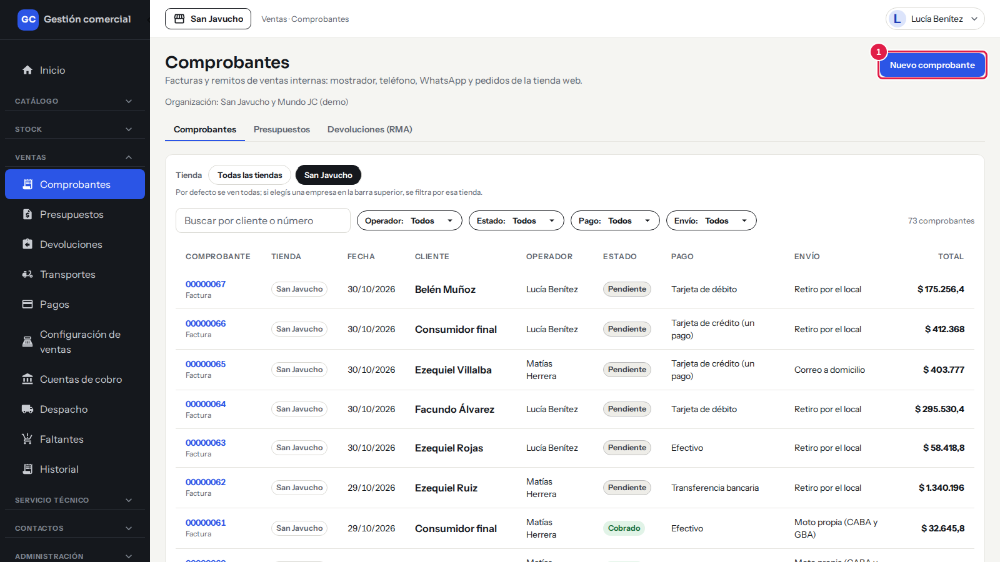
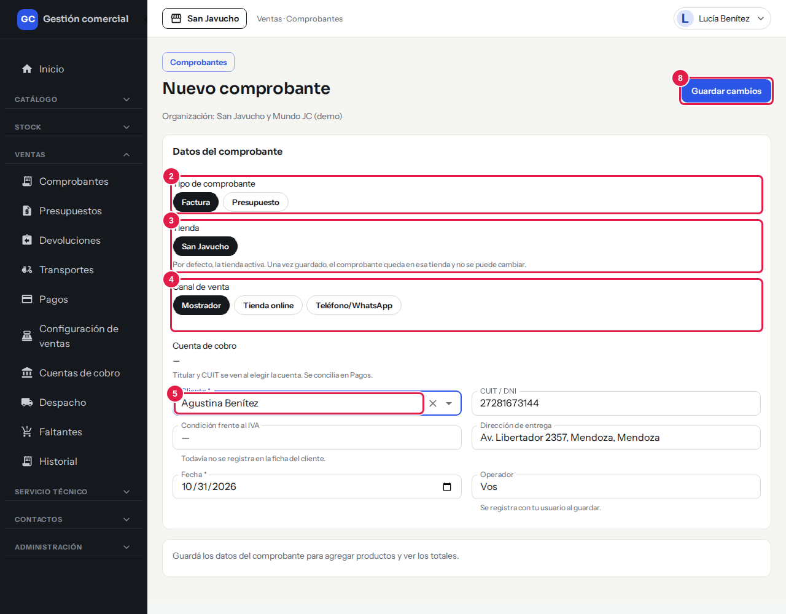
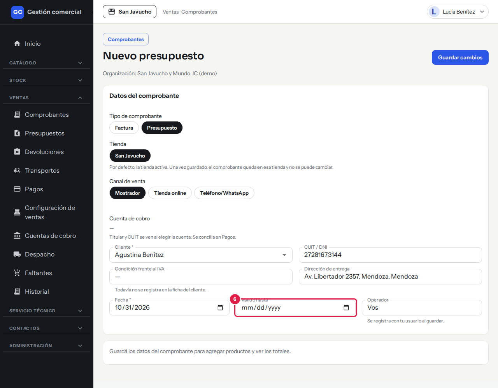
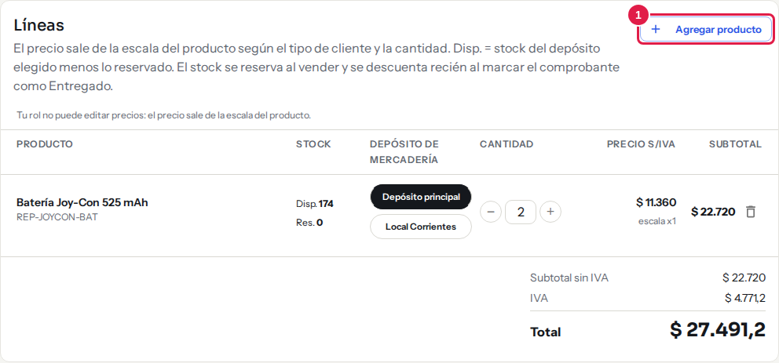
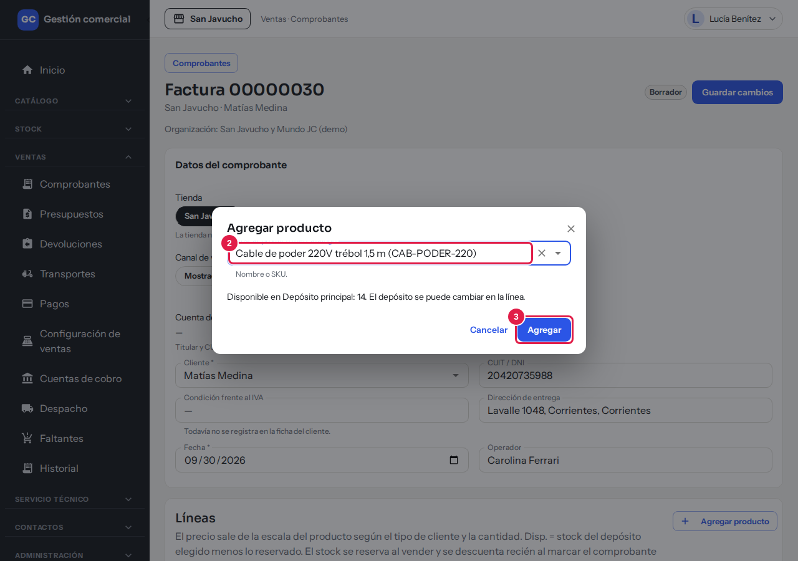
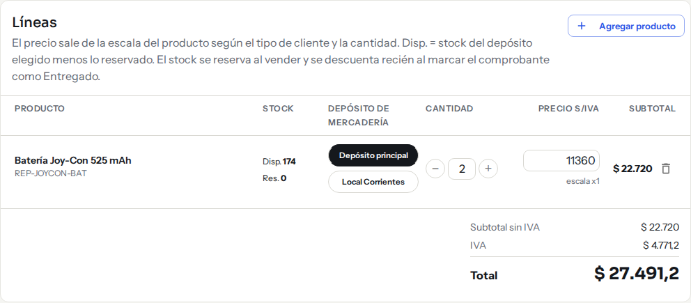
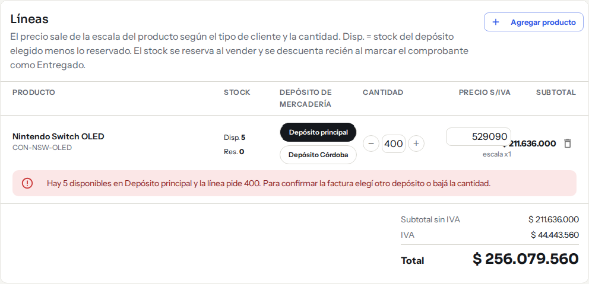
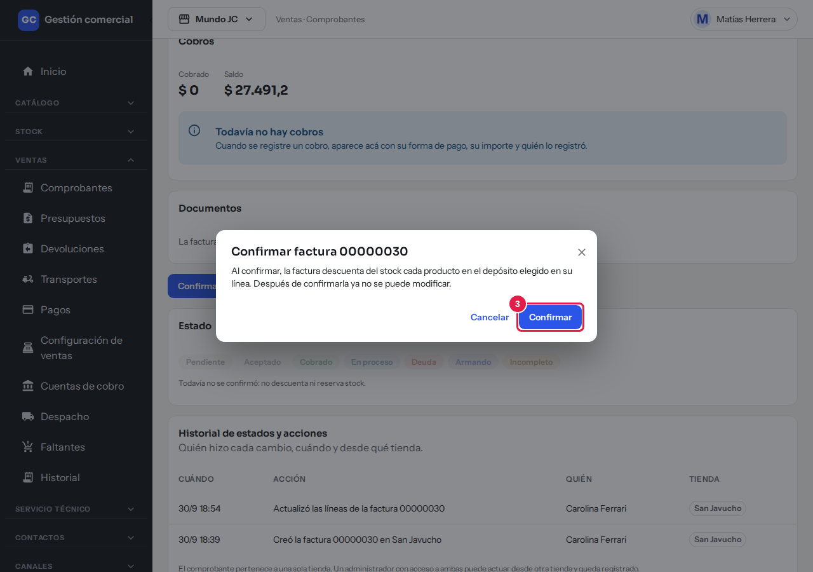
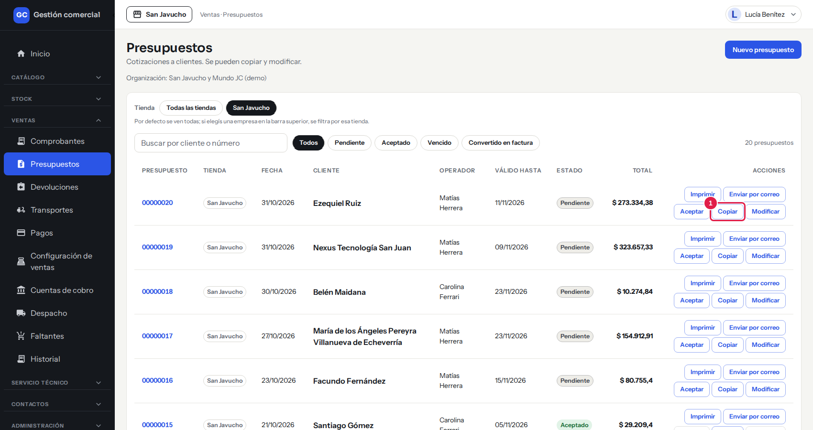

# Crear un presupuesto o una factura

## Para qué sirve

Acá cargás una **factura** o un **presupuesto** para un cliente: elegís quién compra, en qué tienda, por qué canal, y sumás los productos con su precio. El sistema calcula el precio según el tipo de cliente y la cantidad, y te muestra cuánto hay en cada depósito.

Los comprobantes son **internos**: no son facturas fiscales y no tienen validez impositiva. Las impresiones llevan la leyenda «Documento no válido como factura».

## Quién puede hacerlo

| Rol | Qué puede hacer |
|---|---|
| **Administrador, Administración, Operador y Mostrador** | Crear y editar facturas y presupuestos, y confirmar facturas. |
| **Administrador y Operador** | Además, cambiar a mano el precio de una línea (es un permiso aparte; el Administrador puede darlo o sacarlo por rol). |
| **Depósito y Consulta** | Solo ven los comprobantes. Si abren uno, aparece el aviso «Tu rol puede ver este comprobante, no modificarlo.» |

## Dónde lo encontrás

Menú **Ventas → Comprobantes** y botón **Nuevo comprobante**. Para un presupuesto: menú **Ventas → Presupuestos** y botón **Nuevo presupuesto**.

*Ventas → Comprobantes: desde acá se crea una factura con «Nuevo comprobante».*

## Paso a paso: cargar un comprobante nuevo

1. Hacé clic en **Nuevo comprobante** (o **Nuevo presupuesto**).
2. En **Tipo de comprobante** elegí **Factura** o **Presupuesto**.
3. En **Tienda** elegí la tienda. Viene marcada la tienda activa de la barra superior.
4. En **Canal de venta** elegí **Mostrador**, **Tienda online** o **Teléfono/WhatsApp**.
5. En **Cliente** buscá al cliente por nombre. Si no hay datos, elegí **Consumidor final**. Al elegirlo se completan **CUIT / DNI** y **Dirección de entrega** (solo lectura).
6. Revisá la **Fecha**. En un presupuesto podés completar **Válido hasta**.
7. El campo **Operador** muestra tu usuario y se registra al guardar.
8. Hacé clic en **Guardar cambios**. El sistema le asigna un número y aparece el mensaje «Factura … creado» o «Presupuesto … creado».

*Paso 1: el botón «Nuevo comprobante» está arriba a la derecha del listado.*

*Pasos 2 a 5 y 8: elegí tipo, tienda, canal y cliente, y guardá con «Guardar cambios».*

*Paso 6: en un presupuesto aparece el campo «Válido hasta».*

!!! note "La tienda no se puede cambiar después"
    Una vez guardado, el comprobante queda en esa tienda para siempre. Si te equivocaste de tienda, tenés que crear otro comprobante.

Hasta que no guardes, no vas a poder sumar productos: la pantalla te avisa «Guardá los datos del comprobante para agregar productos y ver los totales.»

## Agregar productos

1. Con el comprobante guardado, en la tarjeta **Líneas** hacé clic en **Agregar producto**.
2. En **Buscar producto del catálogo** escribí el nombre o el código (SKU) y elegí el producto. Te muestra cuánto hay disponible en el depósito por defecto.
3. Hacé clic en **Agregar**. El producto queda como una línea nueva.
4. En cada línea podés cambiar:
   - **Depósito de mercadería**: de qué depósito sale el producto.
   - **Cantidad**: con los botones **−** y **+**, o escribiendo (número entero de 1 a 99.999).
   - **Precio s/IVA**: solo si tu rol puede editar precios (ver más abajo).
5. Para sacar una línea, usá el ícono del tacho de basura.

*Un borrador con una línea. El botón «Agregar producto» está arriba a la derecha de la tarjeta «Líneas»; los totales se ven abajo.*

*Pasos 2 y 3: buscá el producto por nombre o código y hacé clic en «Agregar». Abajo se lee cuánto hay disponible.*

Abajo de las líneas se ven **Subtotal sin IVA**, **IVA** y **Total**.

### Columnas de las líneas

| Columna | Qué muestra |
|---|---|
| **Producto** | Nombre y código del producto. Los productos «A pedido» llevan la etiqueta «A pedido · no descuenta stock». |
| **Stock** | **Disp.** es lo disponible en el depósito elegido (existencias menos lo reservado). **Res.** es lo reservado. |
| **Depósito de mercadería** | Depósito de donde sale. |
| **Cantidad** | Unidades de la línea. |
| **Precio s/IVA** | Precio unitario sin IVA y, debajo, de dónde sale: «escala x1», «escala x5», etc., o «precio manual». |
| **Subtotal** | Cantidad por precio, sin IVA. |

### Cómo se calcula el precio

- El precio sale del producto según el **tipo de cliente** y la **cantidad de esa línea**. El IVA se suma aparte según la categoría del producto.
- Cliente **minorista**: siempre precio de la escala x1.
- Cliente **mayorista**: x1 de 1 a 4 unidades, x5 de 5 a 9, x10 de 10 a 49 y x50 desde 50.
- Si cambiás el cliente del comprobante y guardás, los precios de las líneas se recalculan con el tipo del nuevo cliente.

### Cambiar el precio a mano

Si tu rol puede editar precios, la columna **Precio s/IVA** es un campo editable. Escribí el precio (cero o más, hasta dos decimales) y apretá Enter. La línea queda marcada como «precio manual». Para volver al precio de la escala, borrá el valor y apretá Enter.

Si tu rol no puede, ves el aviso «Tu rol no puede editar precios: el precio sale de la escala del producto.»

*Con un rol que puede editar precios (acá, Operador), la columna «Precio s/IVA» es un campo editable. Con otros roles se ve solo el número y el aviso de arriba.*

## Aviso de faltante de stock

Si pedís más unidades que las disponibles en el depósito elegido, la línea muestra en rojo: «Hay N disponibles en … y la línea pide M. Para confirmar la factura elegí otro depósito o bajá la cantidad.»

El aviso **no te impide guardar** el borrador, pero sí confirmar la factura.

*El aviso rojo aparece debajo de la línea que pide más de lo disponible.*

## Confirmar una factura

Mientras la factura está en **Borrador** no mueve stock. Cuando está lista:

1. Revisá que tenga al menos una línea.
2. Hacé clic en **Confirmar factura**. Se abre una ventana que explica qué va a pasar.
3. Hacé clic en **Confirmar**.

*Paso 3: la ventana explica qué va a pasar. «Confirmar» descuenta el stock; «Cancelar» cierra sin cambios.*

### Qué pasa con el stock al confirmar

- Cada producto **se descuenta del depósito elegido en su línea**.
- Los productos **«A pedido»** no se descuentan: **se reservan** y se descuentan recién cuando la factura se entrega (ver [Despacho y faltantes](ventas-despacho-y-faltantes.md)).
- Es todo o nada: si en algún depósito no alcanza el stock, no se descuenta nada y la ventana te dice qué producto y en qué depósito falta. Corregí las líneas y volvé a intentar.
- Después de confirmarla, **ya no se puede modificar**. Si hubo un error, mirá cómo corregirlo en [Listado, estados y anulación](ventas-listado-estados-y-anulacion.md).
- Un **presupuesto nunca se confirma** ni mueve stock.

Al confirmar, la factura pasa a **Pendiente** y entra al circuito de cobro y de despacho.

## Presupuestos

En **Ventas → Presupuestos** ves todos los presupuestos con **Comprobante**, **Tienda**, **Fecha**, **Cliente**, **Operador**, **Válido hasta**, **Estado** y **Total**. Podés buscar por cliente o número y filtrar por estado.

| Estado | Qué significa |
|---|---|
| **Pendiente** | Todavía no lo aceptó el cliente. |
| **Aceptado** | El cliente lo aceptó. No reserva ni descuenta stock. |
| **Vencido** | Estaba pendiente y pasó la fecha de «Válido hasta». Se marca solo. |
| **Convertido en factura** | Existe como filtro de la lista, pero por ahora ningún botón convierte un presupuesto en factura. |

En cada fila tenés estos botones (según tu rol y el estado):

- **Imprimir** y **Enviar por correo**: ver [Imprimir facturas, remitos y presupuestos](ventas-impresion.md).
- **Aceptar**: pasa el presupuesto de Pendiente a Aceptado.
- **Copiar**: crea un presupuesto nuevo, Pendiente y con número nuevo, listo para editar. El original no cambia. También está el botón **Copiar** dentro del presupuesto.
- **Modificar**: abre el presupuesto para editarlo, solo mientras está Pendiente.

*Cada fila trae sus botones: Imprimir, Enviar por correo, Aceptar, Copiar y Modificar. «Copiar» hace un presupuesto nuevo a partir de este.*

Por ahora no hay un botón que convierta un presupuesto en factura. Para cobrar, cargá una factura nueva con los mismos productos (podés usar **Copiar** para tener los datos a mano).

## Cambiar de tienda con un comprobante abierto

Si con un comprobante abierto cambiás la tienda activa en la barra superior, el comprobante se cierra con el aviso «Cambiaste de tienda: cerramos el comprobante para no mezclar datos de dos tiendas.» No se pierde nada de lo ya guardado.

## Si algo no sale

| Mensaje | Qué significa y qué hacer |
|---|---|
| «Revisá los campos marcados antes de guardar.» | Falta un dato obligatorio (cliente, fecha, canal o tienda). Completá lo marcado en rojo. |
| «Otra persona modificó este comprobante mientras lo editabas. Recargá para ver sus cambios; no se guardó nada tuyo.» | Dos personas editaron a la vez. Hacé clic en **Recargar** y volvé a cargar tu cambio. |
| «Este comprobante ya está cerrado: solo se puede consultar.» | La factura ya fue confirmada (o anulada). No admite cambios. |
| «Ingresá una cantidad entera de 1 a 99999.» | La cantidad tiene que ser un número entero. |
| «Ingresá un precio de cero o más, con hasta dos decimales.» | El precio manual no es válido. |
| «No hay stock suficiente para confirmar. Corregí estas líneas y volvé a intentar» | Cambiá el depósito o bajá la cantidad de las líneas que se listan. |
| «No pudimos confirmar la factura. No se descontó nada: probá de nuevo.» | Falló la confirmación y no se movió stock. Reintentá. |

## Preguntas frecuentes

**¿Puedo cargar una venta con un producto sin stock?** Podés guardar el borrador con el aviso de faltante, pero no confirmar la factura hasta elegir otro depósito o bajar la cantidad. Los productos «A pedido» no tienen este límite.

**¿Dónde se elige la forma de pago?** No se elige al crear el comprobante: se registra al cobrar. Ver [Cobros y conciliación](ventas-cobros-y-conciliacion.md).

**¿Puedo vender por Mercado Libre?** Por ahora no: el canal Mercado Libre todavía no está disponible.
