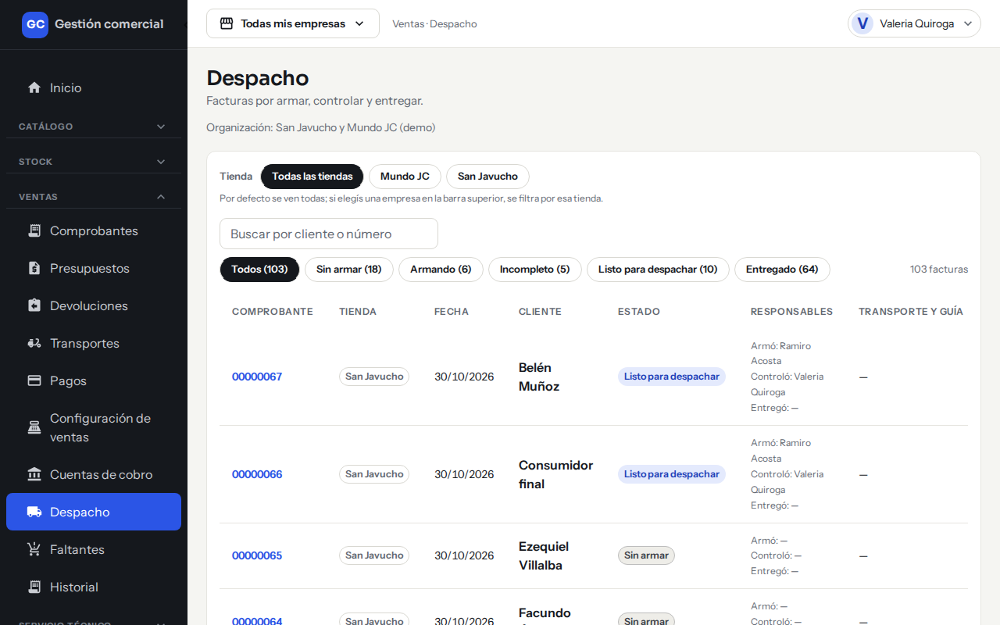
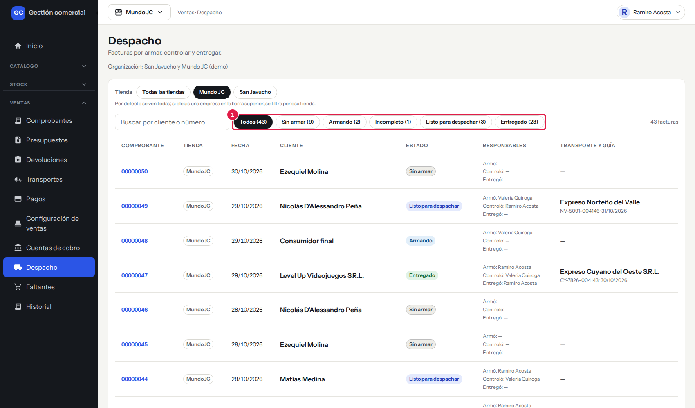
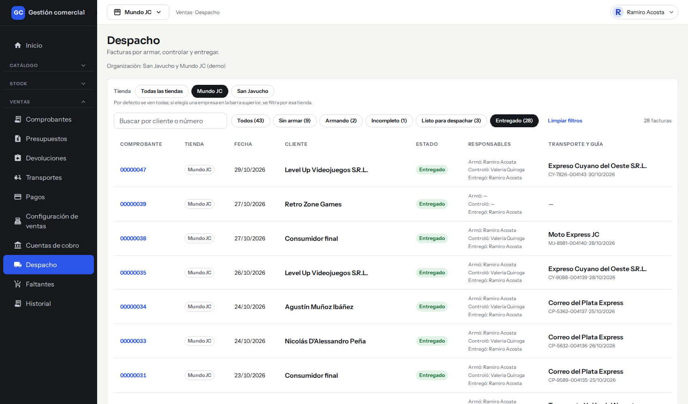
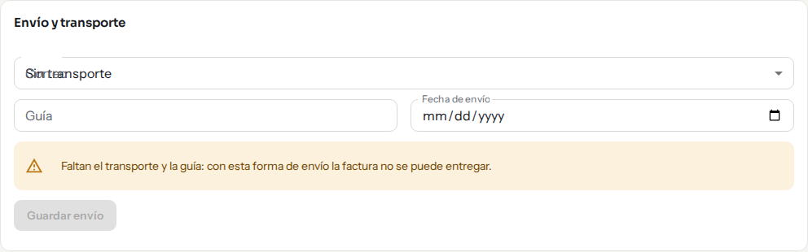
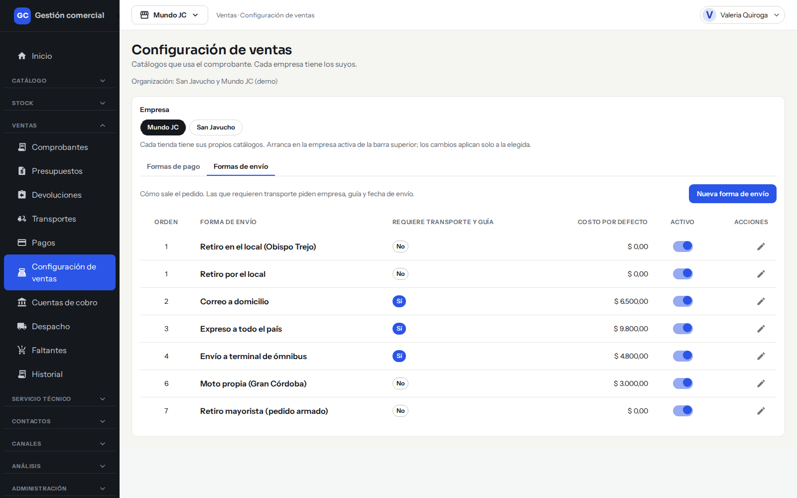
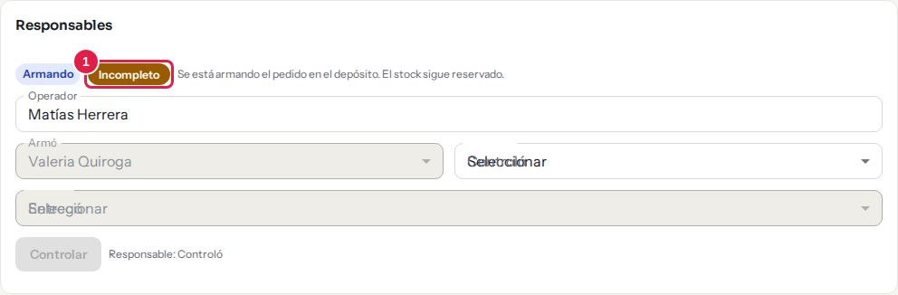
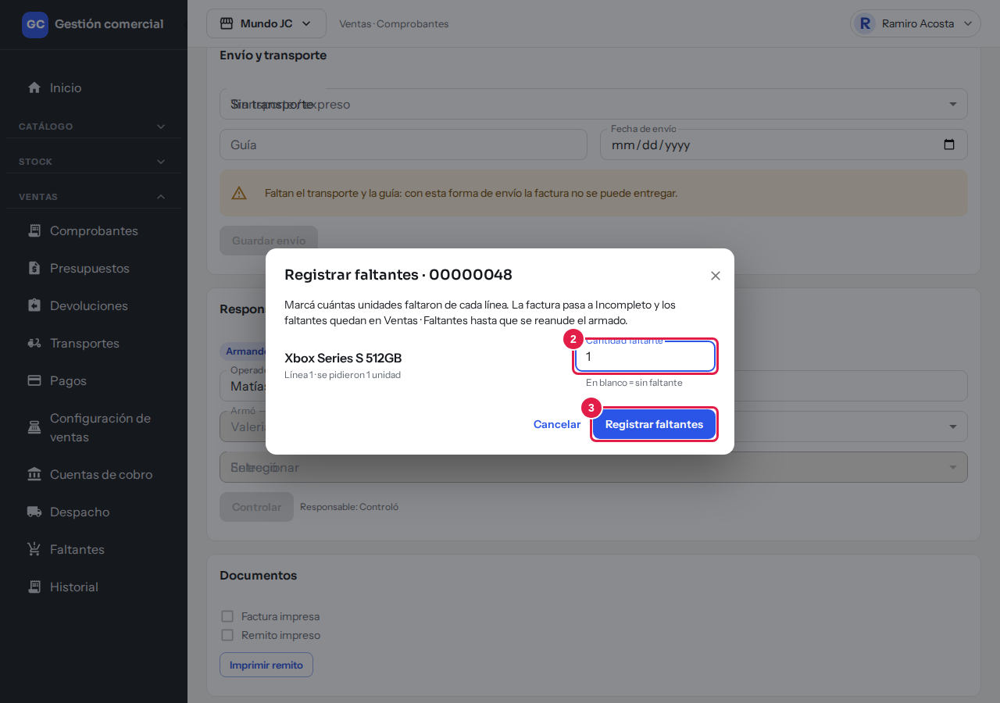
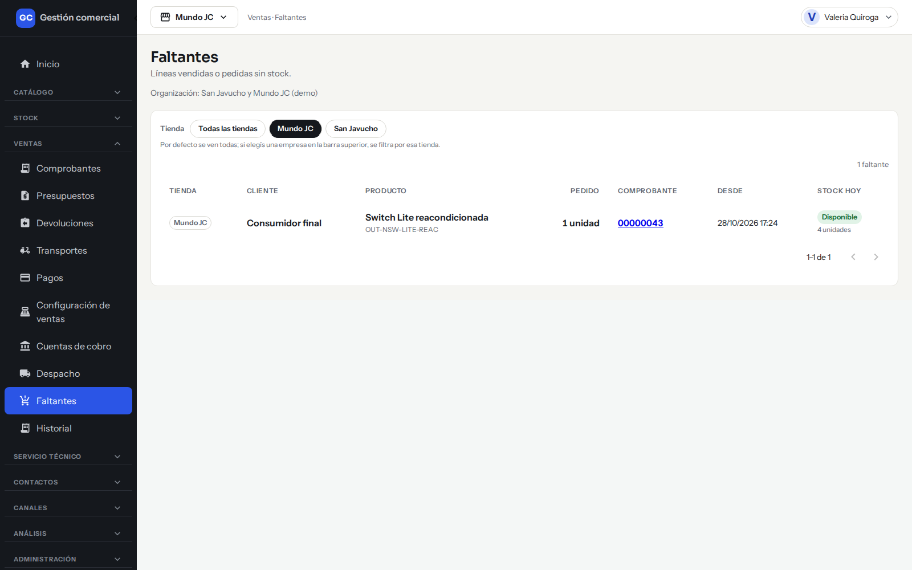
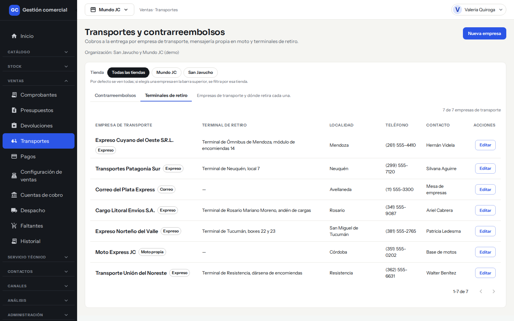
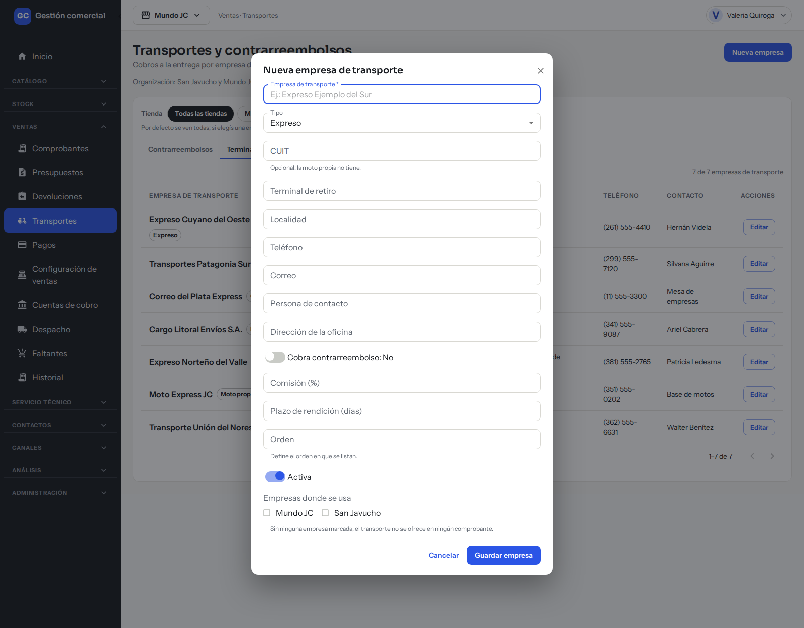

# Armar, controlar y entregar pedidos, y registrar faltantes

## Para qué sirve

Cuando una factura se confirma, empieza el **despacho**: alguien arma el pedido, otra persona lo controla y finalmente se entrega al cliente o se envía con un transporte. Si falta mercadería, se registra el faltante. Todo queda con el nombre de quien hizo cada paso.

## Quién puede hacerlo

| Persona | Qué hace |
|---|---|
| **Depósito** | Arma el pedido, lo controla, lo entrega y registra faltantes. |
| **Administrador** | Puede hacer todos los pasos. Es el único que puede controlar un pedido que armó él mismo. |
| **Mostrador, Operador y Administración** | Ven el estado del despacho, los responsables y el envío. Con los permisos iniciales no avanzan el pedido. |
| **Consulta** | Solo mira. |

Quien tiene Ventas en edición también puede cargar el transporte y la guía. Los permisos iniciales los puede cambiar el Administrador.

Si tu rol no puede avanzar el despacho, la tarjeta te lo dice: «Podés ver el estado y los responsables, pero tu rol no puede avanzar el despacho.»

## Dónde lo encontrás

- **Ventas → Despacho**: el tablero con todas las facturas por armar, controlar y entregar.
- En el detalle de cada factura confirmada (**Ventas → Comprobantes**): las tarjetas **Responsables** y **Envío y transporte**.
- **Ventas → Faltantes**: las líneas que quedaron sin stock.
- **Ventas → Transportes**: las empresas de transporte.

## La pantalla Despacho

*Ventas → Despacho: cada factura con su estado, quién armó, controló y entregó, y el transporte con su guía.*

### Estados de despacho

Los botones de arriba filtran por estado y muestran cuántas facturas hay en cada uno.

| Estado | Qué significa |
|---|---|
| **Sin armar** | La factura está confirmada y todavía no se empezó a armar. |
| **Armando** | Se está armando el pedido en el depósito. El stock sigue reservado. |
| **Incompleto** | Faltan productos: el armado quedó incompleto. |
| **Listo para despachar** | El pedido está controlado y listo para salir. |
| **Entregado** | El pedido salió. |

*Los botones de estado, con la cantidad de facturas de cada uno, filtran la lista. «Todos» las muestra a todas.*

### Columnas

**Comprobante** (con enlace al detalle), **Tienda**, **Fecha**, **Cliente**, **Estado**, **Responsables** (**Armó**, **Controló** y **Entregó**, con «—» si ese paso todavía no se dio) y **Transporte y guía** (o «Sin guía»).

Podés buscar por cliente o número y filtrar por tienda.

*Filtrado por «Entregado»: se ve quién armó, controló y entregó, y el transporte con su guía y fecha.*

## Paso a paso: despachar una factura

Abrí la factura confirmada y andá a la tarjeta **Responsables**. Las tarjetas **Responsables** y **Envío y transporte** del detalle se ven mientras la factura está en estado **Pendiente**; el tablero **Despacho** las lista igual. Ahí ves el estado de despacho, el **Operador** (quien cargó la factura, solo para consulta) y tres campos: **Armó**, **Controló** y **Entregó**.

### 1. Armar

1. En **Armó** elegí quién arma el pedido (la lista dice «Seleccionar»).
2. Hacé clic en **Empezar a armar**. El estado pasa a **Armando**.

### 2. Controlar

1. En **Controló** elegí quién controla.
2. Hacé clic en **Controlar**. El estado pasa a **Listo para despachar**.

**Quien armó no puede controlar** (salvo el Administrador): el control tiene que hacerlo otra persona.

### 3. Entregar

1. Si el pedido va por transporte, completá antes **Envío y transporte** (ver más abajo).
2. En **Entregó** elegí quién entrega.
3. Hacé clic en **Entregar**. El estado pasa a **Entregado** y queda registrada la fecha y la hora.

Al entregar se descuentan del stock los productos «A pedido» que estaban reservados. Los demás productos ya se habían descontado al confirmar la factura (ver [Crear un presupuesto o una factura](ventas-comprobantes.md)).

En los tres campos solo podés elegir personas activas de esa tienda con acceso a Ventas. Si alguien cambió la factura mientras la mirabas, se recarga y te pide que elijas de nuevo.

## Envío con transporte y guía

En el detalle de la factura confirmada, la tarjeta **Envío y transporte** depende de la forma de envío de la factura:

| Forma de envío | Qué pide |
|---|---|
| **Retiro en el local** | Nada: «El cliente retira en el local. No hace falta transporte ni guía.» |
| **Correo, Transporte / expreso o Mensajería propia** | El transporte, la **Guía** y la **Fecha de envío**. |

1. En el selector (se llama **Correo**, **Transporte / expreso** o **Mensajería propia** según la forma de envío) elegí la empresa. Solo aparecen las empresas del tipo que corresponde y habilitadas para esa tienda.
2. Escribí el número de **Guía**.
3. Elegí la **Fecha de envío**.
4. Hacé clic en **Guardar envío**. Aparece «Envío guardado.»

Si la forma de envío exige transporte y guía y falta alguno, ves un aviso, por ejemplo «Falta la guía: con esta forma de envío la factura no se puede entregar.» No podés entregar hasta completarlo.

Una vez **Entregado**, el envío ya no se puede cambiar: «Esta factura ya fue entregada: no se puede cambiar el envío.»

*La tarjeta «Envío y transporte» de una factura que va por transporte: sin transporte y guía no se puede entregar.*

Si la factura no tiene forma de envío, aparece «Esta factura todavía no tiene forma de envío: sin ella no se puede cargar el transporte ni la guía.»

### Las formas de envío

Se administran en **Ventas → Configuración de ventas → Formas de envío**. Cada una indica si **Requiere transporte y guía**, su **Costo por defecto** y si está **Activo**. Con **Nueva forma de envío** creás una y con el lápiz la editás.

*Ventas → Configuración de ventas → Formas de envío.*

## Registrar faltantes

Si al armar un pedido no hay todos los productos, registrá lo que falta:

1. Con la factura en **Armando** (o ya **Incompleto**), en la tarjeta **Responsables** hacé clic en el botón **Incompleto** (si ya estaba incompleta, el botón dice **Ajustar faltantes**).
2. Se abre **Registrar faltantes**. Por cada línea escribí en **Cantidad faltante** cuántas unidades faltaron. Dejá en blanco las líneas sin faltante.
3. Hacé clic en **Registrar faltantes**. Aparece «Faltantes registrados».

*Paso 1: con el pedido en «Armando», el botón «Incompleto» de la tarjeta «Responsables» abre el registro de faltantes.*

*Pasos 2 y 3: escribí la cantidad faltante de cada línea y confirmá con «Registrar faltantes».*

La factura pasa a **Incompleto** y los faltantes quedan listados en **Ventas → Faltantes**. Es todo o nada: si algo falla no se guarda nada. Cada línea admite un faltante abierto; si volvés a registrar, se actualiza la cantidad.

### Cómo se resuelven

Cuando llega la mercadería y se puede seguir armando, abrí la factura y hacé clic en **Reanudar el armado**: la factura vuelve a **Armando** y sus faltantes se dan por resueltos. Después seguís con **Controlar** y **Entregar** como siempre.

### La pantalla Faltantes

**Ventas → Faltantes** («Líneas vendidas o pedidas sin stock») muestra **Tienda**, **Cliente**, **Producto**, **Pedido**, **Comprobante**, **Desde** y **Stock hoy**, para saber qué reponer.

*Ventas → Faltantes: lo que quedó sin stock y cuánto hay hoy de cada producto.*

## Transportes

En **Ventas → Transportes** hay dos pestañas:

- **Contrarreembolsos**: lo que cobran los transportes al entregar y cuándo lo rinden. Ver [Cobros y conciliación](ventas-cobros-y-conciliacion.md).
- **Terminales de retiro**: el listado de empresas de transporte con **Empresa de transporte** (y su tipo: **Expreso**, **Correo** o **Moto propia**), **Terminal de retiro**, **Localidad**, **Teléfono** y **Contacto**. Si una empresa está desactivada, lleva la etiqueta «Inactiva».

*Ventas → Transportes → Terminales de retiro.*

### Cargar o editar una empresa de transporte

Solo el **Administrador** puede.

1. Hacé clic en **Nueva empresa** (o en el lápiz de una existente).
2. Completá **Empresa de transporte** (obligatorio) y elegí el **Tipo**.
3. Completá lo que tengas: **CUIT**, **Terminal de retiro**, **Localidad**, **Teléfono**, **Correo**, **Persona de contacto**, **Dirección de la oficina**, **Comisión (%)**, **Plazo de rendición (días)** y **Orden**.
4. Indicá si **Cobra contrarreembolso**, si está **Activa** y en qué tiendas se usa (**Empresas donde se usa**). Sin ninguna tienda marcada, el transporte no se ofrece en ningún comprobante.
5. Hacé clic en **Guardar empresa**.

*La ventana «Nueva empresa de transporte». Sin ninguna tienda marcada en «Empresas donde se usa», el transporte no se ofrece.*

## Si algo no sale

| Mensaje | Qué significa y qué hacer |
|---|---|
| «No pudimos cambiar el estado del despacho. No se guardó nada: probá de nuevo.» | El paso no se aplicó. Reintentá. |
| «Otra persona modificó este comprobante mientras lo mirabas. Recargamos los datos: volvé a elegir el responsable.» | Alguien avanzó la factura a la vez. Elegí de nuevo. |
| «Elegí quién…» (armó, controló o entregó) | Falta elegir al responsable del paso. |
| Mensaje de que quien armó no puede controlar | Pedile a otra persona que controle. |
| «Falta el transporte» / «Falta la guía» | Completá **Envío y transporte** y guardalo antes de entregar. |
| «Elegí al menos una línea con cantidad faltante.» | En Registrar faltantes, completá al menos una cantidad. |
| «La cantidad faltante no puede ser mayor a lo pedido.» | Revisá la cantidad de esa línea. |
| «Los faltantes se registran con la factura en Armando o Incompleto.» | Primero la factura tiene que estar en armado. |
| «Tu rol no puede registrar faltantes en esta tienda.» | Pedile a Depósito o al Administrador. |
| «Cambiaste de tienda: cerramos el registro de faltantes para no mezclar datos de dos tiendas.» | Cambiaste la tienda activa con la ventana abierta. Volvé a abrir la factura. |
