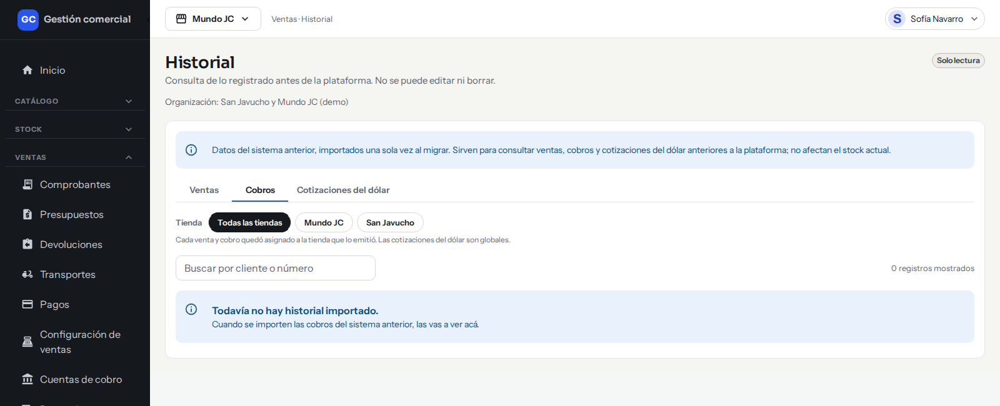
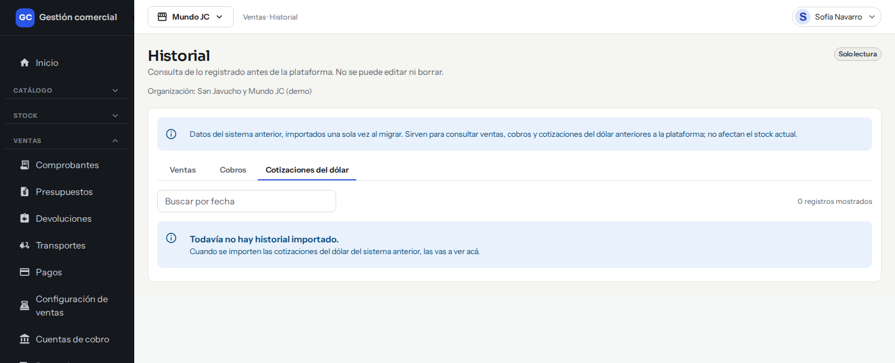
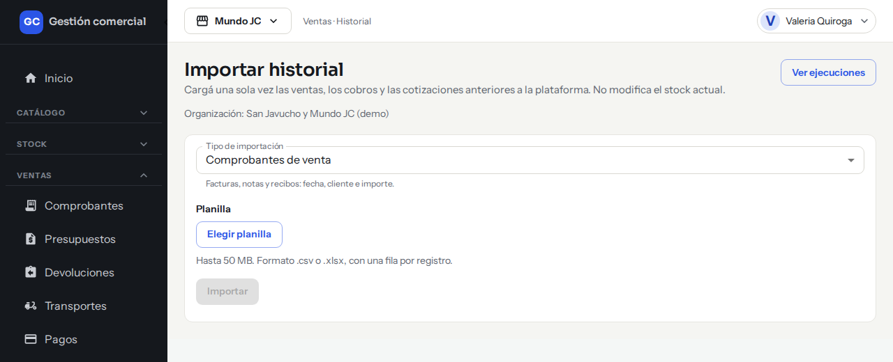

# Historial de ventas y cobros anteriores

## Para qué sirve

El menú **Historial** guarda, solo para consultar, las ventas, los cobros y las cotizaciones del dólar de **antes de empezar a usar MSF** (las del sistema anterior). Sirve para responder a un cliente por una compra vieja, revisar un cobro o ver a cuánto estaba el dólar en una fecha pasada, sin abrir el sistema anterior.

Lo que ves ahí es **solo lectura**: no se puede editar, anular ni borrar. Tampoco afecta el stock actual ni los saldos de hoy. Cada comprobante conserva su **número original** y lleva el rótulo **«Histórico»**, para que nadie lo confunda con una venta hecha en MSF.

## Quién puede hacerlo

| Rol | Consultar el historial | Importar archivos |
|---|---|---|
| Administrador | Sí | Sí |
| Operador | Sí | No |
| Mostrador | Sí | No |
| Depósito | Sí | No |
| Administración | Sí | No |
| Consulta | Sí | No |
| Técnico | No | No |

La consulta está disponible para quien tiene acceso a **Ventas** en la empresa activa (lectura alcanza). Si no tenés ese acceso, el menú no te muestra **Historial**. **Importar** es solo del Administrador.

## Dónde lo encontrás

- **Consultar:** menú **Ventas → Historial**.
- **Importar:** la pantalla **Importar historial** no está en el menú. El Administrador entra desde la pantalla **Ejecuciones**, con el botón **Importar historial**.

## Consultar el historial

La pantalla se llama **Historial** y muestra la etiqueta «Solo lectura». Arriba tiene un aviso que recuerda que son datos del sistema anterior, importados una sola vez, y que no afectan el stock actual. Debajo hay tres pestañas.

*La pantalla «Historial», pestaña «Ventas». Cuando todavía no se importó nada, avisa «Todavía no hay historial importado.»*

### Pestaña Ventas

| Columna | Qué muestra |
|---|---|
| Comprobante | El número original, con el rótulo «Histórico» |
| Tienda | La tienda que emitió la venta |
| Fecha | Fecha de la venta |
| Cliente | Nombre del cliente |
| Operador | Quién la hizo (o «—» si no figura) |
| Estado final | Cobrado, Deuda, Incompleto u otro estado que traiga el archivo |
| Total | Importe total |

### Pestaña Cobros

| Columna | Qué muestra |
|---|---|
| Fecha | Fecha del cobro |
| Comprobante | Número original, con «Histórico» |
| Tienda | Tienda que lo emitió |
| Cliente | Nombre del cliente |
| Cuenta de cobro | Dónde entró el dinero |
| Aprobado por | Quién lo aprobó |
| Importe | Monto cobrado |

*La pestaña «Cobros» del historial.*

### Pestaña Cotizaciones del dólar

| Columna | Qué muestra |
|---|---|
| Fecha | Día de la cotización |
| Dólar comprador | Valor de compra |
| Dólar vendedor | Valor de venta |
| Cargó | Quién la cargó |

*La pestaña «Cotizaciones del dólar»: se busca por fecha.*

Las cotizaciones valen para toda la organización: no tienen tienda. La cotización vigente de hoy no está acá; la ves en [Precios y dólar](precios-dolar.md).

### Buscar y filtrar

- **Buscar por cliente o número** (Ventas y Cobros): escribí parte del nombre del cliente, su número de cliente o el número del comprobante. No distingue mayúsculas ni tildes. La lista se actualiza sola mientras escribís.
- **Buscar por fecha** (Cotizaciones del dólar): escribí la fecha como `dd/mm/aaaa`, `aaaa-mm-dd` o solo una parte (por ejemplo `03/2020`).
- **Tienda** (Ventas y Cobros): elegí «Todas las tiendas» o una tienda en particular. Solo aparecen las tiendas que tenés asignadas, y el filtro arranca en la empresa activa de la barra superior. Si cambiás de empresa activa, la pantalla vuelve a la primera página y limpia la búsqueda.
- **Indicadores:** «N registros mostrados», y en Ventas y Cobros también «Desde: …» y «Hasta: …», que marcan el rango de fechas de lo importado.
- **Paginación:** se ven 25 registros por página. Abajo aparece «Página N · 1–25 de total» y los botones para pasar de página.

En pantallas angostas (celular), las tablas se muestran como tarjetas.

## Importar un archivo (solo Administrador)

La importación se hace una sola vez por cada tipo de dato, con los archivos que entrega el sistema anterior.

### Formato del archivo

- Una planilla **.csv** o **.xlsx**, de hasta **50 MB**, con **una fila por registro** y los nombres de las columnas en la primera fila.
- Los nombres de las columnas no distinguen mayúsculas, tildes ni espacios; las columnas que sobran se ignoran. Las marcadas con * son obligatorias.

| Tipo de importación | Columnas |
|---|---|
| Comprobantes de venta | Tienda*, Comprobante* (número), Fecha*, Cliente*, Total*, Tipo, Número de cliente, Operador, Estado final |
| Cobros | Tienda*, Fecha*, Comprobante*, Cliente*, Importe*, Número de cliente, Cuenta de cobro, Aprobado por |
| Cotizaciones del dólar | Fecha*, Dólar comprador*, Dólar vendedor*, Cargó |

- **Fechas:** `dd/mm/aaaa` o `aaaa-mm-dd`, o una celda de fecha de Excel. Tiene que ser una fecha que exista.
- **Importes:** con coma o punto decimal. Se admiten símbolos como `$`. En las cotizaciones no pueden ser negativos.
- **Tienda:** debe coincidir con el nombre de una tienda de tu organización. Si no existe, la fila se rechaza (no se crean tiendas desde acá). Si dos tiendas se llaman igual, conviene renombrar una antes de importar.

Por ahora no hay una plantilla para descargar: armá el archivo con las columnas de la tabla.

### Paso a paso

1. Entrá a **Ejecuciones** y hacé clic en **Importar historial**.
2. En **Tipo de importación** elegí *Comprobantes de venta*, *Cobros* o *Cotizaciones del dólar*.
3. Hacé clic en **Elegir planilla** y seleccioná el archivo. Vas a ver su nombre y su tamaño. Si te equivocaste, hacé clic en **Quitar**.
4. Hacé clic en **Importar**. Aparece «Subiendo la planilla…» y después «Importación en curso». Podés esperar en la pantalla; se actualiza sola.
5. Cuando termina, ves el resultado:
   - **Importación completada:** cuántos registros nuevos entraron y cuántos ya existían (no se duplican).
   - **La importación no se aplicó:** hay filas con problemas. Abajo aparece **Filas rechazadas** con la **Fila**, la **Columna** y el **Motivo** de cada una. Si son muchas, se muestran las primeras y se aclara cuántas hay en total.
6. Para ver el detalle, hacé clic en **Ver en Ejecuciones**. Para cargar otro archivo, hacé clic en **Importar otra planilla**.

*La pantalla «Importar historial» antes de elegir una planilla (solo Administrador).*

### Si hay filas rechazadas

La importación es **todo o nada**: si una sola fila está mal, **no se importa ninguna**. Corregí en la planilla las filas que indica la lista (por ejemplo, una fecha ilegible o un importe con letras) y volvé a importarla.

### Volver a importar

Podés subir de nuevo el mismo archivo sin miedo: los registros que ya estaban no se duplican y el resultado te dice cuántos ya existían. Una vez completada la importación, los registros no se pueden modificar ni borrar desde el sistema.

## Si algo no sale

| Mensaje | Qué significa y qué hacer |
|---|---|
| Acceso restringido | Tu rol no tiene acceso a Ventas. Pedile a un Administrador que revise tus permisos. |
| Solo un administrador con una organización activa puede importar el historial. | Importar es solo del Administrador. Si lo sos, revisá que tengas una organización activa elegida. |
| «archivo» no es un archivo .csv o .xlsx. / está vacío. / pesa más de 50 MB. | Elegí otro archivo: debe ser .csv o .xlsx, con datos y de hasta 50 MB. |
| Elegí una planilla .csv o .xlsx para importar. | Hacé clic en **Elegir planilla** antes de **Importar**. |
| No pudimos subir la planilla. Revisá tu conexión e intentá de nuevo. | Falló la subida. Revisá tu internet y probá otra vez. |
| Ya hay una importación de este tipo en curso. Esperá a que termine. | Hay otra importación del mismo tipo en marcha. Esperá y volvé a intentar. |
| Esta organización no tiene habilitada la importación del historial. Contactá a soporte. | La importación todavía no está activada para tu organización. Escribile a soporte. |
| Tu rol no puede importar el historial de esta organización. | Tu rol no tiene permiso para importar. |
| La planilla no quedó registrada. Volvé a subirla. | Volvé a elegir el archivo y a importar. |
| No pudimos iniciar la importación. Intentá de nuevo en unos minutos. | Error general al arrancar. Reintentá más tarde; si sigue, avisá a soporte. |
| La importación no terminó a tiempo | Revisá **Ejecuciones**. Si no entraron registros nuevos, volvé a importar el mismo archivo. |
| No pudimos consultar el estado de la importación. / No encontramos la ejecución de esta importación en la organización activa. | Mirá el resultado en **Ejecuciones**. Verificá también que estás en la organización correcta. |
| No pudimos cargar el historial de ventas / cobros / las cotizaciones del dólar. | Hacé clic en **Reintentar**. |
| Sin resultados | Ninguna fila coincide con lo que buscaste. Probá con otro texto, otra fecha u otra tienda. |
| Todavía no hay historial importado. | Todavía no se importó ese tipo de datos. Lo hace el Administrador. |

## Lo que por ahora no se puede

- Exportar el historial.
- Editar, anular o borrar un registro histórico, ni convertirlo en una venta o un cobro de MSF.
- Ver el historial dentro de los reportes de rentabilidad, stock o saldos: son solo de consulta.
