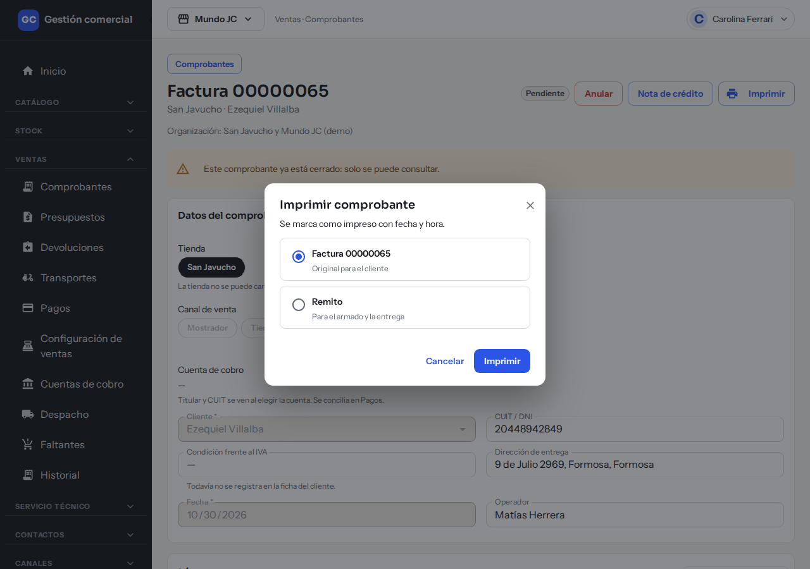
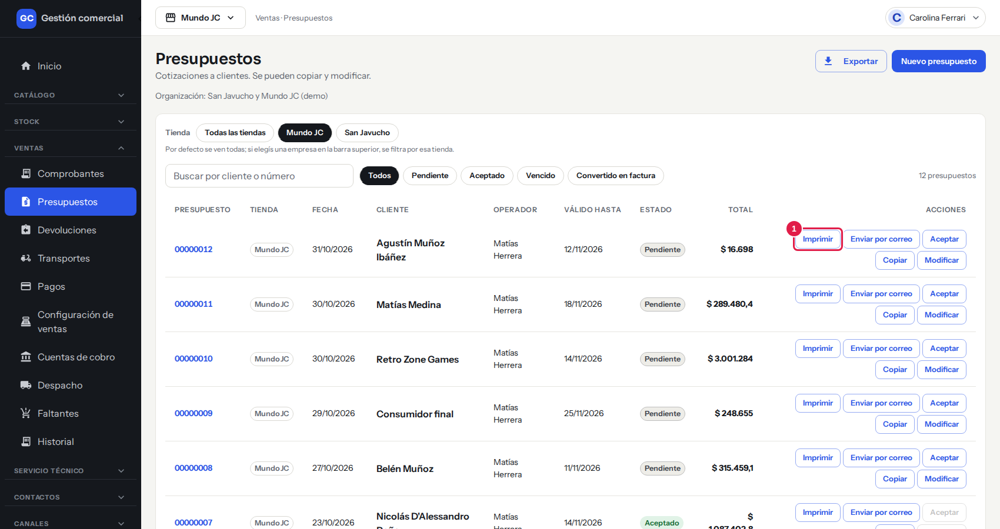
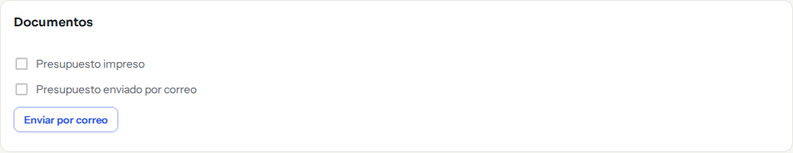
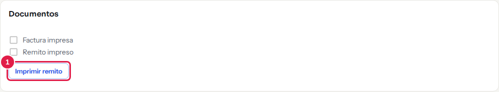

# Imprimir facturas, remitos y presupuestos

## Para qué sirve

Desde Ventas generás en PDF la **factura**, el **remito** y el **presupuesto** para entregárselos al cliente o para el armado del pedido. Cada impresión queda marcada con fecha y hora, y se puede volver a imprimir las veces que haga falta.

Todos los documentos llevan la leyenda «Documento no válido como factura»: son comprobantes internos, no fiscales.

## Quién puede hacerlo

| Acción | Quién |
|---|---|
| **Imprimir** factura, remito o presupuesto | Todos los roles con acceso a Ventas, incluso los que solo pueden mirar. |
| **Enviar por correo** un presupuesto | Quienes pueden editar Ventas: Administrador, Administración, Operador y Mostrador. |

## Qué documento se puede imprimir

| Comprobante | Qué se imprime |
|---|---|
| **Factura confirmada** | La **Factura** (original para el cliente) y el **Remito** (para el armado y la entrega). |
| **Presupuesto** Pendiente, Aceptado o Vencido | El **Presupuesto** (cotización para el cliente). |
| **Factura en borrador** | Nada: «La factura tiene que estar confirmada para imprimirla.» |
| **Presupuesto convertido en factura** | Nada. |

Los botones de impresión del detalle de una factura están disponibles mientras la factura está en estado **Pendiente** (recién confirmada).

## Dónde lo encontrás

- **Dentro de un comprobante**: botón **Imprimir** arriba a la derecha, y la tarjeta **Documentos** (con el botón **Imprimir remito**).
- **En la lista de presupuestos** (Ventas → Presupuestos): los botones **Imprimir** y **Enviar por correo** de cada fila.

## Paso a paso: imprimir una factura o un remito

1. Abrí la factura desde **Ventas → Comprobantes**.
2. Hacé clic en **Imprimir**. Se abre «Imprimir comprobante» con el aviso «Se marca como impreso con fecha y hora.»
3. Elegí el documento: **Factura** (Original para el cliente) o **Remito** (Para el armado y la entrega).
4. Hacé clic en **Imprimir**. Aparece «Preparando documento…» unos segundos.
5. Se abre el PDF en otra pestaña y el sistema muestra «Enviado a imprimir». Imprimilo desde el navegador.

*Pasos 2 y 3: la ventana «Imprimir comprobante» te deja elegir entre la factura y el remito.*

Para el remito también podés hacer clic directo en **Imprimir remito**, en la tarjeta **Documentos**.

## Paso a paso: imprimir un presupuesto

- **Desde la lista**: en **Ventas → Presupuestos**, hacé clic en **Imprimir** en la fila del presupuesto. Aparece «Enviado a imprimir · número».
- **Desde el presupuesto abierto**: botón **Imprimir** y luego **Imprimir** en la ventana.

*El botón «Imprimir» de cada fila de Ventas → Presupuestos.*

Si modificás un presupuesto, la siguiente impresión sale con los cambios.

### Enviar el presupuesto por correo

1. En la fila del presupuesto (o en la tarjeta **Documentos**), hacé clic en **Enviar por correo**.
2. Aparece «Enviando por correo…» y después «Presupuesto número enviado por correo». El cliente recibe el PDF adjunto.

*La tarjeta «Documentos» de un presupuesto, con el botón «Enviar por correo».*

El cliente tiene que tener un correo cargado en su ficha. Con **Consumidor final** o con un correo mal escrito, el envío se rechaza con un aviso y no se manda nada.

## Reimprimir y marcas de impreso

La tarjeta **Documentos** muestra una casilla por cada documento:

- Casilla tildada: ya se imprimió. Por ejemplo «Factura impresa · 07/10 11:42» (día/mes y hora de la **última** impresión).
- Casilla vacía: nunca se imprimió («Factura impresa», «Remito impreso» o «Presupuesto impreso»).
- En un presupuesto, además, «Presupuesto enviado por correo · día/mes hora» cuando ya se envió.

*La tarjeta «Documentos» de una factura: las casillas indican qué ya se imprimió y el botón imprime el remito.*

Para **reimprimir**, repetí el mismo paso a paso. No hay límite y la marca se actualiza con la última vez.

## Qué muestra cada documento

| Documento | Contenido |
|---|---|
| **Factura** | Número, fecha, operador, datos de la tienda, datos del cliente (nombre y CUIT / DNI), una línea por producto con **Cantidad**, **Precio** (sin IVA) e **Importe**, y al final **Subtotal sin IVA**, **IVA** y **Total**; también la forma de pago y el envío. |
| **Remito** | Producto, código, cantidad y depósito de cada línea, **sin importes**: es para armar y entregar. |
| **Presupuesto** | Número, fecha, **Válido hasta**, datos del cliente, líneas con **Cantidad**, **Precio** e **Importe**, y **Subtotal sin IVA**, **IVA** y **Total**. Lleva las leyendas «Documento no válido como factura · Versión sin valor fiscal». |

Los datos que no estén cargados (razón social, CUIT, correo…) simplemente no aparecen. Si la tienda tiene logo cargado, sale en el documento.

El formato de los documentos todavía puede ajustarse.

## Si algo no sale

| Mensaje | Qué significa y qué hacer |
|---|---|
| «El documento está tardando más de lo esperado. Reintentá en un momento.» | El PDF no estuvo listo a tiempo. Hacé clic en **Reintentar**. |
| «No pudimos preparar el documento. Probá de nuevo.» | Falló la preparación. Reintentá. |
| «Tu navegador bloqueó la ventana del documento.» | Hacé clic en **Abrir documento** o permití las ventanas emergentes para este sitio. |
| «El documento se preparó, pero no pudimos registrar la impresión. Reintentá para marcarlo como impreso.» | El PDF se generó pero no quedó la marca. Reintentá. |
| «No tenés permiso para imprimir en esta tienda. Puede que tu rol haya cambiado: recargá la página.» | Recargá; si sigue, consultá al Administrador. |
| «El envío está tardando más de lo esperado. Reintentá en un momento.» | El correo del presupuesto no salió todavía. Reintentá. |
| «No pudimos enviar el presupuesto por correo. Probá de nuevo.» | No se envió. Revisá el correo del cliente y reintentá. |
| «Cambiaste de tienda: cerramos la impresión para no mezclar datos de dos tiendas.» | Cambiaste la tienda activa con la ventana abierta. |
