# Ver los comprobantes, cambiar su estado y anularlos

## Para qué sirve

Acá ves todo lo que se vendió, buscás un comprobante, filtrás por estado, pago o envío, y exportás la lista. Desde el detalle de cada factura seguís su estado, la anulás si se emitió por error o emitís una nota de crédito si hay una devolución o un ajuste.

## Quién puede hacerlo

| Persona | Qué hace |
|---|---|
| **Todos los roles con acceso a Ventas** | Ver el listado y el detalle de cada comprobante, con su historial. |
| **Mostrador** | Pasa una factura de **Pendiente** a **Aceptado** o **En proceso**. |
| **Depósito** | Pasa una factura de **Aceptado** a **Armando**, y de **Armando** a **Incompleto** (y de vuelta). |
| **Administración y Administrador** | Hacen lo de Mostrador y Depósito, y además **anulan** facturas y **emiten notas de crédito**. |
| **Administrador, Operador y Administración** | Exportan el listado. |
| **Consulta** | Solo mira: los estados le aparecen deshabilitados. |

Estos permisos son los que vienen configurados al inicio. El Administrador puede ajustarlos desde la configuración de roles.

## Dónde lo encontrás

Menú **Ventas → Comprobantes**. Muestra facturas y notas de crédito. Los presupuestos tienen su propia pantalla en **Ventas → Presupuestos**.

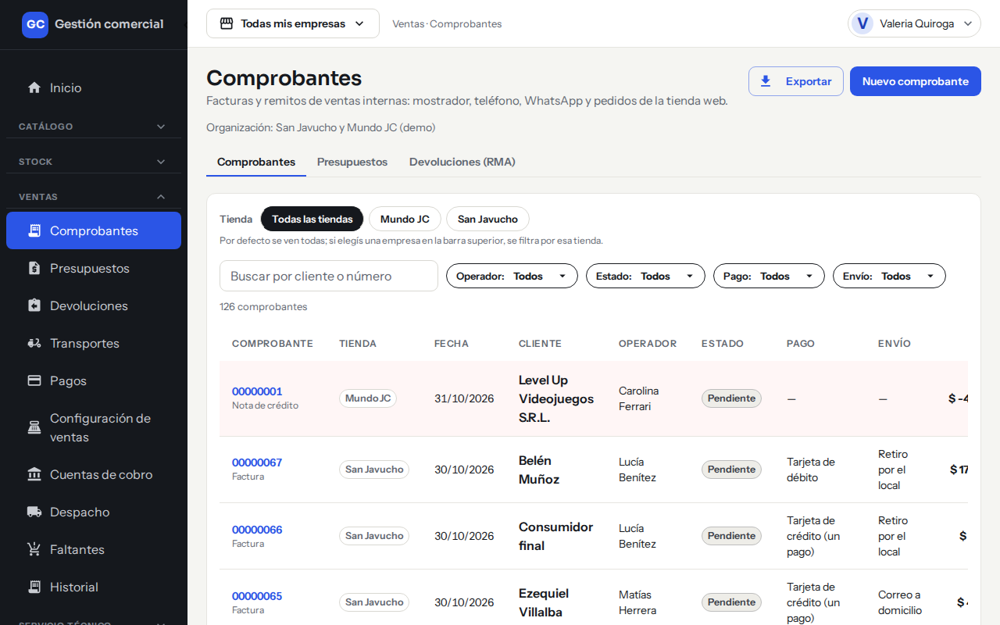

*Ventas → Comprobantes: la nota de crédito se ve con el total en negativo y la fila resaltada.*

## El listado de comprobantes

### Qué muestra cada columna

| Columna | Qué muestra |
|---|---|
| **Comprobante** | Número (con enlace al detalle) y si es **Factura** o **Nota de crédito**. |
| **Tienda** | La tienda donde se emitió. |
| **Fecha** | Fecha del comprobante. |
| **Cliente** | A quién se le vendió. |
| **Operador** | Quién lo cargó. |
| **Estado** | Estado actual (ver más abajo). |
| **Pago** | Forma de pago, o «—» si todavía no hay. |
| **Envío** | Forma de envío, o «—». |
| **Total** | Importe con IVA. En una nota de crédito va con signo negativo. |

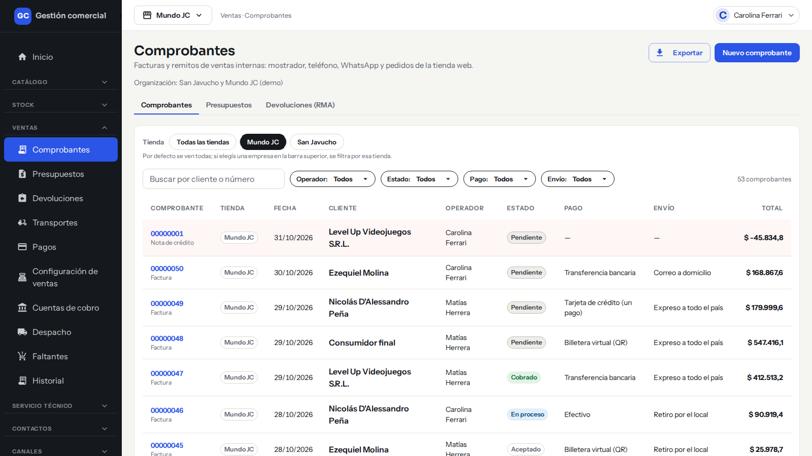

*Todas las columnas del listado. La nota de crédito va con el total en negativo.*

### Buscar y filtrar

- **Tienda**: por defecto se ven todas. Si elegís una tienda en la barra superior, se filtra por esa tienda. También podés elegirla con los botones de arriba de la lista.
- **Buscar por cliente o número**: escribí parte del nombre o del número.
- **Operador**, **Estado**, **Pago** y **Envío**: cada uno es un desplegable con la opción «Todos».
- **Limpiar filtros**: aparece cuando hay algún filtro puesto y los saca todos.
- Arriba de la tabla se ve cuántos comprobantes cumplen el filtro. La lista se muestra de a 12 por página.

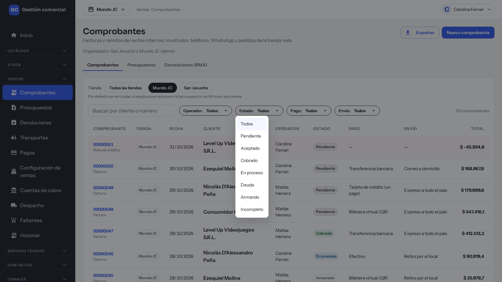

*El desplegable «Estado» ofrece Pendiente, Aceptado, Cobrado, En proceso, Deuda, Armando e Incompleto. Para ver borradores o anuladas, buscalas por número o cliente.*

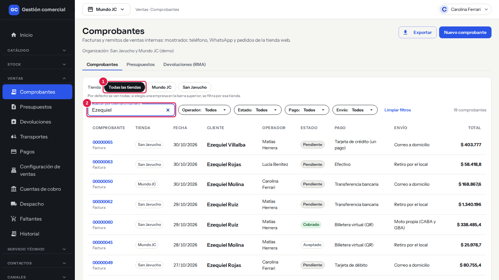

*1: botones de tienda. 2: buscador por cliente o número. Arriba de la tabla se ve cuántos comprobantes coinciden.*

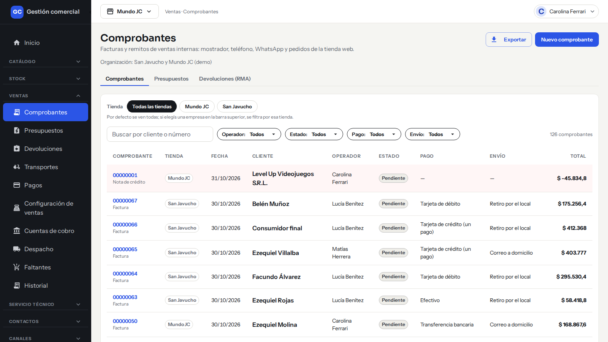

*Ejemplo: con «Estado: Deuda» ves solo las facturas que tienen saldo por cobrar. «Limpiar filtros» los saca todos.*

Si no hay resultados, aparece «Sin resultados. Probá con otra búsqueda o limpiá los filtros.»

### Exportar la lista

1. Poné los filtros que quieras.
2. Hacé clic en **Exportar**. Se exporta exactamente lo que estás viendo, con todos los filtros.
3. Aparece «Exportación lista: el archivo se descargó.» Es un archivo CSV que abrís con Excel, con las columnas Comprobante, Tipo, Tienda, Fecha, Cliente, Operador, Estado, Pago, Envío y Total.

Si son muchos comprobantes, el archivo tarda en prepararse y aparece «Exportación solicitada: se está generando. Cuando termine, descargala desde acá.» con un botón **Descargar**. Si no hay nada que exportar, te avisa «Sin resultados: no hay filas para exportar con estos filtros.»

El botón **Exportar** solo lo ven los roles con ese permiso.

## Los estados de una factura

El estado se ve junto al título de la factura, en el listado y en la tarjeta **Estado** del detalle.

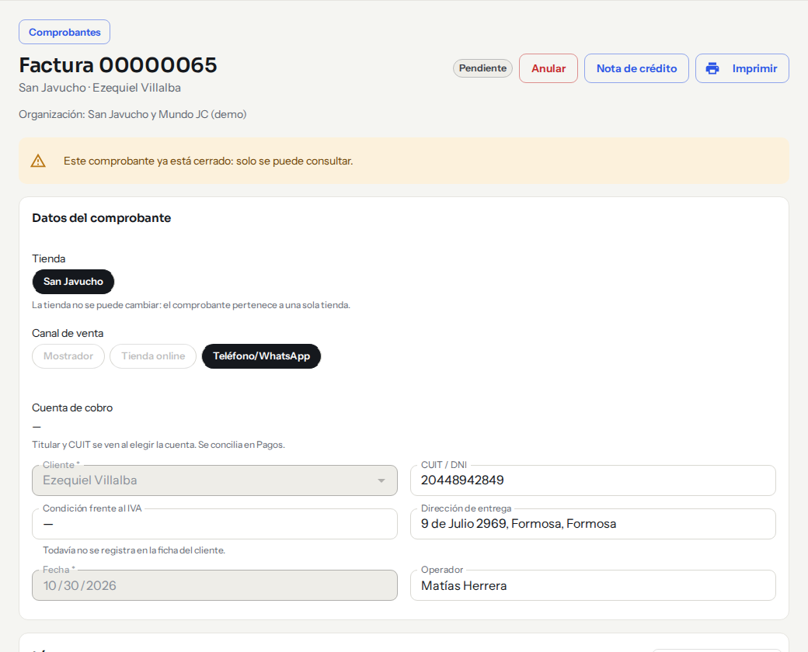

*El detalle de una factura: el estado está arriba, junto a los botones «Anular», «Nota de crédito» e «Imprimir».*

| Estado | Qué significa |
|---|---|
| **Borrador** | La factura todavía no se confirmó. No descuenta ni reserva stock y se puede editar. |
| **Pendiente** | Factura confirmada. Es el estado con el que arranca. |
| **Aceptado** | El cliente aceptó la factura o el pedido. |
| **En proceso** | Hay gestión en curso: un pago o un envío. |
| **Armando** | Se está armando el pedido en el depósito. |
| **Incompleto** | Faltan productos; los faltantes quedan registrados en Ventas → Faltantes. |
| **Cobrado** | Está pagada por completo. |
| **Deuda** | Se entregó o facturó y falta cobrar. |
| **Anulada** | El documento dejó de valer y no admite cambios. |

Los presupuestos tienen sus propios estados (**Pendiente**, **Aceptado**, **Vencido**, **Convertido en factura**); están explicados en [Crear un presupuesto o una factura](ventas-comprobantes.md).

### Quién puede pasar de un estado a otro

En el detalle de la factura, la tarjeta **Estado** muestra un botón por cada estado. Elegí el nuevo estado haciendo clic. Los que tu rol no puede usar aparecen deshabilitados, y al pasar el mouse te dicen el motivo (por ejemplo «Tu rol no puede pasar de Aceptado a Cobrado»).

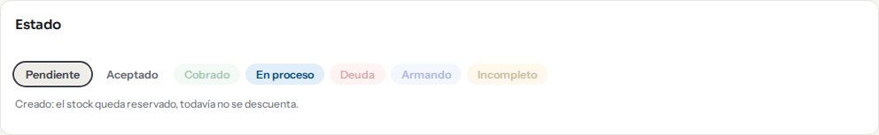

*La tarjeta «Estado»: el estado actual tiene borde y los que no podés elegir se ven más claros.*

| Estado nuevo | Quién lo puede elegir |
|---|---|
| **Aceptado** y **En proceso** | Mostrador, Administración y Administrador. |
| **Armando** e **Incompleto** | Depósito, Administración y Administrador. |
| **Cobrado** y **Deuda** | **Nadie a mano**: los pone el sistema según los cobros. Mirá [Cobros y conciliación](ventas-cobros-y-conciliacion.md). |

Más reglas:

- Una factura en **Borrador** no cambia de estado: «Confirmá la factura antes de cambiar su estado.»
- Una factura **Anulada** tampoco: «La factura está anulada y no admite cambios de estado.»
- Los presupuestos no tienen estos botones.
- Cada cambio queda registrado en la tarjeta **Historial de estados y acciones**, con **Cuándo**, **Acción**, **Quién** y **Tienda**.

!!! note "Incompleto se elige con los faltantes"
    Para dejar una factura **Incompleta** por falta de mercadería, usá la tarjeta **Responsables** del detalle: el botón **Incompleto** te abre «Registrar faltantes» para que marques qué faltó. Ver [Despacho y faltantes](ventas-despacho-y-faltantes.md).

## Anular una factura

**Anular** sirve para corregir una factura que se **emitió por error**: deja de valer, el stock vuelve al depósito de origen de cada línea y se liberan las reservas de los productos «A pedido». El número no se reutiliza y queda registrado quién la anuló, cuándo y por qué. **No se puede deshacer.**

Solo lo pueden hacer **Administración** y **Administrador**.

### Paso a paso

1. Abrí la factura desde **Ventas → Comprobantes**.
2. Hacé clic en **Anular** (arriba a la derecha). Si no ves el botón, esa factura no se puede anular o tu rol no tiene el permiso.
3. En **Motivo de la anulación** escribí por qué (es obligatorio, hasta 300 caracteres).
4. Hacé clic en **Anular factura**.

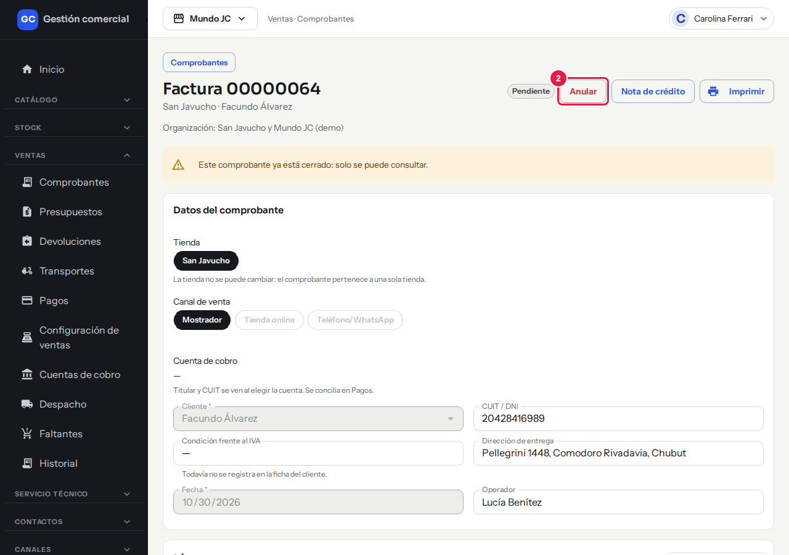

*Paso 2: el botón «Anular» está arriba a la derecha.*

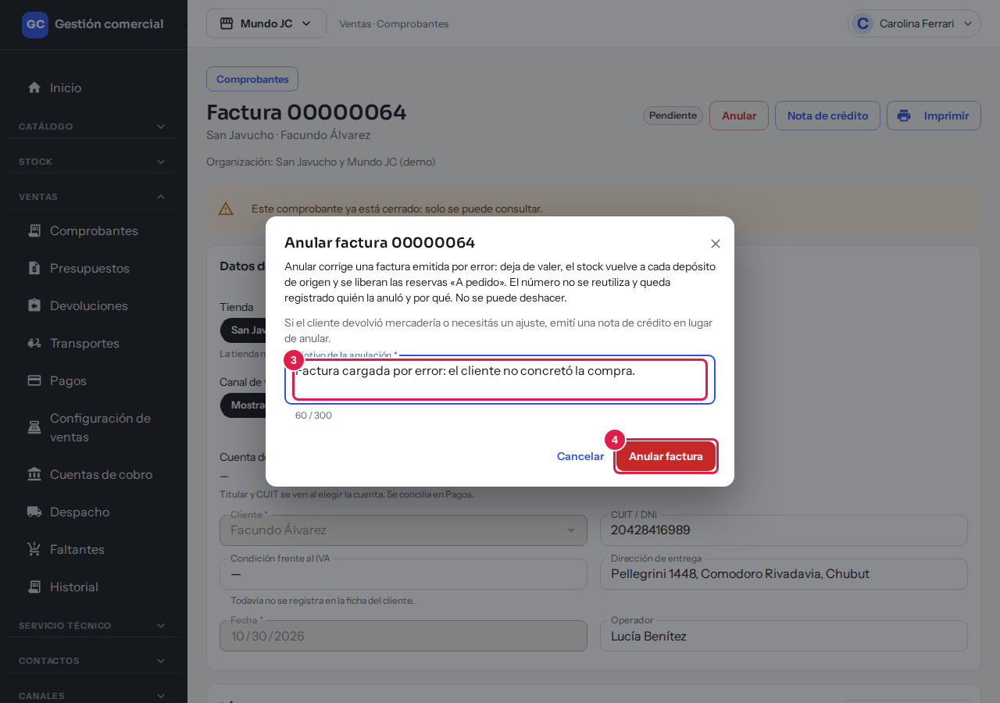

*Pasos 3 y 4: escribí el motivo y confirmá con «Anular factura». Con «Cancelar» no pasa nada.*

La factura queda con el estado **Anulada**, de solo lectura, y arriba se lee «Factura anulada el … por …: «motivo». El número no se reutiliza.»

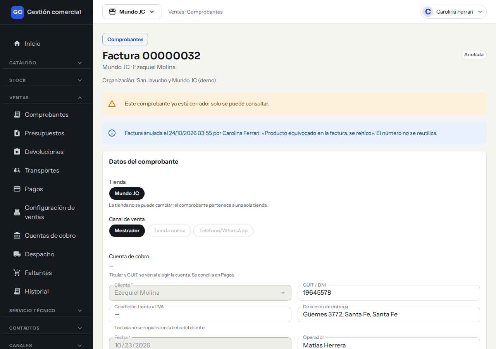

*Una factura anulada: queda de solo lectura y muestra quién la anuló, cuándo y por qué.*

### Cuándo se puede y cuándo no

| Situación | ¿Se puede anular? |
|---|---|
| Factura confirmada sin cobros ni notas de crédito | Sí. |
| Factura **Cobrada** | No. Corregila con una nota de crédito. |
| Factura que **ya tiene una nota de crédito** | No. |
| **Borrador** | No hace falta: no movió stock. Simplemente no la confirmes. |
| **Presupuesto** o **nota de crédito** | No. |

Si algo falla, la anulación es todo o nada: no se devuelve stock a medias. El mensaje «No pudimos anular la factura. No se devolvió nada: probá de nuevo.» te dice que nada cambió y podés reintentar.

## Emitir una nota de crédito

La **nota de crédito** corrige una devolución o un ajuste sobre una factura **que sigue valiendo**. Es un documento propio, con número propio, asociado a la factura. En el listado aparece como **Nota de crédito**, con el total en negativo.

Solo la emiten **Administración** y **Administrador**.

### Paso a paso

1. Abrí la factura y hacé clic en **Nota de crédito**.
2. Elegí el motivo:

| Motivo | Qué hace |
|---|---|
| **Devolución de productos** | La mercadería vuelve al depósito y se acredita el importe. Indicás cuántas unidades devuelve el cliente de cada producto. |
| **Devolución de importe** | Se devuelve el dinero sin que vuelva mercadería. |
| **Descuento o bonificación** | Ajuste de precio sin devolución de mercadería. |

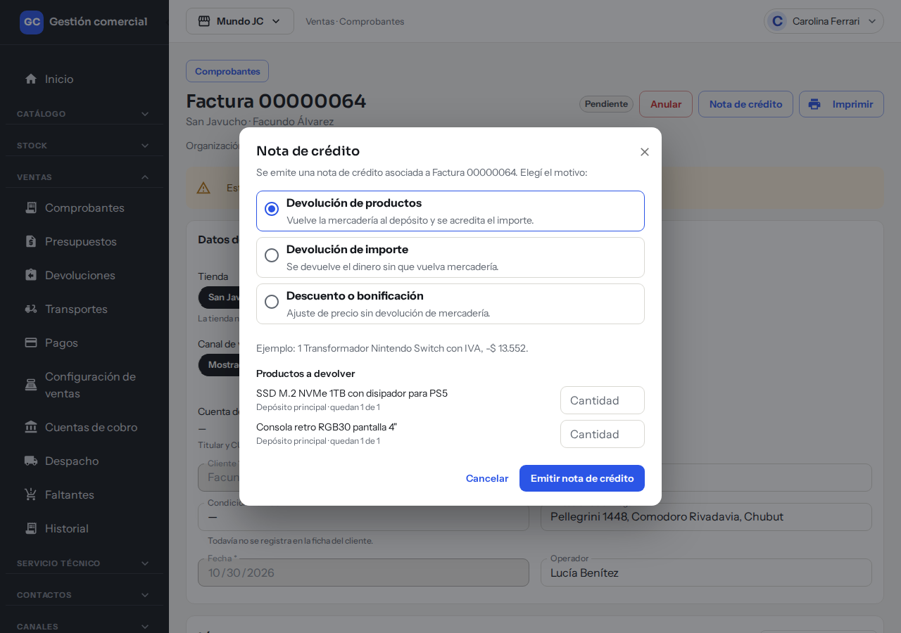

*La ventana «Nota de crédito»: elegí el motivo y, en «Devolución de productos», la cantidad de cada producto.*

3. En **Devolución de productos**, completá **Cantidad** en cada producto que vuelve. Te dice cuántas unidades quedan por devolver de cada línea.
4. En los otros dos motivos, completá **Importe sin IVA** y **Concepto** (el IVA se calcula con la misma proporción de la factura).
5. Hacé clic en **Emitir nota de crédito**.

Aparece «Nota de crédito emitida …» y la factura muestra una tarjeta con la nota, marcada «Asociada a esta factura», con cantidades e importes en negativo.

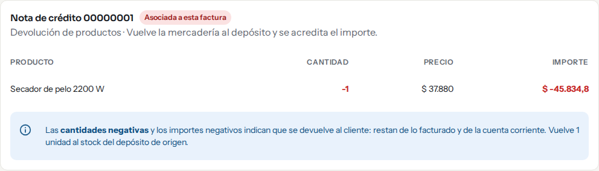

*Así se ve la nota dentro de la factura: marcada «Asociada a esta factura», con cantidades e importes en negativo.*

### Reglas

- No podés acreditar **más de lo facturado**. Podés emitir notas parciales, una tras otra.
- Solo en **Devolución de productos** vuelve stock al depósito de origen. En los otros dos motivos el stock no se toca.
- Los totales y rankings cuentan la nota restando de lo facturado.

!!! note "¿Anular o nota de crédito?"
    **Anular** es para una factura emitida por error: se deshace todo. **Nota de crédito** es para una devolución o un ajuste: la factura sigue valiendo y la nota resta. Si el cliente devolvió mercadería, usá la nota. Para llevar el reclamo completo, mirá [Devoluciones y reclamos (RMA)](ventas-rma-devoluciones.md).

## Si algo no sale

| Mensaje | Qué significa y qué hacer |
|---|---|
| «Escribí el motivo de la anulación.» | El motivo es obligatorio. |
| «Otra persona modificó este comprobante mientras lo mirabas. Recargamos los datos: revisalo y volvé a intentar.» | Alguien tocó la factura a la vez. Revisá cómo quedó y repetí la acción. |
| «Escribí el concepto de la nota de crédito.» | En una nota por importe o descuento, el concepto es obligatorio. |
| «Ingresá un importe mayor a cero, con hasta dos decimales.» | Revisá el importe de la nota. |
| «Indicá cuántas unidades se devuelven de al menos un producto.» | En una devolución de productos, completá al menos una cantidad. |
| «No quedan productos por devolver en esta factura.» | Ya se devolvió todo lo facturado. |
| «No pudimos cambiar el estado. No se guardó nada: probá de nuevo.» | El cambio de estado no se aplicó. Reintentá. |
| «Cambiaste de tienda: cerramos el comprobante para no mezclar datos de dos tiendas.» | Cambiaste la tienda activa con un comprobante abierto. Volvé a abrirlo desde el listado. |
