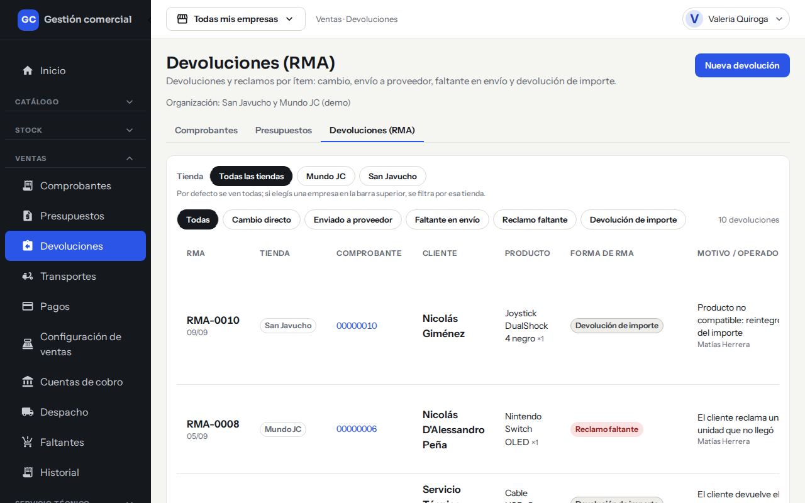
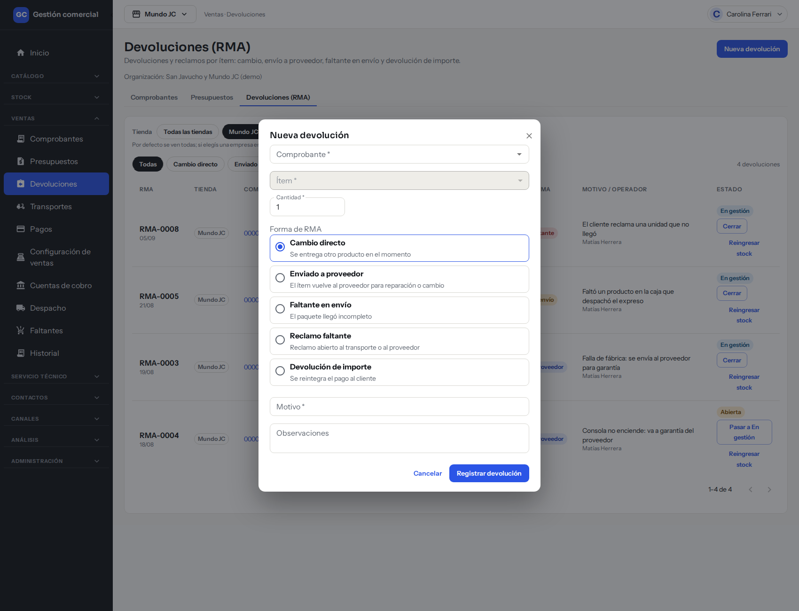
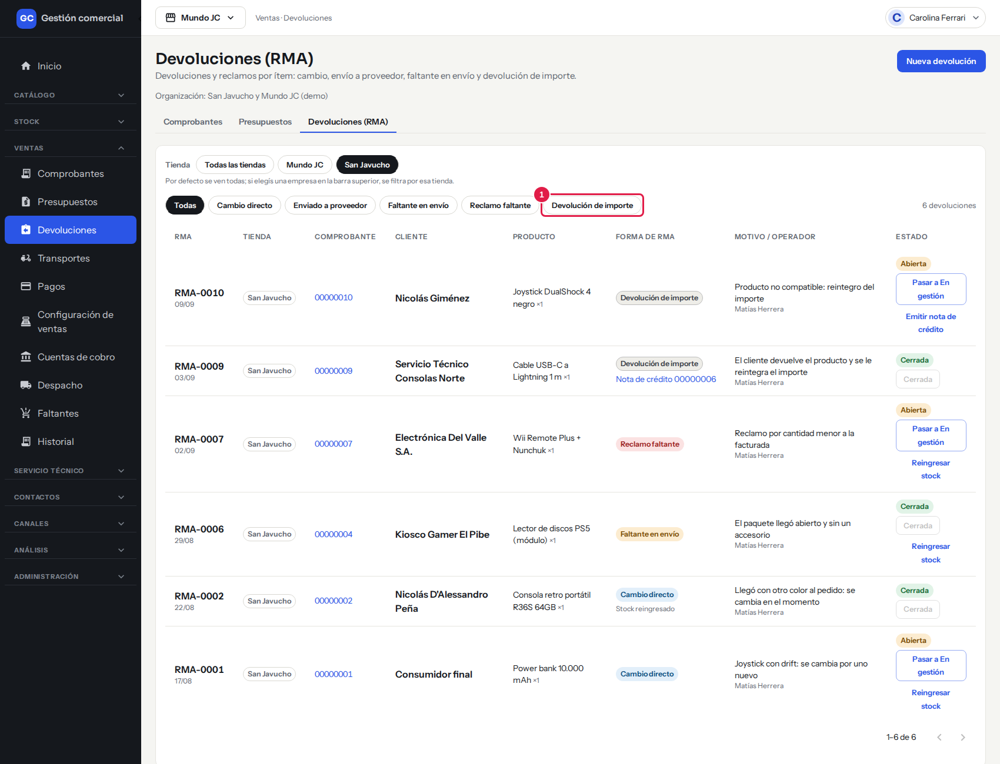
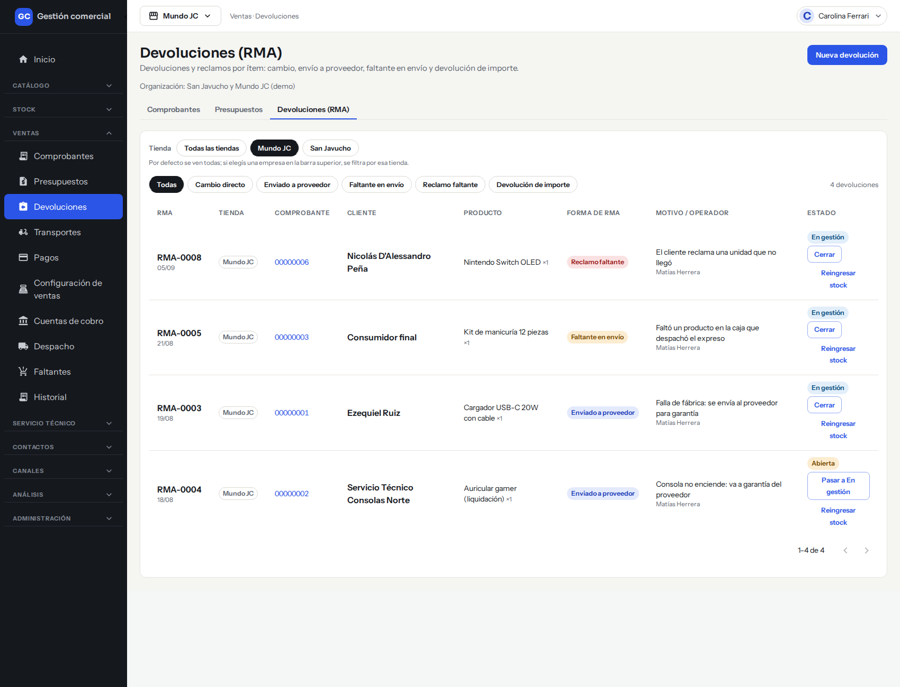
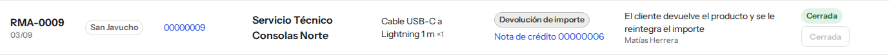
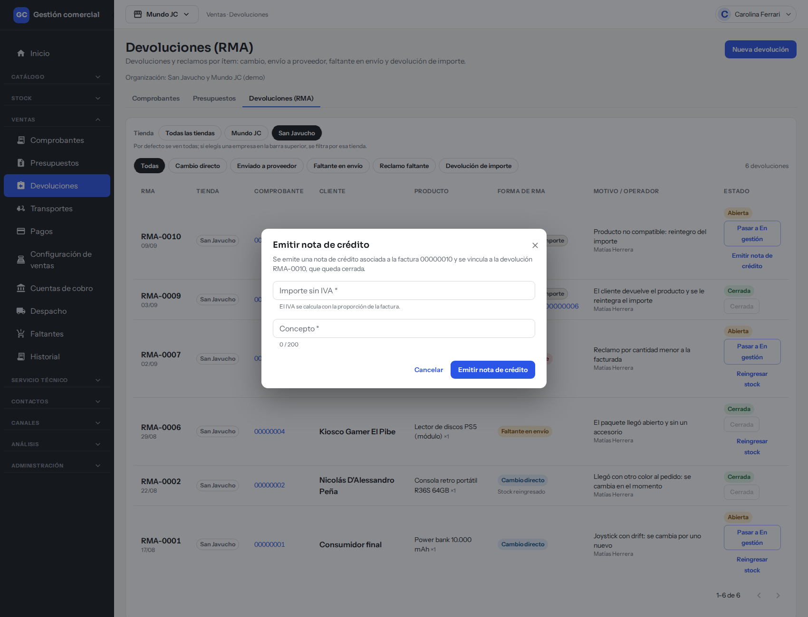
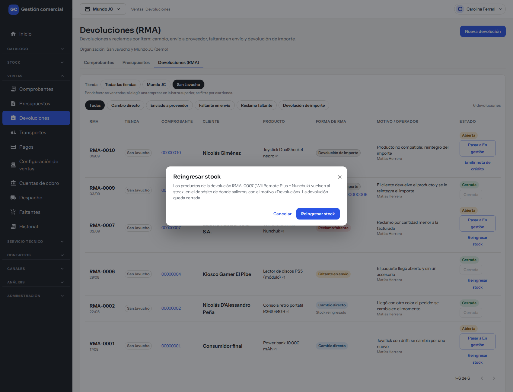

# Registrar y resolver devoluciones y reclamos (RMA)

## Para qué sirve

Una **devolución o reclamo (RMA)** es el registro de que un producto vendido volvió, se cambió, se reclamó o llegó incompleto. Se registra **por producto** de una factura, con su motivo y quién lo cargó, y se sigue hasta cerrarlo: ya sea devolviendo la mercadería al stock o emitiendo una nota de crédito.

## Quién puede hacerlo

| Persona | Qué hace |
|---|---|
| **Administrador, Administración, Operador y Mostrador** | Registrar devoluciones y cambiar su estado. |
| **Administrador y Administración** | Emitir la nota de crédito que cierra una devolución de importe. |
| **Administrador y Operador** | Reingresar el stock de una devolución de mercadería (además de Ventas, hace falta poder editar Stock). |
| **Depósito y Consulta** | Solo ven el listado y los estados. |

Con la configuración inicial, el Mostrador y Administración no reingresan stock desde acá, aunque sí pueden cargar una entrada desde Stock. El Administrador puede ajustar estos permisos.

## Dónde lo encontrás

Menú **Ventas → Devoluciones**, o la pestaña **Devoluciones (RMA)** arriba en Comprobantes y Presupuestos.

*Ventas → Devoluciones (RMA): cada fila es una devolución de un producto, con su forma, motivo y estado.*

## Las formas de RMA

Cada devolución tiene una forma, que describe qué pasó:

| Forma | Cuándo se usa |
|---|---|
| **Cambio directo** | Se entrega otro producto en el momento. |
| **Enviado a proveedor** | El ítem vuelve al proveedor para reparación o cambio. |
| **Faltante en envío** | El paquete llegó incompleto. |
| **Reclamo faltante** | Hay un reclamo abierto al transporte o al proveedor. |
| **Devolución de importe** | Se reintegra el pago al cliente. |

## Registrar una devolución

1. En **Ventas → Devoluciones**, hacé clic en **Nueva devolución**.
2. En **Comprobante** buscá la factura por número o por cliente. Solo aparecen facturas confirmadas: no se pueden cargar devoluciones sobre borradores, facturas anuladas, presupuestos ni notas de crédito.
3. En **Ítem** elegí el producto de la factura.
4. En **Cantidad** escribí cuántas unidades. No puede superar lo vendido.
5. En **Forma de RMA** elegí una de las cinco formas.
6. En **Motivo** escribí por qué (obligatorio, hasta 200 caracteres). **Observaciones** es opcional (hasta 1000 caracteres).
7. Hacé clic en **Registrar devolución**. Aparece «Devolución registrada · forma».

Cada devolución recibe un número (**RMA-0010**, por ejemplo) y queda con el estado **Abierta**.

*La ventana «Nueva devolución»: elegí comprobante, ítem, cantidad, forma y escribí el motivo.*

## La lista de devoluciones

| Columna | Qué muestra |
|---|---|
| **RMA** | Número y fecha de carga. |
| **Tienda** | Tienda de la factura. |
| **Comprobante** | Factura de origen, con enlace. |
| **Cliente** | A quién se le vendió. |
| **Producto** | Producto y cantidad (×1, ×2…). |
| **Forma de RMA** | La forma. Debajo aparece «Nota de crédito …» (con enlace) o «Stock reingresado» cuando ya se resolvió. |
| **Motivo / operador** | El motivo y quién la cargó. |
| **Estado** | **Abierta**, **En gestión** o **Cerrada**, con los botones de avance. |

Arriba hay una fila de botones para filtrar por forma (**Todas**, **Cambio directo**, **Enviado a proveedor**, **Faltante en envío**, **Reclamo faltante**, **Devolución de importe**) y el filtro **Tienda**. La lista se muestra de a 8 por página.

*Los botones de arriba filtran por forma de RMA. La lista de ejemplo muestra devoluciones Abiertas y Cerradas.*

## Estados y cómo se cierra una devolución

| Estado | Qué significa |
|---|---|
| **Abierta** | Recién registrada. |
| **En gestión** | Se está resolviendo (hablando con el proveedor, el transporte o el cliente). |
| **Cerrada** | Terminó. |

*Devoluciones «En gestión»: cada una muestra el botón «Cerrar» y su acción de resolución.*

### Avanzar el estado

En la columna **Estado** tenés un botón que dice a dónde va a pasar: **Pasar a En gestión** y después **Cerrar**. Una devolución ya cerrada muestra el botón **Cerrada** deshabilitado. Los estados avanzan siempre en ese orden.

*Una devolución de importe ya cerrada: debajo de la forma se ve la nota de crédito vinculada.*

### Resolver: nota de crédito o reingreso de stock

Debajo del estado aparece una acción de resolución, según la forma:

**Devolución de importe: Emitir nota de crédito**

1. Hacé clic en **Emitir nota de crédito**.
2. Completá **Importe sin IVA** (el IVA se calcula con la proporción de la factura) y **Concepto**.
3. Hacé clic en **Emitir nota de crédito**.

Se emite una nota de crédito asociada a la factura, se vincula a la devolución y esta **queda cerrada**. En la lista aparece «Nota de crédito …» con enlace.

*La ventana para emitir la nota de crédito de una devolución de importe.*

**Las otras cuatro formas: Reingresar stock**

1. Hacé clic en **Reingresar stock**.
2. Leé la confirmación: los productos vuelven al stock, en el depósito de donde salieron, con el motivo «Devolución».
3. Hacé clic en **Reingresar stock**.

La devolución **queda cerrada** y la lista muestra «Stock reingresado».

*La confirmación de «Reingresar stock»: los productos vuelven al depósito de origen.*

Reglas:

- El stock vuelve siempre al **depósito de origen** de la línea. No se puede elegir otro.
- Una devolución se resuelve **una sola vez**: o con nota de crédito, o con reingreso, no con las dos.
- Una vez resuelta, la acción desaparece de la lista.

## Relación con las notas de crédito

La nota de crédito es el documento que **resta de lo facturado**. En una devolución de importe se emite desde acá y queda vinculada al RMA. También podés emitir una nota de crédito directamente desde la factura (ver [Ver los comprobantes, cambiar su estado y anularlos](ventas-listado-estados-y-anulacion.md)), pero esa nota no cierra ningún RMA: son registros separados.
## Si algo no sale

| Mensaje | Qué significa y qué hacer |
|---|---|
| «Elegí el comprobante.» / «Elegí el ítem a devolver.» | Completá esos campos. |
| «Ingresá una cantidad entera de al menos 1.» | La cantidad tiene que ser un número entero. |
| «No puede superar lo vendido (N).» | No podés devolver más unidades que las vendidas. |
| «Escribí el motivo de la devolución.» | El motivo es obligatorio. |
| «No pudimos registrar la devolución. No se guardó nada: probá de nuevo.» | Falló el registro. Reintentá. |
| «Otra persona modificó esta devolución. Actualizamos el listado: revisá y volvé a intentar.» | Alguien tocó la misma devolución a la vez. |
| «No pudimos resolver la devolución. No se guardó nada: probá de nuevo.» | Falló la nota de crédito o el reingreso. Reintentá. |
| «Cambiaste de tienda: cerramos la devolución que estabas cargando. Volvé a abrirla para la nueva tienda.» | Cambiaste la tienda activa con la ventana abierta. |
