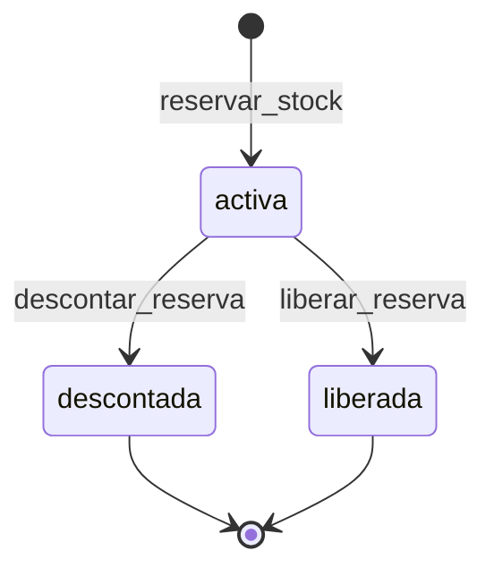

# Stock · Reserva y descuento de productos a pedido (F-STK-16, MSF-337)

Spec: `specs/20261022-180000-stock-depositos-y-reservas/` (épica MSF-292). Esta guía es el contrato de las tres
RPC que consumirá el **formulario de venta** (otra épica): los productos «A pedido» **reservan** al vender y
**descuentan** recién cuando el cliente retira o recibe. No hay pantallas nuevas en esta historia.

## Modelo (esquema `dominio`, Principio VII)

`dominio.reservas_stock` es negocio de Stock y vive en `dominio`, nunca en `public`.

| Columna | Detalle |
|---------|---------|
| `id`, `organizacion_id` | Identidad y organización (RLS). |
| `producto_id`, `deposito_id` | Producto y depósito de la reserva (FK compuestas con la organización). |
| `cantidad` | Entero `> 0`. |
| `estado` | `activa` → `descontada` \| `liberada` (estados finales). |
| `referencia` | Opcional, ≤ 200; única por organización cuando existe (idempotencia). |
| `responsable_id`, `responsable_nombre` | Quién reservó (foto del nombre). |
| `creado_en`, `resuelto_en`, `updated_at` | `resuelto_en` solo en estados finales. |

RLS: `select` para `authenticated` con `organizacion_id = private.organizacion_id()` y
`private.nivel_seccion('stock') in ('lectura','edicion')`. Sin `insert/update/delete` directos: escriben solo las
RPC. `anon` sin privilegios.

**Disponible = cantidad − reservado**, por depósito y en total. Reservar sube `reservado`; la `cantidad` solo baja al
descontar.

## RPC (migración `20261023130100_stock_reservas.sql`)

Las tres: *security definer*, `search_path = ''`, `revoke … from public, anon`, `grant execute … to authenticated`,
exigen `nivel_seccion('stock') = 'edicion'` y serializan por producto (`select … for update` sobre `existencias`);
el disponible nunca queda `< 0`.

| RPC | Hace | Rechaza |
|-----|------|---------|
| `reservar_stock(p_producto, p_deposito, p_cantidad, p_referencia default null)` → reserva | Crea una reserva `activa` y sube `reservado` en el depósito y en el total. La misma `p_referencia` devuelve la reserva existente sin duplicar. | Producto que no es «A pedido»; cantidad ≤ 0; depósito inexistente o inactivo; cantidad > disponible del depósito; misma referencia con otros datos. |
| `liberar_reserva(p_reserva)` → reserva | `activa → liberada`; baja `reservado`; la `cantidad` no cambia. | Reserva inexistente o ajena; ya `descontada`/`liberada`. |
| `descontar_reserva(p_reserva)` → reserva | `activa → descontada`; baja `cantidad` y `reservado` en la cantidad reservada y registra una **salida** en el libro, en el depósito de la reserva, con el motivo de sistema «Entrega de producto a pedido» (se crea por organización la primera vez, `aplica_a = {salida}`). Todo en una transacción. | Reserva inexistente o ajena; ya `descontada`/`liberada`. |

Mensajes (los espeja el formulario de venta): «Tu rol no puede reservar stock» / «…liberar reservas» / «…descontar
reservas» (`42501`), «Solo se puede reservar stock de productos A pedido», «No hay stock suficiente» (`23514`),
«La reserva ya fue descontada» / «La reserva ya fue liberada», «No encontramos esa reserva», «No encontramos ese
producto», «El depósito está inactivo: elegí otro para reservar», «Esa referencia ya tiene una reserva con otros
datos» (`23505`).

### Idempotencia

La `p_referencia` la define quien llama (p. ej. la línea de venta). Un reintento con los mismos datos devuelve la
misma reserva y no suma `reservado` ni emite otro evento. Con la misma referencia y otro producto, depósito o
cantidad se rechaza (no se pisa en silencio).

## Estados

## Disponibilidad del producto (FR-036)

Migración `20261023130200_disponibilidad_con_reservas.sql`: `private.disponibilidad_producto` y
`private.productos_con_stock` (MSF-179) evalúan el **disponible** (`cantidad − reservado > 0`) con el mismo contrato
de salida. La etiqueta manual («A pedido», «Stock entrante en breve») sigue mandando aun con reservas activas; los
productos derivados pasan a «Sin stock» cuando el disponible llega a 0.

## Eventos `stock.actualizado` (FR-038)

Migración `20261023130300_stock_evento_reserva.sql`. Reservar y liberar emiten el evento con `diferencia = 0`,
`movimiento_id = null`, `reserva_id` y la carga ampliada (`deposito_id`, `reservado`, `disponible`), con
`tipo_movimiento` `reserva` / `liberacion`. Descontar lo emite por su salida (`salida`). Contrato completo en
`docs/stock-eventos.md`.

## Pruebas

- pgTAP `supabase/tests/database/stock_reservas.test.sql`: US3-1…US3-9 (reservar 3 de 10 → disponible 7;
  descontar → cantidad 7 / reservado 0; liberar; estados finales; producto no a pedido; referencia repetida; otra
  organización; `anon`; ejecutabilidad de las RPC; disponibilidad; eventos).
- E2E `apps/web/e2e/stock-reservas-concurrencia.e2e.ts`: 8 reservas de 1 en paralelo sobre disponible 5 → 5
  aceptadas, disponible 0 (requiere `pnpm dev:supabase`).

## Reversión

Migraciones aditivas; el camino de vuelta está en el encabezado de cada una (migración posterior, exportando antes
`dominio.reservas_stock`):

1. `20261023130300`: `drop trigger reservas_stock_evento_alta, reservas_stock_evento_liberacion` y
   `drop function private.emitir_stock_reserva()`.
2. `20261023130200`: restaurar los cuerpos de `private.disponibilidad_producto` y `private.productos_con_stock` de
   `20261022120900_catalogo_disponibilidad.sql`.
3. `20261023130100`: liberar las reservas activas, `drop function` de las tres RPC y `drop table
   dominio.reservas_stock`. El motivo «Entrega de producto a pedido» es dato: se desactiva, no se borra, si ya
   tiene movimientos.

> **Revisión de fuentes:** 2026-10-25 — se revisaron las fuentes de esta página y su contenido no cambia.

> **Revisión de fuentes:** 2026-10-25 23:00 — se revisaron las fuentes de esta página (specs, prototipos, migraciones y código) y su contenido no cambia.
