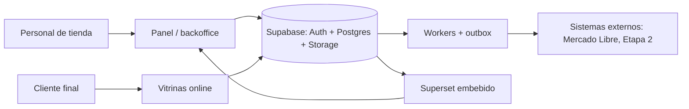

# System design · San Javucho / Mundo JC

Diseño de sistema de la plataforma multi-tienda: un backoffice único más
vitrinas online, con N tiendas por organización y un usuario que puede tener un
rol distinto en cada tienda.

## Objetivo

Una sola operación (catálogo, stock, clientes, ventas, service) para varias
tiendas y canales, con permisos por tienda y reportes centralizados.
MVP: 31/12/2026. Mercado Libre: Etapa 2 (enero 2027).

## Mapa de documentos

| Documento | Qué responde |
|---|---|
| [Arquitectura](arquitectura.md) | Componentes, límites y flujo de una request |
| [Datos](datos.md) | Modelo de entidades y reglas de integridad |
| [Permisos](permisos.md) | Roles, alcance por tienda y RLS |
| [Ventas y despacho](ventas.md) | Comprobantes, estados, cobranza, despacho, RMA |
| [Stock](stock.md) | Depósitos, reservas, disponible, movimientos |
| [Tiendas](tiendas.md) | Multi-tienda, empresa activa, vitrinas online |
| [Infraestructura](infra.md) | Hosting, entornos, backups, observabilidad |
| [Roadmap](roadmap.md) | Olas de entrega y qué queda para Etapa 2 |

## Decisiones de diseño (resumen)

1. **Un catálogo y un stock por producto** para toda la organización; las
   tiendas no duplican productos, los publican.
2. **Multi-depósito**: `disponible = cantidad − reservado`. No se vende sin
   disponible, salvo productos "a pedido".
3. **Rol por tienda**: la membresía vincula usuario, tienda y rol.
4. **Aislamiento por RLS** en Postgres: el navegador solo opera con lo que la
   política permite.
5. **Comprobantes internos** (sin integración fiscal en el MVP).
6. **Reportes con Superset embebido**; el panel transaccional no hace analítica.
7. **El historial del sistema anterior es solo lectura**, no se migra a tablas vivas.

## Contexto de sistema

Relación con el resto de la documentación: la arquitectura base de la
plantilla está en [../architecture.md](../architecture.md) y el DER generado en
[../tecnico/datos.md](../tecnico/datos.md). Este diseño describe el dominio
de negocio construido encima.
