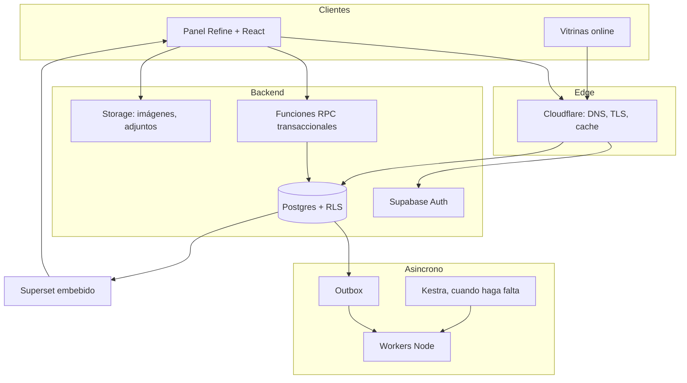
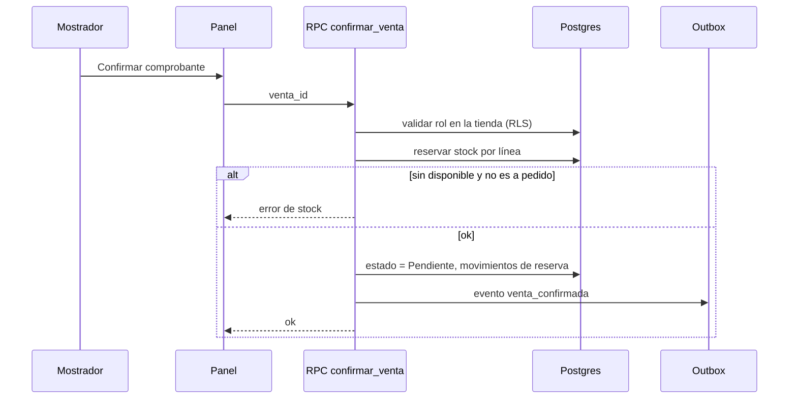

# Arquitectura

## Componentes

## Capas y responsabilidades

| Capa | Responsabilidad | No hace |
|---|---|---|
| Panel (Refine) | UI, formularios, tablas, selector de tienda activa | Reglas de negocio críticas |
| RPC / funciones SQL | Operaciones atómicas: confirmar venta, reservar, mover stock | Presentación |
| Postgres + RLS | Verdad de los datos y aislamiento | Lógica de UI |
| Workers + outbox | Efectos asíncronos: sincronizar canales, notificaciones | Decidir permisos |
| Superset | Reportes y tableros sobre vistas de lectura | Escribir datos |

## Flujo de una operación crítica (confirmar venta)

## Principios

- **Transacción en la base**: toda operación que toca stock o dinero corre en una RPC atómica.
- **Idempotencia**: los eventos del outbox llevan clave única; reintentar no duplica.
- **Un solo origen de verdad**: nada de copias del stock por tienda o canal.
- **Lectura analítica separada**: Superset consulta vistas, no tablas operativas.
- **Entornos separados**: staging y producción con proyectos y secretos distintos.

## Stack

Refine + React, Supabase (Postgres, Auth, Storage, RLS, pruebas pgTAP), workers
Node con outbox, Kestra para orquestación larga, Superset embebido por
organización, conexiones OAuth vía Nango (Etapa 2). Detalle de monorepo y
servicios locales en [../architecture.md](../architecture.md).
