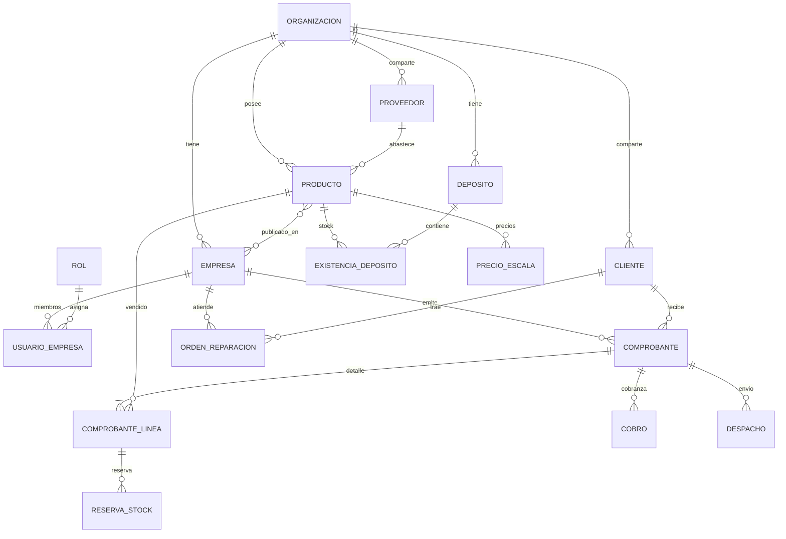

# Modelo de datos

Diseño lógico del dominio. El esquema físico generado vive en
[../schema.html](../schema.html) y [../tecnico/datos.md](../tecnico/datos.md).

## Diagrama de entidades

## Entidades principales

| Entidad | Alcance | Notas |
|---|---|---|
| `organizaciones` | raíz | Frontera de aislamiento (RLS) |
| `empresas` (tiendas) | por organización | Una organización tiene N tiendas |
| `usuarios_empresas` | `(user_id, empresa_id, rol_id)` | Rol por tienda |
| `productos` | organización | Un catálogo; costo y proveedor por producto |
| `producto_precios_escala` (esquema `dominio`) | producto | Escalas x1/x5/x10/x50 por tipo de cliente |
| `depositos`, `existencias_deposito` | organización | Cantidad por depósito |
| `reservas_stock` | línea de comprobante | Compromete stock sin descontarlo |
| `clientes`, `proveedores` (esquema `dominio`) | organización | Con "disponible en" tiendas |
| `comprobantes_venta`, `comprobantes_venta_lineas` | tienda | Venta interna, sin fiscal |
| `cobros_comprobante` | comprobante | Cobranzas parciales y deuda |
| Despacho: columnas de `comprobantes_venta` | comprobante | Armó / controló / entregó (`estado_despacho` y responsables; no hay tabla `despachos`) |
| `reparaciones` | **una** tienda | Service técnico |
| `rma`, `faltantes_venta`, `transportes` | tienda / organización | Postventa y logística |

Los nombres del diagrama de arriba son lógicos; la tabla anterior da el nombre físico cuando difiere. Todas las tablas de
negocio viven en `dominio` y las de plataforma en `public`.

## Reglas de integridad

- Todo registro operativo lleva `organizacion_id`; los de tienda, además `empresa_id`.
- Clientes y proveedores pertenecen a la organización y se habilitan por tienda ("Disponible en").
- Una orden de reparación pertenece a una sola tienda.
- `existencias_deposito.cantidad >= 0` y `reservado <= cantidad` salvo producto "a pedido".
- Estados de producto: Stock, Sin stock, A pedido, Stock entrante.
- Los movimientos de stock son **append-only**: se corrige con otro movimiento, no editando.
- El historial del sistema anterior se consulta en solo lectura y no se mezcla con estas tablas.
