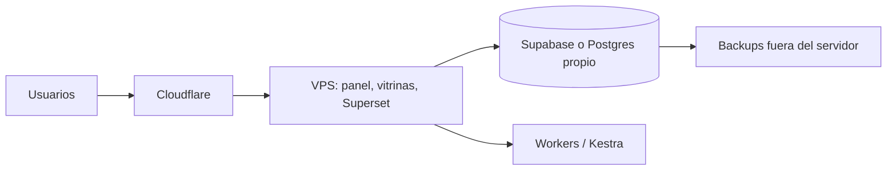

# Infraestructura

## Topología

## Decisiones

- VPS en cuenta a nombre del cliente; despliegue con Dokploy/Traefik.
- Cloudflare delante: DNS, TLS y caché de vitrinas (diseño previsto; el repo no lo configura: hoy los entornos salen por Traefik, ver [Entornos y despliegue](../deployment.md)).
- Supabase self-hosted en el VPS, administrado con Dokploy (junto con Kestra, Superset y Nango).
- Superset embebido para reportes; Kestra solo cuando haya orquestación larga.

## Entornos

| Entorno | Uso |
|---|---|
| Local | Desarrollo con Docker (Supabase CLI, Refine, Superset) |
| Staging | Validación previa; datos de prueba |
| Producción | Operación real |

Pipeline CI: validar, probar, desplegar a staging, promover a producción.
Ver [../deployment.md](../deployment.md).

## Backups y recuperación

- Respaldo diario de base y storage **fuera del servidor**.
- Restauración probada periódicamente en staging.
- Runbooks en [../tecnico/runbooks/README.md](../tecnico/runbooks/README.md).

## Observabilidad

Registro de errores en GlitchTip, flows de monitoreo en Kestra (tiendas, cola, sincronización) y alertas por falla de
flows y de backups: ver [Monitoreo](../monitoreo.md).

## Latencia

Las vitrinas se sirven desde caché de Cloudflare; el panel dinámico agrega un
salto de red hacia el servidor, aceptable para uso interno.

## Seguridad

Secretos fuera del repositorio, RLS obligatoria, mínimo privilegio en
servicios, acceso administrativo con segundo factor.
