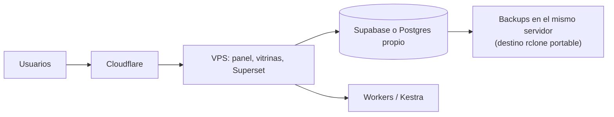

# Infraestructura

## Topología

## Decisiones

- VPS en cuenta a nombre del cliente; despliegue con Dokploy/Traefik.
- Cloudflare delante: DNS, TLS y caché de vitrinas.
- Supabase como backend gestionado (alternativa: Postgres propio si se decide).
- Superset embebido para reportes; Kestra solo cuando haya orquestación larga.

## Entornos

| Entorno | Uso |
|---|---|
| Local | Desarrollo con Docker (Supabase CLI, Refine, Superset) |
| Staging | Validación previa; datos de prueba |
| Producción | Operación real |

Pipeline CI: validar, probar, desplegar a staging, promover a producción.
Ver [../deployment.md](../deployment.md).

## Backups y recuperación

- Respaldo diario de la base (03:00) y de las imágenes de Storage (03:15), con retención de 30 copias
  diarias + 12 mensuales.
- Destino actual: directorio dedicado del **mismo servidor**, fuera de los volúmenes de Supabase, vía un
  remoto `rclone` portable a S3/B2/SFTP. Riesgo asumido: perder el servidor completo se lleva las copias.
- Verificación automática semanal de restauración de la base en un Postgres efímero; el simulacro completo
  en staging está pendiente (MSF-520).
- Detalle y procedimiento: [Copias de seguridad y restauración](../tecnico/copias-y-restauracion.md).
- Runbooks en [../tecnico/runbooks/README.md](../tecnico/runbooks/README.md).

## Observabilidad

Logs de aplicación y base, monitoreo de disponibilidad, alertas por falla de
workers y de backups.

## Latencia

Las vitrinas se sirven desde caché de Cloudflare; el panel dinámico agrega un
salto de red hacia el servidor, aceptable para uso interno.

## Seguridad

Secretos fuera del repositorio, RLS obligatoria, mínimo privilegio en
servicios, acceso administrativo con segundo factor.
