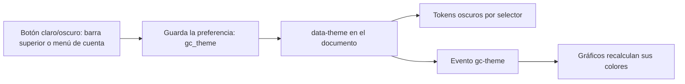

# Modo oscuro

Diseño del tema oscuro del panel. En el prototipo (v25) vive en
`design/pantallas/AdminHeader.dc.html`; en la app real queda por implementar
(hoy [../sistema-de-diseno.md](../sistema-de-diseno.md) lo marca como "no incluido").

## Alcance

- Aplica a todo el panel de gestión: sider, barra superior, listados, fichas, diálogos y gráficos.
- **No** aplica a las vitrinas de las tiendas: cada tienda mantiene su identidad visual.

## Cómo funciona

1. El usuario alterna el tema con el botón de la barra o con el ítem del menú de cuenta ("Modo oscuro" / "Modo claro").
2. La preferencia se guarda por usuario y navegador; sin preferencia, el panel arranca en claro.
3. El tema se expresa con `data-theme="dark"` en el elemento raíz. Los componentes no conocen el tema: leen tokens.
4. Al cambiar, se emite el evento `gc-theme` para que los gráficos (SVG) reemplacen sus colores.

## Tokens

| Rol | Claro | Oscuro |
|---|---|---|
| Fondo de página | `#F5F5F2` | `#0F1216` |
| Superficie (tarjeta, barra) | `#FFFFFF` | `#181C22` |
| Superficie elevada (menú) | `#FFFFFF` | `#1E232A` |
| Campo de entrada | `#FFFFFF` | `#12161B` |
| Neutro / hover | `#EEEDE8` | `#262B33` |
| Borde suave | `#E6E5E0` | `#2B313A` |
| Borde de campo | `#D9D8D2` | `#3A414B` |
| Texto principal | `#15181D` | `#E8EAED` |
| Texto secundario | `#5F6670` | `#A4ABB5` |
| Texto atenuado | `#8A9099` | `#8B93A0` |
| Acción primaria (texto/ícono) | `#2B55E6` | `#8AA4FF` |
| Botón primario (fondo) | `#2B55E6` | `#2B55E6` |

El botón primario conserva su fondo en ambos temas; solo cambian los textos de acento, que se aclaran para sostener contraste.

### Estados semánticos

| Estado | Fondo oscuro | Texto oscuro |
|---|---|---|
| Éxito | `#14382A` | `#6FD39A` |
| Aviso | `#3D2E0A` | `#F2C46A` |
| Error | `#471B1B` | `#FF9C9C` |
| Info | `#12324A` | `#8CC8F2` |
| Primario (etiqueta) | `#1E2A57` | `#A9BBFF` |

### Marca de las tiendas

Los colores de San Javucho y Mundo JC se aclaran para verse sobre fondo oscuro (San Javucho `#1B3A5C` → `#3F6EA8`, Mundo JC `#A3111D` → `#C93642`). Las etiquetas de tienda usan fondos tenues equivalentes.

## Reglas

- Ninguna pantalla define colores propios: usa tokens, así el tema oscuro es automático.
- Los gráficos y los SVG generados leen el tema activo y recalculan sus colores al recibir `gc-theme`.
- Contraste mínimo AA (4,5:1 para texto) en ambos temas; los textos de acento se aclaran en oscuro para cumplirlo.
- Las imágenes de producto no se alteran; sus miniaturas se enmarcan con borde oscuro.
- Se respeta `color-scheme: dark` para controles nativos (scroll, campos, fechas).

## Implementación en la app real

1. Agregar a `apps/web/src/tema/tokens.ts` una paleta oscura con los valores de arriba.
2. Extender `temaPanel.ts` con un tema MUI oscuro y un proveedor que lea y guarde la preferencia.
3. Montar el botón en `EncabezadoPanel` y en `MenuCuenta`.
4. Pasar los gráficos a leer colores del tema en lugar de valores fijos.
5. Cubrir con pruebas: persistencia de la preferencia, contraste de los tokens y que `estilos:check` siga sin valores sueltos.

No cambia permisos, datos ni rutas.

> **Revisión de fuentes:** 2026-10-25 23:00 — se revisaron las fuentes de esta página (specs, prototipos, migraciones y código) y su contenido no cambia.
