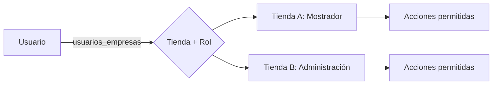
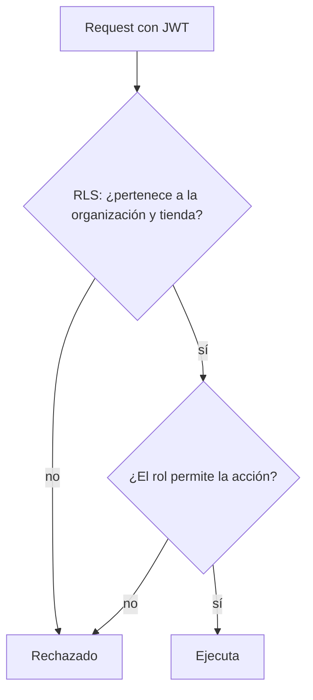

# Permisos y acceso

## Modelo

Un usuario pertenece a una o más tiendas y tiene **un rol por tienda**. La
tienda activa se elige en un selector; todo lo que ve y puede hacer depende del
rol que tiene en ella.

## Roles

| Rol | Alcance típico |
|---|---|
| Administrador | Organización completa: todas las tiendas y la gestión de miembros |
| Administración | Comprobantes, cobranza, clientes, proveedores, reportes |
| Mostrador | Ventas, clientes, consulta de stock y precios |
| Depósito | Stock, armado y despacho, recepciones |
| Operador | Operaciones acotadas (service, tareas asignadas) |
| Consulta | Solo lectura |

El Administrador de la organización no lleva asignaciones por tienda: accede a todas. Los otros cinco
roles se asignan por tienda en `public.usuarios_empresas`. El superadmin de la plantilla pertenece a la
agencia y queda fuera de los roles del cliente.

## Cómo se hace cumplir

1. **Autenticación**: Supabase Auth; el JWT identifica al usuario.
2. **Autorización de datos**: políticas RLS que consultan `private.nivel_seccion()`; el nivel se resuelve
   con el rol de la **empresa activa** (`usuario_empresa_activa`) en las secciones por empresa, con el
   **mejor rol entre sus empresas** en las compartidas, y con el rol de organización en el resto.
3. **Autorización de acciones**: las RPC verifican el rol antes de ejecutar (por ejemplo, solo Depósito marca "entregó").
4. **UI**: el panel oculta lo no permitido, pero **nunca** es la barrera de seguridad.

Implementación y límites: [Permisos por empresa](../tecnico/permisos-por-empresa.md).

## Evolución

Implementado: seis roles fijos, matriz de permisos editable por organización (MSF-125), rol por empresa
y empresa activa persistida (MSF-121), y asignación de empresas desde Usuarios. Reglas ampliadas:
[Permisos por rol](../permisos-por-rol.md) · [Empresa activa](../empresa-activa.md) ·
[Permisos por empresa (técnico)](../tecnico/permisos-por-empresa.md).
