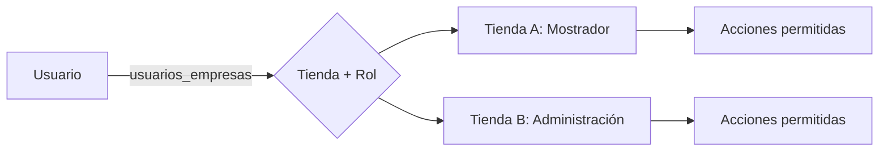
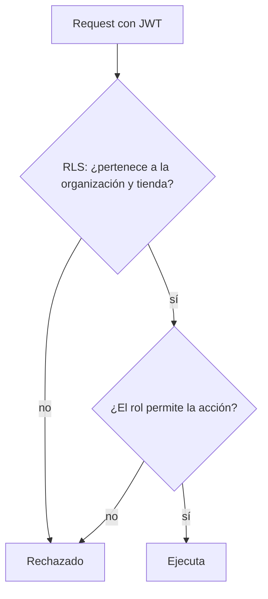

# Permisos y acceso

## Modelo

Un usuario pertenece a una o más tiendas y tiene **un rol por tienda**. La
tienda activa se elige en un selector; todo lo que ve y puede hacer depende del
rol que tiene en ella.

## Roles

| Rol | Alcance típico |
|---|---|
| Administrador | Todo en la tienda, incluida gestión de miembros |
| Administración | Comprobantes, cobranza, clientes, proveedores, reportes |
| Mostrador | Ventas, clientes, consulta de stock y precios |
| Depósito | Stock, armado y despacho, recepciones |
| Operador | Operaciones acotadas (service, tareas asignadas) |
| Consulta | Solo lectura |

El superadmin de la plantilla pertenece a la agencia y queda fuera de los roles del cliente.

## Cómo se hace cumplir

1. **Autenticación**: Supabase Auth; el JWT identifica al usuario.
2. **Autorización de datos**: políticas RLS que consultan `usuarios_empresas` para validar organización, tienda y rol.
3. **Autorización de acciones**: las RPC verifican el rol antes de ejecutar (por ejemplo, solo Depósito marca "entregó").
4. **UI**: el panel oculta lo no permitido, pero **nunca** es la barrera de seguridad.

## Evolución

MVP con seis roles fijos. La matriz de permisos editable por el cliente queda
para Etapa 2. Reglas ampliadas: ver
[../permisos-por-rol.md](../permisos-por-rol.md) y
[../empresa-activa.md](../empresa-activa.md).
