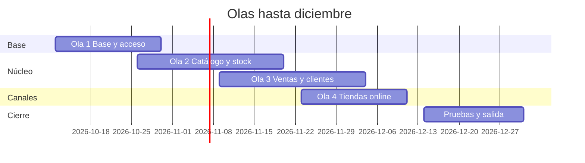

# Roadmap

Entrega en cuatro olas más pruebas y salida. Meta: **31/12/2026**.

| Ola | Contenido |
|---|---|
| 1 Base y acceso | Hosting, accesos, roles por tienda, tienda activa |
| 2 Catálogo y stock | Productos, escalas de precio, depósitos, reservas, movimientos |
| 3 Ventas y clientes | Comprobantes, cobranza, despacho, clientes y proveedores, service |
| 4 Tiendas online | Vitrinas por tienda, publicación, reportes con Superset |
| Pruebas y salida | Pruebas integrales, carga inicial, capacitación, puesta en marcha |

## Etapa 2 (enero 2027)

Mercado Libre, rentabilidad y reportes avanzados, motos con rendición, gastos,
newsletter y opiniones, matriz de permisos editable.

## Decisiones abiertas del cliente

Hosting y accesos, definición de los seis roles, exportación de productos,
clientes y proveedores, numeración de comprobantes, escala por línea o total y
fecha de corte del panel actual.

> **Revisión de fuentes:** 2026-10-25 23:00 — se revisaron las fuentes de esta página (specs, prototipos, migraciones y código) y su contenido no cambia.
