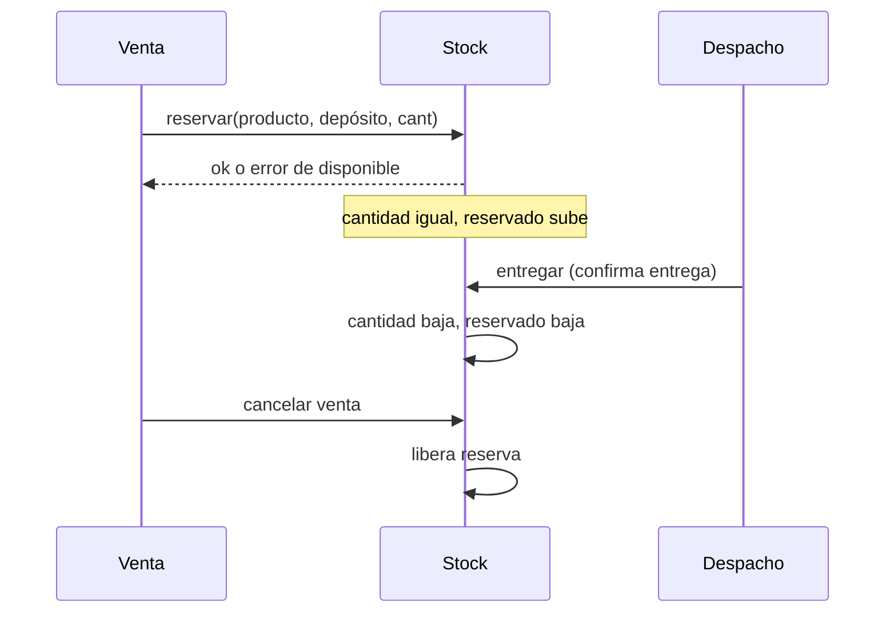

# Stock

## Principios

- Un producto tiene un único stock lógico para toda la organización, repartido en depósitos.
- `disponible = cantidad − reservado`.
- No se confirma una venta sin disponible, salvo producto **a pedido**.
- Todo cambio es un **movimiento** auditable (append-only).

## Flujo de reserva y descuento

Productos **a pedido**: reservan sin exigir disponible y descuentan en la entrega.

## Tipos de movimiento

| Tipo | Efecto |
|---|---|
| Ingreso (compra / recepción) | + cantidad |
| Reserva | + reservado |
| Liberación | − reservado |
| Entrega | − cantidad, − reservado |
| Transferencia entre depósitos | − origen, + destino (atómico) |
| Ajuste de inventario | ± cantidad con motivo obligatorio |
| Devolución (RMA) | + cantidad si reingresa |

## Pantalla Movimientos

Tablero con lo vendido, stock restante y reposición. Orden elegible (última
venta, urgencia de reposición, rotación). Se alimenta de una vista de lectura
y puede embeberse desde Superset.

## Concurrencia

La reserva usa bloqueo de fila sobre `existencias_deposito` dentro de la RPC,
para que dos ventas simultáneas no consuman el mismo disponible.

> **Revisión de fuentes:** 2026-10-25 23:00 — se revisaron las fuentes de esta página (specs, prototipos, migraciones y código) y su contenido no cambia.
