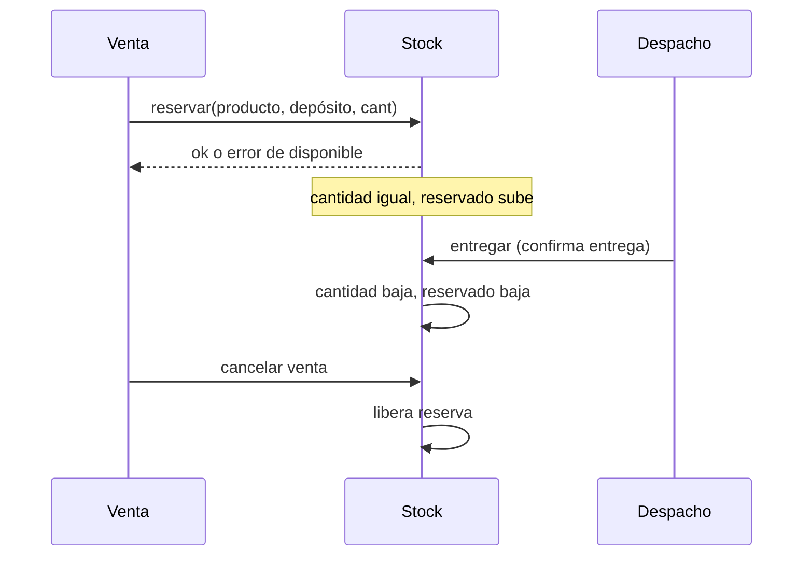

# Stock

## Principios

- Un producto tiene un único stock lógico para toda la organización, repartido en depósitos.
- `disponible = cantidad − reservado`.
- Solo se reservan productos **a pedido**, y la reserva exige disponible suficiente en el depósito: si la cantidad
  supera `cantidad − reservado` se rechaza con «No hay stock suficiente» (`23514`).
- Todo cambio es un **movimiento** auditable (append-only).

## Flujo de reserva y descuento

Solo los productos **a pedido** se reservan (`reservar_stock` rechaza cualquier otro) y la reserva descuenta en la
entrega (`descontar_reserva`, que registra una salida con el motivo «Entrega de producto a pedido»).

## Tipos de movimiento

| Tipo | Efecto |
|---|---|
| Ingreso (compra / recepción) | + cantidad |
| Reserva | + reservado |
| Liberación | − reservado |
| Entrega | − cantidad, − reservado |
| Transferencia entre depósitos | − origen, + destino (atómico) |
| Ajuste de inventario | ± cantidad con motivo obligatorio |
| Devolución (RMA) | + cantidad si reingresa |

## Pantalla Movimientos

Tablero con lo vendido, stock restante y reposición. Orden elegible (última
venta, urgencia de reposición, rotación). Se alimenta de una vista de lectura
y puede embeberse desde Superset.

## Concurrencia

Toda variación de reservado y cantidad se serializa por producto con un bloqueo de fila (`select … for update`) sobre
`dominio.existencias` dentro de la RPC, para que dos reservas simultáneas no consuman el mismo disponible.

## Implementación

Este diseño llega con la épica MSF-292 (depósitos, traslados y reservas de productos a pedido).
Detalle: [Stock · depósitos y reservas (técnico)](../tecnico/stock-depositos-y-reservas.md) ·
[Stock · depósitos y reservas (producto)](../producto/stock-depositos-y-reservas.md).
