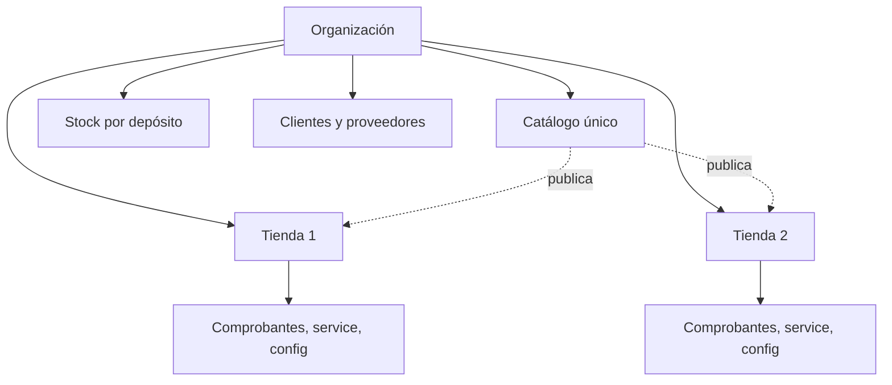
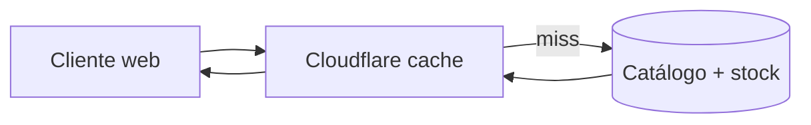

# Tiendas y vitrinas

## Multi-tienda

Una organización agrupa N tiendas. Casi todo es compartido (catálogo, stock,
clientes, proveedores) y lo que es propio de la tienda se asigna explícitamente.

| Tema | Regla |
|---|---|
| Asignación | Todo registro de tienda lleva su `empresa_id`; clientes y proveedores usan "Disponible en" |
| Tienda activa | Selector global; filtra listas y define permisos |
| Cambio de tienda | Refresca datos y rol sin reautenticar |
| Publicación | Un producto se publica por tienda con precio y visibilidad propios |

## Vitrinas online

Cada tienda tiene vitrina propia sobre el mismo catálogo y stock: la misma
aplicación decide por el `Host` si sirve el panel o la tienda de esa empresa
(`dominio.tiendas`). Cloudflare como caché del contenido público es un diseño
previsto (el repo no lo configura; ver [Infraestructura](infra.md)); hoy las
respuestas públicas de la tienda no se cachean y solo `robots.txt` y
`sitemap.xml` pasan por una caché de nginx de 5 minutos. El panel, dinámico, no
se cachea.

La vitrina muestra solo si el producto está **disponible** o sin stock (un
booleano, nunca la cantidad). La tienda no cobra online: el visitante
consulta, arma una lista de pedido o pide un presupuesto.

## Canales externos (Etapa 2)

Mercado Libre se agrega como canal: publicaciones sincronizadas por workers
con outbox, credenciales OAuth gestionadas en Nango, y el mismo stock único
para evitar sobreventa.

> **Arranque de la tienda pública (MSF-1002):** `main.tsx` llama a `precargarRutaActual` antes de renderizar: pide el chunk de la ruta actual en paralelo con `resolverTienda`, así el camino crítico deja de ser JS de entrada → tienda → chunk de la ruta → datos. Ver `docs/tienda-movil.md`, «LCP».
